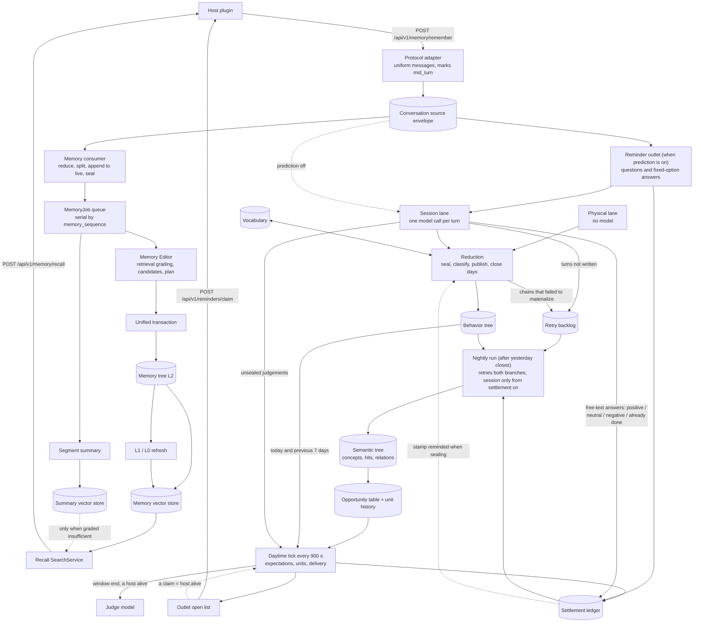

# Habitus

English | [中文](README.zh-CN.md)

Habitus is a local-first personal memory and behavior prediction service that plugs into coding agents (Codex, Claude Code, and others). It distills long-term memory from your conversations with the agent, records what you actually do, learns your own regularities, and — when something you usually do is due but hasn't happened — has the agent ask you about it.

> This document was written alongside a section-by-section audit of the source (2026-10); every statement is checked against the code. The npm package page is [plugins/README.md](plugins/README.md).

Just want to use it: → [Installation](#installation) · [Quick start](#quick-start)

## Contents

- [Core concepts](#core-concepts)
- [Features and supported hosts](#features-and-supported-hosts)
- [Architecture and data flow](#architecture-and-data-flow)
- [Algorithms](#algorithms)
- [Installation](#installation)
- [Quick start](#quick-start)
- [How the plugins work](#how-the-plugins-work)
- [Command reference](#command-reference)
- [HTTP API](#http-api)
- [Configuration](#configuration)
- [Data on disk and privacy](#data-on-disk-and-privacy)
- [Development](#development)
- [Status and roadmap](#status-and-roadmap)
- [What we borrowed from OpenViking](#what-we-borrowed-from-openviking)
- [License and third-party notes](#license-and-third-party-notes)

## Core concepts

Habitus has two halves: **memory** (on by default) distills long-term memory from conversations and recalls it when you speak; **behavior and prediction** (off by default; see [Quick start](#quick-start) to turn it on) records what you did, learns your regularities, and has the agent ask you when something you usually do is due but has not happened. Both halves read the same conversation transcript.

### The memory half

**Conversation source.** For every transcript batch the plugin sends, the local service first runs the protocol adapter to turn the host's raw records into a uniform message batch, then seals it together with the conversation id, date, protocol, `after_turn` and delivery id into an immutable "envelope" on disk, and only then hands it to two consumers: memory (`memory`) and the behavior side's session lane (`behavior_session`). Envelopes of one conversation (conversation id + start date) are delivered in order; the memory consumer requires strict order within a conversation, so a later envelope waits until the earlier one is terminal.

**Messages and "a turn".** A conversation has only four message roles: `prompt` (what the person said), `completion` (the agent's reply), `tool_call`, `tool_result`; every `tool_result` must follow the `tool_call` with the same id and repeat its tool name verbatim, and a call has only one terminal result. A turn is the host's turn: from the line you open with until the agent's final reply; anything you say in between (answering the agent's question, adding a sentence, telling it to stop) belongs to that turn and is marked `mid_turn` by the protocol adapter. Memory and the session lane use the same notion of a turn.

**Live, segments and history.** Messages are first appended to the conversation's `live.jsonl`; at a turn end, an eligible prefix is sealed into an immutable **segment**, written as `history/{start-end}.jsonl` and removed from live. An over-long turn is cut into several segments, which carry `starts_mid_turn` / `ends_mid_turn`.

**Summaries.** Each segment gets one **segment summary** (overview, chronology, corrections, ending state, open threads). Enough segment summaries are combined into a **range summary**, and range summaries into an **archive range summary**, which is the last level. Summaries are only process history: memory extraction reads the raw messages, and recall uses summaries only as a fallback when long-term memory is not enough.

**Memory tree (L0 / L1 / L2).** Long-term memory is a tree of Markdown files under `memory/` in the storage root, addressed by `memory://`. **L2** files are the only authoritative memory: the body is rendered from the schema, and one trailing `HABITUS_MEMORY_FIELDS` JSON comment holds the structured fields, revision, timestamps and relations (`links` / `backlinks`). Every directory may have an **L1** `.overview.md` (a model-written overview covering every direct child) and an **L0** `.abstract.md` (a passage extracted deterministically from the L1 introduction); both can be deleted and rebuilt. The vector index is derived from L0 / L1 / L2 and is not memory either.

**Six kinds of memory.**

| Kind | Path | Answers | Write mode |
|---|---|---|---|
| profile | `profile.md` | who you are (occupation, background, stable abilities) | single file, updatable |
| preference | `preferences/{topic}.md` | how you choose (communication style, output format, workflow habits, tool preferences, explicit likes / dislikes) | updatable |
| entity | `entities/{category}/{name}.md` | objects with a stable name that will be used again | updatable |
| tool | `tools/{tool_name}.md` | stable know-how from real tool calls (purpose, when to use, invocation, constraints, failure recovery, verification) | updatable; the tool name must come verbatim from a real call in the segment |
| event | `events/YYYY/MM/DD/{event_name}.md` | something that happened or a change of state | **add-only** (`add_only`) |
| intention | `intentions/{intent_name}.md` | things not yet done that still need pushing or are waiting for a trigger | updatable, overwritten with the latest state; not recalled by default once `completed` |

**Recall.** When you say something, the plugin calls the service's recall: semantic search over long-term memory, read the complete L2 files and add one hop of related neighbours, then a grading model decides whether that is enough to answer; only when it says "insufficient" does the service search a few historical summaries, listed separately as a low-weight fallback.

### The behavior and prediction half

All three layers are off by default: the behavior side turns on only when `behavior.primary_subject` names the person being tracked; `scene.enabled` and `foresight.enabled` default to `false`; prediction requires the semantic tree, and the semantic tree requires the behavior side. With them off, the plugins still recall memory and there are no reminders.

- **Two lanes.** The session lane (your conversations with the coding agent) and the physical lane (behavior segments delivered by an upstream source such as a wearable). In the behavior tree, semantic tree and prediction layer each lane is a complete, separate set that never sees the other; on disk they are two branches of one directory (`behavior/session/`, `behavior/physical/`). **Only the session branch is currently wired into the semantic tree and the prediction layer**; the physical branch stops at the behavior tree.
- **Turn.** The session lane's unit is also the host's turn; one turn yields one record, and turns are never merged by "is this the same task".
- **Behavior tree.** An append-only layer of facts: each record is a Markdown document (a behavior occurrence or an observation gap), addressed `behavior://occurrences/YYYY/MM/DD/<name>--<start>.md`. Gaps come in two kinds: "not understood" (`没读懂`: watching, but the turn could not be written) and "not observed" (`未观测`: not watching).
- **Kind vocabulary.** One list of behavior classes per lane, starting empty with no preset classes. Each class has a permanent id (`s-k0007`, `p-k0003`), a name, a criterion and a reminder sentence; two placeholders exist: `-待定` (none of the classes) and `-非事件` (not a task). Classification runs during the day, new classes grow nightly, splits and merges run weekly.
- **Semantic tree (scene).** Derived nightly from the behavior tree: classes become "concepts" (a base concept is one class; there are also model-written refinement, group and situation concepts, plus calendar situations generated mechanically from the local calendar); every record is mapped to the concepts it hits; then every comparable "antecedent → consequent × span" pair is tested statistically, yielding relations with the states sparse, tested, candidate, established, rejected and expired (`sparse` / `tested` / `candidate` / `established` / `rejected` / `expired`).
- **Series and time slots.** `series` reads the behavior tree as an immutable event series; `temporal` holds the pure time algorithms: a day is cut into 15-minute slots, and two starts of the same class no more than 45 minutes apart count as one occurrence (the only such ruler in the system), plus intervals, observation coverage, density, within-day profile and long absence.
- **Opportunity table.** A table of facts the prediction layer lays out each night from that night's relations and timelines: for every relation (and every class's "time since last") each past opportunity and whether the consequent came. It neither ranks nor scores.
- **Expectation.** Built on each daytime tick (15 minutes by default) from the opportunity table: "this should happen within this window", with a window, a deadline and its basis. Three triggers: something just happened (event), you are in a calendar situation (situation), it has been long enough since last time (day).
- **Unit.** One unit per behavior class: the antecedent expectations present at a moment are its inputs; its reading counts how often the consequent came in the past when the same set of inputs was present.
- **Levels: shadow / remind.** Delivery has two levels: level 0 "shadow" forms expectations, keeps the ledger and settles, but never speaks; level 1 "remind" speaks when the window closes and the thing has not been done. Moving up or down depends on whether a forgetting Beta reading crosses a line θ = 1 − acceptable false-alarm rate (0.67 by default); between the two sides the previous level is kept.
- **Settlement ledger.** Append-only records: expectations, deliveries, responses, settlements, later rulings and omissions, filed by day; every "fact" (on time / early / late but done / done after reminder / expired pending / caught up / void) is also filed under its account (class + trigger kind + trigger identity). The ledger is a log and stores no weights; weights are recounted each night from the unit history.
- **Reminder outlet.** When prediction decides to speak it records "awaiting host" (`待取`); the host's plugin claims it on your next message and has the agent ask you first with the host's own question tool; whether it asked and how you answered is recognised by the service from the transcript that comes back.

## Features and supported hosts

Habitus has two parts:

- **The local service `habitus-server`** (Python). The memory tree, behavior tree, semantic tree and prediction layer all live in this process. It only listens on a loopback address.
- **The npm package `habitus`** (Node). A command-line tool, `habitus`, plus the plugins installed into each coding agent (a "host"). Both the CLI and the plugins are clients of the service.

On every host the plugin does three things: when you say something, it recalls relevant memories and injects them into the context, and fetches due reminders for the agent to ask you first (reminders need the prediction layer turned on, see [Quick start](#quick-start)); when a turn finishes, it sends that turn's transcript back to the service.

| Host | `--harness` | Registration | Conversation protocol | Question tool used for reminders | Verification |
|---|---|---|---|---|---|
| OpenAI Codex | `codex` | Host marketplace (`codex plugin …`) | `codex_rollout` | `request_user_input` (`request_user_input_async` in Desktop) | Integrated (memory + reminders), tested on a real machine |
| Claude Code | `claude-code` (`claude`, `cc`) | Host marketplace (`claude plugin …`) | `claude_code` | `AskUserQuestion` | Integrated; the memory chain has been run end to end on real Claude Code transcripts (batched by the plugin's logic) with a real model; reminders have only been tested live on Codex |
| ZCode | `zcode` (`zc`) | Host marketplace, installs the Claude Code plugin | `zcode` | `AskUserQuestion` | Integrated from the v3.15.1 source, not yet tested live |
| OpenCode | `opencode` (`oc`) | An entry file in `~/.config/opencode/plugins/` | `opencode` | `question` | Integrated, not yet run in a real OpenCode |
| pi | `pi` (`pi-coding-agent`) | An entry file in `~/.pi/agent/extensions/` | `pi` | `ask_user` (registered by the plugin) | Verified against the real pi 1.3.0 extension loader; no real conversation yet |
| DeepSeek Harness | `dsh` (`deepseek-harness`, `deepseek`) | Through the official Claude Code hook bridge, as a managed block in `$DSH_HOME/cordis.patch.yml` | `dsh` | `ask_user_question` | Integrated from the 0.2.1-rc.2 source, not yet tested live |

Known limitations per host:

- **Codex**: after installing, type `/hooks` in Codex once and approve the Habitus hooks; unapproved hooks do not run (this is Codex's own safety confirmation, and Habitus does not approve on your behalf; `habitus plugin install / status` and `habitus doctor` tell you when approval is pending). In the Codex CLI's default mode `request_user_input` is not available (`default_mode_request_user_input` is off in `codex features list`), so reminders cannot be asked there; `habitus doctor` warns about it and `habitus plugin status` says so on the Codex line (Codex Desktop is not affected).
- **Claude Code**: transcripts are cut where "no tool call is pending and the reply's `stop_reason` is not `tool_use`"; occasionally that falls in the middle of a turn (known issue, pending confirmation of Claude Code's end-of-turn marker).
- **ZCode**: only seven hook events; no PreCompact, SessionEnd or Subagent*, so nothing is flushed at session end and subagents are not captured. Reading its session database needs Node ≥ 22.5.
- **OpenCode**: subagent sessions (started by the task tool) are not captured and get no recall and no reminders.
- **pi**: a session is a tree whose branches are appended to one file, so a transcript that switched branches arrives interleaved; processes without a session file (`-p --no-session`) do nothing.
- **DeepSeek Harness**: the hook bridge has no PreCompact or SessionEnd; installed into the `web` profile only; reading compressed session logs needs Node ≥ 22.15.

The service also ships four generic conversation protocols (`openai_chat_completions`, `openai_responses`, `anthropic_messages`, `openclaw`) that no plugin uses; other clients can call the HTTP API with them directly.

## Architecture and data flow



### The memory chain

When a batch arrives, the foreground does only deterministic work: adapt, write the envelope, reduce, append to live, possibly seal and enqueue, then return; every model call happens in a background MemoryJob.

1. **Adapt**: `POST /api/v1/memory/remember` selects the adapter by protocol name and converts host records into a uniform message batch; Codex marks mid-turn lines by `task_started`, Claude Code by "the previously accepted message is not a reply".
2. **Conversation source**: write the envelope first, then start both consumers in parallel; the HTTP request waits only for the memory consumer, the behavior side continues in the background.
3. **Memory consumer (foreground)**: reduce tool results → split over-long text losslessly → shrink tool groups that exceed one segment until they fit → append to live idempotently; when the batch has `after_turn=true` and sealing triggers, seal a segment at a safe cut: create a `STAGED` job first, publish the history file, then activate it as `QUEUED`.
4. **MemoryJob (background, strictly serial by `memory_sequence`)**: read the segment and the whole turn it belongs to, and **in parallel** produce the segment summary and the Memory Editor's pure plan (retrieve old memory → candidates → field plan → identities → relations). When the whole turn fits the extraction input limit, only the segment that ends the turn extracts it, once; when it does not, each segment extracts itself (see [Algorithms](#5-memory-editor-from-a-turn-to-a-pure-plan)).
5. **Publish**: persist the summary → change receipt PREPARED → one transaction commits every L2 change → sync the summary vectors → receipt COMMITTED → rebuild L1 / L0 bottom-up for the affected directories → sync the memory vectors → job COMMITTED.
6. **Recall injection**: `POST /api/v1/memory/recall` → query planning → vector recall (direct L2 plus hierarchical recall through directory L0/L1) → rerank → read full L2 → hot/cold ranking → one relation hop → assemble → grade → summary fallback when insufficient → record which memories were actually used; the plugin wraps the result as `<habitus-memory-context>`.
7. **Background maintenance**: the LifecycleWorker runs hourly: two-stage summary compaction and archive retirement, expired job / receipt cleanup, and L2 hot/cold compaction and retirement; the same worker also releases conversation source envelopes, periodically recovers consumers that have not reached a terminal state, and handles the release of behavior, semantic-tree and prediction outputs and the cleanup of every layer's retry ledgers.

### Behavior and prediction

The session lane reads the same conversation source envelope as memory. When prediction is on, the reminder outlet sits in front of the session lane: the same transcript is first scanned by the outlet for questions and fixed-option answers, then handed to the session lane to be split into turns; when prediction is off the conversation source goes straight to the session lane.

1. **Session lane**: one model call per turn, writing one judgement; when the turn has open reminders and you typed your own answer, it also writes the model's positive / neutral / negative / already-done verdict back to the ledger; a turn it cannot write becomes "not understood" and goes to the retry backlog. The physical lane writes judgements straight from upstream deliveries without a model.
2. **Reduction** (one resident worker per branch, every 300 s): seal (when prediction is on, it looks up the ledger and stamps `reminded` on records that started after a "spoken") → daytime classification (vocabulary) → publish to the behavior tree → refresh L0/L1 → record closed days; chains that fail to materialize go to the retry backlog.
3. **Nightly run** (starts once yesterday is closed, not at a fixed time; the resident worker looks every 5 minutes), in a fixed order, each step following the previous one: refresh calendar → nightly retry (both branches' backlogs are handled in this step; if a lock is held by another process the run stops here and resumes on the next look, without settling) → settlement (from this step on, session branch only) → both branches' vocabulary: nightly growth, then the weekly revision if none has run yet in the revision cycle this night belongs to (cycles start on the Wednesday night) → cutoff N = min(today, last closed day + 1) → stop if a vocabulary migration is unfinished → read series → semantic tree → opportunity table and unit history → today's day expectations. Both vocabulary jobs are part of this run, before the structure, with no clock time. If the service did not run overnight, it runs on start-up once yesterday is closed (every step is idempotent on a rerun).
4. **Daytime tick** (900 s by default): read today and the previous 7 days of the behavior tree, the unsealed judgements and the latest opportunity table on disk → form expectations → unit reading → delivery decision (the judge model is asked only at window end and only when a host has claimed reminders recently; a host claiming reminders is the proof that it is alive) → "awaiting host" entries go to the outlet's open list.
5. **Outlet**: the host plugin claims on UserPromptSubmit → the agent asks you with the question tool → the transcript comes back → the outlet records "spoken" and the response → ledger, settled by the next nightly run.

## Algorithms

Each subsection follows "input / computation / output / why"; numbers are the defaults. The running example "writing the weekly report on Thursday afternoon" is at the end of this section.

### 1. Recognizing a turn: `starts_turn` and `mid_turn`

- **How**: a message opens a turn iff it is a `prompt`, not a continuation part of a long message, and not marked `mid_turn`; only a `prompt` may carry `mid_turn`. The Codex adapter follows the host's `task_started`: human lines after the first one in a turn, and human lines before the first `task_started` of a batch, are marked `mid_turn`. The Claude Code adapter marks a human line `mid_turn` when the previous message accepted in the same batch is not a reply; the other hosts' adapters never mark it.
- **Output**: `starts_turn` per message; per segment `starts_mid_turn` (the first message does not open a turn) and `ends_mid_turn` (the last message is not a complete `completion`).
- **Why**: in Codex Desktop, answers, additions and stops typed into a running turn used to open new turns each and the whole batch was rejected; the adapter that knows the host's turns marks them, and the memory core never guesses.

### 2. Retention and segmentation

- **Trigger**: nothing is sealed unless `after_turn` or `flush`. Before sealing, every turn in live must end with a complete final `completion` and every `tool_call` in the turn must have a terminal result, otherwise the batch is rejected. Normally the most recent turns stay: the last turn always, plus earlier ones up to `keep_recent_turn_count` (3) turns within `retained_message_token_budget` (12,000 tokens); the rest is "pending". An explicit flush keeps no tail and seals everything. Any of these triggers sealing: an explicit flush; pending ≥ `commit_token_threshold` (12,000); total live > 12,000 tokens; more than 200 live messages or 2 MiB. When the retained tail alone exceeds the live window, its smallest safe prefix is added to pending.
- **Safe cut**: no open tool call, and never right after a mid-turn `completion` that is followed by more tool steps of the same turn.
- **Segment size**: if the pending part fits one segment (≤ 500 messages, ≤ 1 MiB, ≤ `max_segment_tokens` 12,000) it is sealed whole. Otherwise safe cuts are scored: structural score (turn boundary 40, after a tool result 30, message boundary 20, between parts of one long message 10) + 2 × semantic distance across the cut + prefix tokens / bound; candidates whose prefix reaches 60% of the bound are preferred, and the highest score wins (ties go to the later cut). The semantic distance is the cosine distance between embeddings of adjacent safe units; if embedding fails, pure structural scores are used and the conversation is not blocked. Within one `after_turn`, after sealing one segment the rest of pending is sealed too.
- **Token estimate**: no tokenizer; each character of the message's canonical JSON is weighted in three tiers by Unicode East Asian Width — wide and fullwidth characters (`east_asian_width` W / F: Han characters, kana, Hangul syllables, fullwidth punctuation and letters, most emoji) 1.5, other characters beyond the BMP 2.0, everything else 0.25 — and rounded up.
- **Why**: seal only when the host marks a turn end; normal content is cut at whole-turn boundaries, over-long content in a 60–100% window preferring structure, and a tool call is never separated from its result.

### 3. Before live: reduction, splitting and tool-group extraction

Three deterministic steps, no model:

1. **Tool-result reduction**: text results whose canonical JSON is ≤ 64 KiB (`max_inline_tool_result_bytes`) are kept verbatim; media-only results keep only a description plus the original payload's byte size and sha256 (`omitted`); larger text results get key-information extraction (`summarized`, at most 4,000 characters) and record the byte size and sha256 of the whole original.
2. **Lossless splitting of long text**: a `prompt` / `completion` over `max_segment_tokens` is split by code fences, blank lines, newlines, sentence-ending punctuation, whitespace, and finally by binary search; the parts must join back to the original byte for byte and carry `logical_message_id` / `logical_part_index` / `logical_part_count`.
3. **Fitting tool groups into one segment**: when an inseparable tool exchange (calls plus their results) exceeds a segment, its tool results and call arguments are re-extracted from the **originals** in descending token order until it fits; if it still does not fit, the excerpt bound is halved and the pass repeats, down to 128 characters; if it still does not fit at 128 characters (or the group has more than 500 messages), the planner fails explicitly. For object arguments, fields up to 256 characters (paths, commands, flags) stay verbatim and only larger fields are extracted; when those small fields together exceed half the excerpt bound, the whole arguments object is extracted at once. An extracted call is marked `summarized` with the size and sha256 of the original arguments' canonical JSON.

**Key-information extraction** classifies by content, not by tool name: empty, binary-like, JSON, XML, TSV / CSV, YAML, code, plain text, each with its own deterministic synopsis; for plain text, lines with errors / warnings / exceptions / stack frames / failures / fatal / non-zero exit codes and their context come first, then the head and tail.

**Why**: in a real session two parallel file reads were each under the bound but together exceeded a segment, leaving no safe cut and freezing the conversation; hence no head/tail truncation, extraction of key information by content kind, and sizing the whole group. Originals are not stored on the side (raw payloads are never kept in a side store).

### 4. Three levels of summary

- **Segment summary**: generated once per MemoryJob for its segment (reused if present); the model sees the whole segment plus `starts_mid_turn` / `ends_mid_turn` and outputs only field operations (UPDATE for overview and ending state, APPEND for chronology, corrections and open threads); input over 2 million characters fails outright instead of being truncated.
- **Range summary**: only **sequence-contiguous** summaries of the same stage are combined; age is measured from the end of the covered messages. Segment → range: at least 7 days and 20 contiguous summaries (at most 100 / 500,000 characters per range), or the oldest has waited 180 days and there are at least 2 contiguous. Range → archive: at least 180 days and 2 contiguous (at most 24). Summaries actually used by recall in the last 90 days are not combined yet. Each maintenance pass creates at most one parent summary per conversation (archive stage first, then range), with one model call and without deleting any source.
- **Retirement**: once an archive summary is 1,095 days past its creation or last use, it becomes a retirement candidate, waits a 90-day grace period, and then retires idempotently in phases: remove from the index → release the raw history → delete child summaries → delete the archive.
- **Why**: summaries are not an endlessly growing final layer; compaction uses contiguous message sequences rather than calendar buckets, with exactly two stages and no unbounded hierarchy.

### 5. Memory Editor: from a turn to a pure plan

**Input**: the whole turn this segment belongs to (the sealed segments plus the turn's tail still in live). First the turn's conversation material (the retrieval-grading and candidate requests without old memories, estimated from the real request projection) is checked against `memory.extraction.max_input_tokens` (56,000) minus `max_old_memory_tokens` (28,000):

- **It fits**: segments that end mid-turn only get their summary; the segment that ends the turn joins the whole turn and extracts it once.
- **It does not fit** (or the whole turn exceeds `max_context_chars`): each segment's job extracts only its own segment, adding the turn's opening human lines, the earlier segments' summaries (overview and ending state) and the number of segments left out; when the budget is short, the oldest summaries are dropped first. The prompt says this segment is the only source of facts and the earlier context only helps understanding, nothing is extracted from it (this sentence has not been tuned against a real model).

Every job of one turn reaches the same verdict: either only the turn-ending segment extracts the whole turn, or each segment extracts itself, with nothing missed or doubled. Real over-long turns (about 120,000 tokens in one turn) extracted segment by segment stay within 56,000 tokens per request including the old-memory budget.

**5.1 Which old memories are read first**: `profile.md` directly; `tools/{name}.md` for every tool name actually called in the segment; then one semantic search (top 5) under `preferences/`, `entities/`, `events/`, `intentions/` with a query built from the segment, and the complete L2 of each hit. The query fills a 5,000-character budget starting from the last human line: earlier human lines first, then the other messages, each newest-first and never splitting a tool call from its result; each message is first clipped to 1,000 characters (human) / 500 (reply, tool); the selection is then rendered back in original order. Events are add-only but are still read, because an Intention's status depends on the Event timeline. Old memories are bounded by 64 items, 4,000,000 bytes and 28,000 tokens; if `profile.md` or a tool memory of the segment does not fit, extraction fails explicitly. Every node read adds one hop of Links / Backlinks neighbours (8 per node, 32 in total), and the two directions are checked for consistency.

**5.2 Retrieval grading (controlled ReAct)**: each round the model sees the whole segment, every old-memory snapshot and previous actions' results, and may choose exactly one action: `finish`, one `memory_search` (a single query, top 5), or reading one URI the system has exposed. Repeated queries are answered from cache; a failure of search or read itself (vector service unavailable, out-of-scope URI, integrity error) fails explicitly. At most 3 rounds by default: the first 2 may request actions; the 3rd round's schema allows only `finish`, and the prompt says the budget is used up and that an empty earlier search means there is no old memory to update; if it still answers "insufficient", or exhausts structural corrections, the job does not fail but records "retrieval ended at the round limit" on the job's `workflow/memory_plan` observation. **Why**: on an empty tree "insufficient" is the honest answer, which used to fail the job permanently and block the whole queue.

**5.3 Candidates**: from the whole segment and all old snapshots, the model outputs one strict `MemoryCandidateBatch`: six candidate arrays plus `identity_proposals` and `relations`. Each candidate carries a `page_id` valid only for this run: the system numbers old nodes 1–99, the model numbers new ones from 100, and an update must reuse the system number. Add-only old Events are marked `read_only` in the request: their numbers are only for `relations`, and a changed outcome or decision must be recorded as a new Event. Intention candidates also carry `confirmed`: whether this conversation explicitly created, updated or reconfirmed it. Candidates may not contain URIs, paths, revisions, timestamps or confidence. Message times in the extraction material carry the local offset of the subject's time zone (`locale.timezone`).

**5.4 Source validation (deterministic)**: after JSON Schema validation, the output is checked against the raw messages and old snapshots:

- an old node must reuse the number assigned to its exact URI; a new number may not point at an old URI that was read;
- a `tool` candidate needs a successful call and result of that tool in the segment; a `failure_recovery` newly written or rewritten in this segment additionally needs "a failure followed by a success" in the segment, while a value carried over unchanged from the same old tool memory counts as already sourced;
- an Event date may not be later than the **local date** (in `locale.timezone`) of the segment's last message;
- a `completed` Intention must have `confirmed=true` and target an old Intention read in this run;
- a relation `remove` must connect two old nodes and match a relation that really exists in the old snapshots.

When items fail, the model gets the list of "which item, which rule" back and repairs the batch once (same structured client, same input budget); items that still fail are dropped together with the relations and identity proposals that reference them, the rest of the batch is written normally, and a batch with everything dropped is committed as empty; how many were dropped and why goes into `source_rejected_count` / `source_rejected_reasons` on the job's `workflow/memory_plan` observation. If the repair request does not fit, or the repair reply is still invalid after structural corrections, the first reply is used and only the failing items are dropped. **Why**: normal variation in model answers (a renamed entity, an existing memory given a new number, a tool name spelled differently, completing an Intention that was not read) used to fail the whole batch permanently and block the queue. This repair prompt has not been tuned against a real model.

**5.5 Field plan**: each candidate is merged with the old fields by the schema's per-field strategy: changing an `immutable` field fails; `patch` takes the candidate's full value and keeps the old one when absent; `replace` is the latest full state and drops an absent optional field. A candidate pointing at an add-only old Event keeps the old fields and becomes a NOOP; the count goes into `read_only_noop_count` on `workflow/memory_plan`, and the rest of the batch is written normally. The result is CREATE / UPDATE / NOOP per candidate; an unconfirmed Intention may only be preserved as a merge target. **Why**: in a real session the model rewrote an old Event three times, the whole batch failed permanently and 4 valid candidates were lost with it.

**5.6 Identity planning (FinalIdentityMap)**: deterministically turns proposals into a final disposition per number — CREATE / UPDATE / NOOP / MERGE / DELETE — bound to a final URI (DELETE has none). `same_memory` can only merge a fully read old node that receives no field change into a live target of the same kind, one hop away and covered by the field plan, and only for preference, entity and intention; when the target is a NOOP, its fields must fully contain the source's content. `remove_memory` accepts only `explicit_forget` / `fully_invalidated`. Merge chains, cycles, or a proposal source also used in relations fail. A field-planning or identity-planning failure still fails the job permanently (see §8).

**5.7 Relation planning**: after identities are final: check old relations are bidirectionally consistent, remap old Links / Backlinks endpoints to final identities (move MERGE ones, drop DELETE ones), drop self-loops; apply explicit `REMOVE`, then idempotent `ADD`. Backlinks are derived from the final forward relations, never produced by the model.

**Output**: one unified commit plan with no persistence side effects (complete documents to write, URIs to delete, read-set snapshots).

### 6. Transactional commit

- Take a transaction lock plus one lock per document for every URI in the read set (affected nodes, relation endpoints, one-hop neighbours); inside the locks confirm there is no transaction pending recovery, then CAS every snapshot.
- Durably write a PREPARED journal first, then atomically replace / delete each file, read everything back, and finally mark COMMITTED. Content and relation changes to one document are one write and one revision bump; an Intention refreshes `last_confirmed_at` only when this conversation explicitly confirmed it (or created it).
- Any failure restores all old documents and deletes new files inside the same lock set and marks ROLLED_BACK. After a crash, recovery runs before the next job: if every file is the new version it completes as COMMITTED, if every file is either old or new it rolls back, any third state is an error.
- **Why**: node content and relations must not be published separately; locks handle concurrency, the journal handles crashes in the middle of a multi-file write.

### 7. Bottom-up L0 / L1 and vector sync

- **How**: take every ancestor directory of the L2 files changed by the commit and refresh each once, deepest first. Refreshing a directory: the entries are the bodies of direct L2 files and the L0 of child directories (taken from a child's L1 when it has no L0); the model writes a directory summary and one summary per entry, with the same count, order and names as the input; this renders L1, and L0 is cut deterministically from L1's first paragraph (≤ 800 characters). An empty directory loses its L0 / L1.
- **Vectors**: L2 is embedded as "kind + path + body", L0 / L1 as "directory + path + content", and written to the vector store; unchanged content digests reuse the old vector. `completed` Intentions go to a separate partition that default recall excludes before top-K.
- **Why**: L0 / L1 and vectors are rebuildable derived layers: a refresh failure never rolls back a committed L2, but the job stays unfinished and is retried under the three dispositions of §8.

### 8. MemoryJob queue

- The global `memory_sequence` comes from a never-decreasing high-water mark in `jobs/state.json`; the mark is advanced before the `STAGED` job is created, so a crash can only leave a gap.
- The worker only claims the **oldest** unfinished job (with a lease and heartbeat) and never skips it. Failures fall into three dispositions:
  - **Wait for a dependency**: the model is unavailable right now (unreachable, rate-limited, quota or balance exhausted, credentials rejected, permission denied, broken server reply; chat and embedding alike), or the vector store is busy / unavailable (its file locked by another connection, disk full or an I/O error, index rebuilding). The attempt is not counted; the job is requeued with a long backoff: from 60 s, doubling, capped at 1 day (`workflow.jobs.model_wait_*`), with no limit on the number of waits, and it never becomes FAILED. Meanwhile the `memory_queue` health check reports `waiting_for_model:<sequence>;waits=<count>;next_attempt_at=…` (the same name when it is the vector store being waited on).
  - **Retryable**: commit conflict, timeout, a model reply still invalid after structural corrections, uncategorised runtime faults. Backoff from 1 s up to 60 s, at most 5 attempts (`workflow.jobs.max_attempts`), then FAILED.
  - **Permanent**: input too large, content safety, permanent extraction error (field planning or identity planning failed), integrity error, configuration error, any other vector-store error (e.g. a corrupt vector file). FAILED at once.
  - The disposition follows the exception's cause chain from the outside in, and the first layer it recognises decides: a wrapped busy vector store still waits for the dependency, and a wrapped model 401 / 403 / 400 still fails permanently. A source-validation failure no longer fails the job (see 5.4).
- A FAILED job blocks every later job until it is retried by hand: take `memory_sequence`, `conversation_id`, `started_on` and `version` from the `job` returned by `GET /api/v1/memory/jobs/blocked`, then `POST /api/v1/operations/memory/jobs/{memory_sequence}/retry?conversation_id=<…>&started_on=<YYYY-MM-DD>` with body `{"expected_version": <version>}`; without the two query parameters the answer is 400 `INVALID_ARGUMENT`. While a job is FAILED or waiting for a dependency, `/ready` returns 503, but `recall_ready` in the result stays true and the plugins keep recalling existing memories.
- **Why**: a later job may read old memory only after the earlier job's summary, receipt, L2, L0 / L1 and vectors are all done, which covers the true cross-conversation order, so failed jobs are not skipped; an unavailable model or vector store is "try again later and it works", which should not use up attempts.

### 9. Recall

- **Two entry points**: `find()` runs one direct query with no planner or grader; HTTP recall uses `search()`.
- **Planning**: with a conversation, read its active summary frontier and the latest 5 live messages, and let the model resolve elided references and split into at most 4 queries (it may output only query text, intent and priority), then merge with the original question; with no conversation context the original sentence is used; a planner failure falls back to the original sentence and records a degradation.
- **Vector recall** (one query embedding per query): direct L2 recall under the given roots; the default hierarchical mode also recalls 20 directories by their L0 / L1 and expands them level by level from a priority queue (at most 128 directories, 32 children each), child score = 0.8 × own score + 0.2 × parent score; then the optional reranker rescores the top 50 and drops those below 0.2; a reranker failure falls back to vector scores with a degradation.
- **Aggregate and read**: deduplicate by URI across queries; read full L2, filter by `kinds` and Intention scope (this limits primary nodes only, not their relation neighbours).
- **Hot/cold ranking**: final score = semantic score × (1 − 0.2 × (1 − hotness)); COLD_2 nodes are excluded from normal results, and each search admits at most one COLD_2 node as a "probe": chosen only among the top-`limit` by semantic score; once it reaches the final context it counts as a use and returns to HOT.
- **Relations and assembly**: each hit adds one hop of Links / Backlinks (5 per hit, 32 total), and the context is assembled (up to 120,000 characters).
- **Grading and fallback**: the grader decides whether these memories suffice for the current question; with zero memories it does not call the model and returns "insufficient". On "insufficient" with context budget left, the grader's single gap query retrieves at most 3 historical summaries, placed in a separate block whose prefix says it is a historical fallback only because long-term memory coverage is insufficient; summaries do not take part in memory ranking or count towards the memory limit.
- **Accounting**: each L2 that ends up in the final context counts as one "use" (affects hotness); a compacted COLD_2 node is restored to its original before being returned.
- **Why**: with no embedder or an unavailable vector service recall fails explicitly, never faking semantic search with keywords or a local scan; a grader or summary-fallback failure only records a degradation and the recalled memories are still returned; summaries are only a fallback.

### 10. L2 hot/cold tiers and retirement

The L2 hot/cold lifecycle is on by default and controlled solely by `memory.recall_lifecycle.enabled` (off = no hotness, compaction or retirement; `memory.field_compaction` and `memory.lifecycle_maintenance` only hold bounds); it runs in the hourly LifecycleWorker pass.

- **Hotness** = (n + 1) / (n + 2) × 2^(−days since last activity / half-life), where n is the number of actual uses and last activity is the later of content update and last use; a compaction write-back is not activity and does not reset the clock. Half-lives: profile 180 days, preference 90, entity 60, tool 30, event 14, intention 30. Hotness < 0.08 is COLD_2, < 0.2 COLD_1, > 0.6 HOT, otherwise WARM.
- **Retirement**: a COLD_2 file whose last activity is older than its retirement period (profile 720 days, preference 365, entity 270, tool 180, event 180, intention 540) becomes a candidate, waits 30 days of grace, and is then marked retired and deleted through the commit transaction in the same pass (resumed next pass if interrupted; at most 4 per pass). Retirement does not require prior compaction and does not wait for the compaction model's answer.
- **Compaction** (best effort): each pass scans at most 256 L2 files; a COLD_2 file that is not yet due for retirement and not yet compacted has its business fields shortened by the model, the original is saved under `workflow/lifecycle/l2_recovery/`, and the result is written back through the same commit transaction. At most 4 model attempts per pass; a successful compaction, an "already compact" verdict (KEEP) and an error each count as one. KEEP is only recorded in the maintenance scan ledger as "this version was judged", and the same content is not asked again; errors back off and retry. Recall restores the original before returning a compacted memory.
- A memory that is never used, on default settings (with or without compaction):

  | Kind | Reaches COLD_2 | Retirement candidate | Deleted |
  |---|---|---|---|
  | event | about day 37 | day 180 | day 210 |
  | tool | about day 79 | day 180 | day 210 |
  | intention | about day 79 | day 540 | day 570 |
  | entity | about day 159 | day 270 | day 300 |
  | preference | about day 238 | day 365 | day 395 |
  | profile | about day 476 | day 720 | day 750 |

  Compaction does not distinguish `immutable` fields or add-only kinds, so an Event's body fields are rewritten too; an unfinished Intention also retires by time (see [Status and roadmap](#status-and-roadmap)).

### 11. Session lane

- **Input**: the messages in a source envelope; sub-agent conversations (conversation id containing `.subagent.`) are skipped whole.
- **Turns**: a human message opens a turn; interjections the host marked `mid_turn`, and answers to synchronous and asynchronous question tools (rewritten as "（回答助手的提问）…", "answering the assistant's question"), stay in the turn; a stretch where the agent is woken by a background notification after it stopped is its own turn; three or more human messages within one second are dropped as a replay. A turn in which the agent neither answered nor called a tool yields no record.
- **Material**: the instruction, interjections, intermediate replies, one line per tool call (tool name + first 120 characters of the arguments), the first 240 characters of a failed call's error, and the final answer; tool result bodies are not included. Total limit 8,000 characters; when over, the middle of the tool calls, then intermediate replies, then the middle of the final answer are trimmed, and the instruction last. Secrets are redacted before trimming and again before the material leaves, and the model output is redacted again before it is stored.
- **Model call**: one structured call (prompt `behavior_session_turn_prompt_v7`) returning `name`, `summary`, `goal` (nullable), `steps` (≤ 3); when reminders are open in this turn, also `responses: [{reminder, polarity: 已做|正|中|负}]` (already done / positive / neutral / negative), with at most 5 open reminders included. How the direction is judged: he says he has already done it this time → already done; not done yet and not put off (doing it now, doing it, handing it to the assistant) → positive; put off to before the deadline, or unsure → neutral; not doing it or put off past the deadline → negative.
- **Output**: per turn, two evidence observations (when you spoke and when the agent finished; only times and the turn identity, no content), one judgement, one receipt and one coverage record, in that fixed order.
- **Failure**: a deterministic failure (including the model certainly refusing this material) and an unavailable model (unreachable, quota / balance, credentials, permission, broken server reply) both affect only that turn: a "not understood" record is written first, then the turn goes to the retry backlog; the day still closes on time, and settlement reads that stretch as "can't tell" instead of "not done"; a recovered judgement voids that "not understood" record. Other failures redo the whole source under the conversation source's retry ledger, and turns already written are recognised. A half-written turn (judgement stored, receipt not) is completed from the stored judgement without asking the model again.
- **Why**: fusion only describes "what this turn was doing"; "is it a task, which class" is judged in one place only, the vocabulary, to avoid reducing twice; the material is used for that one call and never stored.

### 12. Physical lane

- **Input**: a delivery `{source, device, delivery_id, sent_at, segments, coverage}`; a segment `{id, behavior, started_at, ended_at, facts?}`; a coverage span `{started_at, ended_at, state}` with `state` ∈ `observing | not_worn | charging | no_data`. The entry point is `Runtime.deliver_physical`; there is no HTTP route yet.
- **Computation**: no model. The whole delivery is rejected on extra fields, timestamps without offsets, coverage spans that do not join end to end, overlapping segments or duplicate ids, segments outside watched spans, or a segment ending more than 300 s after `sent_at`. One judgement per segment: the name is the upstream label, the summary a fixed template "name, HH:MM–HH:MM; facts…"; an unwatched span becomes an empty judgement, stored as "not observed". Segment ids are tracked per "device + segment id": resending the same content is idempotent, changed content is rejected; backfill older than 7 days is rejected.
- **Why**: upstream sends final results; fusion does not judge and has no confidence threshold; whether you were being watched is upstream's call.
- **Status**: tested only on synthetic data, not yet against samples from a real device; this branch has no semantic tree or prediction layer.

### 13. Vocabulary: daytime classification, nightly growth, weekly revision

- **Daytime classification** (the single classification call per record; nightly growth and weekly revision run in the nightly run, and the day's L0 / L1 are written by the model): the input is sealed records (name, summary, goal, steps) together with all active classes of the lane, 10 per batch; the output per record is `{record, reason, choice: class id | none | not a task, proposed}`; "none" becomes `-待定` with a proposed name, "not a task" becomes `-非事件`; only badly answered items are asked again, at most 2 rounds, then they count as pending. Pending items enter the pending pool (cap 5,000; when full the oldest are evicted).
- **Nightly growth** (in the nightly run, before the structure): per lane, newly pooled items (at most 200 a night) each recall 3 old items by similarity and the model groups them; **a class is created only for a group of ≥ 2 items spanning ≥ 2 days**; groups the model says belong to an existing class are re-judged by daytime classification.
- **Weekly revision** (in the nightly run, after growth; a revision cycle starts on the Wednesday night and the first night the run reaches in a cycle revises): splits look at each class's members from the last 120 days (grouping only with ≥ 6), the model groups, the same 2-items / 2-days threshold decides whether to cut, and a closed-set re-judgement confirms; a merge must be proposed in 2 consecutive revision cycles; a changed class cools down for 14 days and a revision changes at most 3 things. Before release an anchor self-check runs: for every untouched class, the latest 8 members that classify back to it twice under the old list are anchors; under the new list the changed classes may take at most ⌊2% × number of anchors⌋ of them (none at all with fewer than 50 anchors).
- **Migration**: the migration plan is written first, then each occurrence's `kind_token` in the tree is rewritten from the source id to the new one (only where it still holds the source id), and the change log is appended. Ids are never reassigned; splits and merges record their destinations in `branches`.
- **Why**: a class is one thing with the same reminder sentence; "done repeatedly" has a single definition, 2 items / 2 days lets small habits surface early, and "across 2 days" keeps the "came back on another day" requirement; classes only grow from the user's own data.

### 14. Reduction: sealing, publishing, closing days

- **Computation** (every 300 s per branch): resume an unfinished vocabulary migration → expire coverage records, receipts and the consumption ledger → seal (the session branch seals on arrival; the physical branch waits 3,600 s after evidence is complete) → daytime classification → stage (name collisions get a suffix and `original_name`, dry-run schema validation) → write checkpoint, publish documents, write the consumption ledger, release judgements → chains that fail deterministically go to the retry backlog and become a "not understood" record → refresh L0 / L1 day by day → record closed days → release observations no longer referenced. Before publishing, `reminded` is stamped by checking the prediction ledger: a "spoken" delivery before the start, within that expectation's coverage, for a matching class.
- **Closed day**: a day is closed when it has no unsealed judgement and the sealing horizon has passed its local end. Both lanes close days against the horizon with the lookback (`behavior.context_lookback_seconds`, 1 hour by default), so the session branch closes a day at about 01:00 the next morning or later. Prediction settles closed days only.
- **L0 / L1**: a day directory's overview is written by the model from that day's behaviors and the gaps that still stand; months and years roll up from child L0s; gap directories are enumerated deterministically; no model call when the source digest is unchanged.
- **Why**: reduction only seals and publishes, never merges; raw material (observations, judgements) is released as soon as it is published, the behavior data living only in the behavior tree.

### 15. Nightly retry backlog

- **What enters**: session turns that could not be written (deterministic failure, unavailable model, or the retry ledger gave up) and chains whose materialisation failed in reduction. Each item records which day it belongs to; at most 500 items per branch, beyond which only the "not understood" record is written.
- **Computation**: the first step of the nightly run handles items for yesterday and earlier; each item is tried once and deleted either way; if any session turn reports "model unavailable", the remaining session turns of that branch are dropped for the night. Once a day's nightly run has happened, new items for that day are refused. When a daytime window-close needs a "not understood" stretch, it is re-read on the spot first.
- **Why**: retry runs before settlement, so a recovered turn is settled and enters the series the same night; one try then delete means nothing is ever added to a day already processed.
- **Limit**: the backlog exists only when the semantic tree is enabled.

### 16. Semantic tree: concepts, hits, relations

- **Concepts**: vocabulary sync (no model): one base concept per class; calendar situations only for the (key, value) pairs seen in the series, with four keys `日历.周几` (weekday), `日历.几号` (day of month), `日历.月末` (month end), `日历.日型` (day type). Model-written concepts (`scene_concept_author_prompt_v6`): given each class's name, criterion, up to 5 real examples and rhythm line, it writes refinement / group / situation concepts; it runs the first time for a lane, when the class list changed, or when it has not run this week.
- **Concept hits**: base concepts follow `kind_token` directly; refinement concepts attached to the class are judged by the model (`scene_concept_mapper_prompt_v4`), asked twice with candidates reversed the second time; a hit needs "yes" both times, and two different answers leave it undecided; numeric refinements are decided mechanically by rule, and one whose deciding material is missing is undecided at once. The day closed tonight is always mapped; other days newest first, at most 14 per night.
- **Candidate pairs**: per lane, active concepts × active concepts × 4 short spans (within the chain `chain`, rest of the day `rest_of_day`, next day `next_day`, days 2–7 `days_2_7`), plus 4 long-span markers for behavior antecedents and the `situation` span for calendar situations. Only time when the person is present is measured. Records made after a reminder are not used as consequents; they count as "unseen".
- **Case-crossover controls**: the `chain` span uses two controls (the moment another task finished on the same day; days with the same weekday and slot without the antecedent) and must pass both; `rest_of_day` and the two day spans use days with the same weekday, without the antecedent that day, with the person present at that time. Calendar situations take controls per dimension: weekday and day type stratified by ISO week, day of month and month end by month, with the day type held fixed; when several values of one dimension are each raised, they are combined into one value-set situation and tested again, and a finer one is not reported when the coarser one explains it.
- **Statistics**: short spans use an exact Poisson-binomial test within strata (exact up to 400 informative strata, normal approximation beyond); long spans and calendar situations use one 2×2 table per stratum combined through the hypergeometric distribution. `chain` without conditions tests only "more", the rest are two-sided. Short spans form one family and long spans (including the calendar `situation` segment) another, each pre-screened with Tarone, then weighted Benjamini–Hochberg at a false discovery rate of 0.10 (gate 1); relations already candidate or established stay out of the family (they go through forward validation or maintenance), and so do refinement consequents with more than half "cannot judge"; gate 2 "stable over time" (dropping any block keeps the direction, heterogeneity p ≥ 0.05); gate 3 "large enough" (near end of a 95% block-bootstrap interval, absolute difference ≥ 0.05 and relative difference ≥ 20%).
- **Forward validation and state**: passing gate 1 makes a "candidate"; it is then checked once on new data only, the required count set by power (α = 0.05, power 0.80, at most 40, across at least 2 blocks), deferring when even a perfect record could not reach α; it becomes "established" only if, on the night the count is reached, the one-sided forward test passes and gates 2 and 3 pass the same night, otherwise the forward check did not replicate ("rejected"). An established relation gets a maintenance check each period: the far end of the test interval missing gate 3 counts as one miss, and two consecutive periods make it "expired"; an undecidable period neither counts nor resets; "large enough" has hysteresis. Relations touching a class changed by vocabulary revision fall back to candidate.
- **Moderating conditions**: place / people present / a class seen just before the antecedent / situation concepts; a test opens once each side has ≥ 2 cases and the minimum attainable p with full separation is ≤ 0.05; from the second condition on, conditions grow only on established conditioned relations, at most 3. The model is asked for candidate conditions only once an antecedent has 40 chains (`scene_relation_conditions_prompt_v3`).
- **Prior**: the model sees only class names and criteria and answers likely / unsure / unlikely (asked three times, median taken), used as test weights 2 / 1 / 0.5.
- **Output**: per night and lane a relation table `relations/<lane>/<YYYY-MM-DD>.json`, a transition log, and concept and hit documents. Separately, "recurrences", not statistically tested: each class's daily occurrences and intervals, passed in memory to the opportunity table.
- **Why**: measure every pair and let the data decide rather than asking a model about causality; the calendar is an external condition that enters as situation relations; thresholds derive from α and power instead of fixed counts.
- **Experimental**: the concept-writing and condition-proposal prompts are marked as not yet tuned against a real model.

### 17. How temporal reads time

Pure functions, no model:

- **Merge**: starts of one class in ascending order; neighbours ≤ 45 minutes apart merge into one occurrence, regardless of duration.
- **Observation coverage**: a 0–1 "watched" share per slot per day, reduced by both gap kinds; on the session lane a whole day without a single record (not even a "not an event") counts as not watched (coverage 0, as if upstream had reported a whole-day "not observed"), while the physical lane's gaps come from upstream and an empty day there still counts as watched; a "blind day" is a day when the class was done only after a reminder.
- **Intervals**: calendar days between consecutive occurrence days; an interval ending on a reminder-only day is censored. "e days since last" requires intervals of exactly e days in history, at least 2 at risk after removing censored ones, and a natural hit in the cluster. From e the cluster takes in the next day (1 day apart) only while the share of at-risk intervals in which he came by that day on his own is not above the line θ (a longer interval across an observation gap counts as "not come" only for the part that was seen): a daily habit that misses a day now and then keeps a same-day window; only a real mix of 1- and 2-day gaps joins into two days. When the line cuts the cluster into successive segments, e days since last belongs to the segment that covers it (identity and window start are that segment's first day): for a daily habit missed a few times before, the second day of a streak is a new expectation. **Streak past the history**: once it has been longer than the history's intervals (fewer than 2 intervals at least e days long, so the regular reading has nothing) and it is still not done, expectations go on at the typical interval (seen-weighted median of uncensored intervals): from the second-longest interval onward, one every typical interval, each covering only that day — daily habits get one a day, weekly ones one every 7 days; when to stop speaking is left to the account's "the habit broke" and to reminder feedback, with no fixed day.
- **Density, within-day profile, long absence**: only the latest M days with natural occurrences; the profile uses two-level Beta shrinkage (slot → ±3 slots → whole day) and then finds peaks, each needing at least 2 distinct days and ≥ 0.10 of the mass. M = ⌈H · log₂(1/α)⌉; with the defaults H = 8 and α = 0.05, M = 35.

### 18. Opportunity table and expectations

- **Opportunity table (nightly)**: input is tonight's timelines, relation table, concepts, recurrences, coverage and local calendar from the semantic tree. Only established or candidate relations whose consequent is a base concept are taken; event spans only the 4 short spans; conditioned relations only when established; calendar situations only when upward. An event relation has one opportunity per chain; a calendar relation one per day on which the condition holds and the person is present, marked came if done naturally that day and unknown if done only after a reminder.
- **Expectations**: read the behavior tree for today and the previous 7 days, unsealed judgements and the newest opportunity table on disk. The daytime tick (every 900 s) runs the event and situation triggers; the day trigger runs at the end of the nightly run:
  - **Event**: built only with ≥ 2 hits; for the two slot spans (`chain`, `rest_of_day`) the window spans the minimum to maximum "time after finishing" of past hits; the `chain` deadline is one slot past the end of the span, and `rest_of_day` cuts both window and deadline at the end of the day; for the two day spans (`next_day`, `days_2_7`) it uses the "which day, what time" of past hits.
  - **Situation**: today is in this calendar situation and there are ≥ 2 hits; by default only on day types where he has been seen doing it naturally (`foresight.unseen_day_types: skip`); the window is p10–p90 of past consequent times (earliest to latest with 10 or fewer); the deadline is the end of today; nothing is built before the window.
  - **Day** (long enough since last time): reads `temporal.cluster_at`; the window spans the earliest to latest of the latest M natural hits in that cluster; the deadline is the end of the cluster's last day. A streak past the history reads `temporal.overdue_at`: the window is that day only, its times taken from the latest M hits of the typical-interval cluster. Day expectations are not built in the daytime: once a day, as the last step of the nightly run, from the table that run has just written and that includes yesterday (intervals, clusters, hits and windows have that one source); they still count from local midnight, so anything done between midnight and the end of the run is built and settled, and a habit whose whole window falls in that stretch and was not done gets no expectation that day.
- The expectation id is the first 24 hex digits of sha256(class, trigger kind, trigger identity, trigger instance), so the same opportunity recomputed on another day gets the same id; an expectation is built whenever the window arrives, done or not. Each carries a reverse list of antecedents (present / absent / suppressing).
- **Holiday data**: the day type (working day, weekend, holiday, make-up working day) comes from holiday data. Data for mainland China 2025 and 2026 (generated from the State Council General Office's holiday notices) and for Singapore 2025 and 2026 (entered from the Ministry of Manpower's published public holidays; a holiday falling on a Sunday is followed by a Monday off) ships with the package; when `locale.calendar_path` is set, only that directory is read. For a year or region without data the day type cannot be answered: statistics treat it as unknown, expectation building fills in a day type from the nominal weekend (`locale.nominal_weekend`), and working days that are public holidays still get expectations and reminders.
- **Why**: candidates are not a sieve; the only question is "what is raising it right now"; every opportunity enters the ledger, otherwise the hit side is truncated and the denominator is wrong; no expectations from too few samples.

### 19. Units, levels and delivery

- **Unit reading**: expectations of one class whose windows are due this tick form one unit (day-unit expectations starting on different days are not one moment: today's two-day window is not folded into yesterday's already-decided unit, each decides on its own); the signature is the inputs' account identities plus any suppressing relations present; inputs the semantic tree judged coincidental are left out. The reading falls back by layer: past moments with exactly the same signature → moments with the same number of raising / suppressing inputs → the input with the highest account lower bound; an earlier layer shrinks towards the next: the moments with the same counts but a different signature are its prior, weighted at the effective-sample cap × `foresight.unit_prior_share` (1/3) and never more than the prior itself; the third layer is not used as a prior. Each layer is a forgetting Jeffreys Beta: weight 0.5^(rank distance / H), `k = Σw·y`, `n = Σw`, `p ~ Beta(k+½, n−k+½)`, lower = α quantile, upper = 1−α quantile, over the latest M moments only. If the trailing run of misses has probability q < α / n under the earlier reading, "the habit broke" and the earlier evidence is multiplied by q·n/α.
- **Levels**: lower bound L ≥ θ moves the unit up to remind, upper bound U < θ moves it back to shadow, otherwise the previous level stays. The basis is chosen among the inputs whose window has come: the established relation with a large-enough effect and the highest lift; failing that, the input with the highest account lower bound among those that can be a basis (the day account, or an established relation not judged too small an effect); candidate relations and coincidences only feed the reading and are never the basis, however high their lower bound — they do not take the basis from the day account, and when only they are left the unit uses one of them and stays silent. It also drops when the upper bound of its reminder feedback is below θ; forgetting in the feedback reading is pushed by every opportunity in this behavior's unit history (done ones included; void and neutral ones not), so dropping is recoverable: for a daily habit two bad feedbacks are back over the line after about 4 opportunities, three after about 8 (a moment enters the unit history only after its day is closed, so in practice a day or two later). θ = 1 − `foresight.false_alarm_rate` (0.33 → 0.67). With the defaults, one input with 5 in-window (strength 1) hit moments has a lower bound of 0.653 and with 6 of 0.689, crossing the line on the 6th; hits with strength below 1 need more (6 hits all at strength 0.8 give only 0.631).
- **Delivery decision tree**:
  - Window opens: already done → "happened"; level 0 → "shadow"; back after long absence → "back after absence"; otherwise "wait for window end".
  - Window closes: happened → a "not understood" gap within the coverage (`observed_from` → now) → "can't tell" → level 0 "shadow" → back after absence → antecedent no longer holds → the judge says "not like" → same class already spoken today → no host claimed in the last 48 hours → "unreachable" → 10 already today → "cap reached" → otherwise "awaiting host".
  - Awaiting host: done → append "happened"; past the deadline → "host never claimed".
  - Basis never said (it got "unreachable" or "host never claimed", or is stuck at "wait for window end" / "awaiting host" past its deadline): one of the other inputs of that moment it decided for (recorded as "unit chose") whose own deadline is still ahead takes over (chosen from the same set of inputs) and goes through the window-close steps above at its own window end; while that member is still waiting or chose not to speak, no other member takes over. "Same class already spoken" and the daily cap leave out the inputs of that moment that were never said, but count every other unit. When the basis was said, or itself decided not to speak (happened, shadow, same class already spoken, cap reached…), the members stay silent as before.
- **Back after absence**: the gap between this account's two latest opportunities is longer than its longest one in history **and** at least H typical gaps (typical gap = median of its past gaps; H = the forgetting half-life `foresight.half_life_opportunities`, default 8), so this time it only records a shadow and stays silent; the level is unchanged and the next one proceeds as usual. In practice a daily habit needs an 8-day gap, an every-other-day one 16 days and a weekly one 8 weeks; a daily habit that misses one day is not back after absence. Opportunity days come from settled facts, and expectations already formed but not yet settled count as opportunities too (settlement waits for the nightly run after the deadline day closes), so a daily habit is not judged "back after absence" just because settlement lags.
- **Judge model**: called only at window close, with a live host and the cap not reached; one small package per tick (now, the day-type wording, each candidate's class name / level / opportunities and hits / window / latest 6 occurrences / antecedents / readings of the unit's inputs), asked in forward and reverse order, and a candidate is "not like" only if both passes say so; output per candidate `like`, `like_basis`, `text`, plus an `order` ranking the candidates that are "like", by which the cap is allotted. Text over 40 characters, with banned words, or saying "usually" with fewer than two past occurrences falls back to a template; for a situation trigger the template is "往常{situation}你会{class}，今天还没有。" ("Usually on {situation} you {class}; not yet today."). The prompt is `foresight_judge_prompt_v10`, marked as not yet tuned against a real model.
- **Why**: the ledger is the gate and wording follows evidence; one line for the whole system, each behavior's difference expressed by the Beta bounds of its own account, with no separate loss function.

### 20. Reminder outlet

- **Open list**: at the end of every tick, "awaiting host" deliveries within their deadline, with text, and not yet done are written to `outlet/open.json`.
- **Claim**: the host calls `POST /api/v1/reminders/claim` on UserPromptSubmit; a host without a registered question tool gets nothing and does not count as alive; up to 3 are given, nearest deadline first; skipped are those already spoken, those leased by another session, and those returned 3 times; the lease is min(claim + 30 minutes, deadline). The plugin wraps it in a `<habitus-reminder>` instruction block (format in [Injecting recall and reminders](#injecting-recall-and-reminders)).
- **Recognising "spoken"**: only question calls in that session after the claim (with 120 s tolerance) are considered; a call carrying options that are not at least two of our four is not matched; scoring: our options + the class name in the title is strongest, then title similarity ≥ 0.6 to the reminder sentence, then, as a fallback, a call with our options when only one reminder is left. Once matched, a question after the deadline or after the ledger's latest record is already "happened" does not count; otherwise one "spoken" delivery is appended with `decided_at` = time of the question, `text` = the title, `via` = host, `turn` = call_id, at most one per expectation. If the turn after the claim passes without the question, the reminder is returned and its attempt count increases.
- **Responses**: when the answer is exactly one of the four fixed options the outlet writes the response itself (do it now → positive, not this time → negative, noted → neutral, already done → already done); Codex Desktop's asynchronous answers are matched in the next transcript by (call_id, question index). A free-text answer is left to the session lane's model (§11).
- **Why**: a reminder is a conversation the system starts, so it uses the host's existing "stop, ask with options, wait" mechanism; both the question and the answer are recognised from the transcript; anything done before being asked does not count as "spoken".

### 21. Settlement, strength and feedback

- **Settlement** (nightly, only expectations whose deadline day is closed): only the first occurrence of the class after `observed_from` and before the deadline counts, `abandoned` excluded: spoken first, done afterwards → "done after reminder"; before the window → "early"; within → "on time"; after the window but before the deadline → "late but done"; nothing by the deadline → "expired pending".
- **Facts and strength**: four short-circuits first: antecedent no longer holds → "void" (weight 0); expired pending with an observation gap within the coverage (`observed_from` → deadline; on the session lane a whole day without any session counts too) → strength 0 (a later doing does not turn it into caught up: a day nobody watched caught no miss); expired pending where he answered "already done" to the reminder spoken to him (this expectation's own, or its basis's when the unit decided for both) → strength 0 (he says he did it and we did not see it: a gap in observation; likewise never turned into caught up, and the unit-history moment is unknown); an occurrence prompted by another account's reminder → "done after reminder" with strength 0. Otherwise: a natural hit is good, strength = share of past offsets at least as large as this one; done after reminder is good with strength 0 (the reminder's credit is not the habit's); expired pending is bad with strength 1; caught up is bad, strength = share of earlier (uncensored) past intervals no longer than "days from the previous occurrence to the catch-up day"; with fewer than 2 past points strength is 1.
- **Into the unit history**: a natural hit with strength > 0 is "came", expired pending / caught up with strength > 0 is "did not come", everything else (including done after reminder) is unknown and not counted. Expectations of one behavior whose coverage (`observed_from` → deadline) overlaps form one moment. Day-unit expectations ("日子" day and "情境" situation) that start on different days are each their own moment: two adjacent days that only touch end to start are not joined; overlapping ranges are not merged either, and one occurrence is credited only to the earliest-starting expectation still open, the later one waiting for its own occurrence. Each night every past moment is relabelled with the inputs present according to tonight's relation table.
- **Reminder feedback** (one per behavior, written only for the basis expectation): done after being spoken → good; done before being spoken → not written; expired pending with a neutral or already-done answer → not written; expired pending with a positive or negative answer or no answer → bad.
- **Why**: feedback strength is where this observation falls in the account's own history; all history is relabelled with the newest semantic tree every night, using counts rather than gradients; saying and doing are judged together, doing decides.
- **Not wired**: the read side of "always remind me / never mention this" exists, but nothing writes it.

### Running example: writing the weekly report on Thursday afternoon

Field names in every step come from the code; **values are illustrative**. In steps ⑨–⑩ the reminder text, the options and the response are taken from a 2026-10-22 test on a real Codex Desktop, where the expectation was written into the ledger by the experiment script, not grown from the behavior tree. The behavior half has not yet been run with a real model from a conversation all the way to a reminder (see [Status and roadmap](#status-and-roadmap)).

**① He talks to Codex.** On several Thursday afternoons he tells the agent "write this week's report and put it in docs/weekly/"; the agent reads the commit log, writes the file and gives its final answer. Midway he adds "only the Habitus repo"; the Codex adapter marks that line `mid_turn` and it stays in the turn. The host marks the turn end, and the plugin sends it to `/api/v1/memory/remember` (`after_turn=true`); memory and the session lane read the same source.

**② The memory side.** The turn becomes 1 `prompt`, a few `tool_call` / `tool_result` pairs and 1 final `completion`. It is under 12,000 tokens and stays in live; a few turns later pending reaches the threshold and the oldest turns are sealed at a turn boundary into one segment: STAGED → publish history → QUEUED. The background job writes the segment summary; the Memory Editor reads `profile.md` and `tools/{tool name}.md` for the tools called in the segment, and searches preferences / entities / events / intentions. The candidates **may** include a preference (how and where the report is written) or an intention (write the report every Thursday), as the model judges from the raw text; the system only validates format, sources and field strategies. After commit the L1 / L0 of `preferences/` are rewritten and vectors synced; the next Thursday, when he says "let's start the weekly report", recall injects this memory with its one-hop relations. "It is Thursday afternoon and he has not written it" is not inferred by memory; it belongs to behavior and prediction below.

**③ The session lane writes a judgement.** From the instruction, the agent's replies and the tool-call lines, the model answers:

```json
{"name": "写本周周报", "summary": "根据本周提交记录写周报并存到 docs/weekly", "goal": "交本周周报", "steps": ["读本周提交记录", "写周报文件"]}
```

The stored judgement (`fusion/judgements/<id>.json`) has the fields `judgement_id, judged_at, evidence_ready_at, started_at, last_observed_at, observation_ids, source_refs, subjects, behavior, goal, summary, basis[{semantics, observation_ids}], status, status_basis, fusion_version, prompt_version`.

**④ Reduction publishes it and the vocabulary classifies it.** On the first Thursday daytime classification answers "none", so the record becomes `s-待定` and enters the pending pool; on the second Thursday another one arrives, and that night's growth in the nightly run sees "2 items across 2 days", creates a new class (say `s-k0012` "写周报", weekly report) and migrates both. The document lives at `behavior/session/tree/occurrences/2026/10/15/写本周周报--20261015T143205000000+0800.md`; the `fields` of its trailing JSON comment are `occurred_on, name, started_at, kind_token, status, status_basis, last_observed_at, onset_available_at, reminded, goal, summary, subjects, place, original_name, basis[{semantics, started_at, ended_at, available_at}], prompted_by, chain_digest, fusion_version, reduction_version`. At this point `reminded: false`.

**⑤ Semantic tree.** In the nightly run, vocabulary sync creates the base concept "写周报"; since `日历.周几 = 周四` (weekday = Thursday) appears in the series, the calendar situation concept "周四" is created. The relation test measures `session|周四|写周报|situation` (key shape `lane|antecedent|consequent|span`): in each ISO week, Thursday had it and the other present days of that week did not. Once tonight's test is significant it becomes a "candidate"; it is then forward-validated once on new Thursdays and, if it passes, becomes "established".

**⑥ Opportunity table.** In `opportunities/session/<that night>.json` this calendar relation is one relation entry: `key, antecedent, consequent, antecedent_label="周四", consequent_label="写周报", antecedent_classes, consequent_classes, segment="situation", status, upward=true, items[...], calendar_key="日历.周几", calendar_values=["周四"], within_day_types, reading{treated, control, large_enough}, conditions`; each Thursday is one item: `antecedent_uri, antecedent_uris, day, ended_at, came, consequent_uri, consequent_at`.

**⑦ Expectation.** On another Thursday a daytime tick finds today in the "周四" situation with ≥ 2 past hits: the window is p10–p90 of past report times (say 14:10–16:40) and the deadline is the end of today. One expectation is written (`expectations/2026/10/22/<id>.json`): `expectation_id, kind_token, day, formed_at, source="情境", trigger=<relation key>, trigger_instance="2026-10-22", window, deadline, basis, opportunities, hits, observed_from, antecedents, level, generation, night, version, implementation`. The same day a "日子" (day: long enough since last time) expectation is also formed (for a weekly thing, from the 4th Thursday on). While the relation is still a candidate this situation expectation is still built and only recorded (shadow); the day account at the same moment can still speak once it crosses the line.

**⑧ Unit and level.** The unit for writing the report has two inputs at this moment: the day account and the situation account. Both expectations are day-unit and start on the same day, so they form one moment and are not counted twice. Every settled Thursday enters the unit history: done means "came". The reading is a forgetting Beta and the basis for speaking is the day account: after 6 Thursdays in a row done on time since the first day expectation, the lower bound is 0.689 ≥ 0.67 and the unit moves from shadow to remind — on the 10th Thursday (a weekly thing takes about two months before it is spoken). Whether the "周四" relation is absent, a candidate or established does not change the week it starts speaking.

**⑨ Window closes, not done yet.** At the 16:40 tick he has not written the report: happened? no → "not understood" gap? no → level 1 → antecedent holds → the judge says "like" → not spoken today → Codex claimed within 48 hours → under the cap → "awaiting host". The delivery record from the test:

```json
{"decided_at":"2026-10-22T13:35:23.038611+08:00","evidence":[],"expectation_id":"t01-a","level":0,"p_speak":1.0,"reason":"待取","record":"delivery","schema_version":"foresight_ledger_v9","spoken":false,"text":"周四下午你一般会写周报，这周的还没写。","turn":null,"via":null}
```

(The expectation written for the test has `level` 0 and `source` "日子"; in a real run this step is reached at level 1, with the day and situation inputs in the unit and the day account as the basis. The template wording when the model is unavailable is "往常周四你会写周报，今天还没有。")

**⑩ Codex asks.** On his next message, UserPromptSubmit claims it (claim record `outlet/claims/<id>.json`: `request{request_id, text, kind_token, level, day, formed_at, deadline}`, `kind`, `holder`, `history[{host, session, claimed_at, lease_until, ended}]`, `attempts`, `spoken`) and injects `<habitus-reminder>`. Before doing anything else the agent calls `request_user_input_async` with that sentence as the title and the options "现在就做 / 这次不用 / 知道了 / 已经做过了" (do it now / not this time / noted / already done; the 10-22 test still had the first three). When the transcript comes back the outlet matches the call by call_id and appends:

```json
{"decided_at":"2026-10-22T05:35:37.237000+00:00","expectation_id":"t01-a","reason":"说了","spoken":true,"text":"周四下午你一般会写周报，这周的还没写。","turn":"call_101d53ad1d3a4e258ca34a37f7a4a79b","via":"codex", "...": "other fields as above"}
```

He picks "现在就做" (do it now) and the outlet writes the response itself:

```json
{"expectation_id":"t01-a","polarity":"正","record":"response","responded_at":"2026-10-22T05:36:14.797000+00:00","schema_version":"foresight_ledger_v9","turn":"call_101d53ad1d3a4e258ca34a37f7a4a79b"}
```

Had he typed "晚上再说" (later tonight) instead, the outlet would not write anything and the session lane's model for that turn would judge positive / neutral / negative / already done. Had he picked "已经做过了" (already done) and the tree still showed nothing by the deadline, the account would get an expired pending with strength 0 (neutral, not an opportunity) and no reminder feedback would be written.

**⑪ Settlement.** In his next turn he has the agent write the report. That record starts after "spoken" and falls within the expectation's coverage, so reduction stamps it `reminded: true`, `prompted_by: "system"`. In the nightly run after the day is closed, settlement finds "done after reminder": the account gets a good fact with strength 0, the unit history marks this moment unknown, and the basis expectation writes a "good" reminder feedback. In the semantic tree this reminded record counts as "unseen" when used as a consequent, neither raising nor lowering "周四 → 写周报". Had he not written it by the deadline, settlement would record "expired pending" (bad, strength 1) and bad reminder feedback; enough of those push the unit's upper bound below 0.67 and it falls back to shadow.

## Installation

**1. The local service** (Python ≥ 3.12; not on PyPI yet, install from the repository):

```sh
pip install "habitus[server] @ git+https://github.com/kkxx939-bot/Habitus"
```

Optional dependency groups: `http` (FastAPI, uvicorn — required to run the service), `model` (`json_repair`, `jsonschema` for structured output), `server` (= `http` + `model`, needed by the default configuration), `observability` (OpenTelemetry export). Without `http`, `habitus-server serve` tells you which group to install.

**2. The CLI and plugins** (Node ≥ 18; npm package page: [plugins/README.md](plugins/README.md)):

```sh
npm install -g habitus
```

ZCode needs Node ≥ 22.5 to read its session database (`node:sqlite`), and DeepSeek Harness needs Node ≥ 22.15 to read compressed session logs (zstd). Both are checked only when used; on an older Node the hook still lets the host proceed and the error goes to the plugin log. `habitus doctor` only checks Node ≥ 18.

## Quick start

The default configuration needs two sets of credentials: a chat model service and an embedding service. The vector store needs none: by default it is an embedded local store, one SQLite file per collection under `vector/` in the storage root (records in SQLite, cosine similarity computed with numpy), so no cloud account is involved. With a self-hosted embedding service (see below) the whole memory chain (writing, recall, segmentation scoring) runs without leaving your machine. Embedding comes with no preset vendor and has a single generic OpenAI-compatible protocol (`POST {base_url}/embeddings`): OpenAI, Alibaba Cloud Bailian, SiliconFlow and self-hosted vLLM, TEI or Ollama are all connected through configuration. Chat comes with no preset vendor either and speaks one of two protocols, chosen by `models.chat.route.adapter`: OpenAI Chat Completions (`openai_compatible_chat`, `POST {base_url}/chat/completions`; DeepSeek, Qwen, OpenAI and self-hosted vLLM or Ollama) or Anthropic Messages (`anthropic_messages`, `POST {base_url}/v1/messages`; Anthropic's own `https://api.anthropic.com` and any gateway speaking that protocol). Interactive `init` lets you pick the chat protocol and asks for the chat and embedding API base URLs and model names (placeholders such as `example.` addresses are refused); `--non-interactive` still writes the configuration, but the chat and embedding sections are placeholder templates and the terminal lists what is left to fill in (`models.chat.route.model`, `route.base_url`, `context_window_tokens`; `models.embedding.route.model`, `route.base_url`, `dimension`). Until they are filled in, `habitus doctor` and server start-up report "still holds setup placeholder values" directly.

When `init` creates a configuration it detects the system time zone: interactively it shows what it found, and you press Enter to accept or type another IANA zone name; if nothing is detected (or the system zone is something like `UTC` that says nothing about where you are) it defaults to `Asia/Singapore`. The region code (`locale.region`, which picks the holiday data) follows from the zone: `SG` for Singapore, `CN` for mainland China; for any other zone the interactive setup asks you for it. With `--non-interactive` the detected zone is used, the region falls back to `SG` when it cannot be derived, and one output line says what was written and whether to change it. Without a `locale` section the configuration defaults to `Asia/Singapore` and `SG`. Memory dates its Events by this time zone too. Re-running `init` on an existing configuration (without `--force`) leaves it alone.

```sh
habitus-server init                       # interactive: model, vector store, credentials, time zone, then offers a health check (--non-interactive runs it only with --doctor)
habitus-server serve                      # start the service (runs in the foreground), default http://127.0.0.1:8787; run the next two in another terminal
habitus plugin install --harness codex    # install into a host; repeat --harness, or omit it for every host present
habitus doctor                            # service, features, host registration, hook approval, outbox
```

Codex users: after installing, type `/hooks` in Codex and approve the Habitus hooks.

When the health check of an interactive `init` has no FAIL, it also offers to install the plugins and start the service for you; with a FAIL both questions are skipped and it exits with code 1 — fix what it reports, then run `habitus-server doctor`. Running `habitus-server` in a terminal with no configuration file first asks whether to run `init`.

`habitus-server init` writes the configuration to `~/.habitus/config.yaml` (mode 0600; model and vector-store credentials go in its `credentials` section) and a connection file, `connection.json`, that the plugins use to find the service; `habitus-server` rewrites it every time it starts, so after changing `http.host` / `http.port` restarting the service is enough. If credentials are left empty it tells you where to fill them in and to run `habitus-server doctor` afterwards.

The configuration written by `init` enables memory only: the plugins recall memories but there are no reminders (the service then does not advertise `reminders_v1`, and `habitus doctor` warns "reminders are off"). To get reminders, add `behavior.primary_subject` (an identifier for the person being tracked; non-empty turns the behavior side on), `scene.enabled: true` and `foresight.enabled: true` (each requires the previous one; with one missing the service refuses to start) following the commented sections at the end of `habitus/config/example.yaml`, and restart the service. The fields are listed under [Configuration](#configuration).

## How the plugins work

### What happens on each host event

For command-hook hosts (Codex, Claude Code, ZCode, DeepSeek Harness) every hook script calls one shared dispatcher. Slow network work is handed to a detached background process so the hook returns quickly:

| Event | Hook (foreground) | Background process |
|---|---|---|
| SessionStart | Check service compatibility, create session state | Resend anything stuck for this session and other sessions of the same host; on ZCode and DeepSeek Harness, which have no SessionEnd, also retire stale session state and transcript mirrors of sessions the host no longer has |
| UserPromptSubmit | Recall memories and fetch reminders, return the injection block to the host | — |
| Stop | Read this turn's transcript delta into the local outbox | Send the outbox to the service, in order |
| SessionEnd | Same as Stop | After sending, ask the service to seal the conversation, then retire stale session state |
| PreCompact | Read the delta, send it and seal, all in the foreground (nothing is left behind before compaction) | — |

OpenCode and pi are in-process plugins; they call the same logic from their own events (OpenCode: `chat.message`, `session.idle`, `experimental.session.compacting`, `session.deleted`; pi: `before_agent_start`, `agent_settled`, `session_before_compact`, `session_shutdown`).

Before a delta goes into the outbox, image and other media payloads (base64 and `data:` URLs in messages and tool results) are replaced by a small placeholder that keeps only the type, the media type and the byte count and sha256 of the payload removed; text is never touched. For a tool result that holds only media, the local service records the original payload's size and sha256 from the placeholder, value for value the same as when it receives the payload itself. A batch larger than the service's request limit (`max_request_bytes` from `/api/v1/capabilities`, 16 MiB when an older service does not say) is sent as several requests cut at turn boundaries, never inside a turn. When a single turn is still over the limit and the local service has the `remember_parts_v1` feature, the batch's request body is cut losslessly into parts (each under the limit) and uploaded in order; the local service collects them, checks the digest, puts the whole turn back together and processes it exactly as if it had arrived in one request, so a turn is never split in meaning. If any part fails the batch stays in the outbox and is resent from the first part next time (also when a local service restart lost the staged parts), and the delivery id keeps it from being recorded twice. The reassembled turn is bound, like a single request, by the conversation source's per-record limit (`conversation.source.max_envelope_bytes`, 64 MiB by default) and is marked blocked if it exceeds it. Against a local service without `remember_parts_v1` such a turn is not sent: it stays in the outbox as blocked and `habitus doctor` names the session, the batch size and how far it is over.

### Injecting recall and reminders

When you say something, the plugin first checks that the service is compatible (API version `1.0`, supports this conversation protocol, and has the five features `conversation_cursor`, `flush`, `recall`, `remember`, `remember_idempotency_v1`) and ready for recall (`recall_ready` in the `/ready` result: it stays true when only the memory write side is stopped, for example a failed job or a job waiting for the model / vector store, so recall goes on), then recalls. If the service has the `reminders_v1` feature (advertised only while the prediction layer is on) it also fetches due reminders (up to 3 at a time, configurable; when the plugin asks for more than the local service's `foresight.outlet_claim_limit`, the service hands out up to its own limit). A subagent's "prompt" is a task written by the main agent and its result already comes back into the main session's transcript, so subagent sessions get no recall and no reminders and are never sent to memory (Codex subagent threads are recognised from the `session_meta` at the top of their rollout, Claude Code ones from `agent_id`, OpenCode and DeepSeek Harness ones from their parent session). Non-interactive sessions are skipped the same way: Claude Code `claude -p` and Agent SDK sessions (`CLAUDE_CODE_ENTRYPOINT` starting with `sdk-` in the hook's environment) and Codex `codex exec` sessions (`session_meta.source` is `exec` at the top of the rollout) get no recall and no reminders, send no transcript and leave no session state.

This path has a total budget (20 s by default, `HABITUS_PLUGIN_PROMPT_BUDGET_MS`) that leaves recall enough time while keeping the whole hook within the 30 s the host allows. If the service does not respond, nothing is injected for that turn and your prompt goes to the agent as usual. A failure while fetching reminders only drops the reminders; recalled memories are still injected.

The injection block looks like this:

```
<habitus-memory-context receipt="<32 hex digits>">
{"format":"habitus_memory_context_v1","content":"…"}
</habitus-memory-context>
```

The content is a JSON string with `<` and `>` escaped, so it cannot close the block early. The plugin records each block's nonce and digest in the session state (the latest 32; while the transcript keeps failing to read, every block injected meanwhile is kept until it is read again). When it later sends the transcript it strips these blocks out, and drops messages that contained nothing but an injection block, so injected content is never sent back as something you said.

Reminders use the same wrapper (tag `habitus-reminder`, again `{"format":"habitus_memory_context_v1","content":"…"}`) whose `content` is an instruction to the agent; below is the text of the `content` field:

```
Habitus 的提醒，不是用户说的话。在做任何别的事之前，先用 <host question tool> 问用户下面这件事：
题目原样用这句话、给下面列出的全部选项、允许他自己填别的话。问完照常做他让你做的事；他怎么答你都不用另外处理，系统自己会记。
1. 『<reminder text>』
   选项：现在就做 / 这次不用 / 知道了 / 已经做过了
```

(The instruction is in Chinese: "This is a Habitus reminder, not something the user said. Before doing anything else, ask the user the following with <tool>; use this sentence verbatim as the question, offer all the options listed (do it now / not this time / noted / already done), and allow a free-form answer. Then carry on with what they asked; you don't need to handle the answer, the system records it.") Whether the agent asked, and what you answered, is recognized by the service from the transcript that comes back (see [Reminder outlet](#20-reminder-outlet)).

### Sending transcripts: cutting, the outbox, and resending

The plugin only cuts a batch where the host marks the end of a turn: for Codex, the turn's final answer (`phase = final_answer`) with no pending tool call; for OpenCode / ZCode, a completed reply whose `finish` is not `tool-calls`; for pi, a reply whose `stopReason` is neither `toolUse` nor `pending` and that the host did not withdraw for a retry; for DeepSeek Harness, the `turn/end` event. A turn still in progress stays in the host's transcript and is sent once it finishes.

Each batch is first written to a local outbox (one directory per session, files ordered by transcript position) and then sent in order. Every batch carries the starting sequence number the service handed out and a deterministic delivery id, so resending a batch never records it twice. If the service answers with a non-retryable error the batch is marked blocked and later batches do not overtake it (`habitus doctor` reports it); retryable errors put the batch back for the next attempt.

### When something fails

The plugin never blocks the host. On any error it writes an entry to its operation log and returns an empty success to the host. When recall or claiming reminders comes back empty because the service is unreachable, incompatible, not ready, out of the prompt time budget or answers with an error, that is logged too, with the reason; while the same reason keeps recurring in a session it is logged once, and again after an hour. With `HABITUS_PLUGIN_DEBUG=1` the hooks and the OpenCode / pi plugins also print the stack to stderr; the background process that sends transcripts has no stderr, so its errors are only in the operation log. If the plugin's own configuration cannot be read (for example `HABITUS_URL` is not a loopback address), it writes one line explaining why to stderr.

### Plugin environment variables

| Variable | Default | Purpose |
|---|---|---|
| `HABITUS_MEMORY_ENABLED` | `true` | Turn the plugin off entirely |
| `HABITUS_URL` | from `connection.json`, else `http://127.0.0.1:8787` | Service address; loopback only, and redirects are not followed |
| `HABITUS_PLUGIN_STATE_DIR` | `agent-plugin/` next to the config file when `HABITUS_CONFIG_FILE` is set, else `~/.habitus/agent-plugin` | Plugin state directory. `habitus-server init` with a custom config path writes `agent-plugin/connection.json` next to that config and also rewrites the default `~/.habitus/agent-plugin/connection.json` (or the one under `HABITUS_PLUGIN_STATE_DIR`), so hosts that do not pass `HABITUS_CONFIG_FILE` find that service too; `habitus-server` rewrites the same files when it starts |
| `HABITUS_PLUGIN_TIMEOUT_MS` | `15000` | Timeout for background requests such as sending transcripts, and for `habitus doctor` / `habitus plugin status` asking Codex which hooks are approved (if Codex has not answered by then the check reports that it could not ask; the Codex process is stopped, and killed if it is still running a second later) |
| `HABITUS_PLUGIN_PROMPT_BUDGET_MS` | `20000` | Total budget for the UserPromptSubmit path |
| `HABITUS_PLUGIN_REMINDER_LIMIT` | `3` | Reminders fetched at a time (1–20; the local service hands out at most its `foresight.outlet_claim_limit`) |
| `HABITUS_PLUGIN_REMINDER_TIMEOUT_MS` | `2000` | Timeout for fetching reminders |
| `HABITUS_PLUGIN_MAX_TRANSCRIPT_BYTES` | 64 MiB | How much of a transcript is read in one go, from the cursor onward, counted after media payloads are replaced by placeholders (the rest is read right after). A single transcript line over this before stripping is skipped wherever it sits in the file and whatever record it is: its content does not reach memory, the rest of its turn is captured as usual, the skip goes into the operation log, and `habitus doctor` warns with the session and line. A turn whose text alone is over this cannot be read: that session stops being captured until the limit is raised, and `habitus doctor` names it |
| `HABITUS_PLUGIN_SESSION_GRACE_HOURS` | `24` | Grace period before stale session state is retired |
| `HABITUS_PLUGIN_LOG_MAX_BYTES` / `HABITUS_PLUGIN_LOG_KEEP` | 5 MiB / 3 | Operation log rotation |
| `HABITUS_PLUGIN_DEBUG` | off | Print stacks to stderr on error (not from the background sender, which only writes the operation log) |

## Command reference

The help and messages of both command-line tools (`habitus`, `habitus-server`) are currently in Chinese.

### `habitus` (npm)

| Command | What it does |
|---|---|
| `habitus plugin install [--harness ID …] [--prepare-only] [--json]` | Stage the plugins under `~/.habitus/plugin-marketplace` and register them with the host. Without `--harness` (or with `all`) it installs into every host present; a host that cannot be installed (for example `~/.dsh` exists but `dsh` is not on PATH) is skipped with the reason. Refuses to replace `~/.habitus/plugin-marketplace` if it is not empty and is not a Habitus marketplace. `--prepare-only` stages without registering |
| `habitus plugin update [--harness ID …] [--prepare-only]` | Restage and re-register after upgrading the npm package (without `--harness`: only the hosts already registered) |
| `habitus plugin remove [--harness ID …]` | Unregister from the host; the staging directory is deleted once no host points at it |
| `habitus plugin status [--harness ID …]` | Per host: registered / not registered / not on this machine / entry points at a missing plugin; whether the staged copy is older than the npm package; how many Codex hooks are still unapproved |
| `habitus harnesses [--json]` | Supported hosts and whether each is present (command on PATH, or the host's configuration directory exists) |
| `habitus doctor [--json]` | Checks: Node version, plugin bundle integrity, host registration, host hook features enabled, Codex hook approval, service health / readiness / compatibility / reminder feature (a warning that says how to turn reminders on when they are off; readiness only warns while memory writes are waiting for the model), stuck outbox, sessions whose transcript could not be read (and, as a warning, transcript lines skipped for being over the read limit). Exit code 1 on any failure |
| `habitus status [--json]` | Service health, readiness (listing unhealthy checks when not ready), version and features; exit code 1 when not ready |
| `habitus recall <question> [--limit N] [--json]` | Search memory |
| `habitus memory ls [uri] [--json]` / `tree [uri] [-L N] [--json]` / `read <uri> [--json]` | Browse the memory tree (the `memory://` prefix may be omitted; `tree` shows 3 levels by default, up to 6) |
| `habitus reminders [--day YYYY-MM-DD] [--json]` | For a day (default: today in the service's time zone), how far each reminder got — awaiting pickup / picked up / asked / host never picked up / already happened (you did it before being asked) — plus replies and settlement |
| `habitus --version` | Print the npm package version |

Every subcommand accepts `--help`. The CLI finds the service the same way the plugins do: `HABITUS_URL`, else `connection.json`, else `http://127.0.0.1:8787`. Commands that need newer service features (`memory` needs `memory_tree_v1`, `reminders` needs `reminders_report_v1`) say so when the service is too old.

### `habitus-server` (pip)

| Command | What it does |
|---|---|
| `habitus-server [--config PATH] [serve]` | Run the service (`serve` is the default). A startup check runs first (dependencies, credentials, port); if it fails the service exits with a one-line reason. After the checks it connects to the vector store to confirm the collections; a rejected credential or unreachable service also exits with a one-line reason (credentials redacted). Only one instance per storage directory |
| `habitus-server init [--config PATH] [--from-config PATH] [--force] [--non-interactive] [--doctor \| --skip-doctor] [--deep] [--probe-timeout S] [--harness ID …] [--all-harnesses] [--start \| --no-start]` | Write the configuration and connection file; optionally run the health check, run `habitus plugin install` for you, and start the service |
| `habitus-server doctor [--config PATH] [--json] [--skip-port] [--deep] [--probe-timeout S]` | Local service checks: dependencies (naming the group to install), config file permissions, credentials, `network` (the trust store, extra CA and which proxy model calls use, with any password removed; FAIL when the CA file or the trust store cannot be loaded), port (suggesting a running service when it is taken), whether the plugins' `connection.json` points at the configured address (a warning when not), and with `--deep` live probes of the models and vector stores (chat, embedding and, when configured, one minimal billed rerank request with a single document; an untrusted certificate or a proxy asking for authentication is reported with what to configure) |
| `habitus-server repair-source-outputs <source_id> --consumer memory\|behavior_session [--dry-run]` | Operations: clean up surplus orphan outputs of one conversation source (the service must be stopped) |

The configuration file is `--config`, else `HABITUS_CONFIG_FILE`, else `~/.habitus/config.yaml`.

## HTTP API

The service only accepts local requests: it can only bind to a loopback address; the `Host` header must be a loopback address; an `Origin` header, if present, must be a local http/https origin (`null`, cross-site, or with user info is rejected). The request body limit is 16 MiB by default (`http.max_request_bytes`, 1 KiB–64 MiB). Parts of a split upload are staged in the local service's memory: at most `http.remember_parts_max_bytes` in total (64 MiB by default, never below the request limit), and an upload that has received no new part for `http.remember_parts_ttl_seconds` (600 seconds by default) is dropped when the next part of any upload arrives (expired uploads never count against the total; while no part arrives they stay in memory); after a local service restart the staging is empty and the plugin resends from the first part.

Success responses are `{"status":"ok","result":…,"request_id":…}`; errors are `{"status":"error","error":{"code","message","retryable","retry_after_seconds"?,"details"?},"request_id":…}`. Every response carries an `X-Request-ID` header.

| Method and path | Purpose |
|---|---|
| `GET /api/v1/capabilities` | API version, service version, supported conversation protocols, features, request body limit (`max_request_bytes`) |
| `POST /api/v1/memory/remember` | Send a batch of transcript (used by the plugins); idempotent |
| `POST /api/v1/memory/remember/parts` | One part of a batch whose single turn is over the request limit (used by the plugins): `delivery_id`, `part_index`, `part_count`, `body_bytes`, `body_sha256`, `data` (a slice of the batch's remember request body bytes, standard base64); answers `remember: null` until the last part, and the last part answers with the result of processing the reassembled batch as `/memory/remember`; a part that does not follow the staged ones gets a retryable `ABORTED` (resend from part 0), full staging a retryable `RESOURCE_EXHAUSTED`, and a batch over the staging limit a non-retryable `REQUEST_TOO_LARGE` |
| `GET /api/v1/memory/conversations/cursor` | Next sequence number for a conversation |
| `POST /api/v1/memory/flush` | Seal what has been sent for a conversation |
| `POST /api/v1/memory/recall` | Recall memories |
| `GET /api/v1/memory/tree`, `GET /api/v1/memory/document` | Browse the memory tree, read one memory |
| `GET /api/v1/reminders` | Reminder progress for a day |
| `POST /api/v1/reminders/claim` | A host fetches due reminders (only hosts that have a question tool) |
| `GET /api/v1/memory/jobs`, `/memory/jobs/blocked`, `/memory/jobs/{sequence}` | Status of memory write jobs; `/memory/jobs` and `/memory/jobs/{sequence}` require the query parameters `conversation_id` (1–240 UTF-8 bytes, the same limit on every endpoint that takes one; longer is a 400 `INVALID_ARGUMENT`) and `started_on` (a date), otherwise 400 `INVALID_ARGUMENT` |
| `POST /api/v1/operations/memory/jobs/{sequence}/retry` | Operations: retry a failed write job; requires the query parameters `conversation_id` and `started_on` and the body `{"expected_version": <version>}`, all four values taken from the `job` returned by `GET /memory/jobs/blocked` |
| `GET /api/v1/operations/audit` | Operations: recent audit events |
| `GET /health`, `GET /ready`, `GET /metrics` | Health, readiness (503 when not ready, with the health reading in the body; also 503 while a memory job has failed or is waiting for the model / vector store, in which case `recall_ready` in the result stays true and the plugins keep recalling), Prometheus metrics |

Features: `conversation_cursor`, `flush`, `memory_jobs`, `memory_tree_v1`, `recall`, `remember`, `remember_idempotency_v1`, `remember_parts_v1`, `reminders_v1`, `reminders_report_v1`. Clients negotiate on these: the plugins refuse a service missing a required feature; a missing optional feature only disables that function.

Error codes and HTTP status: `INVALID_ARGUMENT` 400, `NOT_FOUND` 404, `METHOD_NOT_ALLOWED` 405, `CONFLICT` / `ABORTED` 409, `FAILED_PRECONDITION` 412, `REQUEST_TOO_LARGE` 413, `RESOURCE_EXHAUSTED` 429, `UNAVAILABLE` 503, `DEADLINE_EXCEEDED` 504, `INTERNAL` 500. Request validation failures are always 400, with `details.validation_errors` listing each field.

## Configuration

### The configuration file

- Location: `--config PATH`, else the environment variable `HABITUS_CONFIG_FILE`, else `~/.habitus/config.yaml`. It is read once at start-up; restart the service after editing it.
- Strict format: the suffix must be `.yaml`, it must not be a symlink, at most 1 MiB, UTF-8; unknown fields, duplicate keys and loose types (a string where a number is expected) are rejected, and the error names the key.
- The complete list of fields with defaults is `habitus/config/example.yaml` (installed with the wheel). `habitus-server init` writes only the memory-chain groups, without comments and without the behavior side, semantic tree or prediction layer (see [Quick start](#quick-start) to turn them on).

### Credentials

Secrets live only in the `credentials` section of this file: a registry of named credentials, each with a few fields. Model routes, vector-store routes and the OTLP exporter each point at one entry with `credential_ref`; no other section holds secrets.

```yaml
credentials:
  chat:      { api_key: "sk-…" }                    # models.chat.route.credential_ref: chat
  embedding: { api_key: "…" }                        # models.embedding.route.credential_ref: embedding (empty credential_ref for a local service without a key)
  dashscope: { api_key: "…" }                        # models.rerank.route.credential_ref: dashscope (when rerank is on)
```

- Credential and field names are lowercase identifiers; values must not have surrounding whitespace or line breaks, at most 16,384 characters.
- A reference to a credential that does not exist fails loading; a referenced but empty value makes `habitus-server doctor` FAIL and the service refuse to start. Fields each adapter needs: chat / embedding / rerank need `api_key`; the default local vector store needs no credential (its `credential_ref` must stay empty).
- When the file holds any non-empty secret it must not grant group / other permissions, otherwise loading fails; `init` writes it with mode 0600.

### Groups at a glance

| Group | Covers | Default |
|---|---|---|
| `storage` | Storage root, SQLite locks | required |
| `credentials` | Named credentials | required |
| `http` | Address of the local HTTP service, request limit, part uploads | on |
| `network` | Trust store, extra CA certificate and proxy for calls to the model services | system trust store, no extra CA, proxy from the environment |
| `observability` | Metrics, logs, OTLP export, audit | metrics / logs / audit on, OTLP off |
| `models` | Chat / embedding / rerank routes and structured output | required; `models.rerank` may be `null` (no reranking) |
| `conversation` | Conversation journal, conversation source, segmentation, segment summaries, summary vector store and index, summary compaction | on |
| `memory` | Memory documents, tree, retrieval, hot/cold and retirement, Memory Editor, vector store and index, L0 / L1 | on |
| `workflow` | Memory jobs (including the long backoff while waiting for the model / vector store), receipts, job clean-up, memory worker | on |
| `behavior` | The two behavior lanes; a non-empty `primary_subject` enables it | off |
| `scene` | Semantic tree (the nightly run) and relation-test thresholds | off; requires `behavior` |
| `foresight` | Prediction layer and reminder outlet | off; requires `scene` |
| `temporal` | Time ruler (slot width, merge window) shared by the semantic tree and prediction | defaults |
| `locale` | The subject's time zone and regional calendar, shared by memory (an Event's local date), the semantic tree and prediction | `init` writes the detected and confirmed zone and region; without the section: defaults (`Asia/Singapore`, `SG`) |
| `lifecycle` | Unified lifecycle worker, retry ledger, derivative generations, capacity warnings | defaults |

A broken dependency (`scene` on without `behavior`, `foresight` on without `scene`) fails loading. A set of cross-group capacity relations is also checked at load time, e.g. a memory document's encoded limit must not exceed the snapshot item limit, and segmentation byte limits must not exceed the journal file limit.

### Corporate networks (proxy and certificates)

Calls to the model services (chat, embedding, rerank) trust the **operating system's certificate store** by default (`network.trust_store: system`, via the `truststore` package: the Windows certificate store, the macOS keychain, `/etc/ssl` on Linux). A corporate proxy that inspects TLS usually has its root certificate installed there, so nothing needs configuring.

| Situation | What to do |
|---|---|
| The corporate root certificate is not in the system store, you only have a PEM file | `network.ca_bundle: ~/corp-root.pem`: trusted on top of the trust store. Without it the first call fails once with `MODEL_TLS` (no retries) and `habitus-server doctor --deep` says which field to set |
| A proxy address is needed | `network.proxy: http://proxy.example.com:3128` (overrides `HTTPS_PROXY`, and `NO_PROXY` no longer applies), or leave it out and set `HTTPS_PROXY` / `NO_PROXY` as usual. A model service on `127.0.0.1` / `localhost` / `::1` always connects directly, through neither `network.proxy` nor a proxy environment variable, so a company-wide `HTTPS_PROXY` does not need a `NO_PROXY` entry for a local model |
| The proxy needs a user name and password (Basic) | Put the URL with credentials in the `HTTPS_PROXY` environment variable; `network.proxy` refuses credentials (secrets live only in `credentials`), and doctor shows the proxy with the password removed |
| The proxy needs Windows domain sign-in (NTLM / Kerberos) or a PAC file | Not supported directly. The call fails once with `MODEL_PROXY_AUTH` (HTTP 407); run a local forwarding proxy such as cntlm or px and point `network.proxy` at it, e.g. `http://127.0.0.1:3128` |
| A minimal container with no system certificate store | `network.trust_store: bundled` (only the certifi bundle that ships with Python) |

`MODEL_TLS` and `MODEL_PROXY_AUTH` are not retried within a request; memory jobs treat them like broken credentials and wait for the model instead of failing. On macOS the system store rejects server certificates issued after July 2019 that are valid for more than 825 days, also when their CA comes from `ca_bundle` (the error says "not standards compliant"); for such a certificate use `trust_store: bundled` together with `ca_bundle`. The `SSL_CERT_FILE` (or else `SSL_CERT_DIR`) environment variable is still honoured as before and is trusted on top of either trust store.

### Fields

Every field of `example.yaml`, folded by group. "Accepted values" is what loading actually accepts **with every other field at its default**, found by probing field by field; a bound marked † depends on another field (e.g. "must not exceed X") and moves when that field changes; the error names the field. Value ranges of the `behavior.*` overrides and of `scene.relations.*` are checked when the runtime is assembled; both `habitus-server doctor` and start-up report them.

<details><summary><code>storage</code></summary>

| Field | Default | Accepted values | Purpose |
|---|---|---|---|
| `root` | `~/.habitus` | path, not a symlink | Root of all durable data, with memory/ conversation/ behavior/ scene/ foresight/ vector/ workflow/ below it; must not be a symlink |
| `sqlite_lock.timeout_seconds` | 5.0 | ≥ 0.001, ≤ 60 | Seconds the three SQLite lock databases (locks, memory_vector_locks, summary_vector_locks) wait for a busy database |

</details>

<details><summary><code>http</code></summary>

| Field | Default | Accepted values | Purpose |
|---|---|---|---|
| `host` | `127.0.0.1` | loopback address | Listening address of the local service, loopback only; also written into the plugins' connection file |
| `port` | 8787 | 1–65535 | Listening port; also written into the connection file, checked by doctor |
| `max_request_bytes` | 16777216 | 1024–67_108_864 | Request body limit (REQUEST_TOO_LARGE above it); advertised in capabilities so plugins know when to upload in parts |
| `remember_parts_max_bytes` | 67108864 | 16_777_216–1_073_741_824 † | Total bytes of part uploads buffered in memory; a part beyond it is refused |
| `remember_parts_ttl_seconds` | 600.0 | ≥ 1, ≤ 86400 | A part upload with no new part for this long is discarded |

</details>

<details><summary><code>network</code></summary>

| Field | Default | Accepted values | Purpose |
|---|---|---|---|
| `trust_store` | `system` | `system` / `bundled` | Certificates trusted for model calls: the operating system's store, or only the certifi bundle |
| `ca_bundle` | null | path to a readable PEM file, `~` allowed | Extra certificates trusted on top of `trust_store`; a missing file, a directory or a file without PEM certificates fails loading |
| `proxy` | null | `http://` or `https://` with a host and optional port; no user / password, path, query or fragment | Proxy for model calls, overriding `HTTPS_PROXY` and friends; null keeps the environment variables. Loopback model addresses connect directly, bypassing this and the environment variables alike |

</details>

<details><summary><code>observability.metrics</code></summary>

| Field | Default | Accepted values | Purpose |
|---|---|---|---|
| `enabled` | true | true / false | When off, the in-process metrics registry records nothing |
| `namespace` | `habitus` |  | Prefix of in-process metric names |
| `max_recent_events` | 512 | 1–10000 | Recent events kept in the metrics snapshot (ring buffer) |
| `duration_buckets_seconds` | `[0.005, 0.01, 0.025, 0.05, 0.1, 0.25, 0.5, 1.0, 2.5, 5.0, 10.0, 30.0]` | ascending, ≤ 32 | Bucket bounds of the duration histogram (ascending, at most 32) |

</details>

<details><summary><code>observability.logging</code></summary>

| Field | Default | Accepted values | Purpose |
|---|---|---|---|
| `enabled` | true | true / false | Turns the structured event-log observer on or off, and whether serve configures JSON logging |
| `level` | `INFO` | DEBUG / INFO / WARNING / ERROR | Root logger level of the serve process (DEBUG/INFO/WARNING/ERROR) |

</details>

<details><summary><code>observability.tracing</code></summary>

| Field | Default | Accepted values | Purpose |
|---|---|---|---|
| `enabled` | false | true / false | Creates an OTLP exporter for traces and metrics |
| `endpoint` | `http://127.0.0.1:4318` |  | Origin of the OTLP collector; with http, /v1/traces and /v1/metrics are appended; remote endpoints must be HTTPS |
| `protocol` | `http` | http / grpc | OTLP exporter protocol, http or grpc |
| `service_name` | `habitus` |  | service.name resource attribute of exported data |
| `insecure` | true | true / false | Plaintext connection flag, passed to the exporter only with grpc; no effect with http |
| `credential_ref` | empty |  | Credential entry resolved into exporter request headers |
| `export_interval_seconds` | 10.0 | ≥ 1, ≤ 300 | Interval of periodic metric export |

</details>

<details><summary><code>observability.audit</code></summary>

| Field | Default | Accepted values | Purpose |
|---|---|---|---|
| `enabled` | true | true / false | Whether workflow/observability/audit.sqlite3 records security and operations actions |
| `retention_days` | 14 | 1–365 | Audit records older than this are deleted |
| `max_records` | 10000 | 100–1_000_000 | Audit record cap; the oldest are deleted beyond it |

</details>

<details><summary><code>observability.lock_warning_seconds</code></summary>

| Field | Default | Accepted values | Purpose |
|---|---|---|---|
| `observability.lock_warning_seconds` | 300.0 | ≥ 1, ≤ 86400 | Locks held longer than this are reported as hanging_locks in the health snapshot |

</details>

<details><summary><code>models.<chat|embedding|rerank>.route</code></summary>

| Field | chat default | embedding default | rerank default | Accepted values | Purpose |
|---|---|---|---|---|---|
| `provider` | `custom` | `custom` | `aliyun` |  | Vendor name; must match the provider_name of the component the adapter builds; for embedding it is part of the vector fingerprint |
| `adapter` | `openai_compatible_chat` | `openai_compatible_embedding` | `openai_compatible_rerank` |  | Selects the registered protocol adapter by (capability, adapter); built in: openai_compatible_chat or anthropic_messages / openai_compatible_embedding / openai_compatible_rerank |
| `model` | `example.chat-model` (placeholder, must be changed) | `example.embedding-model` (placeholder, must be changed) | `qwen3-rerank` |  | The model field of the request; must match the component's model; for embedding it is part of the vector fingerprint |
| `base_url` | `https://chat.example.com/v1` (placeholder, must be changed) | `https://embedding.example.com/v1` (placeholder, must be changed) | `https://{WorkspaceId}.cn-beijing.maas.aliyuncs.com/compatible-api/v1` | ; null allowed | API prefix: chat appends /chat/completions (anthropic_messages appends /v1/messages, or only /messages when the prefix already ends in /v1), embedding /embeddings, rerank /reranks; required by the three built-in adapters; remote must be HTTPS; loopback addresses (127.0.0.1, localhost) count as a local service |
| `credential_ref` | `chat` | `embedding` | `dashscope` | ; null allowed | Credential entry holding the API key; referenced but empty fails start-up; when empty for embedding no Authorization header is sent |
| `timeout_seconds` | 300.0 | 30.0 | 30.0 | > 0, ≤ 600 | Per-call timeout (httpx timeout for chat; embedding and rerank add a wait_for timeout) |
| `max_retries` | 2 | 2 | 2 | 0–10 | Retries of retryable errors; total attempts = this + 1 |
| `retry_base_delay_seconds` | 0.5 | 0.5 | 0.5 | > 0, ≤ 30 | Initial exponential-backoff delay (doubling, ±20 % jitter) |
| `retry_max_delay_seconds` | 30.0 | 30.0 | 30.0 | ≥ 0.5, ≤ 300 † | Backoff cap; also caps the vendor's Retry-After |
| `max_concurrent` | 16 | 16 | 8 | 1–4096 | Concurrent in-flight requests for this capability (semaphore) and connection-pool size |
| `max_response_bytes` | 8388608 | 8388608 | 8388608 | 1024–67_108_864 | Byte limit when reading a response body |
| `extra_headers` | `{}` | `{}` | `{}` |  | Extra request headers; must not contain Authorization (for anthropic_messages also not x-api-key or anthropic-version, which the adapter sets; anthropic-beta is allowed) |
| `extra_body` | `{}` | `{}` | `{"instruct": "Given a web search query, retrieve relevant passages that answer the query."}` |  | Vendor-specific fields merged into the request body, cannot override reserved fields; for embedding part of the vector fingerprint (changing it triggers a rebuild) |

</details>

<details><summary><code>models.chat</code></summary>

| Field | Default | Accepted values | Purpose |
|---|---|---|---|
| `context_window_tokens` | 64000 | 64000–10_000_000 † | Estimated input plus reserved output above this is refused (ModelInputTooLarge); also bounds the extraction budget |
| `max_output_tokens` | 8192 | 1–63999 †; null allowed | Sent as max_tokens (and reserved) when the caller gives none; null sends nothing; required by anthropic_messages (the protocol's max_tokens is mandatory) |
| `structured_output_mode` | `json_object` | none / json_object / json_schema | response_format for structured calls: none (not sent) / json_object / json_schema; anthropic_messages accepts only json_schema (sent as output_config.format, with the schema reduced to the protocol's subset; the full schema is still checked locally) or none |
| `reasoning` | false | true / false | When true, temperature is not sent and requests may carry reasoning_effort (anthropic_messages: output_config.effort low / medium / high; it never sends temperature) |

</details>

<details><summary><code>models.embedding</code></summary>

| Field | Default | Accepted values | Purpose |
|---|---|---|---|
| `dimension` | 1024 (placeholder, set it for your model) | 1–65536 | Vector dimension: the service must return exactly this many values, a mismatch fails and nothing is truncated (if the service supports it, put `dimensions` in `route.extra_body` to request this size); also the vector store's dimension |
| `max_batch_size` | 32 | 1–2048 | Single-text requests sent concurrently per batch when embedding many texts |
| `max_input_chars` | 16000 | 16000–1_000_000 † | Character limit of one text to embed, counted after the prefix is added; minus the length of `document_prefix` it bounds segmentation boundary units and vector records, minus `query_prefix` it bounds queries |
| `query_parameters` | `{}` |  | Parameters merged into the body of query embeddings |
| `document_parameters` | `{}` |  | Parameters merged into the body of document embeddings; part of the vector fingerprint |
| `query_prefix` | `""` | string | Prefix put in front of query text (E5-style models use `query: `, BGE and Qwen3-Embedding an instruction); not part of the vector fingerprint, changing it does not rebuild the index |
| `document_prefix` | `""` | string | Prefix put in front of document text (E5-style models use `passage: `); part of the vector fingerprint, changing it rebuilds the vector indexes. The default `max_input_chars` equals both `max_record_chars` values, so when you set a non-empty prefix, lower each `max_record_chars` by at least the prefix length or raise `max_input_chars`, otherwise the config fails to load |

</details>

<details><summary><code>models.rerank</code></summary>

| Field | Default | Accepted values | Purpose |
|---|---|---|---|
| `max_documents` | 100 | 50–2048 † | Documents per rerank call; every max_rerank_candidates must not exceed it |
| `max_query_chars` | 8000 | 5000–1_000_000 † | Character limit of the rerank query; memory query limits must not exceed it |
| `max_document_chars` | 16000 | 12000–1_000_000 † | Character limit per document; max_rerank_document_chars must not exceed it |

</details>

<details><summary><code>models.structured_output</code></summary>

| Field | Default | Accepted values | Purpose |
|---|---|---|---|
| `allow_json_repair` | true | true / false | Try to repair non-strict JSON (trailing commas, Python literals, json_repair) |
| `validation_retries` | 1 | 0–5 | Model re-calls after a parse or schema-validation failure |

</details>

<details><summary><code>conversation.journal</code></summary>

| Field | Default | Accepted values | Purpose |
|---|---|---|---|
| `max_file_bytes` | 67108864 | 2_097_152–268_435_456 † | Byte limit of each live/history JSONL and state file |
| `max_history_files` | 10000 | 1–1_000_000 | Files enumerable in one conversation's history directory |
| `max_conversation_tree_entries` | 100000 | 100–1_000_000 | Total entries when enumerating the conversation message tree |
| `max_ingress_receipts` | 100000 | 1–1_000_000 | Delivery receipts (idempotency) per conversation; new deliveries are refused when full |
| `max_ingress_receipt_bytes` | 16384 | 1–1_048_576 | Byte limit of one delivery receipt |
| `lock_ttl_seconds` | 30 | 1–3600 | Lease of the conversation path lock (held while appending, sealing, compacting summaries) |
| `lock_wait_timeout_seconds` | 5.0 | > 0, ≤ 60 | How long to wait for the conversation path lock |
| `lock_retry_delay_seconds` | 0.01 | > 0, ≤ 1 | Delay between attempts to take the conversation path lock |

</details>

<details><summary><code>conversation.source</code></summary>

| Field | Default | Accepted values | Purpose |
|---|---|---|---|
| `max_envelope_bytes` | 67108864 | 1–268_435_456 | Byte limit of one conversation-source envelope (one delivery, or one reassembled from parts) |
| `max_source_addresses` | 100000 | 1–10_000_000 | Conversation addresses with markers in the source index; new addresses are refused when full |
| `max_markers_per_address` | 10000 | 1–10_000_000 | Source markers per address |
| `max_pending_sources` | 100000 | 1–10_000_000 | Sources not yet terminal (pending markers); new sources are refused when full |
| `max_output_files_per_consumer` | 4 | 1–1000 | Output files each consumer (memory / behaviour) may write per source |
| `max_outcome_bytes` | 65536 | 1–16_777_216 | Byte limit of a consumer's outcome record per source |
| `max_memory_output_bytes` | 33554432 | 1–536_870_912 | Byte limit of one memory-consumer output file |
| `max_behavior_session_output_bytes` | 1048576 | 1–67_108_864 | Byte limit of one session-lane receipt (turn times only) |
| `recovery_batch_size` | 100 | 1–100_000 | Non-terminal sources / consumers redelivered per periodic recovery round |
| `release_batch_addresses` | 1000 | 1–1_000_000 | Addresses examined per release round from the cursor, wrapping around |
| `orphan_grace_seconds` | 86400 | 1–2_592_000 | A pending marker whose envelope is still missing after this long is an orphan cleared by recovery |
| `execution_lock_ttl_seconds` | 300 | 180–86400 † | Lease of a consumer execution lock; also used by source release |
| `execution_lock_heartbeat_seconds` | 60.0 | > 0, ≤ 100 † | Renewal interval of the execution lock; must be at most a third of the lease |
| `execution_lock_wait_seconds` | 30.0 | > 0, ≤ 86400 | How long to wait for a consumer execution lock |
| `shutdown_timeout_seconds` | 30.0 | > 0, ≤ 3600 | How long shutdown waits for in-flight source deliveries |

</details>

<details><summary><code>conversation.segmentation</code></summary>

| Field | Default | Accepted values | Purpose |
|---|---|---|---|
| `commit_token_threshold` | 12000 | 1–10_000_000 | Sealing starts once pending messages reach this many tokens |
| `keep_recent_turn_count` | 3 | 0–10000 | Most recent turns kept in live after sealing (0 keeps none) |
| `retained_message_token_budget` | 12000 | 1–10_000_000 | Token limit of live messages: exceeding it triggers sealing; also bounds retained turns |
| `max_live_messages` | 200 | 5–100_000 | More live messages than this triggers sealing |
| `max_live_bytes` | 2097152 | 1–67_108_864 | More live bytes than this triggers sealing |
| `max_segment_messages` | 500 | 1–100_000 | Maximum messages per segment; above it, cut again at a safe point |
| `max_segment_bytes` | 1048576 | 65536–67_108_864 † | Maximum bytes per segment; above it, cut again at a safe point |
| `max_segment_tokens` | 12000 | 1–10_000_000 | Token limit per segment; a single message above it is split into chunks |
| `semantic_boundary_min_ratio` | 0.6 | ≥ 0.1, ≤ 1 | Prefer cut points whose cumulative tokens are at least segment limit × this ratio |
| `max_inline_tool_result_bytes` | 65536 | 1–1_048_576 | Tool results above this are excerpted or omitted instead of kept verbatim |
| `max_tool_result_summary_chars` | 4000 | 128–100_000 | Character limit of the excerpt made from an oversized tool result |

</details>

<details><summary><code>conversation.summary</code></summary>

| Field | Default | Accepted values | Purpose |
|---|---|---|---|
| `max_input_chars` | 2000000 | 500_000–16_000_000 † | Character limit of one segment-summary input (the segment JSON); fails above it, no truncation |
| `max_output_tokens` | 4096 | 256–65536 | Output-token limit of segment and range summary calls |
| `max_file_bytes` | 2097152 | 1024–16_777_216 | Byte limit of each segment / range summary file |
| `max_files_per_conversation` | 10000 | 100–10000 | Files enumerable in one conversation's summary directory |

</details>

<details><summary><code>conversation.summary_vector_index</code></summary>

| Field | Default | Accepted values | Purpose |
|---|---|---|---|
| `max_records` | 100000 | 30000–100_000_000 † | Total records of the summary vector index (rebuild, scan, store capacity requirement) |
| `max_records_per_conversation` | 30000 | 30000–100_000 † | Summaries indexable per conversation |
| `max_search_hits` | 10000 | 50–1_000_000 † | Upper bound of candidates and limit per search |
| `max_record_chars` | 16000 | 1–16000 | Character limit of one summary record (truncated with "...") |
| `embedding_batch_size` | 128 | 1–4096 | Records per embedding batch when computing missing summary vectors |
| `stale_retries` | 2 | 0–10 | Extra retries on vector-store version conflicts during sync / rebuild |
| `candidate_multiplier` | 4 | 1–20 | Vector candidates = limit × this (not below the minimum) |
| `min_vector_candidates` | 20 | 1–10000 | Minimum vector candidates |
| `max_rerank_candidates` | 50 | 3–100 † | Candidates sent to rerank |
| `max_rerank_document_chars` | 12000 | 1–16000 | Characters of each candidate sent to rerank |
| `vector_score_threshold` | -1.0 | ≥ -1, ≤ 1 | Candidates below this vector score are dropped (-1 = no filtering) |
| `rerank_score_threshold` | 0.0 |  | Candidates below this rerank score are dropped; falls back to the vector score if rerank fails |

</details>

<details><summary><code>conversation.lifecycle</code></summary>

| Field | Default | Accepted values | Purpose |
|---|---|---|---|
| `max_conversations_per_cycle` | 100 | 1–10000 | Conversations maintained per lifecycle round (by cursor) |
| `summary_compaction.enabled` | true | true / false | Off stops new summary compaction only; retiring existing Archives still runs |
| `summary_compaction.segment_to_range.min_age_days` | 7 | 0–180 | A segment summary must have ended this many days ago to be merged into a Range |
| `summary_compaction.segment_to_range.min_source_count` | 20 | 2–100 † | Consecutive mergeable segment summaries needed to form a Range |
| `summary_compaction.segment_to_range.max_wait_days` | 180 | 7–3650 † | Low-frequency fallback: once the oldest is older than this and ≥ 2 are consecutive, merge them |
| `summary_compaction.segment_to_range.max_source_count` | 100 | 20–1000 † | Maximum segment summaries in one Range; a new chain starts when full |
| `summary_compaction.segment_to_range.max_source_chars` | 500000 | 1024–2_000_000 | Total input characters of one Range; a single source above it fails |
| `summary_compaction.range_to_archive.min_age_days` | 180 | 0–3650 | A Range must have ended this many days ago to be merged into an Archive |
| `summary_compaction.range_to_archive.min_source_count` | 2 | 2–24 † | Consecutive Ranges needed to form an Archive (no max-wait fallback) |
| `summary_compaction.range_to_archive.max_source_count` | 24 | 2–990 † | Maximum Ranges in one Archive |
| `summary_compaction.range_to_archive.max_source_chars` | 500000 | 1024–2_000_000 | Total input characters of one Archive; a single source above it fails |
| `summary_compaction.recent_use_protection_days` | 90 | 1–36500 | Summaries used by retrieval within this many days are not compacted |
| `summary_compaction.archive_retire_days` | 1095 | 1–36500 | An Archive with no activity (creation or useful recall) for this long becomes a retirement candidate |
| `summary_compaction.archive_retire_grace_days` | 90 | 1–3650 | A retirement candidate is deleted (unindexed, sources released, children removed) after this many more days |
| `summary_compaction.cleanup_batch_size` | 100 | 1–10000 | History segments released / cleared per round when retiring an Archive |

</details>

<details><summary><code>memory.vector_store` / `conversation.summary_vector_store</code></summary>

| Field | memory default | summary default | Accepted values | Purpose |
|---|---|---|---|---|
| `route.provider` | `local` | `local` |  | Service name; only checked against the backend's provider_name and part of the publication-lock identity |
| `route.adapter` | `local_sqlite` | `local_sqlite` |  | Registered vector-store protocol (only `local_sqlite` today: embedded SQLite + numpy); unregistered names fail |
| `route.base_url` | empty | empty | must be empty for local_sqlite | Address of a networked vector store; the local store refuses a non-empty value |
| `route.credential_ref` | empty | empty | must be empty for local_sqlite | Credential entry to use; the local store needs none and refuses a reference |
| `route.timeout_seconds` | 30.0 | 30.0 | ≥ 0.001, ≤ 600 | Request timeout of a networked vector store; unused by local_sqlite |
| `route.max_retries` | 2 | 2 | 0–10 | Retries of a networked vector store; unused by local_sqlite |
| `route.retry_base_delay_seconds` | 0.5 | 0.5 | ≥ 0.001, ≤ 60 | Backoff base of a networked vector store; unused by local_sqlite |
| `route.retry_max_delay_seconds` | 30.0 | 30.0 | ≥ 0.001, ≤ 300, ≥ retry_base | Backoff cap of a networked vector store; unused by local_sqlite |
| `route.max_concurrent` | 16 | 16 | 1–4096 | Concurrent requests of a networked vector store; unused by local_sqlite |
| `route.max_response_bytes` | 8388608 | 8388608 | 1024–67_108_864 | Response byte limit of a networked vector store; unused by local_sqlite |
| `route.extra_headers` | `{}` | `{}` | must be empty for local_sqlite | Extra request headers of a networked vector store; no auth headers |
| `collection` | `memory` | `conversation_summaries` | must differ between the two; lowercase for local_sqlite | Collection written to; for local_sqlite also the file name `vector/{collection}.sqlite3`; part of the publication-lock identity |
| `options.busy_timeout_seconds` | 5.0 | 5.0 | 0.001–600 | Seconds to wait while another connection holds the file's write lock; on timeout the store reports busy and a memory job waits for the dependency instead of failing |

The local store reads all vectors of a collection into memory when it opens and updates them on every commit; it notices commits made by another connection and reloads. Its files are derived data: deleting `vector/` makes the service rebuild both indexes from the memory tree and the summaries (re-embedding everything).

</details>

<details><summary><code>memory.document</code></summary>

| Field | Default | Accepted values | Purpose |
|---|---|---|---|
| `max_markdown_body_chars` | 6000 | 1–117_952 † | Body characters of one L2 memory; exceeding it fails on write and read |
| `max_encoded_bytes` | 128000 | 1–256_000 † | Encoded bytes of one memory file; refused on write, bounds reads |
| `max_relations_per_document` | 512 | ≥ 1 | Links and Backlinks each per memory |

</details>

<details><summary><code>memory.intention_review</code></summary>

| Field | Default | Accepted values | Purpose |
|---|---|---|---|
| `first_review_after_days` | 30 | 1–59 † | An Intention not explicitly confirmed for this many days is marked first_review; a hint only, status unchanged |
| `second_review_after_days` | 60 | 31–179 † | … marked second_review |
| `strong_review_after_days` | 180 | 61–36500 † | … marked strong_review; the review level is written into the memory blocks returned by retrieval |

</details>

<details><summary><code>memory.tree</code></summary>

| Field | Default | Accepted values | Purpose |
|---|---|---|---|
| `max_children_per_directory` | 10000 | 1002–1_000_000 † | Direct children per memory-tree directory; checked when enumerating / parsing |

</details>

<details><summary><code>memory.snapshot</code></summary>

| Field | Default | Accepted values | Purpose |
|---|---|---|---|
| `max_items` | 64 | ≥ 64 † | Memory documents per batch read; also caps the candidates read by retrieval |
| `max_item_bytes` | 256000 | 128_000–4_000_000 † | Serialized bytes of one document snapshot |
| `max_total_bytes` | 4000000 | 4_000_000–16_777_216 † | Total bytes of one snapshot batch |

</details>

<details><summary><code>memory.search_service</code></summary>

| Field | Default | Accepted values | Purpose |
|---|---|---|---|
| `default_limit` | 10 | 1–20 † | Memories returned when the request gives no limit |
| `max_limit` | 20 | 10–64 † | Largest accepted limit; requests above it are refused |
| `candidate_multiplier` | 4 | 1–20 | Each query recalls limit × this candidates, then hot/cold re-ranking trims to limit |
| `max_query_chars` | 5000 | 2000–7904 † | Character limit of the question; requests above it are refused |
| `max_planned_queries` | 4 | 1–8 | Queries the planner may produce; 1 skips planning and uses the question as is |
| `max_planned_query_chars` | 2000 | 1–5000 | Character limit of one planned query (planning fails above it) |
| `max_query_intent_chars` | 500 | 1–1000 | Character limit of each planned query's intent (planning fails above it) |
| `max_summary_context_chars` | 30000 | 1–32904 † | Budget of conversation summaries shown to the planner, newest first |
| `max_recent_messages` | 5 | 1–5 † | Recent messages shown to the planner |
| `max_recent_message_chars` | 4000 | 1–4580 † | Each recent message is truncated to this |
| `max_target_context_chars` | 8000 | 1–10904 † | Budget of target-directory abstracts (L0) shown to the planner; directories that do not fit are skipped |
| `max_planner_context_chars` | 70000 | 67096–4_000_000 † | Planner input limit; above it planning fails and the question is searched directly |
| `planner_max_output_tokens` | 2000 | 128–65536 | Output-token limit of the planner call |
| `max_target_roots` | 16 | 1–128 | Target directories one search may name |
| `max_relation_neighbors_per_match` | 5 | 0–32 | One-hop related memories brought in per hit |
| `max_relation_neighbors_total` | 32 | 5–64 † | One-hop related memories per search; 0 disables relation expansion |
| `max_context_chars` | 120000 | 24000–120_000 † | Character budget of the memory context handed to the agent; blocks that do not fit are dropped, failing if the first does not fit |
| `retrieval_grader_max_context_chars` | 120000 | 120_000–4_000_000 † | Context limit of the sufficiency grader; above it grading fails (one degradation, no summary fallback) |
| `retrieval_grader_max_output_tokens` | 1000 | 128–65536 | Output-token limit of the grader call |
| `retrieval_grader_max_reason_chars` | 1000 | 1–10000 | Character limit of the grader's reason (invalid output above it) |
| `retrieval_grader_max_missing_items` | 3 | 1–10 | Missing items the grader may list (invalid output above it) |
| `retrieval_grader_max_missing_item_chars` | 1000 | 1–10000 | Character limit per missing item (invalid output above it) |
| `summary_fallback_enabled` | true | true / false | When the grader says memories are insufficient, also search conversation summaries |
| `summary_fallback_limit` | 3 | 1–50 | Summaries fetched by the fallback |
| `summary_fallback_max_query_chars` | 2000 | 1–5000 | Character limit of the grader's fallback query (invalid output above it) |
| `summary_fallback_max_context_chars` | 24000 | 1–120_000 | Budget of fallback summaries in the final context; those that do not fit are dropped |

</details>

<details><summary><code>memory.recall_lifecycle</code></summary>

| Field | Default | Accepted values | Purpose |
|---|---|---|---|
| `enabled` | true | true / false | Off: rank by semantic score only, no usage tracking or hot/cold, hence no compaction / retirement |
| `ranking_alpha` | 0.2 | > 0, ≤ 0.95 | Weight of heat in ranking: final = semantic × (1 − α × (1 − heat)) |
| `cold2_threshold` | 0.08 | > 0, < 0.2 † | Heat below this is COLD_2: excluded from normal results, subject to compaction / retirement / probing |
| `cold1_threshold` | 0.2 | > 0.08, ≤ 0.5 † | Heat below this is COLD_1; affects only the temperature label and metrics |
| `hot_threshold` | 0.6 | ≥ 0.5, < 0.666667 † | Heat above this is HOT; affects only the temperature label and metrics |
| `profile_half_life_days` | 180.0 | ≥ 0.001, ≤ 36500 | Heat half-life of Profile memories: halves every this many days since the last activity |
| `preference_half_life_days` | 90.0 | ≥ 0.001, ≤ 36500 | Heat half-life of Preference (as above) |
| `entity_half_life_days` | 60.0 | ≥ 0.001, ≤ 36500 | Heat half-life of Entity (as above) |
| `tool_half_life_days` | 30.0 | ≥ 0.001, ≤ 36500 | Heat half-life of Tool (as above) |
| `event_half_life_days` | 14.0 | ≥ 0.001, ≤ 36500 | Heat half-life of Event (as above) |
| `intention_half_life_days` | 30.0 | ≥ 0.001, ≤ 36500 | Heat half-life of Intention (as above) |
| `profile_retire_days` | 720.0 | ≥ 0.001, ≤ 36500 | A COLD_2 Profile becomes a retirement candidate this many days after its last activity (content update or use; a compaction write-back does not count), with no prior compaction required |
| `preference_retire_days` | 365.0 | ≥ 0.001, ≤ 36500 | Retirement threshold of Preference (as above) |
| `entity_retire_days` | 270.0 | ≥ 0.001, ≤ 36500 | Retirement threshold of Entity (as above) |
| `tool_retire_days` | 180.0 | ≥ 0.001, ≤ 36500 | Retirement threshold of Tool (as above) |
| `event_retire_days` | 180.0 | ≥ 0.001, ≤ 36500 | Retirement threshold of Event (as above) |
| `intention_retire_days` | 540.0 | ≥ 0.001, ≤ 36500 | Retirement threshold of Intention (as above) |
| `retire_candidate_grace_days` | 30.0 | ≥ 0.001, ≤ 36500 | Days a retirement candidate waits before actually retiring |
| `cold2_probe_interval_days` | 30.0 | ≥ 0.001, ≤ 36500 | Minimum interval between two probe re-inclusions of the same COLD_2 memory (not in effect: nothing records the probe time, so every search may include a probe) |
| `cold2_probe_limit` | 2 | 1–1_000_000_000 | Only caps the stored probe count, which nothing reads; does not limit probing (known issue) |
| `max_cold2_probes_per_search` | 1 | = 1 | COLD_2 probes per search; validation forces it to be 1 |
| `sqlite_timeout_seconds` | 5.0 | ≥ 0.001, ≤ 60 | Connection and busy timeout of the hot/cold SQLite database |
| `max_batch_size` | 1000 | 80–100_000 † | Candidates per rank / read-write / forget call |
| `max_useful_recall_count` | 1000000000 | ≥ 2 † | Cap of the useful-recall counter (feeds the heat frequency term), against overflow |

</details>

<details><summary><code>memory.field_compaction</code></summary>

| Field | Default | Accepted values | Purpose |
|---|---|---|---|
| `max_input_chars` | 2000000 | 1024–16_000_000 | Input limit of the field-compaction model call; that compaction fails above it |
| `max_output_tokens` | 4096 | 256–65536 | Output-token limit of the field-compaction call |
| `max_field_chars` | 1000000 | 1024–4_000_000 | Characters of one compacted field; larger model output is invalid |

</details>

<details><summary><code>memory.lifecycle_maintenance</code></summary>

| Field | Default | Accepted values | Purpose |
|---|---|---|---|
| `max_scan_items` | 256 | 1–100_000 | Memories scanned per lifecycle round by cursor, wrapping around |
| `max_compactions_per_cycle` | 4 | 1–1000 | Compaction-model attempts per round (a compaction, a KEEP and an error each count) |
| `max_retirements_per_cycle` | 4 | 1–1000 | Retirements advanced per round |

</details>

<details><summary><code>memory.editor_retrieval</code></summary>

| Field | Default | Accepted values | Purpose |
|---|---|---|---|
| `max_query_chars` | 5000 | 1–8000 † | Budget of the search text built from the segment, newest prompt first |
| `max_prompt_chars` | 1000 | ≥ 1 | Each user prompt is truncated to this when building the search text |
| `max_completion_chars` | 500 | ≥ 1 | Each assistant reply is truncated to this |
| `max_tool_message_chars` | 500 | ≥ 1 | Each tool call / result and other message is truncated to this |
| `search_limit` | 5 | 1–31 † | Related old memories fetched by semantic search |
| `max_tool_uris` | 32 | 1–58 † | Distinct tool names per segment (each maps to one Tool memory); extraction fails above it |

</details>

<details><summary><code>memory.vector_index</code></summary>

| Field | Default | Accepted values | Purpose |
|---|---|---|---|
| `max_records` | 10000 | 1–1_000_000 | Vector records a full rebuild / consistency audit may hold |
| `max_direct_entries` | 1000 | 256–9998 † | Direct documents and subdirectories listed per directory during rebuild |
| `max_directories` | 2000 | 1–100_000 | Directories walked during rebuild; the rebuild aborts above it |
| `max_search_hits` | 10000 | 320–100_000 † | Largest limit one vector search may ask for |
| `max_record_chars` | 16000 | 1–16000 | Characters of one vector record (truncated with "...") |
| `embedding_batch_size` | 128 | 1–10000 | Records per embedding batch during rebuild / incremental sync |
| `stale_retries` | 2 | 0–10 | Extra retries when remote state changes concurrently (generation conflict) |
| `lock_ttl_seconds` | 30 | 1–3600 | Lease of the memory-root transaction lock while reading the tree for indexing |
| `lock_wait_timeout_seconds` | 30.0 | > 0, ≤ 60 | Longest wait for that lock |
| `lock_retry_delay_seconds` | 0.02 | > 0, ≤ 1 | Delay between attempts to take that lock |

</details>

<details><summary><code>memory.semantic_search</code></summary>

| Field | Default | Accepted values | Purpose |
|---|---|---|---|
| `mode` | `hierarchical` | vector / hierarchical | vector: L2 vector recall only; hierarchical: also recall level by level through directories |
| `candidate_multiplier` | 4 | 1–10 | Direct vector candidates = max(min_vector_candidates, limit × this) |
| `min_vector_candidates` | 20 | 1–10000 | Minimum direct vector candidates |
| `directory_candidates` | 20 | 1–10000 | Directory abstracts / overviews recalled first in hierarchical mode |
| `child_candidates` | 32 | 1–10000 | Children recalled per expanded directory |
| `max_directory_expansions` | 128 | 1–100_000 | Directories expanded at most in hierarchical mode |
| `max_rerank_candidates` | 50 | 1–100 | Candidates sent to the reranker |
| `max_rerank_document_chars` | 12000 | 1–16000 | Characters of each candidate sent to the reranker |
| `vector_score_threshold` | 0.0 | ≥ -1, ≤ 1 | Without a reranker, or when rerank fails, candidates below this vector score are dropped |
| `rerank_score_threshold` | 0.2 |  | Candidates below this final rerank score are dropped |
| `score_propagation_alpha` | 0.8 | > 0, ≤ 1 | Hierarchical score = α × child score + (1 − α) × parent-directory score |
| `rerank_hierarchy` | false | true / false | Whether the reranker also scores children while descending (otherwise vector scores) |

</details>

<details><summary><code>memory.extraction</code></summary>

| Field | Default | Accepted values | Purpose |
|---|---|---|---|
| `max_retrieval_iterations` | 3 | 1–8 | Model decision rounds of the extraction ReAct loop (including the final wrap-up round) |
| `additional_search_limit` | 5 | 1–50 | Hits per extra memory_search the model asks for |
| `max_query_chars` | 5000 | 1–8000 | Character limit of one extra search query |
| `max_old_memory_items` | 64 | 38–64 † | Old-memory snapshots given to extraction |
| `max_old_memory_bytes` | 4000000 | 1–4_000_000 | Cumulative bytes of old-memory snapshots |
| `max_old_memory_tokens` | 28000 | 1–55999 † | Cumulative estimated tokens of old-memory snapshots |
| `max_context_chars` | 1000000 | 1–4_000_000 | Character limit of the JSON context (conversation + old memories) |
| `max_input_tokens` | 56000 | 28001–56000 † | Input-token limit of each extraction call (estimated from the model-visible request); when a whole turn's material does not fit this minus `max_old_memory_tokens`, extraction runs segment by segment |
| `max_observation_chars` | 12000 | 1–100_000 | Character limit of one retrieval action's observation (JSON) |
| `max_relation_neighbors_per_seed` | 8 | 1–32 | Neighbours added per seed memory through relations |
| `max_relation_neighbors_total` | 32 | 8–99 † | Neighbours added through relations per extraction |
| `grader_max_output_tokens` | 1000 | 1–8000 † | Output-token limit of the retrieval-decision call |
| `candidate_max_output_tokens` | 8000 | 1–8000 † | Output-token limit of the candidate-generation call |

</details>

<details><summary><code>memory.commit</code></summary>

| Field | Default | Accepted values | Purpose |
|---|---|---|---|
| `lock_ttl_seconds` | 30 | 1–3600 | Lease of the transaction and document path locks during commit and recovery |

</details>

<details><summary><code>memory.transaction_journal</code></summary>

| Field | Default | Accepted values | Purpose |
|---|---|---|---|
| `max_record_bytes` | 33554432 | 8_000_000–536_870_912 † | Byte limit of one recovery journal record |
| `max_records` | 1000 | 1–100_000 | Journal files enumerable when listing transactions to recover |

</details>

<details><summary><code>memory.semantic</code></summary>

| Field | Default | Accepted values | Purpose |
|---|---|---|---|
| `max_direct_entries` | 256 | 1–1000 | Direct documents + subdirectories of one directory when refreshing its overview |
| `max_rebuild_directories` | 10000 | ≥ 1 | Directories found when rebuilding the whole semantic layer |
| `max_prompt_chars` | 120000 | ≥ 1 | Character limit of the overview-generation prompt |
| `max_entry_summary_chars` | 1000 | ≥ 1 | Maximum length of each entry summary in the model's output schema |
| `max_directory_summary_chars` | 2000 | ≥ 1 | Maximum length of the directory summary in the model's output schema |
| `max_overview_chars` | 64000 | ≥ 800 † | Character limit of a directory overview |
| `max_abstract_chars` | 800 | 1–64000 † | Character limit of the abstract derived from the overview (cut at sentence boundaries) |
| `lock_ttl_seconds` | 120 | ≥ 1 | Lease of the transaction and directory locks while refreshing; wait timeout is min(30, this) |
| `stale_retries` | 1 | 0–5 | Extra retries when the snapshot is empty / changed during refresh |

</details>

<details><summary><code>workflow.jobs</code></summary>

| Field | Default | Accepted values | Purpose |
|---|---|---|---|
| `max_attempts` | 5 | 1–20 | Attempts for retryable failures of a memory job; when reached it is FAILED and no longer retried automatically (the queue then blocks); waits for the model / vector store do not count |
| `max_file_bytes` | 65536 | 16384–16_777_216 | Byte limit of one job / abandonment record file |
| `max_files` | 100000 | 100–10_000_000 | Files enumerable in the job and abandonment directories |
| `lease_ttl_seconds` | 120 | 30–3600 | Lease a worker holds on a claimed job; expiry means the lease is lost |
| `retry_base_delay_seconds` | 1.0 | > 0, ≤ 60 † | Backoff base for retryable failures: delay = base × 2^(attempt − 1) |
| `retry_max_delay_seconds` | 60.0 | ≥ 1, ≤ 86400 † | Cap of that delay |
| `model_wait_base_delay_seconds` | 60.0 | > 0, ≤ 86400 † | Long-backoff base while the model is unavailable (unreachable, rate-limited, quota / balance, credentials, permission, broken server reply): after the n-th consecutive wait, wait base × 2^(n − 1) s; not counted in `max_attempts` |
| `model_wait_max_delay_seconds` | 86400.0 | ≥ 60 †, ≤ 604800 | Cap of that long backoff, in seconds |
| `lock_ttl_seconds` | 30 | 1–3600 | Lease of the cross-process queue lock |
| `lock_wait_timeout_seconds` | 5.0 | > 0, ≤ 60 | Longest wait for the queue lock |
| `lock_retry_delay_seconds` | 0.01 | > 0, ≤ 1 | Delay between attempts to take the queue lock |

</details>

<details><summary><code>workflow.receipts</code></summary>

| Field | Default | Accepted values | Purpose |
|---|---|---|---|
| `max_file_bytes` | 4194304 | 4096–67_108_864 | Byte limit of one memory change receipt |
| `max_files` | 100000 | 100–10_000_000 | Entries enumerable in the receipt directory |

</details>

<details><summary><code>workflow.lifecycle</code></summary>

| Field | Default | Accepted values | Purpose |
|---|---|---|---|
| `committed_job_retention_days` | 30 | 0–365 | Committed jobs older than this, whose sources are released, are cleaned up |
| `committed_receipt_retention_days` | 365 | 30–36500 † | Committed receipts older than this (with their job gone) are deleted |
| `cleanup_batch_size` | 100 | 1–10000 | Expired jobs / receipts deleted per conversation per maintenance |

</details>

<details><summary><code>workflow.worker</code></summary>

| Field | Default | Accepted values | Purpose |
|---|---|---|---|
| `poll_interval_seconds` | 0.2 | > 0, ≤ 60 | Wait before polling again when the queue is empty or after a recoverable error |
| `heartbeat_interval_seconds` | 10.0 | > 0, ≤ 40 † | Lease renewal interval while running a job |
| `shutdown_timeout_seconds` | 30.0 | > 0, ≤ 3600 | How long stopping the worker waits for the current job before cancelling it |

</details>

<details><summary><code>behavior</code></summary>

| Field | Default | Accepted values | Purpose |
|---|---|---|---|
| `behavior.primary_subject` | empty (disabled) | non-empty string enables it | Stable identifier of the tracked person; setting it enables the behaviour side (session and physical lanes) |
| `behavior.context_lookback_seconds` | 3600 | 60–86400 | Reduction's lookback: a physical-branch record is sealed into the tree this long after its evidence is complete; a session-branch record is sealed on arrival; both branches close days against the horizon that includes it |
| `behavior.reduction_sweep_interval_seconds` | 300 | 1–3600 | How often the reduction sweep runs |
| `behavior.reduction_sweep_lock_ttl_seconds` | 600 | 60–86400 | Lease of a reduction sweep; raise it for week-scale backfills |
| `behavior.worker_shutdown_timeout_seconds` | 30 | 1–3600 | How long shutdown waits for the reduction worker |
| `behavior.coverage_window_days` | 7 | 1–365 | Window for redo de-duplication; expiry of coverage records, receipts and ledgers (coverage records do not expire before their evidence is released) |
| `behavior.retry_backlog_max` | 500 | 1–100_000 | Maximum items in each branch's nightly retry backlog (guard); when full, new items are only recorded as "not understood" |
| `behavior.session_max_turn_chars` | 8000 | ≥ 4000 † | Total characters of one turn given to the model (tool-call middles are trimmed first, the person's instruction last) |
| `behavior.session_max_instruction_chars` | 4000 | 1–8000 † | Characters kept from the person's instruction |
| `behavior.session_tool_argument_chars` | 120 | ≥ 1 | Leading characters kept from each tool call's arguments |
| `behavior.session_tool_error_chars` | 240 | ≥ 1 | Characters kept from a failed tool call's error |
| `behavior.session_kept_tool_lines` | 12 | ≥ 2 | Tool-call lines kept (head + tail) when over the total limit (at least 2) |
| `behavior.session_kept_reply_lines` | 6 | ≥ 2 | Intermediate assistant messages kept (head + tail) when over the total limit (at least 2) |
| `behavior.session_max_steps` | 3 | ≥ 1 | Maximum steps written per turn |
| `behavior.session_max_summary_chars` | 200 | ≥ 1 | Maximum characters of a turn's summary |
| `behavior.session_max_step_chars` | 120 | ≥ 1 | Maximum characters per step |
| `behavior.physical_max_segments` | 2000 | ≥ 1 | Maximum behaviour segments per delivery |
| `behavior.physical_max_coverage_spans` | 2000 | ≥ 1 | Maximum coverage spans per delivery |
| `behavior.physical_max_facts` | 5 | ≥ 1 | Maximum extra facts per segment |
| `behavior.physical_max_fact_chars` | 80 | ≥ 1 | Maximum characters per extra fact |
| `behavior.physical_max_summary_chars` | 200 | ≥ 1 | Maximum characters of the assembled summary |
| `behavior.physical_max_device_chars` | 120 | ≥ 1 | Maximum characters of a device name |
| `behavior.physical_max_segment_id_chars` | 200 | ≥ 1 | Maximum characters of a segment ID |
| `behavior.physical_max_future_seconds` | 300 | ≥ 1 | How far (seconds) a segment may end after the delivery's send time (clock skew allowance) |
| `behavior.kinds_batch_size` | 10 | 1–100 | Entries classified per model call during the day |
| `behavior.kinds_validation_rounds` | 2 | 0–10 | Re-ask rounds for badly answered entries (only those); when exhausted they become "pending" |
| `behavior.kinds_transient_retries` | 5 | 0–20 | Bounded retries of model calls on timeouts / disconnects |
| `behavior.kinds_transient_retry_delay_seconds` | 5 | 0–600 (decimals allowed) | Seconds between transient retries |
| `behavior.kinds_max_encoded_bytes` | 16777216 | 1–268_435_456 | Byte limit of each vocabulary file (catalogue, change log, pending pool, …) |
| `behavior.kinds_max_examples` | 3 | 1–10 | Maximum representative examples per class |
| `behavior.kinds_recurrence_min_count` | 2 | 2–1000 | Nightly additions: minimum pending entries in a group to create a class; also applies to both sides of a split |
| `behavior.kinds_recurrence_min_days` | 2 | 1–2 † | Nightly additions: and spanning at least this many days (follow-ups on one day do not count); same for splits |
| `behavior.kinds_max_pending` | 5000 | 1–1_000_000 | Pending-pool limit (guard) |
| `behavior.kinds_nightly_max_new` | 200 | 1–10000 | Maximum new entries handled per night (guard; the rest wait for the next night; old entries are recalled by similarity) |
| `behavior.kinds_recall_per_entry` | 3 | 0–50 | Old entries recalled by character-bigram similarity per new entry for grouping |
| `behavior.kinds_revision_weekday` | 2 | 0–6 | Weekday whose night starts a revision cycle (0 = Monday, 2 = Wednesday; in the nightly run, no clock time) |
| `behavior.kinds_merge_evidence_runs` | 2 | 1–20 | A merge needs to be proposed in this many consecutive revision cycles |
| `behavior.kinds_cooldown_days` | 14 | 0–365 | Cool-down days for a changed class (provisional) |
| `behavior.kinds_max_changes_per_revision` | 3 | 1–100 | Maximum changes per revision (provisional) |
| `behavior.kinds_lane_candidate_cap` | 80 | 1–10000 | Warn when a lane has more classes in use than this (guard) |
| `behavior.kinds_anchors_per_class` | 8 | 1–100 | Revision anchor self-check: anchors taken from each untouched class |
| `behavior.kinds_max_anchor_pull` | 0.02 | > 0, ≤ 1 | Anchor self-check: maximum share of anchors pulled away by the new catalogue |
| `behavior.kinds_revision_samples_per_class` | 8 | 1–100 | Original utterances per class shown to the model when proposing merges / criteria changes |
| `behavior.kinds_revision_window_days` | 120 | 7–730 | Split grouping looks only at each class's members from the last this-many days |
| `behavior.kinds_grouping_min_members` | 6 | 2–10000 | Classes with fewer members are not grouped (effective threshold is at least recurrence_min_count on each side) |
| `behavior.kinds_grouping_batch_size` | 60 | 2–500 | Maximum entries shown to the model per grouping call; later batches see earlier groups |
| `behavior.kinds_checkpoint_every` | 200 | 1–100_000 | Renew the sweep lease every this many entries when scanning / relabelling the tree |
| `behavior.kinds_prompt_max_steps` | 12 | 0–200 | Maximum steps listed per entry in classification and pending-pool prompts |
| `behavior.kinds_sample_max_steps` | 4 | 0–200 | Maximum steps listed per sampled utterance in revision |
| `behavior.observation_max_files` | 100000 | ≥ 1 | Maximum observation deliveries stored (guard; released after publishing) |
| `behavior.fusion_max_receipt_files` | 100000 | ≥ 1 | Maximum receipts (guard; expire with the coverage window) |
| `behavior.fusion_max_judgement_files` | 1000000 | ≥ 1 | Maximum judgements (guard; released on publishing) |
| `behavior.tree_max_children_per_directory` | 10000 | 2–1_000_000 | Maximum children per behaviour-tree directory (guard) |
| `behavior.document_max_markdown_body_chars` | 24000 | ≥ 1 | Maximum body characters of a behaviour-tree document (guard) |
| `behavior.document_max_encoded_bytes` | 512000 | ≥ 1 | Maximum encoded bytes of a behaviour-tree document (guard; also checked in the dry run before publishing) |
| `behavior.write_lock_ttl_seconds` | 30 | 1–3600 | Lease of the behaviour-tree document write lock |
| `behavior.semantic_max_direct_entries` | 512 | ≥ 1 | Daily overview: maximum direct children read per directory |
| `behavior.semantic_max_prompt_chars` | 120000 | ≥ 1 | Daily overview: maximum characters of material given to the model |
| `behavior.semantic_max_narrative_chars` | 4000 | ≥ 1 | Daily overview: maximum characters of the generated narrative |
| `behavior.semantic_max_entry_summary_chars` | 500 | ≥ 1 | Daily overview: maximum characters per child summary |
| `behavior.semantic_max_overview_chars` | 64000 | ≥ 800 † | Daily overview: maximum characters of the rendered overview |
| `behavior.semantic_max_abstract_chars` | 800 | 1–64000 † | Daily overview: maximum characters of the abstract (not more than the overview) |

</details>

<details><summary><code>scene</code></summary>

| Field | Default | Accepted values | Purpose |
|---|---|---|---|
| `scene.enabled` | false | true / false; requires the behaviour side | Enable the semantic tree (the nightly run) |
| `scene.baseline_slack_slots` | 3 | 0–96 | Slots of slack on each side of a peak when splitting the baseline by peaks (provisional) |
| `scene.nightly_shutdown_timeout_seconds` | 30 | 1–3600 | How long shutdown waits for the nightly run |
| `scene.relations.fdr` | 0.10 | > 0, < 1 | Gate 1: false discovery rate of the night's test family |
| `scene.relations.forward_alpha` | 0.05 | > 0, < 1 | One-sided significance of forward validation |
| `scene.relations.forward_power` | 0.80 | > 0, < 1 | Power that sets how many occurrences forward validation and maintenance tests collect |
| `scene.relations.forward_max_antecedents` | 40 | ≥ 1 | …but at most this many |
| `scene.relations.min_absolute_lift` | 0.05 | ≥ 0, < 1 | Gate 3 "large enough": absolute difference of the lower interval bound |
| `scene.relations.min_relative_lift` | 0.20 | ≥ 0, < 1 | …and relative difference (both must hold) |
| `scene.relations.heterogeneity_alpha` | 0.05 | > 0, < 1 | Gate 2: significance of effect heterogeneity across blocks |
| `scene.relations.interval_level` | 0.95 | > 0, < 1 | Confidence level of the difference interval |
| `scene.relations.bootstrap_rounds` | 400 | ≥ 1 | …number of block bootstrap resamples |
| `scene.relations.exact_strata_limit` | 400 | ≥ 1 | p-values are exact up to this many informative strata, normal approximation above |
| `scene.relations.first_seen_min_days` | 14 | ≥ 1 | Long-span "first appearance of a new class": at least this many days after recording starts |
| `scene.relations.first_seen_min_blocks` | 3 | ≥ 1 | …and at least this many of the class's own block lengths |
| `scene.relations.condition_ask_min_antecedents` | 40 | ≥ 1 | Ask the model for moderating conditions only after this many antecedent occurrences |
| `scene.relations.max_blind_share` | 0.5 | > 0, ≤ 1 | When the consequent is a refined concept, windows that cannot be judged above this share keep it out of the test family |
| `scene.relations.max_combined_conditions` | 3 | ≥ 1 | Maximum conditions on one relation (guard) |

</details>

<details><summary><code>temporal</code></summary>

| Field | Default | Accepted values | Purpose |
|---|---|---|---|
| `temporal.slot_minutes` | 15 | positive integer dividing 1440 | Slot width (provisional) |
| `temporal.merge_window_minutes` | 45 | positive multiple of slot_minutes | Two starts of the same class within this many minutes count as one occurrence; also gives the "same chain" window of relation tests |
| `temporal.pool_half_width` | 3 | ≥ 1 and fewer than the slots in a day (≤ 95 at the default width) | Neighbourhood for shrinking the within-day distribution: slot ← this many slots each side ← whole day (provisional) |
| `temporal.shrink_slot_to_pool` | 5 | 0–1000 | Prior weight shrinking a slot toward its neighbourhood (provisional) |
| `temporal.shrink_pool_to_all_day` | 5 | 0–1000 | Prior weight shrinking the neighbourhood toward the whole day (provisional) |
| `temporal.min_peak_mass` | 0.10 | > 0, < 1 | Minimum share of occurrences in a peak (after normalisation) |

</details>

<details><summary><code>locale</code></summary>

| Field | Default | Accepted values | Purpose |
|---|---|---|---|
| `locale.timezone` | Asia/Singapore | IANA time zone name | Decides which day "today" is and which slot "now" is in |
| `locale.region` | SG | ISO 3166 code (CN, SG, US-CA, …) | Region of the person (the calendar follows the person, not the server) |
| `locale.calendar_path` | null | directory path or null | Directory of holiday schedules (one `<year>.json` per year, format in `habitus/conditions/calendar_data.py`); when set, only it is read. When null, the bundled data is read (currently CN 2025 and 2026, from the State Council notices, and SG 2025 and 2026, from the Ministry of Manpower's public holidays); a year without data has an unknown day type (not treated as an ordinary working day), weekday and date are still answered |
| `locale.nominal_weekend` | [5, 6] | distinct weekdays 0–6 | Fallback weekend for building expectations without holiday data (0 = Monday … 6 = Sunday); not used in statistics |

</details>

<details><summary><code>foresight</code></summary>

| Field | Default | Accepted values | Purpose |
|---|---|---|---|
| `foresight.enabled` | false | true / false; requires the semantic tree | Enable the foresight layer and the reminder outlet |
| `foresight.false_alarm_rate` | 0.33 | ≥ 0.01, ≤ 0.99 | Acceptable false-reminder rate; the line is 1 − it (0.33 → 0.67), one line for every account in this version |
| `foresight.shadow_uses_unestablished` | true | true / false | Shadow expectations also use not-yet-established candidate relations (accounts start early; speaking still uses established ones only) |
| `foresight.unseen_day_types` | skip | skip / official | Unseen day types: skip = no extrapolation; official = group by the holiday data's official meaning (pending) |
| `foresight.daily_reminder_cap` | 10 | 1–100 | Maximum reminders per day (guard) |
| `foresight.open_reminders_judged` | 5 | 1–50 | Maximum open reminders sent with each conversation segment into fusion for judging responses (nearest deadline first) |
| `foresight.unit_prior_share` | 1/3 (comment shows 0.333) | > 0, < 1 | Prior weight in the layered behaviour-unit reading, as a share of the effective sample cap |
| `foresight.judge_transient_retries` | 1 | 0–20 | Bounded retries of the model on transient transport errors |
| `foresight.judge_transient_retry_delay_seconds` | 5.0 | ≥ 0, ≤ 600 | Seconds between transient retries |
| `foresight.tick_interval_seconds` | 900 | 60–86400 | Daytime tick interval (build expectations, decide whether to speak at window end; default one slot) |
| `foresight.worker_shutdown_timeout_seconds` | 30 | 1–3600 | How long shutdown waits for the daytime worker |
| `foresight.half_life_opportunities` | 8 | 1–200 | Evidence half-life in opportunities (shared by accounts, behaviour units and slot readings); an account's long absence also needs a gap of at least this many typical gaps |
| `foresight.outlet_liveness_hours` | 48 | 1–720 | Reminder outlet: a host counts as alive if it claimed within this many hours (alive → write the sentence and record "awaiting"; else "unreachable") |
| `foresight.outlet_lease_minutes` | 30 | 1–1440 | After one session claims a request, other sessions cannot claim it for this long (not past the deadline) |
| `foresight.outlet_max_attempts` | 3 | 1–20 | Maximum times a request is put back (claimed but not asked, lease expired) |
| `foresight.outlet_claim_limit` | 3 | 1–20 | Maximum reminders a host may claim at once |
| `foresight.outlet_match_similarity` | 0.6 | ≥ 0.1, ≤ 1 | Recognising the question: minimum similarity between the question and the sentence |
| `foresight.store.record_max_bytes` | 1000000 | 1024–67_108_864 | Maximum bytes of one ledger / outlet record (checked on write) |
| `foresight.store.directory_max_entries` | 100000 | 1000–10_000_000 | Maximum entries listed in one ledger directory |
| `foresight.store.unreadable_max_paths` | 1000 | 1–1_000_000 | Maximum unreadable file paths remembered between two drains |
| `foresight.store.outlet_max_entries` | 10000 | 100–1_000_000 | Maximum entries in one outlet directory |
| `foresight.store.unit_moment_max_records` | 200000 | 1000–100_000_000 | Maximum per-moment unit-history records per lane |
| `foresight.store.unit_moment_max_record_bytes` | 65536 | 1024–16_777_216 | Maximum bytes of one per-moment unit-history record |
| `foresight.store.unit_history_max_bytes` | 33554432 | 1_048_576–1_073_741_824 | Maximum bytes of one night's unit-history snapshot |
| `foresight.store.opportunity_table_max_bytes` | 16777216 | 1_048_576–1_073_741_824 | Maximum bytes of one night's opportunity table |
| `foresight.store.nightly_max_entries` | 10000 | 100–1_000_000 | Maximum entries in a lane's nightly-derivative directory |

</details>

<details><summary><code>lifecycle</code></summary>

| Field | Default | Accepted values | Purpose |
|---|---|---|---|
| `lifecycle.worker.maintenance_interval_seconds` | 3600 | 60–86400 | Interval between maintenance rounds (the first round also waits a full interval) |
| `lifecycle.worker.lease_ttl_seconds` | 300 | 180–3600 † | Lease of the global maintenance lease |
| `lifecycle.worker.heartbeat_interval_seconds` | 60.0 | > 0, ≤ 100 † | Lease renewal interval (at most a third of the lease) |
| `lifecycle.worker.shutdown_timeout_seconds` | 30.0 | > 0, ≤ 3600 | How long shutdown waits for the current round |
| `lifecycle.retry.max_attempts` | 5 | 1–100 | Maximum attempts of a retryable failure before giving up |
| `lifecycle.retry.backoff_base_seconds` | 60.0 | > 0, ≤ 86400 | Backoff base (seconds): base × 2^(n−1) |
| `lifecycle.retry.backoff_cap_seconds` | 86400.0 | ≥ 60, ≤ 2_592_000 † | Backoff cap (seconds), not below the base |
| `lifecycle.retry.given_up_days` | 30 | 1–3650 | Given-up entries older than this are reclaimed |
| `lifecycle.fallback_generations` | 2 | 1–30 | Fallback generations kept for derivatives (relation table, opportunity table, unit history) |
| `lifecycle.transitions_rotate_files` | 4 | 1–100 | Files kept when the relation transition log rotates by size |
| `lifecycle.capacity_warning_share` | 0.8 | > 0, < 1 | Warn (non-critical) when a bounded quantity reaches this share |
| `lifecycle.physical_max_backfill_days` | 7 | 1–365 | How many days back the physical-lane upstream may backfill |
| `lifecycle.feedback_kept` | 100 | 1–100_000 | Recent reminder-feedback entries kept per behaviour; older ones whose day is released are deleted |

</details>

## Data on disk and privacy

All data stays on your machine; only what is listed under "Sent to external services" below goes to the models and vector store you choose in the configuration.

- **Service**: the storage root defaults to `~/.habitus` (`storage.root`). It holds `memory/` (long-term memory tree), `conversation/` (conversation transcripts and summaries), `behavior/<session|physical>/` (behavior tree and vocabulary), `scene/` (semantic tree), `foresight/<branch>/` (prediction ledgers, opportunity tables, reminder outlet state), `workflow/` (transaction journals, SQLite locks and usage records, audit), and `service/http.lock` (instance lock). The configuration file is `~/.habitus/config.yaml` (0600). What each layer stores and for how long is in the four tables below; in addition, each layer keeps its own retry ledgers under `lifecycle/retry/<owner>.json` in its directory, holding only backoff and attempt counts, and entries given up for longer than `lifecycle.retry.given_up_days` (30 days) are reclaimed by the lifecycle worker.
- **Plugins**: the state directory is `~/.habitus/agent-plugin/`: `connection.json` (service address, no secrets), `sessions/` (per-session cursor and injection receipts), `outbox/` (transcript batches waiting to be sent), `transcripts/` (transcript mirrors for OpenCode / ZCode / DeepSeek Harness), and `logs/operations.jsonl` (operation log; next to it `repeated-failures.json` remembers which recall / reminder failure was last logged per session). Directories are 0700 and files 0600. The staged plugin copy lives in `~/.habitus/plugin-marketplace/`.

**Conversation and memory**

| Path | Contents | Kept for |
|---|---|---|
| `conversation/source/envelopes/` | canonical envelope of every transcript batch (full message text) | released once both consumers are terminal and a later envelope of the conversation is committed by memory; **the last envelope of each conversation stays** |
| `conversation/source/{index,pending,watermarks,outcomes,outputs}/` | delivery bookkeeping: order markers, non-terminal markers, release watermarks, both consumers' results | released with the envelope |
| `conversation/messages/YYYY/MM/DD/{conversation}/live.jsonl` | raw messages not yet sealed | moved out on sealing |
| `…/history/{start-end}.jsonl` | sealed raw messages (large tool output already reduced to an extract / description) | **until the conversation's archive summary retires** (default: 1,095 days after the archive's creation or last use, plus 90 days grace) |
| `…/ingress/`, `state.json` | delivery-id dedup receipts, conversation cursor | runtime state |
| `conversation/summaries/…/{segment}.json`, `ranges/`, `archive_ranges/` | segment / range / archive summaries | leave the retrieval frontier once covered by a parent; physically deleted only at archive retirement |
| `memory/` | L2 memory files, directory `.overview.md` / `.abstract.md` | rewritten by the Memory Editor; compacted and retired by the [hot/cold lifecycle](#10-l2-hotcold-tiers-and-retirement) |
| `workflow/jobs/`, `workflow/receipts/` | memory jobs, change receipts (URI, revision, digests, dispositions and relation changes only, no body text) | COMMITTED jobs 30 days, COMMITTED receipts 365 days (subject to preconditions) |
| `workflow/transactions/` | L2 transaction journal (full before/after documents while PREPARED) | deleted once terminal |
| `workflow/lifecycle/l2_recovery/`, `l2_operations/`, `l2_scan_state.json` | pre-compaction originals of L2, lifecycle operation logs, scan cursor | runtime state |
| `workflow/*.sqlite3` | locks, summary use records, L2 hot/cold state | runtime state |

**Behavior tree: `behavior/<session|physical>/`**

| Path | Contents | Kept for |
|---|---|---|
| `observations/envelopes/` | the two evidence observations (times and turn identity, no content) | deleted each sweep once fully covered and unreferenced |
| `fusion/judgements/` | judgements | deleted once published to the tree |
| `fusion/receipts/`, `reduction/consumed/` | receipts, consumption ledger | 7 days (`behavior.coverage_window_days`) |
| `fusion/coverage/` | coverage records | session: deleted once the source is terminal; physical: 7 days |
| `fusion/physical/` | physical segment ledger (physical branch only) | 7-day backfill span + 1 day |
| `retry/backlog/` | retry backlog (a turn's material or a chain's judgement copy) | deleted after one try |
| `reduction/day_closure.json` etc. | closed days, checkpoint, pending refreshes, dirty-day log | runtime state |
| `tree/occurrences/YYYY/MM/DD/`, `tree/gaps/…` | the behavior tree (Markdown + `HABITUS_BEHAVIOR_FIELDS` JSON comment) and per-level `.abstract.md` / `.overview.md` | **never deleted** (no retention) |
| `tree/kinds.*` | vocabulary list, change log, snapshot, pending pool, migration plan, schedule state | change log truncated by lifecycle, older versions folded into the snapshot |

**Semantic tree: `scene/`** (not split by lane at the top; relation tables are per lane)

| Path | Contents | Kept for |
|---|---|---|
| `concepts/<identity>.md` | concepts (Markdown + `HABITUS_CONCEPT` comment) | kept |
| `occurrences/YYYY/MM/DD/` | which concepts each record hit | kept |
| `relations/<lane>/<YYYY-MM-DD>.json` | one night's relation table | current night + 2 spare (`lifecycle.fallback_generations`) |
| `relations/<lane>/transitions.jsonl` | relation state transition log | rotated above 32 MiB, 4 files kept |
| `advice/` | prior cache, condition proposal book | orphaned priors deleted nightly |
| `nightly/last_run.json` | the night the nightly run last ran for (read after a restart to tell whether tonight's has run) | runtime state |

**Prediction layer: `foresight/session/`** (there is no physical branch)

| Path | Contents | Kept for |
|---|---|---|
| `expectations/`, `deliveries/`, `responses/`, `settlements/`, `rulings/`, `omissions/` (by day) | ledger records | a whole day is deleted only when older than 60 days, recorded in the unit history and covered by compaction; omissions 30 days |
| `accounts/<account hash>/facts/` | facts per account, one file each | settled, older than 60 days and outside the latest M opportunities: compacted into a summary |
| `units/<class hash>/{levels,settings,feedback}/` | unit levels, settings, reminder feedback | levels 60 days; feedback: latest 100 per behavior |
| `opportunities/<lane>/`, `unit_history/<lane>/` | opportunity table, unit-history snapshot (one per night) | current night + 2 spare |
| `unit_moments/<lane>/` | one moment per settled expectation | deleted once M later moments exist and older than 60 days |
| `outlet/` | open list, claims, asked questions, host liveness | claims and questions deleted at the deadline |

**Sent to external services**

- **Chat model** (the one you configure):
  - Memory: the complete segment text (segment summary, retrieval grading, candidates; when an over-long turn is extracted segment by segment, also the turn's opening human lines and the earlier segments' summaries), the complete L2 of old memories read in (body, structured fields, revision, timestamps and relations), every direct L2 body and child L0 of a directory (to write L1), the question plus recent messages / active summaries at recall (planning), the assembled recall context (grading), a COLD_2 memory's fields (compaction), summaries being combined (range summaries).
  - Behavior and prediction (once enabled): the session lane's per-turn material (your instruction, the agent's replies, tool-call names with argument prefixes, error prefixes of failed calls; never tool result bodies; secrets redacted twice); for vocabulary classification, growth and revision, the names, summaries, goals and steps of records; for the semantic tree's concept writing, mapping, priors and condition proposals, class names, criteria, examples and the day's timeline; the latest 6 records with times in the prediction judge's package; each day's behaviors for the daily overview. Physical-lane fusion uses no model, but that branch's daytime classification and daily overview still do.
- **Embedding service** (the one you configure): raw text of adjacent safe live units (segmentation scoring, each truncated to the embedding input bound), L2 bodies and L0 / L1, summary text, recall queries.
- **Reranker** (default Alibaba Cloud `qwen3-rerank`, optional; not enabled by the configuration `init` writes): recall queries and candidate memory text.
- **Vector store**: nothing; the default store is local files under `vector/` in the storage root, holding the text and vectors of L2 bodies, L0 / L1 and summaries plus attributes such as URIs.

## Development

### Layout

All Python code lives in the single top-level package `habitus/`:

| Directory | Contents |
|---|---|
| `habitus/config/` | The only external configuration boundary: reads one strict YAML file, aggregates the per-domain configuration types and runs the cross-domain checks |
| `habitus/runtime/` | The only composition root: builds and shares the model clients, vector stores, conversation, memory, the two behavior branches, the semantic-tree nightly run and the prediction layer, and starts and stops every resident worker. It also hosts cross-package bridges, the persistence and orchestration of the prediction layer (`runtime/foresight_*`) and the orchestration of the semantic-tree nightly run (`runtime/scene_*`) |
| `habitus/model_client/` | Chat, embedding and rerank; builders are looked up by `(capability, adapter)`, `provider` only names the service |
| `habitus/pre/` | Conversation schema and one protocol adapter per host transcript format (`pre/conversation/adapters.py`) |
| `habitus/conversation/` | Conversation source: persisting the batches sent by plugins, recovery, fan-out to consumers |
| `habitus/memory/` | Long-term memory: memory tree (L0 / L1 / L2), Memory Editor, retrieval, vector index, job workflow; `memory/conversation/` holds the conversation's live, history, segment / range summaries and segmentation |
| `habitus/behavior/` | Behavior side: observation → fusion → reduction → behavior tree, and the vocabulary |
| `habitus/series/`, `habitus/temporal/`, `habitus/conditions/` | Reading the behavior tree as an event series; the time ruler; calendar conditions (including the bundled holiday data in `conditions/holidays/`) |
| `habitus/scene/` | Semantic tree (relation tests, recurrence, concepts) |
| `habitus/foresight/` | Pure rules of the prediction layer (accounts, ladder, delivery, feedback); never touches infrastructure; its only model touchpoint is `foresight/judge/` (the judge model, pinned by an architecture test) |
| `habitus/infrastructure/` | Durable files, locks (SQLite), transactional snapshots, vector publication and the local SQLite + numpy vector store, observability |
| `habitus/foundation/` | Building blocks with no dependency on any other package (IDs, timestamps, intervals, redaction) |
| `habitus/integrations/` | `http_api/` (the FastAPI app) and `local_service/` (the `habitus-server` CLI: init / doctor / serve) |
| `habitus/benchmark/` | Memory benchmark (LoCoMo, LongMemEval, native Habitus data); runs from the repository only, `python -m habitus.benchmark`; not shipped in the wheel |
| `plugins/` | The npm package `habitus`: CLI in `bin/`, host registry `harnesses.mjs`, registration methods `registrations.mjs`, shared library `memory-plugin-shared/lib/` (copied into each plugin's `scripts/shared/` by `memory-plugin-shared/sync.mjs`), one directory per host plugin |
| `tests/` | `unit/` (one directory per domain), `integration/` (cross-layer chains: conversation → job, memory commit, transaction recovery, runtime assembly, reminder outlet, …), `architecture/` (static dependency-direction rules); coverage matrix in `tests/COVERAGE.md` |
| `scripts/` | `ci.sh` (the check chain shared by local runs and CI), `check_wheel.py` (wheel contents match the source tree and `pyproject.toml`) |

### Local checks: `scripts/ci.sh`

A change is done when `scripts/ci.sh` passes locally. Dependencies and tool versions are pinned in `requirements.txt` (generated from `pyproject.toml` with `uv pip compile --universal`, minimum Python 3.12; the full command is in its header). The recommended development environment is built with [uv](https://docs.astral.sh/uv/):

```sh
uv venv --python 3.12 .venv
uv pip install --python .venv -r requirements.txt && uv pip install --python .venv -e . --no-deps
bash scripts/ci.sh
```

Plain pip works with the same lock file inside any Python ≥ 3.12 environment:

```sh
python -m pip install -r requirements.txt && python -m pip install -e . --no-deps
bash scripts/ci.sh
```

It runs, in order: `compileall` → `ruff check` → `mypy` → `pyright` → `coverage run --branch -m pytest` (fails below 79% branch coverage, `fail_under` in `pyproject.toml`) → `npm test` for the plugins (`node --test`). Without an active virtual environment it uses `.venv` at the repository root if present.

On top of `ci.sh`, `.github/workflows/ci.yml` runs on Ubuntu and macOS × Python 3.12, 3.13 and 3.14 (the lower bound of `requires-python` up to the latest release), and in each job regenerates the plugins' shared-library copies and requires them to match the commit (`npm run sync` + `git diff --exit-code`), runs a non-interactive `habitus-server init --from-config habitus/config/example.yaml` and checks the file mode 0600, builds the wheel and runs `scripts/check_wheel.py`, then installs the wheel and the `npm pack` tarball into clean environments and runs the plugin lifecycle.

### Test layers

- **Unit** (`tests/unit/<domain>/`): each domain package's invariants; models, clocks and lock contention are replaced by test doubles; the local vector store runs for real under a temporary directory.
- **Integration** (`tests/integration/`): real file storage and the real runtime assembly. `test_runtime_assembly.py` builds the runtime with the four optional groups switched on (behavior, semantic tree, prediction, lifecycle) and starts and stops every resident worker; `test_long_turn_extraction.py` runs segment-by-segment extraction of an over-long turn with the default route's real request estimate.
- **Architecture** (`tests/architecture/test_dependency_boundaries.py`): static checks of dependency direction, e.g. domain packages never import `runtime`, `foundation` depends on nothing else, `infrastructure` never imports `config` or `model_client`, the semantic tree is derived only from the behavior tree, prediction only reads derived trees, `config/root.py` never branches on a specific model or vector adapter, memory gets its time zone only from the composition root, and retired contracts and URI schemes such as `memoryos://` never come back.
- **Plugins** (`plugins/memory-plugin-shared/test/`): `node --test`, including that the shared-library copies match the source, and the plugin ↔ service contract (`test/fixtures/service-contract.json`, asserted on the service side by `tests/unit/integrations/test_service_contract.py`).

### Adding a host

Host-specific code lives in exactly two places:

1. **Plugins** (`plugins/`)
   - Add a definition to `DEFINITIONS` in `harnesses.mjs`: `id` and aliases, host command, conversation protocol, plugin directory, required hooks and files, registration method (the lifecycle coordinator only consumes these descriptions and has no per-host branches). Three registration methods exist: the host's own marketplace, an entry file in the host's plugin directory, and DeepSeek Harness's cordis patch; a fourth one is a new present / inspect / install / remove / restore set in `registrations.mjs`.
   - Create the plugin directory with its host adapter (see `habitus-memory-claude-code/scripts/host-adapter.mjs`; sub-agent and non-interactive sessions are recognised by the adapter's `isSubagent` / `isNonInteractive`), list it under `files` in `package.json`, and run `npm run sync` to copy the shared library into its `scripts/shared/`.
2. **Service** (`habitus/pre/conversation/adapters.py`)
   - Write a conversation protocol adapter that turns the host's transcript records into prompt / completion / tool_call / tool_result. Host protocols also declare `host` (the same name the plugin reports when claiming reminders) and `question_tools` (the tools this host uses to ask the user; the reminder outlet uses them to recognise that a reminder was asked). Register it in `ConversationAdapterRegistry.with_builtins()`.

## Status and roadmap

Written against the code and audit records of 2026-10-28.

### Implemented

- **Memory chain**: plugin sends transcripts → conversation source → segmentation and segment summaries → Memory Editor extraction and L2 writes → L0 / L1 refresh → vector index → recall injection. Run end to end on 1, then 3 real Claude Code sessions with a real model: every stage produced real output and the L2 content matched the conversations. The failures that run exposed are fixed: retrieval grading at the round limit no longer fails the job; rewriting an existing Event no longer sinks the whole batch; old fields carried over unchanged are no longer rejected by source validation; an over-long turn is extracted segment by segment (two real sessions with over-long turns stopped at the first one before the fix, and committed 17/17 and 161/161 jobs after it); when the model's quota / credentials / permission / balance fail, jobs queue and wait for the model and continue on their own once it recovers; recall keeps working while the memory write side is stopped; a model reply that fails structural validation is now retried boundedly; Event dates are checked against the subject's local day. Three more fixes followed (each reproduced independently before and after the fix, without a real model): candidates that fail source validation are sent back to the model once for repair, and only an item that still fails is dropped while the rest of the batch is written and the job no longer fails; when the vector store or the embedding service is unreachable a job waits for the dependency instead of becoming FAILED; L2 retirement no longer requires prior compaction, and the same content answered KEEP by the compaction model is no longer asked again every hour.
- **Behavior side, semantic tree, prediction layer and reminder outlet** are wired into the composition root and assemble, start and stop with all four groups on. On the production composition root a synthetic 30-day conversation stream was replayed with zero model calls (scripted model answers): conversation source → session lane → behavior tree → semantic tree → opportunity table → expectations → delivery decisions (shadow level) ran 30 days without errors or stalls, and the behavior-tree counts matched the ground truth day by day. That run showed "a daily habit is merged into one moment and never reaches the remind level in the first month"; the fix comes in two parts: two adjacent days that only touch are no longer joined into one moment (merged); overlapping day-unit expectations credit one occurrence to only one expectation (merged). A daily habit being judged "back after absence" at the remind level because settlement lags has also been fixed (merged, reproduced independently). The re-run after the fixes (remind level, "awaiting host", outlet claims) had not finished as of 2026-10-28.
- **Reminder outlet**: on a real Codex Desktop, 13 of 13 reminders were asked first and 11 of 11 fixed-option answers were recorded correctly (the reminders were written into the ledger by the experiment).
- **Reminder switch under the default configuration**: with the prediction layer off the service does not advertise `reminders_v1`, and `habitus doctor` reports "reminders are off" with how to turn them on.
- **Holiday data**: mainland China 2025 and 2026 ship with the package.
- **Non-interactive sessions stay out of memory**: Claude Code `claude -p` / Agent SDK sessions (`CLAUDE_CODE_ENTRYPOINT` starting with `sdk-`) and Codex `codex exec` sessions (`session_meta.source` is `exec` at the top of the rollout) get no recall and no reminders, send no transcript and leave no session state.
- Plugins for six hosts and the npm CLI (see [Features and supported hosts](#features-and-supported-hosts)).

### Off by default

The configuration written by `habitus-server init` (non-interactive, or interactive with the defaults) contains only the memory chain: **the behavior side, semantic tree and prediction layer are off, and so is rerank**. The plugins recall memory but there are no reminders; the service does not advertise `reminders_v1`, and the `reminders` check of `habitus doctor` warns. See [Quick start](#quick-start) to turn them on.

### Not yet tested live

| Item | Status |
|---|---|
| Reminders growing out of your real day: is the timing right, is it annoying | The mechanism has been tested on a real Codex; a real day needs you to install the plugin, turn on prediction and use it for a day |
| Behavior and prediction end to end with a real model | Only run with zero model calls (above); the session-lane, vocabulary, semantic-tree and judge prompts have not run end to end on a real model; the concept-writing, condition-proposal and judge prompts are marked as not yet tuned against a real model |
| Answering "do it now" and the agent doing it in the same turn | Inferred from the code: that turn starts at his first line, before "spoken", so the occurrence may not count as "done after reminder", the expectation may settle as "expired pending" and a bad reminder feedback may be written; not reproduced, to watch in real use |
| Segment-by-segment extraction | The prompt sentence "this segment is the only source of facts" has not been A/B-tested on a real model |
| Repair round of source validation | The prompt that sends failing items back to the model has not been tuned on a real model; how often it triggers in real sessions and how much it repairs needs a real-model re-run |
| Recognising non-interactive sessions | Whether Claude Code's hook processes inherit `CLAUDE_CODE_ENTRYPOINT`, and whether a `codex exec` rollout already has `session_meta` at SessionStart, were inferred from the host binaries and the local environment, not run in a real host |
| ZCode | Integrated against v3.15.1 source, not tested live (how the injection is stored in the session database, whether background processes get killed, questions that auto-close after 5 minutes) |
| DeepSeek Harness | Integrated against 0.2.1-rc.2 source, not tested live (repeated pre-step triggers, the current log line format, whether the home patch takes effect) |
| OpenCode | Not run in a real OpenCode |
| pi | Verified on the real pi 1.3.0 extension loader; no real conversation yet |
| Recall with a real vector store and reranker | The end-to-end runs had no embedding service / Bailian keys and used deterministic stand-in embeddings (the local vector store itself was real); ranking and counts have not been checked with real embeddings and the real reranker |

### Known limitations

| What you will run into | Status |
|---|---|
| When a memory job really fails (a permanent error, or 5 retryable attempts used up), memory writes for every conversation queue behind it until it is retried by hand; the `habitus` CLI has no retry command, so it goes through HTTP (see [MemoryJob queue](#8-memoryjob-queue)). Recall keeps working meanwhile | By design: failed jobs are not skipped |
| While the model's quota or credentials stay broken, or the vector store / embedding service stays unreachable (e.g. a wrong address), memory jobs keep waiting and retry at most once a day; the `ready` check of `habitus doctor` warns and says to look at the quota / credentials; when it is the vector store being waited on, the hint still calls it waiting for the model (`waiting_for_model`) | By design: waits for a dependency are not capped in number |
| When a session-lane turn cannot be written because the model is unavailable (including a short network drop during the day), it becomes "not understood" and is retried once that night; if the model is still unavailable then, it stays "not understood" | By design |
| Years without holiday data (2027 onwards) or regions other than mainland China and Singapore have no day type: working days that are public holidays still get expectations and reminders; you have to supply data in the format of `habitus/conditions/calendar_data.py` and set `locale.calendar_path`. `habitus doctor` does not warn about missing data yet | To do |
| The L2 hot/cold lifecycle is on by default: memories never used by recall are deleted after their retirement period (an Event around day 210; an unfinished Intention retires by time too, around day 570), and may be compacted and rewritten by the model on the way (including the body of add-only Events). To turn it off, set `memory.recall_lifecycle.enabled: false` in the configuration | To be decided: whether unfinished Intentions belong in this lifecycle is not settled; the disagreement with statements in `AGENTS.md` such as "only the Memory Editor changes L2" and "retrieval does not use hotness" is pending with it |
| The physical lane has no HTTP entry point and is not wired into the semantic tree or prediction | To do |
| The session lane does not recognise sessions started by scripts or schedules (the plugins already skip non-interactive Claude Code / Codex sessions; other hosts and clients calling the HTTP API directly do not) | To do; scripts can set `HABITUS_MEMORY_ENABLED=0` |

Other confirmed but unfixed edge cases (not seen in real data, or low severity) are on the to-do list and will be fixed in later iterations.

## What we borrowed from OpenViking

Several parts of the memory half follow OpenViking; only what the design names explicitly is listed:

- **L0 / L1 directory layering**: collection directories may hold rebuildable `.abstract.md` / `.overview.md`.
- **Orchestration of old-memory retrieval for writing**: a bounded query from the complete segment, schema-scoped directories, fixed files read directly, dynamic files found by semantic search and prefetched as complete snapshots (optional prefetch in OpenViking; always done in Habitus).
- **Staged recall and multi-query planning**: `search()` uses the active summary frontier, recent messages and directory L0 to plan bounded queries, recalls concurrently and deduplicates by URI.
- **afterTurn and pending-token sealing**: seal only when the host marks a turn end, triggered by pending tokens.
- **Segment-by-segment extraction of over-long turns**: a turn that fits is extracted whole; one that does not is extracted segment by segment, each with the turn's opening human lines (cf. OpenViking's `_partial_latest_turn_plan` in `session/retention.py`, which archives the first part of an over-budget turn together with a copy of its opening user message). Also passing the earlier segments' summaries is Habitus's own addition: OpenViking's extraction prompt does not include the previous archive overview (its `latest_archive_overview` only feeds the Working Memory summary and query planning).
- **Deterministic tool-result synopsis by content kind** (cf. `openviking/session/tool_result_synopsis.py`); the "store originals outside, restore at extraction" half is **not** borrowed, because raw payloads are never kept in a side store.
- **Retrieval grading ends at the round limit instead of failing** (cf. `session/memory/extract_loop.py`).
- **Add-only memories are not merged and do not error** (cf. `session_extract_context_provider.py`, `streaming_memory_updater.py`). The difference: OpenViking does not prefetch add-only old files; Habitus reads old Events in, marks them `read_only`, and treats candidates pointing at them as NOOP.
- **Candidates failing source validation are sent back to the model for one repair** (cf. the repair round in `session/memory/extract_loop.py`); an item that still fails is the only one dropped.
- **Controlled memory relation types**: the six relation type values are the same as OpenViking's (cf. `session/memory/dataclass.py`).

**Deliberate differences**: unknown page ids, out-of-tree URIs and dangling relation endpoints fail explicitly instead of being skipped silently as in OpenViking; a failed job retries boundedly and blocks later jobs instead of being skipped as terminal as in OpenViking; a failed old-memory search fails explicitly instead of being treated as no results as in OpenViking.

## License and third-party notes

Apache-2.0; see [LICENSE](LICENSE).

The plugins for DeepSeek Harness (MIT), OpenCode (MIT), pi (MIT) and ZCode (Apache-2.0) are written only against their public plugin / hook interfaces and session log formats; none of their code is copied or distributed. OpenViking (AGPL-3.0): only its design is borrowed, no code is copied; where is described in [What we borrowed from OpenViking](#what-we-borrowed-from-openviking).
