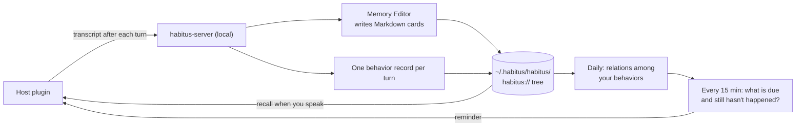

# Habitus

English | [中文](README.zh-CN.md)

**Your coding agent forgets you between sessions, and never notices what you usually do. Habitus handles both.**

Habitus is a local service with plugins for coding agents: Codex, Claude Code, OpenCode, pi, ZCode and DeepSeek Harness. It turns your conversations with the agent into long-term memory that the agent recalls when you speak. If you turn on the prediction side, it also learns your routines, and when something you usually do is due but hasn't happened, it has the agent ask you about it.

```text
You     ▸ let's fix the flaky test in ci.sh
Agent   ▸ (asks you first, with the host's own question tool)
          Habitus reminder: you usually write the weekly report on Thursday afternoon.
          ○ Do it now   ○ Not this time   ○ Noted   ○ Already done
```
<sub>Illustration. The reminder text is written by the model from your own history. Your answer is read back from the transcript, so the plugin needs no extra UI.</sub>

## Highlights

- **Memory you can read.** Plain Markdown cards under `~/.habitus/habitus/`, in four kinds: profile, preferences, entities and tools.
- **No vector database.** The model browses directory overviews and reads whole cards, so one chat model is all you need.
- **Grounded facts.** Tool know-how is written only from tool calls that really happened.
- **Reminders that earn the right to speak.** They are learned from your own turns, and a rule stays silent until its track record is good enough.
- **Never in your way.** If the service is down, your prompt goes through unchanged; transcripts are queued and resent without duplicates.
- **Local-first.** The service listens on loopback only, media is stripped, and your data stays in `~/.habitus`; the only outbound call is to your chat model.

## Supported hosts

| Host | `--harness` | Status |
|---|---|---|
| OpenAI Codex | `codex` | Memory and reminders tested live before the Nov 2026 memory rework; re-test pending |
| Claude Code | `claude-code` | Memory tested live before the Nov 2026 memory rework; re-test pending |
| ZCode | `zcode` | Integrated from source (v3.15.1), not yet tested live |
| OpenCode | `opencode` | Integrated, not yet run in a real OpenCode |
| pi | `pi` | Checked against the real pi 1.3.0 extension loader |
| DeepSeek Harness | `dsh` | Integrated from source (0.2.1-rc.2), not yet tested live |

For per-host limitations (hook coverage, subagents, Node versions), see [Plugins and command line](docs/plugins-and-cli.md).

## Quick start

You need Python ≥ 3.12, Node ≥ 18 and an API key for a chat model.

```sh
# 1. The local service (not on PyPI yet; install from the repository)
pip install "habitus[server] @ git+https://github.com/kkxx939-bot/Habitus"

# 2. The CLI and the host plugins
npm install -g habitus

# 3. Configure: chat protocol, base URL, model, API key, time zone
habitus-server init

# 4. Run the service (foreground, http://127.0.0.1:8787)
habitus-server serve

# 5. In another terminal: install the plugin and check everything
habitus plugin install --harness codex    # repeat --harness, or omit it to install into every host found
habitus doctor
```

> **Codex users:** after installing, type `/hooks` in Codex once and approve the Habitus hooks.

That's it: memory is on. Talk to your agent as usual. You can see what Habitus has stored with `habitus memory tree` and query it with `habitus recall "<question>"`.

### Turn on reminders

Reminders are off by default. To turn them on, add these three sections to `~/.habitus/config.yaml` and restart the service:

```yaml
behavior:
  primary_subject: "me"   # who is being tracked; any non-empty name turns on the behavior side
scene:
  enabled: true           # requires behavior
foresight:
  enabled: true           # requires scene
```

Every option is listed, with comments, in [`habitus/config/example.yaml`](habitus/config/example.yaml).

## How it works



1. **Capture.** After each turn the plugin sends that turn's transcript to the local service, which stores it as an immutable conversation segment.
2. **Remember.** A background job reads the segment together with the existing cards it touches. The model proposes changes, and code checks them against a schema and against the source (tool facts must come from real tool calls) before the cards are written.
3. **Recall.** When you speak, the plugin asks for memory. The service reads the directory overviews and then the full cards, and the injected context is wrapped in `<habitus-memory-context>` so it is never fed back into memory as if you had said it.
4. **Predict** (opt-in). Each turn is classified as one behavior. Once a day Habitus counts which behaviors reliably follow which situations. Every 15 minutes it builds expectations ("this should happen within this window"), and when the window closes with nothing done, it may remind you.
5. **Settle.** Your answer ("do it now", "already done", …) and whether the behavior happened go into a ledger. That ledger decides whether a rule stays silent or is allowed to speak.

More detail, with a worked example: [Architecture](docs/architecture.md).

## Documentation

| Doc | What is in it |
|---|---|
| [Architecture](docs/architecture.md) | How memory, behavior, relations and reminders work, with a worked example |
| [Plugins and command line](docs/plugins-and-cli.md) | What each hook does, the injection format, the outbox and resending, environment variables, the full `habitus` / `habitus-server` command reference |
| [HTTP API](docs/http-api.md) | Endpoints, features, error codes |
| [`habitus/config/example.yaml`](habitus/config/example.yaml) | Every configuration field with its default (comments in Chinese) |
| [Design rulings](docs/rulings/README.md) | The numbered design decisions the code follows (Chinese) |
| [`AGENTS.md`](AGENTS.md), [`docs/agents/`](docs/agents/) | Invariants for contributors, per module (Chinese) |

## Status

Habitus is **early-stage (0.1)**.

- CI runs the full test suite on macOS, Linux and Windows with Python 3.12, 3.13 and 3.14.
- The service is not on PyPI yet. The help and messages of both CLIs are in Chinese.
- The physical lane (behavior from wearables) is designed, but there is no endpoint yet for sending its data in.
- Holiday data ships only for mainland China and Singapore. For other regions you can supply your own file (`locale.calendar_path`).

## Development

```sh
uv venv --python 3.12 .venv
uv pip install --python .venv -r requirements.txt && uv pip install --python .venv -e . --no-deps
bash scripts/ci.sh        # the same chain CI runs: lint, format, mypy, pyright, Python and Node tests
```

Plugins live in [`plugins/`](plugins/) (the npm package; [its README](plugins/README.md)). Read [`AGENTS.md`](AGENTS.md) before changing a module.

## Acknowledgements

Several designs on the memory side follow [OpenViking](https://github.com/volcengine/OpenViking): L0/L1 directory overviews, sealing a conversation after a turn based on pending tokens, and sending invalid extraction candidates back to the model for one repair round. Only the design is borrowed; no code was copied (OpenViking is AGPL-3.0).

## License

[Apache-2.0](LICENSE). The plugins for DeepSeek Harness (MIT), OpenCode (MIT), pi (MIT) and ZCode (Apache-2.0) are written only against their public plugin/hook interfaces and session formats; none of their code is included.
