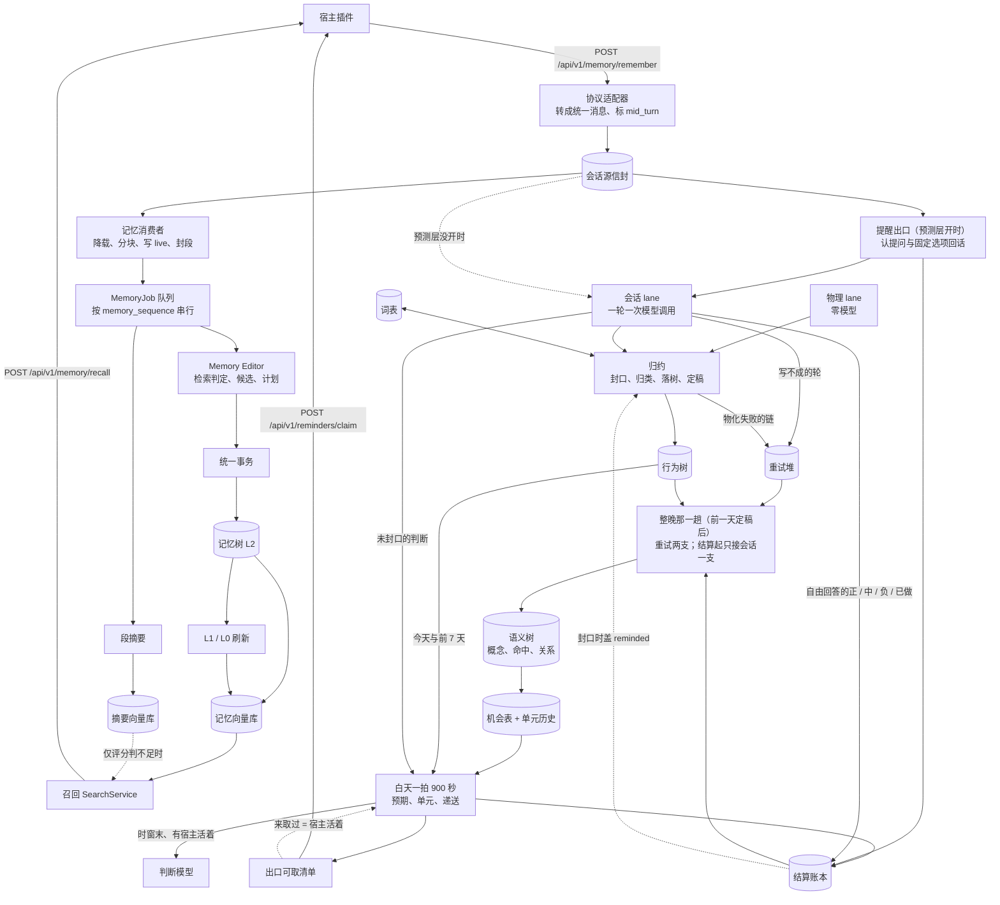

# Habitus

[English](README.md) | 中文

Habitus 是一个本地优先的个人记忆与行为预测服务，以插件形式接入编程 agent（Codex、Claude Code 等）：它从你和 agent 的对话里沉淀长期记忆、记录你做过的事，学出你自己的规律，在"该来了还没来"的时候通过 agent 问你一句。

> 本文档随源码逐段核对编写（2026-10），每一句都对得上代码。npm 包的页面见 [plugins/README.md](plugins/README.md)。

想直接装来用：→ [安装](#安装) · [快速开始](#快速开始)

## 目录

- [核心概念](#核心概念)
- [功能与宿主支持](#功能与宿主支持)
- [架构与数据流](#架构与数据流)
- [算法](#算法)
- [安装](#安装)
- [快速开始](#快速开始)
- [插件怎么工作](#插件怎么工作)
- [命令参考](#命令参考)
- [HTTP API](#http-api)
- [配置](#配置)
- [数据落盘与隐私](#数据落盘与隐私)
- [开发](#开发)
- [现状与路线](#现状与路线)
- [借鉴 OpenViking](#借鉴-openviking)
- [许可证与第三方说明](#许可证与第三方说明)

## 核心概念

Habitus 有两半：**记忆**（默认开）从对话里沉淀长期记忆、在你说话时召回；**行为与预测**（默认关，打开方法见[快速开始](#快速开始)）记下你做过的事、学出你的规律、在该做还没做时让 agent 问你一句。两半读的是同一份会话转写。

### 记忆这一半

**会话源。** 插件每送来一批转写，本地服务先由协议适配器把宿主的原始记录转成统一的消息批次，再连同会话号、日期、协议、`after_turn` 和投递号封成一份不可变的"信封"落盘，然后才分给两个消费者：记忆（`memory`）与行为侧的会话 lane（`behavior_session`）。同一个会话（会话号 + 开始日期）的信封按序交付；记忆消费者要求同会话内严格按序，前一份没有终态时后一份等着。

**消息与"一轮"。** 会话里只有四种消息：`prompt`（人说的话）、`completion`（agent 的答复）、`tool_call`、`tool_result`；每个 `tool_result` 必须跟在同 ID 的 `tool_call` 之后、工具名逐字相同，一个调用只有一个终态结果。"一轮"就是宿主的一轮：从你开口的那句话起，到 agent 给出最终答复为止；中途你又说的话（回答 agent 的提问、补一句、叫停）属于这一轮，由协议适配器标成 `mid_turn`。记忆与会话 lane 用的是同一个"一轮"。

**live、段与 history。** 消息先追加进会话的 `live.jsonl`；在一轮结束的边界上，满足条件的一段前缀被封成不可变的**段**，写成 `history/{起止序号}.jsonl` 并移出 live。超长的一轮会被切成几段，段上记着 `starts_mid_turn` / `ends_mid_turn`。

**摘要。** 每一段生成一份**段摘要**（概述、经过、纠正、结束状态、未完的线索）。段摘要攒够了合成**范围摘要**，范围摘要再合成**归档范围摘要**，到此为止。摘要只是过程史：记忆抽取只读原文，召回只在长期记忆不够用时拿摘要做后备。

**记忆树（L0 / L1 / L2）。** 长期记忆是存储根下 `memory/` 里的一棵 Markdown 文件树，地址协议 `memory://`。**L2** 是唯一权威的记忆文件：正文按 Schema 渲染，文件末尾一段 `HABITUS_MEMORY_FIELDS` JSON 注释保存结构字段、版本、时间和关系（`links` / `backlinks`）。每个目录可以有 **L1** `.overview.md`（覆盖全部直接子项的目录概览，模型写）和 **L0** `.abstract.md`（从 L1 简介里确定性摘出的一段），两者都能删掉重建。向量索引从 L0 / L1 / L2 派生，也不是记忆本身。

**六类记忆。**

| 类 | 路径 | 回答什么 | 写法 |
|---|---|---|---|
| profile | `profile.md` | 你是谁（职业、背景、稳定能力） | 单文件，可更新 |
| preference | `preferences/{topic}.md` | 你怎么选（沟通风格、输出格式、工作流习惯、工具偏好、明确的喜恶） | 可更新 |
| entity | `entities/{category}/{name}.md` | 有稳定名字、以后还会用到的对象 | 可更新 |
| tool | `tools/{tool_name}.md` | 真实工具调用形成的稳定用法（用途、何时用、怎么调、约束、失败恢复、验证） | 可更新；工具名必须逐字来自本段的真实调用 |
| event | `events/YYYY/MM/DD/{event_name}.md` | 已经发生的事或状态变化 | **只增不改**（`add_only`） |
| intention | `intentions/{intent_name}.md` | 还没完成、以后要推进或等待触发的事 | 可更新，覆盖为最新状态；`completed` 后默认不召回 |

**召回。** 你说一句话时，插件调本地服务的召回：先在长期记忆里语义检索、读出完整的 L2 并沿关系补一跳邻居，由评分模型判断"够不够回答"；只有判"不够"时才再检索少量历史摘要，作为低权重的后备单独列出。

### 行为与预测这一半

这三层默认都关：`behavior.primary_subject` 填了被跟踪的人才启用行为侧；`scene.enabled`、`foresight.enabled` 默认 `false`；预测层要求语义树已启用，语义树要求行为侧已启用。不启用时插件照常召回记忆，没有提醒。

- **两条 lane。** 会话 lane（你和编程 agent 的对话）与物理 lane（可穿戴设备等上游送来的行为段）。两条 lane 在行为树、语义树、预测层里各是一整套、互不相通，磁盘上是同一层目录下的两支（`behavior/session/`、`behavior/physical/`）。**目前只有会话一支接了语义树与预测层**；物理一支只到行为树。
- **一轮。** 会话 lane 的单位同样是宿主的一轮；一轮出一条记录，不按"是不是同一件事"合并。
- **行为树。** 只增不改的事实层：每条记录是一份 Markdown 文档（行为 occurrence 或观测空白 gap），地址 `behavior://occurrences/YYYY/MM/DD/<名字>--<开始时刻>.md`。空白有两种：「没读懂」（在看，但这一轮没写成）和「未观测」（没在看）。
- **kind 词表。** 每条 lane 一份行为类清单，从空开始，没有预置类。每个类有不变的编号（`s-k0007`、`p-k0003`）、名字、判据、提醒句；另有两个占位标记 `-待定`（哪类都不是）与 `-非事件`（不是一件事）。白天归类、每晚新增、每周拆改。
- **语义树（scene）。** 每晚从行为树派生：把类变成"概念"（基础概念 = 一个类；还有模型写的细分、汇总、情境概念，以及按当地日历机械生成的日历情境），把每条记录映射到它命中的概念，再对"所有可比的前因 → 后果 × 跨度"做统计检验，得到关系，状态有样本不足、检过、候选、成立、驳回、失效（`sparse` / `tested` / `candidate` / `established` / `rejected` / `expired`）。
- **序列与时间槽。** `series` 把行为树读成不可变的事件序列；`temporal` 是纯时间算法：一天切成 15 分钟一槽，同一类开始时刻相隔 ≤ 45 分钟算同一次（全系统只这一把尺），另有间隔、观测覆盖、密度、日内分布、久别。
- **机会表。** 预测层每晚从语义树这一晚的关系与时间线摆出来的事实表：每条关系（以及每个类的"离上次多久"）历史上的每一次机会、后果来没来。它不排序、不给读数。
- **预期（expectation）。** 白天每一拍（默认 15 分钟）从机会表建出的一条"这件事该在这段时间里发生"：带时窗、最晚时限和依据。三种触发：有事刚发生（事件）、处在日历情境里（情境）、离上次够久（日子）。
- **单元（unit）。** 一个行为类一个单元：同一刻在场的各条前因预期是它的输入；读数从历史上"同样这组输入在场时，后果来了多少"数出来。
- **档：影子 / 提醒。** 递法只有两档：0 档"影子"只建预期、记账、结算，不开口；1 档"提醒"在时窗末还没做时开口。升降看带遗忘的 Beta 读数是否越过一条线 θ = 1 − 可接受误提醒率（默认 0.67），在线两边之间时维持上一档。
- **结算账本。** 只增不改的流水：预期、递送、回话、结算、追加裁决、漏报按日子分目录；每笔"事实"（准时 / 早到 / 晚了但做了 / 提醒后发生 / 过期待决 / 后补 / 作废）再按账（类 + 触发种类 + 触发身份）存一份。账是流水，不存权重；权重每晚从单元历史重新数。
- **提醒出口。** 预测层决定开口时记「待取」；宿主的插件在你下一句话时取走，让 agent 先用宿主自带的提问工具问你；问没问出口、你怎么答，服务从送回的转写里认。

## 功能与宿主支持

Habitus 由两部分组成：

- **本地服务 `habitus-server`**（Python）：记忆树、行为树、语义树、预测层都在服务进程里，只监听本机回环地址。
- **npm 包 `habitus`**（Node）：一个命令行 `habitus`，以及装进各个编程 agent（下称"宿主"）的插件。插件和命令行都只是服务的客户端。

插件在每个宿主上做三件事：你说一句话时召回相关记忆并注入上下文、取到期的提醒让 agent 先问你（提醒要先打开预测层，见[快速开始](#快速开始)）；一轮做完时把这一轮的转写送回服务。

| 宿主 | `--harness` | 注册方式 | 会话协议 | 提醒用的提问工具 | 验证程度 |
|---|---|---|---|---|---|
| OpenAI Codex | `codex` | 宿主 marketplace（`codex plugin …`） | `codex_rollout` | `request_user_input`（Desktop 是 `request_user_input_async`） | 已接（记忆 + 提醒），本机实测过 |
| Claude Code | `claude-code`（`claude`、`cc`） | 宿主 marketplace（`claude plugin …`） | `claude_code` | `AskUserQuestion` | 已接；记忆主链用真实 Claude Code 会话的转写（按插件的切批逻辑）配真实模型端到端跑过；提醒只在 Codex 上实测过 |
| ZCode | `zcode`（`zc`） | 宿主 marketplace，装的是 Claude Code 那份插件 | `zcode` | `AskUserQuestion` | 按 v3.15.1 源码接入，待实测 |
| OpenCode | `opencode`（`oc`） | 在 `~/.config/opencode/plugins/` 放一个入口文件 | `opencode` | `question` | 已接，未在真实 OpenCode 里跑过 |
| pi | `pi`（`pi-coding-agent`） | 在 `~/.pi/agent/extensions/` 放一个入口文件 | `pi` | `ask_user`（插件自己注册） | 在真 pi 1.3.0 的扩展加载器上验证过，未跑过真实对话 |
| DeepSeek Harness | `dsh`（`deepseek-harness`、`deepseek`） | 经官方 Claude Code hook 桥，写入 `$DSH_HOME/cordis.patch.yml` 的受管段 | `dsh` | `ask_user_question` | 按 0.2.1-rc.2 源码接入，待实测 |

各宿主的已知局限：

- **Codex**：装完插件后要在 Codex 里输入 `/hooks` 批准一次 Habitus 的 hook，没批准的 hook 不会运行（Codex 的安全确认，Habitus 不替你批准；`habitus plugin install / status` 与 `habitus doctor` 会提示）。Codex CLI 的默认模式里没有 `request_user_input`（`codex features list` 里 `default_mode_request_user_input` 默认关），提醒在那里问不出去；`habitus doctor` 会报 warn，`habitus plugin status` 的 Codex 那一行也会说（Codex Desktop 不受影响）。
- **Claude Code**：转写按"没有挂着的工具调用、且答复的 `stop_reason` 不是 `tool_use`"切批，个别情况会切在一轮中间（已知问题，在核实 Claude Code 的"一轮结束"标记）。
- **ZCode**：只有七个 hook 事件，没有 PreCompact、SessionEnd、Subagent*：会话结束时不 flush，子代理采不到。读会话库需要 Node ≥ 22.5。
- **OpenCode**：子代理会话（task 工具起的）不采、不召回、不取提醒。
- **pi**：会话是一棵树、各分支追加在同一个文件里，换过分支的转写会混在一起；没有会话文件的进程（`-p --no-session`）什么都不做。
- **DeepSeek Harness**：hook 桥不支持 PreCompact、SessionEnd；只装进 `web` profile；读压缩的会话日志需要 Node ≥ 22.15。

本地服务还内置了四个通用会话协议（`openai_chat_completions`、`openai_responses`、`anthropic_messages`、`openclaw`），没有插件在用，供别的客户端直接调 HTTP API。

## 架构与数据流



### 记忆主链

一批转写进来，前台只做确定性的事：适配、落信封、降载、写 live、可能封段并入队，然后返回；所有模型调用都在后台的 MemoryJob 里。

1. **适配**：`POST /api/v1/memory/remember` 按协议名找到适配器，把宿主记录转成统一的消息批次；Codex 按 `task_started`、Claude Code 按"上一条收下的不是答复"标出轮中插话。
2. **会话源**：先写信封，再并行启动两个消费者；HTTP 请求只等记忆消费者完成，行为侧在后台继续。
3. **记忆消费者（前台）**：工具结果降载 → 超长文字无损分块 → 超出一段上限的工具组抽到放得下 → 幂等追加 live；这批 `after_turn=true` 且触发了封存时，在安全切点封出段：先建 `STAGED` 任务，再发布 history，最后激活为 `QUEUED`。
4. **MemoryJob（后台，按 `memory_sequence` 严格串行）**：读出段与它所在的整轮，**并行**生成段摘要与 Memory Editor 的纯计划（检索旧记忆 → 候选 → 字段计划 → 身份 → 关系）。整轮放得进抽取的输入上限时，只在轮尾那段抽一次整轮；放不下时每段各抽自己（见[算法](#5-memory-editor从一轮对话到一份纯计划)）。
5. **发布**：摘要落盘 → 变更回执 PREPARED → 一个事务提交全部 L2 变化 → 摘要向量同步 → 回执 COMMITTED → 受影响目录的 L1 / L0 自下而上重建 → 记忆向量同步 → Job COMMITTED。
6. **召回注入**：`POST /api/v1/memory/recall` → 查询规划 → 向量召回（L2 直召 + 经目录 L0/L1 的层级召回）→ 重排 → 读完整 L2 → 冷热排序 → 一跳关系 → 组装 → 评分 → 不够时补摘要 → 记下实际用到了哪些；插件把结果包成 `<habitus-memory-context>` 注入。
7. **后台维护**：LifecycleWorker 每小时一轮：摘要的两级压缩与归档退休、过期 Job / 回执清理、L2 的冷热压缩与退休；同一个 Worker 还释放会话源信封、把没到终态的消费者按周期恢复，并负责行为侧、语义树、预测层产物的释放与各层重试账的清理。

### 行为与预测

会话 lane 与记忆读同一份会话源信封。预测层开着时，会话 lane 前面挂着提醒出口：同一份转写先由出口认提问与固定选项的回答，再交会话 lane 切轮；预测层没开时会话源直接交会话 lane。

1. **会话 lane**：一轮一次模型调用，写一条判断；这一轮开着提醒、你自己填了回答时，模型判出的正 / 中 / 负 / 已做由它写回账本；写不成的轮落「没读懂」并进重试堆。物理 lane 从上游交付直接写判断，不调模型。
2. **归约**（每支一个常驻 worker，每 300 秒一轮）：封口（预测层开着时查账本，给「说了」之后才开始的记录盖 `reminded`）→ 白天归类（词表）→ 落行为树 → 刷新 L0/L1 → 记定稿日；物化失败的链进重试堆。
3. **整晚那一趟**（前一天定稿完成就接着跑，不挂固定时刻；常驻节拍每 5 分钟看一眼），顺序固定、前一步完成即接下一步：刷新日历 → 每晚重试（两支的重试堆都在这一步处理；锁被另一进程拿着就停在这里、下一眼接着跑，不结算）→ 结算（从这一步起只接会话一支）→ 两支的词表：每晚新增，这一晚所在的拆改周期（从每周三那一晚起）里还没拆改过就接着拆改 → 截止日 N = min(今天, 最后定稿日 + 1) → 词表迁移没做完就停 → 读序列 → 语义树 → 机会表与单元历史 → 当天的日子预期。词表的两件活都在这一趟里、结构之前，不挂任何钟点。服务夜里没跑的，起来时昨天已定稿就接着跑（每一步重跑都幂等）。
4. **白天一拍**（默认 900 秒）：读行为树今天与前 7 天、未封口的判断与盘上最新的机会表 → 建预期 → 单元读数 → 递送决定（时窗末、最近有宿主来取过提醒时才问判断模型；宿主来取提醒就是它"活着"的凭据）→ 「待取」写进出口可取清单。
5. **出口**：宿主插件在 UserPromptSubmit 取走 → agent 用提问工具问你 → 转写送回 → 出口认「说了」与回话 → 进账本，第二天整晚那一趟结算。

## 算法

各小节按"输入 / 怎么算 / 输出 / 为什么"写；数值是默认配置。贯穿例子"周四下午写周报"放在本节末尾。

### 1. 一轮怎么认：`starts_turn` 与 `mid_turn`

- **怎么算**：一条消息开一轮，当且仅当它是 `prompt`、不是长消息的后续分块、且没有标 `mid_turn`；`mid_turn` 只能标在 `prompt` 上。Codex 适配器按宿主的 `task_started` 分轮：一轮里第一句人话之后的人话、以及一批里第一个 `task_started` 之前的人话，都标 `mid_turn`。Claude Code 适配器在同一批里上一条收下的消息不是答复时把人话标 `mid_turn`；其余宿主的适配器不标。
- **输出**：每条消息的 `starts_turn`；每段的 `starts_mid_turn`（第一条不开轮）和 `ends_mid_turn`（最后一条不是完整的 `completion`）。
- **为什么**：Codex Desktop 里一轮中插进来的作答、补充、叫停原先各被当成一轮开头，整批被拒；改为由知道宿主轮次的适配器标，记忆核心不猜。

### 2. 保留与切段

- **触发**：既不是 `after_turn` 也不是 `flush` 时什么都不封。封存前要求 live 里每一轮都以完整的最终 `completion` 结束、轮内每个 `tool_call` 都有终态结果，否则整批拒收。正常封存时保留最近的轮：最后一轮必留，再往前最多凑到 `keep_recent_turn_count`（3）轮、合计不超过 `retained_message_token_budget`（12,000 token）；其余是"待封存"。显式 flush 不保留尾巴，全部封存。触发条件（任一）：显式 flush；待封存 ≥ `commit_token_threshold`（12,000）；live 总量 > 12,000 token；live 超过 200 条或 2 MiB。保留下来的尾巴本身超出 live 窗口时，把它的最小安全前缀也并入待封存。
- **安全切点**：没有挂着的工具调用；一轮中间的 `completion` 后面还有同一轮的工具步骤时不在那里切。
- **一段多大**：待封存部分整段放得下（≤ 500 条、≤ 1 MiB、≤ `max_segment_tokens` 12,000）就整段封。放不下时在安全切点里打分：结构分（轮边界 40、工具结果后 30、消息边界 20、同一长消息的分块之间 10）+ 2 × 两侧语义距离 + 前缀 token / 上限；优先选前缀不少于上限 60% 的候选，取分最高者（同分取更靠后）。语义距离是相邻安全单元 Embedding 的余弦距离；Embedding 调用失败时退回纯结构分，不挡会话。一次 `after_turn` 里封完一段后接着把剩余待封存部分封完。
- **token 怎么估**：不调 tokenizer；对消息的规范 JSON 逐字符加权，按 Unicode 东亚宽度分三档：宽字符与全角字符（`east_asian_width` 为 W / F：汉字、假名、韩文音节、全角标点与字母、多数 emoji）1.5，其余 BMP 以外的字符 2.0，其余 0.25，向上取整。
- **为什么**：只在宿主明确一轮结束时封存；正常大小的内容在完整轮边界封，超长内容在 60%–100% 窗口里按结构优先选点，工具调用与结果永不切开。

### 3. 写入 live 之前：降载、分块与工具组抽取

三步，都是确定性的，不调模型：

1. **工具结果降载**：规范 JSON ≤ 64 KiB（`max_inline_tool_result_bytes`）的文字结果原样保留；只有媒体的结果只存描述、原载荷的字节数与 sha256（`omitted`）；更大的文字结果做关键信息抽取（`summarized`，摘录上限 4,000 字），同时记整份原内容的字节数与 sha256。
2. **超长文字无损分块**：单条 `prompt` / `completion` 超过 `max_segment_tokens` 时，依次按代码块、空行、换行、句末标点、空白切，再不行就二分硬切；拼回去必须与原文逐字相同，分块带 `logical_message_id` / `logical_part_index` / `logical_part_count`。
3. **工具组放得进一段**：一组切不开的工具交换（调用与它们的结果）合起来超过一段上限时，按当前 token 从大到小，把组里的工具结果与调用参数从**原文**重新抽取；全抽过还放不下就把摘录上限减半再来，最低 128 字；到 128 字仍放不下（或整组超过 500 条）时，规划器明确报错。调用参数是对象时，256 字以内的字段（路径、命令、开关）原样保留，只抽更大的字段；这些小字段合计超过摘录上限一半时整份参数一起抽取。被抽过的调用参数标 `summarized`，记原参数规范 JSON 的字节数与 sha256。

**关键信息抽取**按内容分类、不按工具名：依次认空、类二进制、JSON、XML、TSV / CSV、YAML、代码、纯文本，各出一种确定性摘要；纯文本优先留错误 / 警告 / 异常 / 栈 / 失败 / 致命 / 非零退出码的行及其上下文，再留开头与结尾。

**为什么**：真实会话里两次并行读文件的结果单条都不超限、合起来超过一段，没有安全切点，会话被永久卡住；所以不截断头尾，按内容分类抽关键信息，按整组计大小。原文不另存（不旁路保存原始载荷）。

### 4. 三级摘要

- **段摘要**：每个 MemoryJob 为它的段生成一次（已有就复用）；模型看完整段原文和 `starts_mid_turn` / `ends_mid_turn`，只输出字段操作（概述、结束状态用 UPDATE；经过、纠正、未完线索用 APPEND）；输入超过 200 万字直接失败，不截断原文。
- **范围摘要**：只合**序号连续**的同阶段摘要，年龄按来源覆盖的结束时间算。段 → 范围：至少 7 天、连续 20 份（一次最多 100 份、50 万字）；或者最老一份已等满 180 天且至少 2 份连续。范围 → 归档：至少 180 天、连续 2 份（最多 24 份）。90 天内在召回里被实际用过的摘要先不合。每轮维护每个会话最多生成一个父摘要（先看归档，再看范围），只调一次模型，不删任何来源。
- **退休**：归档范围摘要自生成或最后一次被用起满 1,095 天，先标为退休候选，再等 90 天宽限；之后按"撤出索引 → 释放 history 原文 → 删子摘要 → 删归档"的阶段幂等执行。
- **为什么**：摘要不是无限累积的最终层；压缩按连续消息序号而不按日历分桶，固定两级，不允许无限层级。

### 5. Memory Editor：从一轮对话到一份纯计划

**输入**：这一段所在的整轮（已封存的各段加上还在 live 里的轮尾）。先估整轮的对话材料（不带旧记忆的检索判定请求与候选请求，按真实请求投影估 token）能否放进 `memory.extraction.max_input_tokens`（56,000）减去 `max_old_memory_tokens`（28,000）剩下的部分：

- **放得下**：轮中间结束的段只写段摘要，轮尾那一段把整轮拼起来抽一次。
- **放不下**（或整轮超过 `max_context_chars`）：每段的 Job 只抽自己这一段，另带这一轮开头的人话、前面各段的段摘要（概述与结束状态）和没带上的段数；预算不够时从最早的段摘要舍起。提示词说明本段是唯一的事实来源，前文只帮理解、不从里面提取记忆（这一句没有对着真实模型调过）。

同一轮里每个 Job 判出来一样：要么只有轮尾那段抽整轮，要么每段各抽各的，不漏不重。真实的超长轮（一轮约 12 万 token）按段抽取后，每次请求加上旧记忆预算都在 56,000 以内。

**5.1 先读哪些旧记忆**：固定直读 `profile.md`；本段每个真实调用过的工具名对应的 `tools/{name}.md`；再在 `preferences/`、`entities/`、`events/`、`intentions/` 里用一条从段生成的查询做一次语义检索（Top 5），把命中的完整 L2 读进来。查询填进 5,000 字预算：从最后一句人话起，先放更早的人话、再放其余消息，各自最新优先、工具调用与结果不拆，每条先截到人话 1,000 字、答复与工具 500 字，再按原顺序拼回。Event 只增不改，仍读进来，因为 Intention 的状态要看 Event 时间线。读进来的旧记忆受 64 条、400 万字节、28,000 token 三个上限约束；装不下 `profile.md` 或本段工具记忆时明确失败。读到的每个节点按 Links / Backlinks 补一跳邻居（每个最多 8 个、总共 32 个），并核对双向关系一致。

**5.2 检索判定（受控 ReAct）**：模型每轮看完整段、全部旧记忆快照和之前动作的结果，只能选一个动作：`finish`、一次 `memory_search`（单条查询，Top 5）、或读一个系统已暴露过的 URI。重复的查询直接用缓存；搜索或读取本身失败（向量服务不可用、越界 URI、完整性错误）明确失败。默认最多 3 轮：前 2 轮可以要动作，第 3 轮的 Schema 只允许 `finish`，提示词告诉它预算用完、之前搜不到就是没有可更新的旧记忆；它仍答"不足"、或纠错用完仍不合格，都不让 Job 失败，只记为"检索在轮次上限处结束"，写进该 Job 的 `workflow/memory_plan` 观察事件。**为什么**：空树上答"不足"恰是诚实答案，原来这样会让 Job 永久失败、挡住整条队列。

**5.3 候选**：模型基于完整段与全部旧快照输出一个严格的 `MemoryCandidateBatch`：六个候选数组 + `identity_proposals` + `relations`。每个候选带一个只在本次有效的临时 `page_id`：旧节点由系统编 1–99，新节点由模型编 100 以上，更新旧节点必须复用系统编号。只增不改的旧 Event 在请求里标 `read_only`：它的编号只供 `relations` 引用，结果或决定变了要另记一条新 Event。Intention 候选还要带 `confirmed`，表示这次对话是否明确新建、更新或再次确认了它。候选里不能有 URI、路径、版本、时间戳、置信度。抽取材料里的消息时刻带主体所在时区（`locale.timezone`）的本地偏移。

**5.4 来源校验（确定性）**：模型输出过了 JSON Schema 之后，再按原文与旧快照核对：

- 旧节点必须复用分给它那个 URI 的编号；新编号不能指向已读到的旧 URI；
- `tool` 候选的工具名必须在本段有成功的调用与结果；本段新写或改写的 `failure_recovery` 还要求本段有"先失败、后成功"，与旧工具记忆逐值相同、原样带过来的视为已有来源；
- Event 日期不能晚于这一段最后一条消息的**本地日期**（按 `locale.timezone`）；
- `completed` 的 Intention 必须 `confirmed=true`，并且指向本次读到的旧 Intention；
- 关系的 `remove` 两端必须是旧节点，且这条关系在旧快照里真实存在。

有条目不过时，把"哪一条、违反哪条规则"发回模型修补一次（同一个结构化客户端、同一份输入预算）；修补后仍不过的条目连同引用它的关系与身份提议从本批剔除，同批其余照常写，全部被剔就按空批提交；剔了几条、为什么写进该 Job `workflow/memory_plan` 观察事件的 `source_rejected_count` / `source_rejected_reasons`。修补请求放不下、或修补答复用完结构纠错仍不合格时，退回第一次的答复、只剔不合格的条目。**为什么**：模型回答的正常波动（实体改名、已有记忆换了编号、工具名写法不同、完成了一条没读到的 Intention）原来会让整批永久失败、挡住整条队列。这句修补提示没有对着真实模型调过。

**5.5 字段计划**：每个候选按 Schema 的字段策略与旧字段合并：`immutable` 改了就失败；`patch` 取候选给的完整值、缺席保留旧值；`replace` 是最新完整状态、缺席的可选字段被移除。指向只增不改旧 Event 的候选一律保留旧字段、按 NOOP 处理，条数记进 `workflow/memory_plan` 的 `read_only_noop_count`，同批其余候选照常写。结果是每个候选的 CREATE / UPDATE / NOOP；未确认的 Intention 只能作为合并目标被原样保留。**为什么**：真实会话里模型三次去改写旧 Event，整批永久失败、同批 4 条合格候选一起丢。

**5.6 身份规划（FinalIdentityMap）**：确定性地把临时提议提升为每个编号的最终处置 CREATE / UPDATE / NOOP / MERGE / DELETE，并绑定最终 URI（DELETE 没有 URI）。`same_memory` 只能把一个完整读取、本次不再改字段的旧节点并入同类、单跳、且被字段计划覆盖的存活目标，只允许 preference、entity、intention；目标是 NOOP 时，目标字段必须完整包含来源内容。`remove_memory` 只接受 `explicit_forget` / `fully_invalidated`。合并链、循环、提议来源同时出现在关系里，都失败。字段规划与身份规划失败仍让这个 Job 按永久失败处理（见第 8 节）。

**5.7 关系规划**：在身份确定后进行：先核对旧关系双向一致，再把旧 Links / Backlinks 端点映射到最终身份（MERGE 的迁过去，DELETE 的清掉），去掉自环；再应用显式 `REMOVE`，最后幂等应用 `ADD`。Backlinks 由最终的正向关系派生，不由模型给。

**输出**：一份不含任何落盘副作用的统一提交计划（要写的完整文档、要删的 URI、读集快照）。

### 6. 事务提交

- 对读集里全部 URI（受影响节点、关系端点、一跳邻居）加一把事务锁和逐个文档锁，在锁内先确认没有待恢复的事务，再对每个快照做 CAS。
- 先耐久写 PREPARED 日志，再逐个原子替换 / 删除文件，完整回读校验，最后标 COMMITTED。同一文档的内容与关系合成一次写，只推进一次 revision；Intention 只在被本次对话明确确认（或新建）时刷新 `last_confirmed_at`。
- 任一步失败，在同一锁集内恢复全部旧文档并删除本批新文件，标 ROLLED_BACK。进程中途崩溃的，下一次处理 Job 前按日志恢复：文件全是新版就补 COMMITTED，全是新旧之一就回滚，出现第三种状态就报错。
- **为什么**：节点内容和关系不能先后独立发布；锁只解决并发，日志负责多文件写入中途崩溃后的恢复。

### 7. L0 / L1 自下而上与向量同步

- **怎么算**：取本次提交改变的 L2 的全部祖先目录，最深优先各刷新一次。刷新一个目录：取直接 L2 的正文与子目录的 L0（没有 L0 时从子目录 L1 现摘）作为条目，让模型生成目录简介和逐条摘要，条目数、顺序、名字必须与输入一致；渲染成 L1，再从 L1 的第一段确定性截出 L0（≤ 800 字）。空目录删掉它的 L0 / L1。
- **向量**：L2 以"类型 + 路径 + 正文"、L0 / L1 以"directory + 路径 + 内容"作为文本做 Embedding，写进向量库；内容摘要没变的复用旧向量。`completed` 的 Intention 写进单独的分区，默认召回在 Top-K 之前就排除它。
- **为什么**：L0 / L1 与向量是可重建的派生层：刷新失败不回滚已经成功的 L2，但 Job 保持未完成，按第 8 节的三种处置重试。

### 8. MemoryJob 队列

- 全局 `memory_sequence` 由 `jobs/state.json` 里只增不减的高水位分配；先推进高水位、再建 `STAGED`，崩溃只留序号空洞。
- Worker 只认领**最早**的未完成 Job（带租约、心跳），不越过它。失败按三种处置：
  - **等依赖恢复**：模型此刻用不了（连不上、限流、额度 / 余额不足、鉴权失效、没有权限、模型服务答坏；对话与 Embedding 同一组），或向量库忙 / 暂时用不了（文件被另一连接锁着、磁盘满或 IO 错误、索引重建中）。这一次不计入尝试次数，按长退避排回队列：60 秒起、每次翻倍、封顶 1 天（`workflow.jobs.model_wait_*`），次数不设上限，不会进 FAILED。健康检查的 `memory_queue` 这时报 `waiting_for_model:<序号>;waits=<次数>;next_attempt_at=…`（向量库在等时也是这个名字）。
  - **可重试**：提交冲突、超时、模型答复用完结构纠错仍不合格、未归类的运行时故障。1 秒起、最长 60 秒退避，最多 5 次（`workflow.jobs.max_attempts`），用尽进 FAILED。
  - **永久**：输入超长、内容安全、永久抽取错误（字段规划或身份规划失败）、完整性错误、配置错误、向量库的其余错误（例如向量文件损坏）。第一次就 FAILED。
  - 归哪一类顺着异常的根因链由外往里看，第一层认得的说了算：包了一层的向量库忙照样等依赖恢复，包了一层的模型 401 / 403 / 400 照样永久失败。来源校验不过不再让 Job 失败（见 5.4）。
- FAILED 会挡住其后所有 Job，直到人工重试：从 `GET /api/v1/memory/jobs/blocked` 返回的 `job` 里取 `memory_sequence`、`conversation_id`、`started_on`、`version`，再 `POST /api/v1/operations/memory/jobs/{memory_sequence}/retry?conversation_id=<…>&started_on=<YYYY-MM-DD>`，请求体 `{"expected_version": <version>}`；少了两个查询参数回 400 `INVALID_ARGUMENT`。Job FAILED 或在等依赖恢复时 `/ready` 都返回 503，但结果里的 `recall_ready` 仍为 true，插件照常召回已有的记忆。
- **为什么**：后一项必须在前一项的摘要、回执、L2、L0 / L1、向量全部完成后才读旧记忆，才覆盖真正的跨会话顺序，所以失败的 Job 不跳过；模型或向量库用不了是"过一阵再来就能成"，不该耗尽尝试次数。

### 9. 召回

- **两种入口**：`find()` 只做一次直接查询，不调规划和评分；HTTP 召回走 `search()`。
- **规划**：带会话时读这个会话当前的活跃摘要前沿与最近 5 条 live 消息，交给模型补全省略指代、拆成最多 4 条查询（只能输出查询文本、意图、优先级），再与原问题合并；会话上下文为空就直接用原句；规划失败退回原句并记一条降级。
- **向量召回**（每条查询只算一次 query embedding）：在指定根目录下直接召回 L2；默认的层级模式再用目录 L0 / L1 召回 20 个目录，按优先队列逐层展开（最多 128 个目录、每个取 32 个子项），子项分 = 0.8 × 自身分 + 0.2 × 父目录分；然后可选的 Reranker 对前 50 个重排，低于 0.2 的丢掉；重排失败退回向量分并记降级。
- **聚合与读取**：多条查询按 URI 去重；读出完整 L2，按 `kinds` 与 Intention 范围过滤（只限制主节点，不截断关系邻居）。
- **冷热排序**：最终分 = 语义分 × (1 − 0.2 × (1 − 热度))；COLD_2 的节点不进正常结果，每次检索最多放一个 COLD_2 作为"探测"：只在语义分前 limit 名里挑；它若进了最终上下文就记一次"用到"、回到 HOT。
- **关系扩展与组装**：每个命中沿 Links / Backlinks 补一跳（每个最多 5、总共 32），组装成上下文（上限 12 万字）。
- **评分与后备**：评分模型判断这些记忆是否足以回答当前问题；一条记忆都没有时不调模型，直接判"不足"。判"不足"且上下文预算没用完时，用评分给出的一条缺口查询检索最多 3 份历史摘要，放在单独的区块里，前缀写明它只因长期记忆覆盖不足而作为历史后备；摘要不参与记忆排名、不占记忆的条数。
- **记账**：最终进入上下文的 L2 记一次"用到"（影响热度）；被压缩过的 COLD_2 先恢复原文再给。
- **为什么**：没有 Embedder 或向量服务不可用时明确失败，不用关键词或本地扫描冒充语义搜索；评分或摘要后备失败只记降级，照常返回已召回的记忆；摘要只在不够时作为后备。

### 10. L2 冷热分层与退休

L2 的冷热生命周期默认开着，由 `memory.recall_lifecycle.enabled` 一处总控（关掉即不算冷热、不压缩、不退休；`memory.field_compaction`、`memory.lifecycle_maintenance` 只是上限），由 LifecycleWorker 每小时一轮执行。

- **热度** = (n + 1) / (n + 2) × 2^(−距最近活动的天数 / 半衰期)，n 是"被实际用到"的次数，最近活动取内容更新与最近一次用到中较晚者；压缩写回不算活动、不重置时钟。半衰期按类：profile 180 天、preference 90、entity 60、tool 30、event 14、intention 30。热度 < 0.08 为 COLD_2，< 0.2 为 COLD_1，> 0.6 为 HOT，其余 WARM。
- **退休**：COLD_2 且自最近活动起满退休期（profile 720 天、preference 365、entity 270、tool 180、event 180、intention 540）的，先标候选，再过 30 天宽限，标为退休并在同一轮经提交事务删除 L2（中断则下一轮续做；每轮最多 4 个）。退休不要求先压缩过，也不等压缩模型的回答。
- **压缩**（尽力而为）：每轮最多扫 256 个 L2；COLD_2、还没到退休期、未压缩过的，由模型把业务字段压短，原文存进 `workflow/lifecycle/l2_recovery/`，再经同一个提交事务写回。每轮最多送模型 4 次，压成、判"已够紧凑"（KEEP）、报错都算一次。KEEP 只在维护扫描账里记"这一版内容判过"，内容不变不再问；报错按退避重试。召回用到被压缩的记忆时先恢复原文。
- 一条从没被召回用到过的记忆按默认值算（压不压缩都一样）：

  | 类 | 进入 COLD_2 | 标退休候选 | 删除 |
  |---|---|---|---|
  | event | 约第 37 天 | 第 180 天 | 第 210 天 |
  | tool | 约第 79 天 | 第 180 天 | 第 210 天 |
  | intention | 约第 79 天 | 第 540 天 | 第 570 天 |
  | entity | 约第 159 天 | 第 270 天 | 第 300 天 |
  | preference | 约第 238 天 | 第 365 天 | 第 395 天 |
  | profile | 约第 476 天 | 第 720 天 | 第 750 天 |

  压缩时不区分字段是否 `immutable`、类型是否只增不改，Event 的正文字段也会被改写；未完成的 Intention 同样按时间退休（见[现状与路线](#现状与路线)）。

### 11. 会话 lane

- **输入**：会话源信封里的消息；子代理会话（会话号含 `.subagent.`）整份跳过。
- **切轮**：人说的话开一轮；宿主标成 `mid_turn` 的插话、同步与异步提问工具的作答（翻成"（回答助手的提问）…"）留在本轮；agent 停下后被后台通知叫醒的那一段自成一轮；同一秒 ≥ 3 条人话当重放丢掉。agent 既没答复也没调用工具的轮不出记录。
- **材料**：人的指令、中途插话、中途答复、每次工具调用一行（工具名 + 参数前 120 字）、失败调用的报错前 240 字、最后答复；工具结果正文不给。总上限 8,000 字，超了依次削工具调用中段、中途答复、最后答复中段，人的指令最后才削。密钥在截短前、出门前各抹一遍，模型输出落盘前再抹一遍。
- **模型调用**：一次结构化调用（提示词 `behavior_session_turn_prompt_v7`），输出 `name`、`summary`、`goal`（可空）、`steps`（≤ 3 条）；这一轮还开着提醒时另有 `responses: [{reminder, polarity: 已做|正|中|负}]`，开着的提醒最多带 5 条。方向的判法：他说这一次已经做过了 → 已做；还没做、也没往后推（现在就做、正在做、交给助手）→ 正；推到最晚时限之前或说不准 → 中；不做或推到最晚时限之后 → 负。
- **输出**：一轮写两条凭据观测（开口时刻、做完时刻，只存时刻与轮身份，不存内容）、一条判断、一份回执、一条覆盖记录，顺序固定。
- **失败**：确定性失败（含模型对这份材料必然拒绝）和模型此刻用不了（连不上、额度 / 余额、鉴权、权限、模型服务答坏）都只连累这一轮：先落一条「没读懂」，再进重试堆，当天照常定稿，结算把那段时间读成"说不清"而不是"没做"；补回的判断把那段「没读懂」作废。其余失败整份源按会话源的重试账重做，写过的轮认得出。写到一半（判断已落、回执没落）照原判断写完，不重问模型。
- **为什么**：融合只描述"这一轮在做什么"，"算不算一件事、属于哪一类"只在词表一处判，避免两次归约；材料只在那一次调用里用、不落盘。

### 12. 物理 lane

- **输入**：一份交付 `{source, device, delivery_id, sent_at, segments, coverage}`；段 `{id, behavior, started_at, ended_at, facts?}`，覆盖时段 `{started_at, ended_at, state}`，`state` ∈ `observing | not_worn | charging | no_data`。入口是 `Runtime.deliver_physical`，目前没有 HTTP 路由。
- **怎么算**：不调模型。多出字段、时刻不带偏移、覆盖不首尾相接、段重叠或编号重复、段落在没在看的时段里、段结束晚于送出 300 秒以上，整份拒收。一段写一条判断：名字用上游的说法，概要按固定句式拼"名字，HH:MM–HH:MM；事实…"；没在看的时段写一条空判断，落成「未观测」。段编号按"设备 + 段编号"记小账：同内容重送幂等，内容变了拒收；早于 7 天的补发拒收。
- **为什么**：上游送的是最终结果，融合不判、不设置信度门槛；在没在看由上游说了算。
- **现状**：只用造的数据测过，没有对过真实设备的样例；这一支没有语义树与预测层。

### 13. 词表：白天归类、每晚新增、每周拆改

- **白天归类**（每条记录唯一的一次归类调用；每晚新增与每周拆改在整晚那一趟里，当日的 L0 / L1 由模型写）：输入是封口了的记录（名字、概要、目标、步骤），连同这条 lane 全部在用的类，每批 10 条；每条输出 `{record, reason, choice: 类编号 | 都不是 | 不是一件事, proposed}`，"都不是"打 `-待定` 并带一个提议名，"不是一件事"打 `-非事件`；没答好的只重问那几条，最多 2 轮，用尽当待定。待定条目进待定池（上限 5,000，满了挤掉最早的）。
- **每晚新增**（整晚那一趟里、结构之前）：每条 lane 把新进池的条目（一晚最多 200 条）各按相似度召回 3 条旧条目，交模型聚组；**一组 ≥ 2 条且跨 ≥ 2 天才建类**；模型说"就是已有某类"的组交白天归类重判。
- **每周拆改**（整晚那一趟里、每晚新增之后；拆改周期从每周三那一晚起，这个周期里线第一次跑到就拆改）：拆分看每类最近 120 天的成员（≥ 6 条才分组），模型分组、算法按同一个 2 条 / 2 天门槛定切不切，再用封闭集合重判复核；合并要在连续 2 个拆改周期都被提出；改过的类冷却 14 天，一次最多改 3 处。放行前做锚点自检：每个没动过的类取最近 8 条、在旧清单下两遍都归回原类的成员当锚点；新清单下被改动的类接走的锚点不超过 ⌊2% × 锚点数⌋（锚点不足 50 个时一个都不许接走）。
- **迁移**：先写迁移计划，再逐条把树上 occurrence 的 `kind_token` 从源编号改成新编号（只改仍是源值的），写变更日志。编号一经分配不改，拆合用 `branches` 记去向。
- **为什么**：一个类 = 提醒句相同的一件事；"反复做"只有一个定义，2 条 / 2 天让小规律更早出现，"跨 2 天"守住"换一天又来了"；类只从用户数据长出来。

### 14. 归约：封口、落树、定稿

- **怎么算**（每支每 300 秒一轮）：续做未完成的词表迁移 → 过期覆盖记录、回执、消费账本 → 封口（会话支一送到就封；物理支等证据齐备后满 3,600 秒）→ 白天归类 → 定格（同名撞车加后缀并写 `original_name`、干跑 schema 校验）→ 写检查点、发布文档、写消费账本、释放判断 → 确定性失败的链进重试堆并换成一条「没读懂」→ 逐日刷新 L0 / L1 → 记定稿日 → 释放无人引用的观测。落树前查预测层账本给 `reminded` 盖章：开始之前、在那条预期说中的范围里、类对得上的一次「说了」。
- **定稿日**：那天没有未封口的判断、且封口视界已过那天本地日终，那天就定稿。两条 lane 定稿都看带回看（`behavior.context_lookback_seconds`，默认 1 小时）的视界，所以会话一支约在次日 01:00 之后定稿。预测层只结算定稿了的日子。
- **L0 / L1**：日目录的概览由模型据当日行为与仍站得住的空白生成，月、年由子目录 L0 上卷，空白目录的各级是确定性枚举；来源摘要没变不调模型。
- **为什么**：归约只负责封口与落树、不合并；原料（观测、判断）发布后立即释放，行为数据只在行为树。

### 15. 每晚重试堆

- **什么进堆**：写不成的会话轮（确定性失败、模型用不了、或重试账放弃）与归约里物化失败的链。每项记它属于哪一天；每支最多 500 项，满了只落「没读懂」。
- **怎么算**：整晚那一趟第一步处理"昨天及更早"的项；每项只试一次，成败都删；任一会话轮报"模型用不了"，这一支剩下的会话轮当晚全丢。那一天的夜批跑过之后，属于那一天的新项拒收。白天时窗末要用到某段「没读懂」时，先当场重读一次。
- **为什么**：重试放在结算之前，补回来的当晚就按真实情况结、进序列；只试一次、试完即删，不会补进已经跑过批的日子。
- **限制**：重试堆只在语义树启用时建。

### 16. 语义树：概念、命中、关系

- **概念**：同步词表（零模型）：每个类一个基础概念；日历情境只给序列里出现过的（键, 取值），四个键 `日历.周几`、`日历.几号`、`日历.月末`、`日历.日型`。模型写概念（`scene_concept_author_prompt_v6`）：给每个类的名字、判据、最多 5 条真例子与节律行，写细分 / 汇总 / 情境概念；这条 lane 第一次、类清单变了、或这一周还没写过时才跑。
- **概念命中**：基础概念直接由 `kind_token` 定；挂在这个类上的细分概念交模型判（`scene_concept_mapper_prompt_v4`），每条问两遍、第二遍候选倒序，两遍都"是"才算命中，两遍不一致记未决；数值型细分按规则机械判，缺判断所需的材料直接记未决。今晚封口的那天必映射，其余最新的先，每晚最多 14 天。
- **候选对**：每条 lane 在用概念 × 在用概念 × 4 个短跨度段（链内 `chain`、当天剩下 `rest_of_day`、次日 `next_day`、第 2–7 天 `days_2_7`），外加行为前因的 4 种长跨度标志和日历情境的 `situation` 段。只量人在场的时间。被提醒过的记录不当后果，记"看不到"。
- **病例交叉对照**：`chain` 段配两道对照（同一天别的事做完的时刻、同周几同一槽没做前因的日子），两道都过才算，带条件的 `chain` 关系也一样（两道各按条件分组，裁定 95）；`rest_of_day` 与按天两段取同周几、当天没做前因、那时人在场的日子。日历情境按维度取对照：周几、日型按 ISO 周分层，几号、月末按月分层，并固定日型；同一维度有几个取值各自抬高时，合成一个取值集合情境再检验，粗的能解释的就不报细的。
- **统计**：短跨度段在层内做泊松二项精确检验（有信息的层 ≤ 400 时精确，否则正态近似）；长跨度与日历情境每层一张四格表，按超几何分布卷起来。`chain` 不带条件只检"更多"，其余双侧。不带条件的短跨度一族、长跨度（含日历情境 `situation` 段）一族、带条件的短跨度一族，各自先做 Tarone 预筛，再做加权 Benjamini–Hochberg，假发现率 0.10（第 1 道）；已是候选或成立的关系不进族（走前向验证或维持检验），细分后果"判不了"占比超过一半的也不进族；第 2 道"时间上稳"（去掉任一块方向不变、异质性 p ≥ 0.05）；第 3 道"影响够大"（按块 bootstrap 95% 区间的近端，绝对差 ≥ 0.05 且相对差 ≥ 20%）。
- **前向验证与状态**：过第 1 道成"候选"；之后只在新数据上验一次，要攒的次数按功效（α = 0.05、功效 0.80、至多 40 次、至少跨 2 块）定，全中也到不了 α 时不判、再攒；攒够那一晚前向单侧检验过、且第 2、3 道同晚都过才是"成立"，否则判前向未复现（"驳回"）。成立后每段做维持检验：检验区间的远端也够不上第 3 道算一次，连续两段才"失效"；说不清的段不计、也不清零；"影响够大"带滞回。词表拆改碰到的类，相关关系退回候选。
- **调节条件**：地点 / 同在的人 / 前因之前出现过某类 / 情境概念；两边各 ≥ 2 次且全分开时最小可达 p ≤ 0.05 才开测；第二个条件起只长在已成立的带条件关系上，最多 3 个。带条件的关系在不带条件的父关系当晚在不带条件那一族过了第 1 道、或少一个条件的父关系已是候选 / 成立时进带条件那一族；或者它所在的（前因, 后果, 段）这一组过了组间检验（组内 Simes 合并 p，再 Tarone + Benjamini–Hochberg），只在条件下成立、整体看不出的关系不会因此丢掉（裁定 95）。每一族各自控制在 0.10；经过这两层筛选后的总误发现率没有证明仍是 0.10，靠阴性对照实测把关。前因攒到 40 条链才问模型要候选条件（`scene_relation_conditions_prompt_v3`）。
- **先验**：模型只看类名与判据，给 likely / unsure / unlikely 三档（问三遍取中位），作为检验的权重 2 / 1 / 0.5。
- **输出**：每晚每条 lane 一份关系表 `relations/<lane>/<YYYY-MM-DD>.json`、迁移日志、概念与命中文档。另有不过检验的"复现规律"：每个类的按天发生与间隔，只在内存里交给机会表。
- **为什么**：所有对都量、数据说了算，不靠模型判因果；日历是外部条件，作为情境关系进语义树；门槛由 α 与功效推出，不写死次数。
- **实验性**：写概念与候选条件两个提示词注明未对着真实模型调过。

### 17. temporal 读法

纯函数，不调模型：

- **合并**：同一类按开始时刻升序，相邻 ≤ 45 分钟并成一次，与持续多久无关。
- **观测覆盖**：每天每槽 0–1 的"在看"比例，两种空白都扣；会话 lane 一整天一条记录都没有（连「非事件」都没有）算那天没在看（覆盖 0，等同上游报了全天「未观测」），物理 lane 的空白由上游报、空着的一天照旧算在看；"盲日" = 这一类那天只有被提醒后才做。
- **间隔**：相邻发生日相隔几个日历日；以"只有被提醒才做"那天结尾的间隔按截尾。"离上次 e 天"要历史上恰好出现过 e 天的间隔、扣掉截尾后在险 ≥ 2、簇里有自然命中。簇从 e 起按相差 1 天往后接，只在"到这天为止他自己来了的在险间隔占比没超过线 θ"时才接下一天（跨观测空白的长间隔只按看得见的那部分算没来）：天天做的事偶尔漏一天，时窗仍只在当天；1、2 天真混着的才连成两天。簇被线截成先后几段时，离上次 e 天归盖住它的那一段（身份与时窗起点取那一段的第一天）：漏过几次的天天做的事，连漏第 2 天是新的一条。**连漏、超过了历史**：离上次已比历史上的间隔都久（不短于 e 的间隔不到 2 个，常规读法读不出），还没做，就按常见间隔（没截尾间隔的加权中位数）继续建：从第 2 长的间隔那天起每隔一个常见间隔一条、每条只管那一天——天天做的每天一条，每周一次的每 7 天一条；什么时候不再开口由账的「规律断了」与提醒反馈定，不写死第几天停。
- **密度、日内分布、久别**：只看最近 M 个有自然发生的日子；日内分布两级 Beta 收缩（本槽 → 前后各 3 槽 → 全天）后找峰，一个峰至少 2 个不同日子、占比 ≥ 0.10。M = ⌈H · log₂(1/α)⌉，默认 H = 8、α = 0.05 时 M = 35。

### 18. 机会表与预期

- **机会表（每晚）**：输入是语义树这一晚的时间线、关系表、概念、复现、覆盖与当地日历。只收成立或候选、后果是基础概念的关系；事件段只收 4 个短跨度段；带条件的只收成立的；日历情境只收抬高的。事件关系每条链一次机会；日历关系每个"条件成立、人在场"的日子一次机会，当天自然做了记来了、只有被提醒后才做记未知。
- **预期**：读今天与前 7 天的行为树、未封口的判断、盘上最新的机会表。白天每 900 秒一拍跑事件与情境两种触发，日子触发在整晚那一趟末尾跑：
  - **事件**：命中 ≥ 2 次才建；按槽的两段（`chain`、`rest_of_day`）时窗取历史命中"做完之后多久"的最小到最大；`chain` 的最晚时限是这一段末再多一槽，`rest_of_day` 的时窗与最晚时限截到当天末；按天的两段（`next_day`、`days_2_7`）取历史命中"第几天、几点"。
  - **情境**：今天在这个日历情境里、命中 ≥ 2 次；默认只在见过他自然做的日型上建（`foresight.unseen_day_types: skip`）；时窗取历史后果时刻的 p10–p90（10 次以内取最早到最晚）；最晚时限是今天过完；还没到时窗不建。
  - **日子**（离上次够久）：读 `temporal.cluster_at`，时窗是该簇最近 M 次自然命中时刻的最早到最晚；最晚时限是簇末那天过完。连漏超过了历史时读 `temporal.overdue_at`：时窗只在当天，钟点取常见间隔那一簇的最近 M 次命中。日子预期不在白天建：一天只建一次，是整晚那一趟的最后一步，用这一趟刚写的、含昨天的那张表（间隔、簇、命中、时窗只有这一个来源）；仍从当天零点起算，零点到这一趟跑完之间做过的照建、照算，时窗整个落在这一段里而没做的当天不建。
- 预期身份 = sha256(类, 触发种类, 触发身份, 触发实例) 前 24 位，同一次机会跨天重算得到同一身份；到了时窗就建，不管做没做。每条附反向前因清单（在场 / 不在场 / 压低）。
- **放假数据**：日型（工作日、周末、节假日、调休上班）来自放假数据。随包附带中国大陆 2025、2026 两年（照国务院办公厅的放假通知原文生成）与新加坡 2025、2026 两年（照新加坡人力部公布的公共假期原文录入，落在周日的次日周一补休）；`locale.calendar_path` 配了就只读那个目录。没有数据的年份或地区日型答不出：统计里是未知，建预期时按名义周末（`locale.nominal_weekend`）补一个日型，节假日的工作日照常建预期、照常提醒。
- **为什么**：候选不是筛子，只问"此刻有什么在抬高它"；每次机会都进账，否则命中一侧被截掉、分母错；样本少不建。

### 19. 单元、档与递送

- **单元读数**：同一类、这一拍到了时窗的预期拢成一个单元（以天为单位、起算不在同一天的不算同一刻：今天那条两天时窗不并进昨天已决定过的单元，各自决定）；签名 = 各输入的账身份，加上在场的压低关系；语义树判成巧合的输入不进签名。读数分层退：签名完全相同的历史刻 → 抬高 / 压低输入个数相同的刻 → 账下界最高的那一个输入；前一层按后一层收缩：以"个数相同"里签名不同的刻为先验，分量 = 有效样本上限 × `foresight.unit_prior_share`（1/3），且不超过先验自身；第三层不当先验。每层都是带遗忘的 Jeffreys Beta：权重 0.5^(名次差 / H)，`k = Σw·y`、`n = Σw`，`p ~ Beta(k+½, n−k+½)`，下界 = α 分位、上界 = 1−α 分位，只读最近 M 刻。末尾连错在之前读数下的概率 q < α / n 时判"规律断了"，之前的证据乘 q·n/α。
- **档**：单元读数下界 L ≥ θ 升到提醒，上界 U < θ 降回影子，其间维持上一档。依据从到了时窗的输入里选：成立、效应够大、抬升最高的那条关系；没有就在能当依据的输入（日子，或成立而效应没被判不够大的关系）里取账下界最高的那条；候选关系与巧合只进读数、不当依据，下界再高也不抢日子账的依据，只剩它们时单独当依据、不开口。单元的提醒反馈上界 < θ 也降；反馈读数的遗忘按这个行为单元历史里的每一次机会推（做了的也算，作废与中性不算），所以降档可恢复：天天做的事两笔坏约 4 次机会、三笔坏约 8 次机会回到线上（单元历史要等那天定稿才进，实际各晚一两天）。θ = 1 − `foresight.false_alarm_rate`（0.33 → 0.67）。按默认值，一个输入窗内（强度 1）命中 5 刻下界 0.653，6 刻 0.689，第 6 次过线；命中强度低于 1 时要更多次（强度都是 0.8 时 6 次只有 0.631）。
- **递送决策树**：
  - 时窗开：已做 →「已发生」；0 档 →「影子」；久别回来 →「久别回来」；否则「等时窗末」。
  - 时窗末：已发生 → 说中的范围里（起算 → 此刻）有「没读懂」→「说不准」→ 0 档「影子」→ 久别回来 → 前因不成立 → 判断模型判不像 → 同类今天已说 → 最近 48 小时没有宿主来取过 →「不可达」→ 今天已满 10 次 →「名额已满」→ 否则「待取」。
  - 等宿主：做了 → 追加「已发生」；过了最晚时限 →「宿主没取」。
  - 依据没说成（记了「不可达」「宿主没取」，或停在「等时窗末」「待取」过了最晚时限）：被它「单元已选」吸收、自己最晚时限还在的成员接手一条（按同一组输入选），到它的时窗末照上面时窗末那一套走；接手的那条还在等或自己决定不说，别的成员不再接。「同类已说」与名额不算同一刻里没说成的那几条，别的单元照算。依据说出口了、或自己决定不说（已发生、影子、同类已说、名额已满……）的，成员照旧不开口。
- **久别回来**：这本账相邻两次机会之间的空白比它历史上最长的一次还长，**且**不短于 H 个典型间隔（典型间隔 = 历史间隔的中位数，H = 遗忘半衰期 `foresight.half_life_opportunities`，默认 8），这一次只记影子、不开口，档不变、下一次照常。换算下来天天做的事要空 8 天、隔天做的 16 天、每周一次的 8 周；天天做的事漏一天不算久别。机会日按已结算的事实认，已形成、还没结算的预期也算机会（结算要等最晚时限那天定稿后的夜批），所以天天做的事不会因为结算滞后被判成久别。
- **判断模型**：只在时窗末、有宿主活着、名额未满时调；一拍一个小包（此刻、日型说法、每个候选的类名 / 账级 / 机会数与命中数 / 时窗 / 最近 6 次历史 / 前因 / 单元输入的读数），正序逆序各问一遍，两遍都判不像才算不像；每个候选输出 `like`、`like_basis`、`text`，另有一个 `order` 给像的候选排先后，名额按这个顺序分。话超过 40 字、含禁用词或历史不到两次却说"往常"就退回模板，例如情境触发的模板是"往常{情境}你会{类名}，今天还没有。"。提示词 `foresight_judge_prompt_v10`，注明未对着真实模型调过。
- **为什么**：账当门、措辞跟证据走；全系统一条线，各行为的差异由各自账的 Beta 上下界表达，不另设损失函数。

### 20. 提醒出口

- **可取清单**：每拍末尾把时限内、有话、还没做的「待取」写进 `outlet/open.json`。
- **取走**：宿主在 UserPromptSubmit 调 `POST /api/v1/reminders/claim`；没登记提问工具的宿主拿不到、也不算活着；按时限由近到远最多给 3 条；跳过已说出口的、别的会话租约内的、放回满 3 次的；租约 = min(取走 + 30 分钟, 最晚时限)。插件把它包成 `<habitus-reminder>` 指令块（格式见[召回与提醒的注入](#召回与提醒的注入)）。
- **认"说了"**：只看这个会话取走之后（留 120 秒）的提问调用；带了选项却不是我们四个里至少两个的不配；配对打分：我们的选项 + 题目含类名最强，其次题目与那句话相似度 ≥ 0.6，只剩一条时带着我们选项的兜底。配上后，提问在最晚时限之后、或账上最晚一条已是「已发生」都不算；否则追加一条「说了」：`decided_at` = 提问时刻、`text` = 题目原文、`via` = 宿主、`turn` = call_id，一条预期最多一条。取走后那一轮过了还没问就放回、次数加一。
- **回话**：作答整句是四个固定选项之一时出口直接写回话（现在就做 → 正、这次不用 → 负、知道了 → 中、已经做过了 → 已做）；Codex Desktop 的异步作答在下一份转写里按 (call_id, 题序) 认。自己填的话出口不写，交会话 lane 的模型判（第 11 节）。
- **为什么**：提醒是系统发起的一次对话，走宿主本来就有的"停下来问人、给选项"机制；说出口与回复都从转写认；被问之前已经做了的不算「说了」。

### 21. 结算、强度与反馈

- **结算**（整晚那一趟，只结最晚时限那天已定稿的预期）：只认 `observed_from` 之后、最晚时限之前这一类第一次发生，`abandoned` 不算：先说出口、之后才做 →「提醒后发生」；时窗前 →「早到」；时窗内 →「准时」；时窗后时限前 →「晚了但做了」；到时限没有 →「过期待决」。
- **事实与强度**：先过四条短路：前因不成立 →「作废」（权重 0）；过期待决而说中的范围里（起算 → 最晚时限）有观测空白（会话 lane 一整天没会话也算）→ 强度 0（这一笔之后做了也不改判成后补：没在看谈不上抓到缺失）；过期待决而说给他的那句提醒（这条自己的，或单元一并决定时依据那条的）他回了「已做」→ 强度 0（他说做了而我们没看到，是观测的缺口；同样不改判后补，单元历史那一刻记未知）；被别的账的提醒引出的发生 → 强度 0 的「提醒后发生」。其余：自然命中是好，强度 = 历史偏差里不小于这一次的比例；提醒后发生是好、强度 0（提醒的功劳不算习惯本身）；过期待决是坏、强度 1；后补是坏，强度 = 之前（不算截尾的）历史间隔里不长于"补做那天离上一次发生的天数"的比例；历史不到 2 次时强度为 1。
- **进单元历史**：自然命中且强度 > 0 记"来了"，过期待决 / 后补且强度 > 0 记"没来"，其余（含提醒后发生）记未知、不计。同一个行为、说中的范围（起算 → 最晚时限）相互重叠的预期算同一刻。以天为单位的预期（「日子」「情境」）起算不在同一天的各自是一刻：相邻两天首尾相接不连；范围重叠也不合并，一次发生只记给还开着的、起算最早的那一条，后面那条等它自己的发生。每晚按当晚的关系表把历史上每一刻在场的输入重标一遍。
- **提醒反馈**（一个行为一份，只有依据那条写）：说出口后才做 → 好；说出口前就做了 → 不写；过期待决且回了"中"或"已做" → 不写；过期待决且回了正、负或没回应 → 坏。
- **为什么**：反馈强度 = 这次观测在这本账自己历史分布里的位置；每晚用最新的语义树重标全部历史，用计数而不用梯度；说与做合判，以做为准。
- **没接上的**：「以后都提醒我 / 以后别提了」的读侧已在，没有写入方。

### 贯穿例子：周四下午写周报

下面每一步的字段名都来自代码，**取值是示意**；第 ⑨–⑩ 步的提醒文本、选项与回话取自 2026-10-22 在真 Codex Desktop 上的实测，那次的预期是实验脚本直接写进账本的，不是从行为树长出来的。行为这一半还没有用真实模型从会话一路跑到提醒（见[现状与路线](#现状与路线)）。

**① 他在 Codex 里说话。** 连续几个周四下午，他对 agent 说"把这周的周报写了，放到 docs/weekly/"；agent 读了提交记录、写好文件、给出最终答复。中途他补一句"只要 Habitus 仓库的"，Codex 适配器把它标成 `mid_turn`，仍在这一轮里。宿主标出这一轮结束，插件把这一轮送到 `/api/v1/memory/remember`（`after_turn=true`）；记忆与会话 lane 读同一份会话源。

**② 记忆这一侧。** 这一轮转成 1 条 `prompt`、几组 `tool_call` / `tool_result`、1 条最终 `completion`。它不到 12,000 token，先留在 live 里；几轮之后待封存部分到了阈值，最早的几轮在轮边界被封成一段，建 STAGED → 发布 history → QUEUED。后台 Job 写段摘要；Memory Editor 读 `profile.md` 和本段调用过的工具对应的 `tools/{工具名}.md`，并检索偏好 / 实体 / 事件 / 意图。候选里**可能**有一条 preference（周报的写法与存放位置）或 intention（每周四写周报），由模型按原文判断；系统只校验格式、来源与字段策略。提交后 `preferences/` 的 L1 / L0 重写、向量同步；下一个周四他说"开始写周报吧"，召回把这条记忆连同一跳关系注入上下文。"周四下午该写了还没写"不在记忆里推断，归下面的行为与预测。

**③ 会话 lane 写一条判断。** 这一轮的材料是他的指令、agent 的答复与工具调用行，模型答：

```json
{"name": "写本周周报", "summary": "根据本周提交记录写周报并存到 docs/weekly", "goal": "交本周周报", "steps": ["读本周提交记录", "写周报文件"]}
```

落盘的判断（`fusion/judgements/<id>.json`）字段：`judgement_id, judged_at, evidence_ready_at, started_at, last_observed_at, observation_ids, source_refs, subjects, behavior, goal, summary, basis[{semantics, observation_ids}], status, status_basis, fusion_version, prompt_version`。

**④ 归约落树、词表归类。** 第一个周四，白天归类答"都不是"，这条记成 `s-待定`、进待定池；第二个周四又来一条，当晚整晚那一趟里的每晚新增看到"2 条、跨 2 天"，建出新类（例如 `s-k0012`「写周报」），并把两条迁过去。树上的文档在 `behavior/session/tree/occurrences/2026/10/15/写本周周报--20261015T143205000000+0800.md`，末尾 JSON 注释的 `fields`：`occurred_on, name, started_at, kind_token, status, status_basis, last_observed_at, onset_available_at, reminded, goal, summary, subjects, place, original_name, basis[{semantics, started_at, ended_at, available_at}], prompted_by, chain_digest, fusion_version, reduction_version`。此时 `reminded: false`。

**⑤ 语义树。** 整晚那一趟：同步词表生成基础概念「写周报」；序列里出现过 `日历.周几 = 周四`，生成日历情境概念「周四」。关系检验量到 `session|周四|写周报|situation`（关系键形状 `lane|前因|后果|段`）：每个 ISO 周里周四做了、同周其他在场的日子没做。攒到当晚检验能显著时成"候选"，之后在新的几个周四上前向验证一次，过了成"成立"。

**⑥ 机会表。** 这条日历关系在 `opportunities/session/<那一晚>.json` 里是一条 relation：`key, antecedent, consequent, antecedent_label="周四", consequent_label="写周报", antecedent_classes, consequent_classes, segment="situation", status, upward=true, items[...], calendar_key="日历.周几", calendar_values=["周四"], within_day_types, reading{treated, control, large_enough}, conditions`；每个周四一条 item：`antecedent_uri, antecedent_uris, day, ended_at, came, consequent_uri, consequent_at`。

**⑦ 预期。** 又一个周四，白天那一拍发现今天处在「周四」情境、历史命中 ≥ 2 次：时窗取历史上写周报时刻的 p10–p90（比如 14:10–16:40），最晚时限是今天过完。记一条预期（`expectations/2026/10/22/<id>.json`）：`expectation_id, kind_token, day, formed_at, source="情境", trigger=<关系键>, trigger_instance="2026-10-22", window, deadline, basis, opportunities, hits, observed_from, antecedents, level, generation, night, version, implementation`。同一天"离上次够久"也建一条「日子」预期（每周一次的事，第 4 个周四起才有）。关系还是候选时这条情境预期照样建、只记账（影子）；同一刻的日子账过了线照样可以开口。

**⑧ 单元与档。** 这一刻写周报的单元有两个输入：日子账与情境账。两条预期都按天算、起算同一天，并成一刻，不重复计数。结完的每个周四都进单元历史：做了记"来了"。读数按带遗忘的 Beta 算，开口的依据是"日子"账：从有日子预期的那个周四起连着 6 个周四都准时写了，下界 0.689 ≥ 0.67，单元从影子升到提醒，这是第 10 个周四（每周的事约两个月才开口）。"周四"关系是没有、候选还是成立，都不改变开口的那一周。

**⑨ 时窗末还没写。** 16:40 那一拍他还没写周报：已发生？否 → 有「没读懂」？否 → 档 1 → 前因成立 → 判断模型判"像" → 今天没说过 → 最近 48 小时 Codex 来取过 → 名额未满 →「待取」。实测里的递送记录：

```json
{"decided_at":"2026-10-22T13:35:23.038611+08:00","evidence":[],"expectation_id":"t01-a","level":0,"p_speak":1.0,"reason":"待取","record":"delivery","schema_version":"foresight_ledger_v9","spoken":false,"text":"周四下午你一般会写周报，这周的还没写。","turn":null,"via":null}
```

（实测时写进账本的预期 `level` 为 0、`source` 为"日子"；真实运行里走到这一步的是 1 档，单元有日子与情境两个输入，依据是日子账。模型不可用时的模板措辞是"往常周四你会写周报，今天还没有。"）

**⑩ Codex 问出口。** 他接着对 agent 说下一句话，UserPromptSubmit 取走这条（取走记录 `outlet/claims/<id>.json`：`request{request_id, text, kind_token, level, day, formed_at, deadline}`、`kind`、`holder`、`history[{host, session, claimed_at, lease_until, ended}]`、`attempts`、`spoken`），注入 `<habitus-reminder>`。agent 在动手之前调用 `request_user_input_async`，题目是那句话，选项「现在就做 / 这次不用 / 知道了 / 已经做过了」（10-22 实测时还是前三个）。转写送回后，出口按 call_id 认出这次提问，追加：

```json
{"decided_at":"2026-10-22T05:35:37.237000+00:00","expectation_id":"t01-a","reason":"说了","spoken":true,"text":"周四下午你一般会写周报，这周的还没写。","turn":"call_101d53ad1d3a4e258ca34a37f7a4a79b","via":"codex", "...": "其余字段同上"}
```

他选「现在就做」，出口直接写回话：

```json
{"expectation_id":"t01-a","polarity":"正","record":"response","responded_at":"2026-10-22T05:36:14.797000+00:00","schema_version":"foresight_ledger_v9","turn":"call_101d53ad1d3a4e258ca34a37f7a4a79b"}
```

如果他自己填了"晚上再说"，出口不写，交给会话 lane 那一轮的模型判正 / 中 / 负 / 已做。他选「已经做过了」、而到最晚时限树上也没有这一次：账上那一笔是强度 0 的过期待决（中性、不算机会），提醒反馈不写。

**⑪ 结算。** 他在下一轮让 agent 写了周报。那条记录开始于「说了」之后、落在预期说中的范围里，归约给它盖 `reminded: true`、`prompted_by: "system"`。那天定稿后的整晚那一趟，结算判「提醒后发生」：账上记一笔好、强度 0，单元历史里这一刻记未知；依据那条写一笔提醒反馈"好"。语义树里这条被提醒过的记录当后果时记"看不到"，不抬高也不拉低"周四 → 写周报"。如果到最晚时限他也没写，结算记「过期待决」（坏，强度 1），提醒反馈记坏；坏得多了，单元上界掉到 0.67 以下，退回影子。

## 安装

**平台**：本地服务在 **macOS、Linux、Windows** 上都跑；CI 在三个平台 × Python 3.12 / 3.13 / 3.14 上各跑完整测试套件。Windows 的文件锁、耐久写入、长路径（`\\?\`）、文件权限（DACL）都是标准库原生实现（`ctypes` / `msvcrt`，不需要 pywin32，也不需要 WSL）；落盘字节与 POSIX 一致。

**1. 本地服务**（Python ≥ 3.12；从仓库装，没有发布到 PyPI；公司内网可以用 CI 构建出的 wheel 离线安装）：

```sh
pip install "habitus[server] @ git+https://github.com/kkxx939-bot/Habitus"
```

可选依赖分组：`http`（FastAPI、uvicorn，起服务必需）、`model`（结构化输出用的 `json_repair`、`jsonschema`）、`server`（= `http` + `model`，默认配置要它）、`observability`（OpenTelemetry 导出）。缺 `http` 时 `habitus-server serve` 会直接说该装哪个分组。

**2. 命令行与插件**（Node ≥ 18；npm 包页面见 [plugins/README.md](plugins/README.md)）：

```sh
npm install -g habitus
```

ZCode 读会话库要 Node ≥ 22.5（`node:sqlite`），DeepSeek Harness 读压缩的会话日志要 Node ≥ 22.15（zstd）；这两处只在用到时检查，Node 不够时 hook 照常放行、错误记进插件日志。`habitus doctor` 只检查 Node ≥ 18。

## 快速开始

默认配置要两份凭据：对话模型服务、Embedding 服务。向量库不要凭据：默认是嵌在进程里的本地向量库，存储根下 `vector/` 里每个 Collection 一个 SQLite 文件（SQLite 存记录、numpy 算余弦），不涉及任何云账号。Embedding 指向自己部署的服务（见下）时，记忆整条链（写入、召回、切段打分）都在本机跑。Embedding 不预置任何厂商，只有一个通用的 OpenAI 兼容协议（`POST {base_url}/embeddings`）：OpenAI、阿里云百炼、硅基流动，以及自己部署的 vLLM、TEI、Ollama 都靠配置接入。对话模型同样不预置任何厂商，由 `models.chat.route.adapter` 在两种协议里选一种：OpenAI Chat Completions（`openai_compatible_chat`，`POST {base_url}/chat/completions`；DeepSeek、通义千问、OpenAI 以及自己部署的 vLLM、Ollama）或 Anthropic Messages（`anthropic_messages`，`POST {base_url}/v1/messages`；Anthropic 官方 `https://api.anthropic.com` 以及说这套协议的网关）。交互式 `init` 会让你选对话协议，并要你填对话模型与 Embedding 的接口地址和模型名（不收 `example.` 一类占位值）；`--non-interactive` 照样写出配置，但对话与 Embedding 两段都是占位模板，终端会列出还要填的 `models.chat.route.model`、`route.base_url`、`context_window_tokens` 与 `models.embedding.route.model`、`route.base_url`、`dimension`，没填之前 `habitus doctor` 与服务启动都直接报"还是占位值"。

`init` 新建配置时检测系统时区：交互时显示检测结果，回车确认或改填别的 IANA 时区名；检测不到（或系统时区是 `UTC` 这类不代表所在地的）时默认 `Asia/Singapore`。地区码（`locale.region`，决定读哪一份放假安排）从时区推：新加坡是 `SG`、中国大陆是 `CN`，别的时区交互时请你填；`--non-interactive` 时检测到就用检测到的，推不出地区就写 `SG`，输出里有一行说明用了什么、要不要去改。配置里不写 `locale` 时默认 `Asia/Singapore`、`SG`。记忆的 Event 日期也按这个时区算。已有配置重跑 `init`（不带 `--force`）不改它。

```sh
habitus-server init                       # 交互式：选模型、向量库、填凭据、确认时区，最后问要不要体检（--non-interactive 时加 --doctor 才跑）
habitus-server serve                      # 起服务（前台运行），默认 http://127.0.0.1:8787；下面两条另开一个终端
habitus plugin install --harness codex    # 把插件装进宿主；可重复 --harness，省略就是本机有的全部
habitus doctor                            # 服务、特性、宿主注册、hook 是否批准、outbox
```

Codex 用户装完后在 Codex 里输入 `/hooks`，批准 Habitus 的 hook。

交互式 `init` 体检没有 FAIL 时，还会问要不要替你装插件、起服务；体检有 FAIL 时这两问跳过、退出码 1，按提示修好后跑 `habitus-server doctor`。没有配置文件、又在终端里直接跑 `habitus-server` 时，它先问要不要跑 `init`。

`habitus-server init` 把配置写到 `~/.habitus/config.yaml`（权限 0600，模型与向量库的凭据写在其中的 `credentials` 段），并写一份连接文件 `connection.json` 供插件找到服务；`habitus-server` 每次启动都按当时的监听地址重写它，改了 `http.host` / `http.port` 重启服务就行。凭据留空时它会告诉你去哪里填、填完跑 `habitus-server doctor`。

`init` 写出的配置只开记忆：插件会召回，但没有提醒（服务这时不公布 `reminders_v1`，`habitus doctor` 报 warn"reminders are off"）。要提醒，按 `habitus/config/example.yaml` 末尾的注释段，在配置里补上 `behavior.primary_subject`（被跟踪的人的标识，非空即启用行为侧）、`scene.enabled: true`、`foresight.enabled: true`（三者依次依赖，缺一个服务拒绝启动），然后重启服务。各字段见[配置](#配置)。

## 插件怎么工作

### 每个宿主事件做什么

命令行 hook 类宿主（Codex、Claude Code、ZCode、DeepSeek Harness）的每个 hook 脚本只调一个共享的分发器；需要联网的慢活交给脱离出去的后台进程，hook 本身尽快返回：

| 事件 | hook 前台做的 | 后台进程做的 |
|---|---|---|
| SessionStart | 检查服务兼容、建会话状态 | 补送这个会话和同一宿主其他会话卡住的转写；ZCode 与 DeepSeek Harness 没有 SessionEnd，这里还让宿主那边已经没有的会话的状态与转写镜像退场 |
| UserPromptSubmit | 召回记忆、取提醒，拼成注入块交给宿主 | — |
| Stop | 读这一轮的转写增量，放进本地 outbox | 把 outbox 逐条送服务 |
| SessionEnd | 同 Stop | 送完后让服务把这段对话封段，再清理过期的会话状态 |
| PreCompact | 前台直接读增量、送完并封段（压缩前不留尾巴） | — |

OpenCode 与 pi 是进程内插件：它们在各自的事件上（OpenCode 的 `chat.message`、`session.idle`、`experimental.session.compacting`、`session.deleted`；pi 的 `before_agent_start`、`agent_settled`、`session_before_compact`、`session_shutdown`）调用同一套逻辑。

一段增量进 outbox 之前，消息与工具结果里的图片等媒体载荷（base64、`data:` URL）换成一个小占位，只留类型、媒体类型、去掉的载荷的字节数与 sha256，文字一个字不动；本地服务对只有媒体的工具结果就按占位记原载荷的大小与 sha256，与不经插件直接收到原载荷时记的逐值相同。一批超过服务的请求上限（`/api/v1/capabilities` 里的 `max_request_bytes`，老服务不给就按 16 MiB）时，在轮的边界拆成几个请求依次送，一轮不拆开。单独一轮仍超限时，本地服务有 `remember_parts_v1` 特性就把这一批的请求体无损切成几块（每块都在上限以内）按顺序上传，本地服务收齐、核对摘要后拼回完整的一轮，再与一次送来的完全一样处理；一轮在语义上不拆。任何一块失败，这一批都留在 outbox 里，下次从第一块整批重送（本地服务重启丢了暂存也一样），同一个投递号不会被记两遍。拼回的一轮与一次送来的一样受会话源的单条上限约束（`conversation.source.max_envelope_bytes`，默认 64 MiB），超了同样标 blocked。本地服务没有 `remember_parts_v1` 时这一轮不送：留在 outbox 里标 blocked，`habitus doctor` 写明是哪个会话、这一批多大、超了多少。

### 召回与提醒的注入

你说一句话时，插件先确认服务兼容（API 版本 `1.0`、支持这个会话协议、具备 `conversation_cursor`、`flush`、`recall`、`remember`、`remember_idempotency_v1` 五个特性）并且服务的召回已就绪（`/ready` 结果里的 `recall_ready`：只是记忆写入侧停住，例如有 Job 失败或在等模型 / 向量库恢复时，它仍为 true，召回照常），再调召回；服务有 `reminders_v1` 特性（只在预测层开着时公布）时，再取到期的提醒（一次最多 3 条，可配；插件要的条数超过本地服务的 `foresight.outlet_claim_limit` 时，本地服务按自己的上限给）。子代理的"一句话"是主 agent 写的任务，它的结果已经回到主会话的转写里：子代理的会话不召回、不取提醒，也不送进记忆（Codex 的子线程从 rollout 开头的 `session_meta` 认，Claude Code 认 `agent_id`，OpenCode 与 DeepSeek Harness 认父会话）。非交互会话同样跳过：Claude Code 的 `claude -p` 与 Agent SDK 会话（hook 进程环境里 `CLAUDE_CODE_ENTRYPOINT` 以 `sdk-` 开头）、Codex 的 `codex exec` 会话（rollout 开头 `session_meta.source` 为 `exec`），不召回、不取提醒、不送转写，也不留会话状态。

这一路有一个总预算（默认 20 秒，`HABITUS_PLUGIN_PROMPT_BUDGET_MS`），给召回留出足够时间、也保证整个 hook 在宿主给的 30 秒内结束；服务没有响应时这一轮什么都不注入，你的话照常交给 agent。取提醒出错只丢掉提醒，召回到的记忆照样注入。

注入块的格式：

```
<habitus-memory-context receipt="<32 位十六进制随机数>">
{"format":"habitus_memory_context_v1","content":"…"}
</habitus-memory-context>
```

内容是 JSON 字符串，其中的 `<` 与 `>` 被转义，块不会被内容提前闭合。插件把每个块的随机数与摘要记在会话状态里（留最近 32 条；读转写一直失败期间注入的一条不丢，读成之后再收回）；下次送转写时按这份记录把注入块从转写里剥掉，只剩注入块的消息整条丢弃，所以注入的内容不会被当成你说的话送回服务。

提醒用同一种包装（标签 `habitus-reminder`，里面同样是 `{"format":"habitus_memory_context_v1","content":"…"}`），`content` 是一段给 agent 的指令；下面是 `content` 字段里的文字：

```
Habitus 的提醒，不是用户说的话。在做任何别的事之前，先用 <宿主的提问工具> 问用户下面这件事：
题目原样用这句话、给下面列出的全部选项、允许他自己填别的话。问完照常做他让你做的事；他怎么答你都不用另外处理，系统自己会记。
1. 『<提醒的话>』
   选项：现在就做 / 这次不用 / 知道了 / 已经做过了
```

agent 问没问出口、你怎么答的，服务都从送回的转写里认出来（见[提醒出口](#20-提醒出口)）。

### 送转写：切批、outbox 与重送

插件只在宿主标出的"一轮结束"处切批：Codex 是每轮最终答复（`phase = final_answer`）且没有挂着的工具调用；OpenCode / ZCode 是完成的、`finish` 不是 `tool-calls` 的答复；pi 是 `stopReason` 不是 `toolUse` / `pending`、也没有被宿主撤回重试的答复；DeepSeek Harness 是 `turn/end` 事件。做到一半的那一轮留在宿主的转写里，等它做完再一起送。

每一批先写进本地 outbox（一个会话一个目录、文件名按转写位置排序），再按顺序送服务；每批带上服务给的起始序号与一个确定的投递号，同一批重送不会被记两遍。服务答"不可重试"的错误时这一批标为 blocked，之后的批不再越过它（`habitus doctor` 会报出来）；可重试的错误放回队列，下次再送。

### 失败时的表现

插件出任何错都不拦宿主：写一条操作日志，照常给宿主一个空的成功输出。召回、取提醒因为连不上、不兼容、未就绪、超出这一轮的时间预算或服务回错而没拿到东西，也记一条、带原因；同一会话里接连是同一个原因时只记第一次，过一小时仍是它再记一次。`HABITUS_PLUGIN_DEBUG=1` 时 hook 与 OpenCode / pi 插件还把堆栈打到 stderr；送转写的后台进程没有 stderr，它的错误只在操作日志里。插件配置本身读不出来（例如 `HABITUS_URL` 不是本机地址）时往 stderr 写一行原因。

### 插件的环境变量

| 变量 | 默认 | 作用 |
|---|---|---|
| `HABITUS_MEMORY_ENABLED` | `true` | 关掉后插件什么都不做 |
| `HABITUS_URL` | 读 `connection.json`，否则 `http://127.0.0.1:8787` | 服务地址，只接受本机回环地址，不跟随重定向 |
| `HABITUS_PLUGIN_STATE_DIR` | 设了 `HABITUS_CONFIG_FILE` 时是配置文件旁的 `agent-plugin/`，否则 `~/.habitus/agent-plugin` | 插件状态目录。`habitus-server init` 用自定义配置路径时，会在那份配置旁写 `agent-plugin/connection.json`，同时改写默认的 `~/.habitus/agent-plugin/connection.json`（设了 `HABITUS_PLUGIN_STATE_DIR` 时是那里的一份），不带 `HABITUS_CONFIG_FILE` 的宿主也连这个服务；`habitus-server` 启动时重写的是同几份 |
| `HABITUS_PLUGIN_TIMEOUT_MS` | `15000` | 后台送转写等请求的超时；`habitus doctor` / `habitus plugin status` 问 Codex hook 批没批也用它（到点没答就报查不到，Codex 进程随即停掉，过 1 秒还在就强杀） |
| `HABITUS_PLUGIN_PROMPT_BUDGET_MS` | `20000` | UserPromptSubmit 这一路的总预算 |
| `HABITUS_PLUGIN_REMINDER_LIMIT` | `3` | 一次最多取几条提醒（1–20；本地服务最多给它的 `foresight.outlet_claim_limit` 条） |
| `HABITUS_PLUGIN_REMINDER_TIMEOUT_MS` | `2000` | 取提醒的超时 |
| `HABITUS_PLUGIN_MAX_TRANSCRIPT_BYTES` | 64 MiB | 一次从游标往后读多少转写，按媒体载荷换成占位之后的大小算（剩下的紧接着再读）。剥之前单独一行就超过它的，不管在文件的什么位置、是什么记录，一律跳过：这一行的内容不进记忆，它所在那一轮的其余记录照常送，跳过记进操作日志，`habitus doctor` 报提示、写明是哪个会话的第几行。只剩文字仍超过它的一轮读不出来：这个会话停采，直到调大这个值，`habitus doctor` 会列出是哪个会话 |
| `HABITUS_PLUGIN_SESSION_GRACE_HOURS` | `24` | 会话状态退场的宽限期 |
| `HABITUS_PLUGIN_LOG_MAX_BYTES` / `HABITUS_PLUGIN_LOG_KEEP` | 5 MiB / 3 | 操作日志轮转 |
| `HABITUS_PLUGIN_DEBUG` | 关 | 出错时往 stderr 打堆栈（送转写的后台进程打不出，只写操作日志） |

## 命令参考

### `habitus`（npm）

| 命令 | 作用 |
|---|---|
| `habitus plugin install [--harness ID …] [--prepare-only] [--json]` | 把插件暂存到 `~/.habitus/plugin-marketplace` 并在宿主里注册。省略 `--harness`（或写 `all`）时装本机有的全部宿主；某个宿主装不了（例如有 `~/.dsh` 但 PATH 上没有 `dsh`）时跳过它并写明原因。`~/.habitus/plugin-marketplace` 已存在、非空又不是 Habitus 的 marketplace 时拒绝替换。`--prepare-only` 只暂存、不注册 |
| `habitus plugin update [--harness ID …] [--prepare-only]` | npm 包升级后重新暂存并重新注册（不带 `--harness` 时只重新注册已经注册过的宿主） |
| `habitus plugin remove [--harness ID …]` | 从宿主里注销；暂存目录在没有宿主还指着它时删除 |
| `habitus plugin status [--harness ID …]` | 每个宿主：已注册 / 未注册 / 本机没有 / 入口指向的插件已不在；暂存副本是否比 npm 包旧；Codex 的 hook 有几个还没批准 |
| `habitus harnesses [--json]` | 支持的宿主，以及本机有没有（命令在 PATH 上，或宿主的配置目录在） |
| `habitus doctor [--json]` | 体检：Node 版本、插件包完整、各宿主注册、宿主的 hook 特性是否开着、Codex hook 是否批准、服务健康 / 就绪 / 兼容 / 提醒特性（提醒没开时报 warn 并写出怎么开；记忆写入只是在等模型恢复时就绪一项报 warn）、outbox 有没有卡住、有没有读不出转写的会话（因超过读取额度被跳过的转写行报提示）。有失败项时退出码 1 |
| `habitus status [--json]` | 服务健康、就绪（未就绪时列出不健康的项）、版本与特性；未就绪时退出码 1 |
| `habitus recall <问题> [--limit N] [--json]` | 搜记忆 |
| `habitus memory ls [地址] [--json]` / `tree [地址] [-L N] [--json]` / `read <地址> [--json]` | 浏览记忆树（地址可省略 `memory://` 前缀；`tree` 默认 3 层，最多 6 层） |
| `habitus reminders [--day YYYY-MM-DD] [--json]` | 某天（默认服务时区的今天）每条提醒走到哪一步：待取 / 取走了 / 说了 / 宿主没取 / 已发生（被问之前你已经做了），以及回话与结算 |
| `habitus --version` | 打印 npm 包版本 |

每个子命令都接受 `--help`。命令行与插件找服务的方式相同：`HABITUS_URL`，否则 `connection.json`，否则 `http://127.0.0.1:8787`。需要服务新特性的命令（`memory` 要 `memory_tree_v1`、`reminders` 要 `reminders_report_v1`）在服务太老时会说明。

### `habitus-server`（pip）

| 命令 | 作用 |
|---|---|
| `habitus-server [--config PATH] [serve]` | 起服务（不写子命令时就是 `serve`）。先做启动前检查（依赖、凭据、端口），不通过就一行说明原因退出；检查通过后还要连上向量库确认集合可用，凭据错或连不上时也是一行原因退出（原因里的凭据已去掉）；同一个存储目录只能起一个实例 |
| `habitus-server init [--config PATH] [--from-config PATH] [--force] [--non-interactive] [--doctor \| --skip-doctor] [--deep] [--probe-timeout S] [--harness ID …] [--all-harnesses] [--start \| --no-start]` | 写配置与连接文件；可选跑体检、替你执行 `habitus plugin install`、起服务 |
| `habitus-server doctor [--config PATH] [--json] [--skip-port] [--deep] [--probe-timeout S]` | 本地服务体检：依赖（缺了说装哪个分组）、配置权限、凭据、`network`（调模型用的证书库、额外 CA、代理从哪来，代理去掉密码；CA 文件或证书库加载不了时 FAIL）、端口（被占时提示可能已有服务在跑）、插件的 `connection.json` 指的是不是配置的地址（不是时报提示）、`--deep` 时实际探测模型与向量库（chat、embedding，配了 rerank 时再发一次只带一个文档的最小 rerank 请求、会计费；证书不被信任、代理要认证时写出怎么配） |
| `habitus-server repair-source-outputs <source_id> --consumer memory\|behavior_session [--dry-run]` | 运维：清理一份会话源多出来的孤儿输出（需要先停服务） |

配置文件取 `--config`，否则 `HABITUS_CONFIG_FILE`，否则 `~/.habitus/config.yaml`。

## HTTP API

服务只接受本机请求：只能绑定回环地址；`Host` 头必须是回环地址；带 `Origin` 头时它也必须是本机的 http/https 地址（`null`、跨站、带用户信息的一律拒绝）。请求体默认上限 16 MiB（`http.max_request_bytes`，1 KiB–64 MiB）。分块上传的各块暂存在本地服务的内存里：总量上限 `http.remember_parts_max_bytes`（默认 64 MiB，不小于请求体上限），一次上传超过 `http.remember_parts_ttl_seconds`（默认 600 秒）没有新块的，在下一次有任何上传的块到来时清掉（过期的不占总量；一直没有块到来时它留在内存里）；本地服务重启后暂存为空，插件从第一块重送。

成功响应 `{"status":"ok","result":…,"request_id":…}`；错误响应 `{"status":"error","error":{"code","message","retryable","retry_after_seconds"?,"details"?},"request_id":…}`；每个响应都带 `X-Request-ID` 头。

| 方法与路径 | 作用 |
|---|---|
| `GET /api/v1/capabilities` | API 版本、服务版本、支持的会话协议、特性、请求体上限（`max_request_bytes`） |
| `POST /api/v1/memory/remember` | 送一批会话转写（插件用），幂等 |
| `POST /api/v1/memory/remember/parts` | 单独一轮超过请求体上限时分块上传的一块（插件用）：`delivery_id`、`part_index`、`part_count`、`body_bytes`、`body_sha256`、`data`（这一批 remember 请求体字节的一段，标准 base64）；收齐前回 `remember: null`，收齐那一块回拼回的一批按 `/memory/remember` 处理的结果；接不上已暂存的部分回可重试的 `ABORTED`（从第 0 块重送），暂存满了回可重试的 `RESOURCE_EXHAUSTED`，整批超过暂存上限回不可重试的 `REQUEST_TOO_LARGE` |
| `GET /api/v1/memory/conversations/cursor` | 这段对话的下一个序号 |
| `POST /api/v1/memory/flush` | 把这段对话已送的部分封段 |
| `POST /api/v1/memory/recall` | 召回记忆 |
| `GET /api/v1/memory/tree`、`GET /api/v1/memory/document` | 浏览记忆树、读一条记忆 |
| `GET /api/v1/reminders` | 某天的提醒进度 |
| `POST /api/v1/reminders/claim` | 宿主取到期的提醒（只给有提问工具的宿主） |
| `GET /api/v1/memory/jobs`、`/memory/jobs/blocked`、`/memory/jobs/{序号}` | 记忆写入任务的状态；`/memory/jobs` 与 `/memory/jobs/{序号}` 必带查询参数 `conversation_id`（1–240 个 UTF-8 字节，所有带 `conversation_id` 的接口同一上限，超了回 400 `INVALID_ARGUMENT`）与 `started_on`（日期），缺了回 400 `INVALID_ARGUMENT` |
| `POST /api/v1/operations/memory/jobs/{序号}/retry` | 运维：重试失败的写入任务；必带查询参数 `conversation_id`、`started_on`，请求体 `{"expected_version": <version>}`，四个值都取自 `GET /memory/jobs/blocked` 返回的 `job` |
| `GET /api/v1/operations/audit` | 运维：最近的审计事件 |
| `GET /health`、`GET /ready`、`GET /metrics` | 健康、就绪（未就绪时 503，正文照样是健康读数；有记忆 Job 失败或在等模型 / 向量库恢复时也是 503，这时结果里的 `recall_ready` 仍为 true，插件照常召回）、Prometheus 指标 |

特性表（`features`）：`conversation_cursor`、`flush`、`memory_jobs`、`memory_tree_v1`、`recall`、`remember`、`remember_idempotency_v1`、`remember_parts_v1`、`reminders_v1`、`reminders_report_v1`。客户端按它协商：缺了必需特性的服务插件不连，缺了可选特性的只少那一项功能。

错误码与 HTTP 状态：`INVALID_ARGUMENT` 400、`NOT_FOUND` 404、`METHOD_NOT_ALLOWED` 405、`CONFLICT` / `ABORTED` 409、`FAILED_PRECONDITION` 412、`REQUEST_TOO_LARGE` 413、`RESOURCE_EXHAUSTED` 429、`UNAVAILABLE` 503、`DEADLINE_EXCEEDED` 504、`INTERNAL` 500。请求校验失败统一是 400，`details.validation_errors` 列出每个字段的问题。

## 配置

### 配置文件

- 位置：`--config PATH`，否则环境变量 `HABITUS_CONFIG_FILE`，否则 `~/.habitus/config.yaml`。只在启动时读一次，改了要重启服务。
- 格式严格：后缀必须是 `.yaml`、不能是符号链接、不超过 1 MiB、UTF-8；未知字段、重复键、宽松类型（例如把字符串当数字）一律拒绝，报错指到具体的键。
- 完整的字段清单与默认值在仓库的 `habitus/config/example.yaml`（随 wheel 一起装上）。`habitus-server init` 写出的是其中记忆主链那几组，不带注释，不含行为侧、语义树、预测层（打开方法见[快速开始](#快速开始)）。

### 凭据

秘密值只写在这份配置文件的 `credentials` 段：一个具名凭据注册表，每项是若干字段。模型路由、向量库路由、OTLP 导出各自用 `credential_ref` 引用一项；其余各段不放秘密。

```yaml
credentials:
  chat:      { api_key: "sk-…" }                    # models.chat.route.credential_ref: chat
  embedding: { api_key: "…" }                        # models.embedding.route.credential_ref: embedding（本机服务不要密钥时 credential_ref 置空）
  dashscope: { api_key: "…" }                        # models.rerank.route.credential_ref: dashscope（Rerank 开着时）
```

- 凭据名与字段名是小写标识符；值不能带首尾空白或换行，最长 16,384 字符。
- 引用了不存在的凭据，加载即失败；引用了但值为空，`habitus-server doctor` 报 FAIL、服务拒绝启动。各适配器要的字段：chat / embedding / rerank 要 `api_key`；默认的本地向量库不要凭据（它的 `credential_ref` 必须留空）。
- 文件里有任何非空秘密时，文件不得有组 / 其他用户的权限，否则拒绝加载；`init` 写出的文件是 0600。

### 各组一览

| 组 | 管什么 | 默认 |
|---|---|---|
| `storage` | 存储根目录、SQLite 锁 | 必填 |
| `credentials` | 具名凭据 | 必填 |
| `http` | 本地 HTTP 服务的地址、请求体上限、分块上传 | 开 |
| `network` | 调模型服务时的证书库、额外 CA 证书与代理 | 系统证书库、无额外 CA、代理照环境变量 |
| `observability` | 指标、日志、OTLP 导出、审计 | 指标 / 日志 / 审计开，OTLP 关 |
| `models` | chat / embedding / rerank 三条模型路由与结构化输出 | 必填；`models.rerank` 可以写 `null`（不重排） |
| `conversation` | 会话日志、会话源、切段、段摘要、摘要向量库与索引、摘要压缩 | 开 |
| `memory` | 记忆文档、树、检索、冷热与退休、Memory Editor、向量库与索引、L0 / L1 | 开 |
| `workflow` | 记忆 Job（含等模型 / 向量库恢复的长退避）、回执、Job 清理、记忆 Worker | 开 |
| `behavior` | 行为侧两条 lane；`primary_subject` 非空即启用 | 关 |
| `scene` | 语义树（整晚那一趟）与关系检验门槛 | 关；开它要求 `behavior` 已启用 |
| `foresight` | 预测层与提醒出口 | 关；开它要求 `scene` 已启用 |
| `temporal` | 读时间的尺子（槽宽、合并窗），语义树与预测层共用 | 取默认 |
| `locale` | 主体所在的时区与地区日历；记忆（Event 的本地日）、语义树、预测层共用 | `init` 写入检测并确认过的时区与地区；不写时取默认（`Asia/Singapore`、`SG`） |
| `lifecycle` | 统一生命周期 Worker、重试账、派生物代数、容量告警 | 取默认 |

依赖关系违背时（开了 `scene` 没开 `behavior`、开了 `foresight` 没开 `scene`）加载即失败。另有一批跨组容量关系在加载时统一检查，例如记忆文档的编码上限不得超过快照单项上限、切段的字节上限不得超过会话日志单文件上限。

### 公司网络（代理与证书）

调模型服务（chat、embedding、rerank）默认信任**操作系统的证书库**（`network.trust_store: system`，用 `truststore` 包：Windows 证书存储、macOS 钥匙串、Linux 的 `/etc/ssl`）。公司代理做 TLS 解密时，它的根证书一般已经装在那里，不用任何配置。

| 情况 | 怎么配 |
|---|---|
| 公司根证书不在系统证书库里，只拿到一个 PEM 文件 | `network.ca_bundle: ~/corp-root.pem`，在证书库之上额外信任它。不配时第一次调用就报 `MODEL_TLS`（不重试），`habitus-server doctor --deep` 会说配哪个字段 |
| 要配代理地址 | `network.proxy: http://proxy.example.com:3128`（覆盖 `HTTPS_PROXY`，`NO_PROXY` 也随之不再生效）；或者不写，照常用 `HTTPS_PROXY` / `NO_PROXY` 环境变量。模型服务在 `127.0.0.1` / `localhost` / `::1` 时永远直连，`network.proxy` 和代理环境变量都不走，公司统一设了 `HTTPS_PROXY` 也不用为本机模型另加 `NO_PROXY` |
| 代理要账号密码（Basic） | 把带账号密码的 URL 写进环境变量 `HTTPS_PROXY`；`network.proxy` 不收账号密码（秘密值只能在 `credentials` 段），doctor 显示代理时会去掉密码 |
| 代理要 Windows 域登录（NTLM / Kerberos）或 PAC 自动配置 | 不直接支持。调用会一次就报 `MODEL_PROXY_AUTH`（HTTP 407）；请在本机运行 cntlm 或 px 这类转发代理，把 `network.proxy` 指向它，例如 `http://127.0.0.1:3128` |
| 没有系统证书库的极简容器 | `network.trust_store: bundled`（只信 Python 自带的 certifi） |

`MODEL_TLS`、`MODEL_PROXY_AUTH` 单次请求内不重试；记忆 Job 把它们和鉴权失效同样对待，等模型恢复，不会 FAILED。macOS 的系统证书校验不接受 2019 年 7 月之后签发、有效期超过 825 天的服务器证书，CA 来自 `ca_bundle` 也一样（报错是 "not standards compliant"）；碰到这种证书用 `trust_store: bundled` 加 `ca_bundle`。环境变量 `SSL_CERT_FILE`（没有时 `SSL_CERT_DIR`）照旧生效，叠加在两种证书库之上。

### 字段

下面按组折叠列出 `example.yaml` 的全部字段。"取值"一列是**其余字段都取默认值时**加载配置实际接受的范围，逐字段探测得到；标 † 的上下限跟别的字段有关（例如"不得超过某字段"），改了相关字段界也会变，越界时报错会点名。`behavior.*` 的覆盖项与 `scene.relations.*` 的值域在组装 Runtime 时校验，`habitus-server doctor` 与启动时都会报出。

<details><summary><code>storage</code></summary>

| 字段 | 默认 | 取值 | 作用 |
|---|---|---|---|
| `root` | `~/.habitus` | 路径，不能是符号链接 | 全部耐久数据的根目录，其下分 memory/conversation/behavior/scene/foresight/vector/workflow 子目录；不许是符号链接 |
| `sqlite_lock.timeout_seconds` | 5.0 | ≥ 0.001，≤ 60 | 三个 SQLite 锁库（locks / memory_vector_locks / summary_vector_locks）连库时等待数据库忙解除的秒数 |

</details>

<details><summary><code>http</code></summary>

| 字段 | 默认 | 取值 | 作用 |
|---|---|---|---|
| `host` | `127.0.0.1` | 回环地址 | 本地服务监听地址，只许 loopback；也写进插件连接文件 |
| `port` | 8787 | 1–65535 | 本地服务监听端口；也写进插件连接文件，doctor 检查端口可用 |
| `max_request_bytes` | 16777216 | 1024–67_108_864 | 单个请求体上限，超了回 REQUEST_TOO_LARGE；经 capabilities 告诉插件何时改分块上传 |
| `remember_parts_max_bytes` | 67108864 | 16_777_216–1_073_741_824 † | 分块上传在内存里暂存的总字节上限，超了拒收该块 |
| `remember_parts_ttl_seconds` | 600.0 | ≥ 1，≤ 86400 | 分块上传多久没新块就丢弃已暂存部分 |

</details>

<details><summary><code>network</code></summary>

| 字段 | 默认 | 取值 | 作用 |
|---|---|---|---|
| `trust_store` | `system` | `system` / `bundled` | 调模型时信任哪些证书：操作系统证书库，或只信 certifi 那一份 |
| `ca_bundle` | null | 读得出的 PEM 文件路径，可用 `~` | 在 `trust_store` 之上额外信任的证书；文件不存在、是目录、读不出 PEM 证书都在加载时报错 |
| `proxy` | null | `http://` 或 `https://`，带主机、可带端口；不许带账号密码、路径、query、fragment | 调模型用的代理，覆盖 `HTTPS_PROXY` 等环境变量；null 表示照环境变量。回环地址的模型服务直连，这里配的和环境变量里的代理都不走 |

</details>

<details><summary><code>observability.metrics</code></summary>

| 字段 | 默认 | 取值 | 作用 |
|---|---|---|---|
| `enabled` | true | true / false | 关掉后进程内指标注册表不再记录任何事件 |
| `namespace` | `habitus` |  | 进程内指标名的前缀 |
| `max_recent_events` | 512 | 1–10000 | 指标快照里保留的最近事件条数（环形队列） |
| `duration_buckets_seconds` | `[0.005, 0.01, 0.025, 0.05, 0.1, 0.25, 0.5, 1.0, 2.5, 5.0, 10.0, 30.0]` | 升序，≤ 32 个 | 耗时直方图的分桶边界（升序、≤32 个） |

</details>

<details><summary><code>observability.logging</code></summary>

| 字段 | 默认 | 取值 | 作用 |
|---|---|---|---|
| `enabled` | true | true / false | 开关结构化事件日志观察者，且决定 serve 是否配置 JSON 日志 |
| `level` | `INFO` | DEBUG / INFO / WARNING / ERROR | serve 进程根 logger 级别（DEBUG/INFO/WARNING/ERROR） |

</details>

<details><summary><code>observability.tracing</code></summary>

| 字段 | 默认 | 取值 | 作用 |
|---|---|---|---|
| `enabled` | false | true / false | 开启后创建 OTLP 导出后端，导出 trace 与 metric |
| `endpoint` | `http://127.0.0.1:4318` |  | OTLP 收集端 origin；http 协议时自动拼 /v1/traces、/v1/metrics；远端须 HTTPS |
| `protocol` | `http` | http / grpc | 选 OTLP 导出器协议 http 或 grpc |
| `service_name` | `habitus` |  | 导出数据的 service.name 资源属性 |
| `insecure` | true | true / false | 仅 grpc 协议时传给导出器是否明文连接；http 协议下不起作用 |
| `credential_ref` | 空 |  | 指向 credentials 里的条目，解析成导出请求头 |
| `export_interval_seconds` | 10.0 | ≥ 1，≤ 300 | 周期性 metric 导出的间隔 |

</details>

<details><summary><code>observability.audit</code></summary>

| 字段 | 默认 | 取值 | 作用 |
|---|---|---|---|
| `enabled` | true | true / false | 是否建 workflow/observability/audit.sqlite3 记录安全与运维动作 |
| `retention_days` | 14 | 1–365 | 审计记录保留天数，早于此的删除 |
| `max_records` | 10000 | 100–1_000_000 | 审计记录条数上限，超出删最旧的 |

</details>

<details><summary><code>observability.lock_warning_seconds</code></summary>

| 字段 | 默认 | 取值 | 作用 |
|---|---|---|---|
| `observability.lock_warning_seconds` | 300.0 | ≥ 1，≤ 86400 | 健康快照里持有超过此秒数的锁记为 hanging_locks |

</details>

<details><summary><code>models.<chat|embedding|rerank>.route</code></summary>

| 字段 | chat 默认 | embedding 默认 | rerank 默认 | 取值 | 作用 |
|---|---|---|---|---|---|
| `provider` | `custom` | `custom` | `aliyun` |  | 厂商名；须与 adapter 构造出的组件 provider_name 一致；embedding 的进入向量指纹 |
| `adapter` | `openai_compatible_chat` | `openai_compatible_embedding` | `openai_compatible_rerank` |  | 按（能力, adapter）选已注册协议适配器；内置 openai_compatible_chat 或 anthropic_messages/openai_compatible_embedding/openai_compatible_rerank |
| `model` | `example.chat-model`（占位，须改） | `example.embedding-model`（占位，须改） | `qwen3-rerank` |  | 请求体里的 model 字段；须与组件 model 一致；embedding 的进入向量指纹 |
| `base_url` | `https://chat.example.com/v1`（占位，须改） | `https://embedding.example.com/v1`（占位，须改） | `https://{WorkspaceId}.cn-beijing.maas.aliyuncs.com/compatible-api/v1` | ；可为 null | 接口前缀：chat 拼 /chat/completions（anthropic_messages 拼 /v1/messages，前缀已以 /v1 结尾时只拼 /messages）、embedding 拼 /embeddings、rerank 拼 /reranks；内置三适配器都必填，远端须 HTTPS；回环地址（127.0.0.1、localhost）算本机服务 |
| `credential_ref` | `chat` | `embedding` | `dashscope` | ；可为 null | 指向 credentials 条目取 API key；引用了却为空时启动报错；embedding 置空时不发 Authorization |
| `timeout_seconds` | 300.0 | 30.0 | 30.0 | > 0，≤ 600 | 单次调用超时：chat 为 httpx 超时，embedding/rerank 另加 wait_for 超时 |
| `max_retries` | 2 | 2 | 2 | 0–10 | 可重试错误的重试次数，总尝试 = 它+1 |
| `retry_base_delay_seconds` | 0.5 | 0.5 | 0.5 | > 0，≤ 30 | 指数退避起始间隔（每次×2，±20% 抖动） |
| `retry_max_delay_seconds` | 30.0 | 30.0 | 30.0 | ≥ 0.5，≤ 300 † | 退避间隔上限，也封顶厂商 Retry-After |
| `max_concurrent` | 16 | 16 | 8 | 1–4096 | 该能力同时在途的请求数（信号量）与连接池大小 |
| `max_response_bytes` | 8388608 | 8388608 | 8388608 | 1024–67_108_864 | 读响应体的字节上限，超了报错不再读 |
| `extra_headers` | `{}` | `{}` | `{}` |  | 附加到请求头；不许含 Authorization（anthropic_messages 也不许含由适配器设置的 x-api-key、anthropic-version；anthropic-beta 可以） |
| `extra_body` | `{}` | `{}` | `{"instruct": "Given a web search query, retrieve relevant passages that answer the query."}` |  | 并入请求体的厂商专用字段，不能覆盖保留字段；embedding 的进入向量指纹（改了触发重建） |

</details>

<details><summary><code>models.chat</code></summary>

| 字段 | 默认 | 取值 | 作用 |
|---|---|---|---|
| `context_window_tokens` | 64000 | 64000–10_000_000 † | 估算输入+预留输出超过它即拒发（ModelInputTooLarge）；也校验抽取预算 |
| `max_output_tokens` | 8192 | 1–63999 †；可为 null | 调用方没指定时作为 max_tokens 发出并预留；null 则不发；anthropic_messages 必填（协议的 max_tokens 必传） |
| `structured_output_mode` | `json_object` | none / json_object / json_schema | 结构化调用时发 response_format：none 不发/json_object/json_schema；anthropic_messages 只收 json_schema（作为 output_config.format 发出，Schema 换成协议支持的子集，完整 Schema 仍在本地校验）或 none |
| `reasoning` | false | true / false | 为 true 时不发 temperature，并允许请求带 reasoning_effort（anthropic_messages 发 output_config.effort，只收 low / medium / high；它任何时候都不发 temperature） |

</details>

<details><summary><code>models.embedding</code></summary>

| 字段 | 默认 | 取值 | 作用 |
|---|---|---|---|
| `dimension` | 1024（占位，按模型改） | 1–65536 | 向量维度：服务返回的维度必须与它相同，不符即报错、不截取（服务支持时可在 `route.extra_body` 写 `dimensions` 让它按这个维度输出）；也是向量库建库维度 |
| `max_batch_size` | 32 | 1–2048 | 批量嵌入时每批并发发出的单条请求数 |
| `max_input_chars` | 16000 | 16000–1_000_000 † | 单条待嵌入文本字符上限（按拼上前缀之后的长度算），超了报错；减去 `document_prefix` 长度后是切段语义边界单元与向量记录的上限，减去 `query_prefix` 长度后是查询的上限 |
| `query_parameters` | `{}` |  | 查询嵌入时并入请求体的参数 |
| `document_parameters` | `{}` |  | 文档嵌入时并入请求体的参数；进入向量指纹 |
| `query_prefix` | `""` | 字符串 | 查询文本前面拼的前缀（E5 一类用 `query: `，BGE、Qwen3-Embedding 用一句指令）；不进向量指纹，改了不重建索引 |
| `document_prefix` | `""` | 字符串 | 文档文本前面拼的前缀（E5 一类用 `passage: `）；进入向量指纹，改了会全量重建向量索引。默认 `max_input_chars` 与两处 `max_record_chars` 相等，填非空前缀时要把 `max_record_chars` 各调小至少前缀长度，或把 `max_input_chars` 调大，否则配置加载报错 |

</details>

<details><summary><code>models.rerank</code></summary>

| 字段 | 默认 | 取值 | 作用 |
|---|---|---|---|
| `max_documents` | 100 | 50–2048 † | 单次重排文档数上限，超了报错；各处 max_rerank_candidates 不得超过它 |
| `max_query_chars` | 8000 | 5000–1_000_000 † | 重排查询字符上限；各记忆查询字符上限不得超过它 |
| `max_document_chars` | 16000 | 12000–1_000_000 † | 单文档字符上限；max_rerank_document_chars 不得超过它 |

</details>

<details><summary><code>models.structured_output</code></summary>

| 字段 | 默认 | 取值 | 作用 |
|---|---|---|---|
| `allow_json_repair` | true | true / false | 模型返回非严格 JSON 时是否尝试修复（尾逗号、Python 字面量、json_repair） |
| `validation_retries` | 1 | 0–5 | 解析或 schema 校验失败后重新调用模型的次数 |

</details>

<details><summary><code>conversation.journal</code></summary>

| 字段 | 默认 | 取值 | 作用 |
|---|---|---|---|
| `max_file_bytes` | 67108864 | 2_097_152–268_435_456 † | live/history JSONL 与 state 文件读写的单文件字节上限，超了直接报错 |
| `max_history_files` | 10000 | 1–1_000_000 | 单个会话 history 目录枚举的文件数上限，超了报错 |
| `max_conversation_tree_entries` | 100000 | 100–1_000_000 | 枚举会话消息目录树的条目总数上限，超了报错 |
| `max_ingress_receipts` | 100000 | 1–1_000_000 | 单个会话的投递回执（幂等去重）文件数上限，满了拒收新投递 |
| `max_ingress_receipt_bytes` | 16384 | 1–1_048_576 | 单份投递回执文件的字节上限，超了报错 |
| `lock_ttl_seconds` | 30 | 1–3600 | 会话路径锁的租期秒数（追加/封存/摘要压缩时持有） |
| `lock_wait_timeout_seconds` | 5.0 | > 0，≤ 60 | 抢会话路径锁最多等多少秒，等不到就失败 |
| `lock_retry_delay_seconds` | 0.01 | > 0，≤ 1 | 抢会话路径锁时两次重试之间的间隔秒数 |

</details>

<details><summary><code>conversation.source</code></summary>

| 字段 | 默认 | 取值 | 作用 |
|---|---|---|---|
| `max_envelope_bytes` | 67108864 | 1–268_435_456 | 一份会话源信封（一次送来或分块拼回的一轮）的字节上限 |
| `max_source_addresses` | 100000 | 1–10_000_000 | 源索引里有标记的会话地址数上限，满了新地址拒收 |
| `max_markers_per_address` | 10000 | 1–10_000_000 | 单个地址下的源标记数上限，满了拒收 |
| `max_pending_sources` | 100000 | 1–10_000_000 | 尚未到终态的源（pending 标记）数上限，满了拒收新源 |
| `max_output_files_per_consumer` | 4 | 1–1000 | 每份源每个消费者（memory/行为）可写的输出文件数上限 |
| `max_outcome_bytes` | 65536 | 1–16_777_216 | 每份源每个消费者终态记录（Outcome）文件的字节上限 |
| `max_memory_output_bytes` | 33554432 | 1–536_870_912 | memory 消费者单个输出文件的字节上限，超了报错 |
| `max_behavior_session_output_bytes` | 1048576 | 1–67_108_864 | 行为侧会话 lane 回执（只列各轮时刻）单文件字节上限 |
| `recovery_batch_size` | 100 | 1–100_000 | 周期恢复每轮最多重投多少个未终态的源/消费者 |
| `release_batch_addresses` | 1000 | 1–1_000_000 | 源释放每轮从游标往后看多少个地址，到头从头再来 |
| `orphan_grace_seconds` | 86400 | 1–2_592_000 | 打了未终态标记而信封迟迟不在，超过此秒数算孤儿由恢复清掉 |
| `execution_lock_ttl_seconds` | 300 | 180–86400 † | 消费者执行锁的租期秒数；源释放取锁也用它 |
| `execution_lock_heartbeat_seconds` | 60.0 | > 0，≤ 100 † | 执行锁续约心跳间隔，须 ≤ 租期的 1/3，否则配置报错 |
| `execution_lock_wait_seconds` | 30.0 | > 0，≤ 86400 | 抢消费者执行锁最多等多少秒 |
| `shutdown_timeout_seconds` | 30.0 | > 0，≤ 3600 | 停机时等进行中的源交付收尾的秒数，超时抛停机超时错误 |

</details>

<details><summary><code>conversation.segmentation</code></summary>

| 字段 | 默认 | 取值 | 作用 |
|---|---|---|---|
| `commit_token_threshold` | 12000 | 1–10_000_000 | 待封存消息累计 token 达到此值就触发切段 |
| `keep_recent_turn_count` | 3 | 0–10000 | 切段后 live 里最多保留最近几轮（0 表示不留） |
| `retained_message_token_budget` | 12000 | 1–10_000_000 | live 消息 token 上限：超了触发切段，也限制保留轮次总量 |
| `max_live_messages` | 200 | 5–100_000 | live 消息条数超过此值触发切段 |
| `max_live_bytes` | 2097152 | 1–67_108_864 | live 消息总字节超过此值触发切段 |
| `max_segment_messages` | 500 | 1–100_000 | 一段最多多少条消息，超了要在安全切点再切 |
| `max_segment_bytes` | 1048576 | 65536–67_108_864 † | 一段最多多少字节，超了要在安全切点再切 |
| `max_segment_tokens` | 12000 | 1–10_000_000 | 一段 token 上限；单条消息超过它会被切块 |
| `semantic_boundary_min_ratio` | 0.6 | ≥ 0.1，≤ 1 | 选切点时优先选累计 token ≥ 段上限×此比例的切点 |
| `max_inline_tool_result_bytes` | 65536 | 1–1_048_576 | 工具结果原样保留的字节上限，超了抽取摘录或省略 |
| `max_tool_result_summary_chars` | 4000 | 128–100_000 | 超大工具结果被抽取成摘录时的字数上限 |

</details>

<details><summary><code>conversation.summary</code></summary>

| 字段 | 默认 | 取值 | 作用 |
|---|---|---|---|
| `max_input_chars` | 2000000 | 500_000–16_000_000 † | 单段摘要输入（段的 JSON）字数上限，超了直接失败不截断 |
| `max_output_tokens` | 4096 | 256–65536 | 单段摘要与范围摘要调用模型的输出 token 上限 |
| `max_file_bytes` | 2097152 | 1024–16_777_216 | 段摘要/范围摘要文件读写的单文件字节上限 |
| `max_files_per_conversation` | 10000 | 100–10000 | 单个会话摘要目录枚举的文件数上限，超了报错 |

</details>

<details><summary><code>conversation.summary_vector_index</code></summary>

| 字段 | 默认 | 取值 | 作用 |
|---|---|---|---|
| `max_records` | 100000 | 30000–100_000_000 † | 摘要向量索引总记录数上限（重建/扫描/向量库容量要求） |
| `max_records_per_conversation` | 30000 | 30000–100_000 † | 单个会话可入索引的摘要数上限，超了报错 |
| `max_search_hits` | 10000 | 50–1_000_000 † | 一次检索召回候选数与 limit 的上限 |
| `max_record_chars` | 16000 | 1–16000 | 一条摘要记录正文的字数上限，超了截断加"..." |
| `embedding_batch_size` | 128 | 1–4096 | 补算摘要向量时每批送 embedding 的条数 |
| `stale_retries` | 2 | 0–10 | 同步/重建时遇到向量库版本冲突的额外重试次数 |
| `candidate_multiplier` | 4 | 1–20 | 向量召回候选数 = limit×此倍数（不低于下限） |
| `min_vector_candidates` | 20 | 1–10000 | 向量召回候选数的下限 |
| `max_rerank_candidates` | 50 | 3–100 † | 送去 rerank 的候选条数上限 |
| `max_rerank_document_chars` | 12000 | 1–16000 | 每条候选送 rerank 时截取的字数 |
| `vector_score_threshold` | -1.0 | ≥ -1，≤ 1 | 向量分低于此值的候选丢弃（默认 -1 即不过滤） |
| `rerank_score_threshold` | 0.0 |  | rerank 分低于此值的候选丢弃；rerank 失败时退回向量分 |

</details>

<details><summary><code>conversation.lifecycle</code></summary>

| 字段 | 默认 | 取值 | 作用 |
|---|---|---|---|
| `max_conversations_per_cycle` | 100 | 1–10000 | 生命周期每轮按游标最多维护多少个会话 |
| `summary_compaction.enabled` | true | true / false | 关掉只停新的摘要压缩；已有 Archive 的退役清理照跑 |
| `summary_compaction.segment_to_range.min_age_days` | 7 | 0–180 | 段摘要结束满几天才可被合并成 Range |
| `summary_compaction.segment_to_range.min_source_count` | 20 | 2–100 † | 连续可合并的段摘要攒够几条就合成一个 Range |
| `summary_compaction.segment_to_range.max_wait_days` | 180 | 7–3650 † | 低频兜底：最老一条超过此天数且有≥2 条连续就合并 |
| `summary_compaction.segment_to_range.max_source_count` | 100 | 20–1000 † | 一个 Range 最多合并多少条段摘要，满了另起一链 |
| `summary_compaction.segment_to_range.max_source_chars` | 500000 | 1024–2_000_000 | 一个 Range 输入总字数上限；单条超了报错 |
| `summary_compaction.range_to_archive.min_age_days` | 180 | 0–3650 | Range 结束满几天才可被合并成 Archive |
| `summary_compaction.range_to_archive.min_source_count` | 2 | 2–24 † | 连续 Range 攒够几条合成一个 Archive（无 max_wait 兜底） |
| `summary_compaction.range_to_archive.max_source_count` | 24 | 2–990 † | 一个 Archive 最多合并多少条 Range |
| `summary_compaction.range_to_archive.max_source_chars` | 500000 | 1024–2_000_000 | 一个 Archive 输入总字数上限；单条超了报错 |
| `summary_compaction.recent_use_protection_days` | 90 | 1–36500 | 近此天数内被检索用到的摘要不参与压缩 |
| `summary_compaction.archive_retire_days` | 1095 | 1–36500 | Archive 最近活动（生成或有用召回）超过此天数标为退役候选 |
| `summary_compaction.archive_retire_grace_days` | 90 | 1–3650 | 退役候选再过此天数才真删（下索引、释放原文、删子摘要） |
| `summary_compaction.cleanup_batch_size` | 100 | 1–10000 | Archive 退役时每轮最多释放/清除多少个 History 段 |

</details>

<details><summary><code>memory.vector_store` / `conversation.summary_vector_store</code></summary>

| 字段 | memory 默认 | 会话摘要默认 | 取值 | 作用 |
|---|---|---|---|---|
| `route.provider` | `local` | `local` |  | 服务来源名；只做身份校验（须与后端 provider_name 一致）并参与发布锁身份 |
| `route.adapter` | `local_sqlite` | `local_sqlite` |  | 选哪个已注册的向量库协议实现（目前只有 `local_sqlite`：进程内 SQLite + numpy），未注册即报错 |
| `route.base_url` | 空 | 空 | local_sqlite 必须为空 | 走网络的向量库的地址；本地库收到非空值即报错 |
| `route.credential_ref` | 空 | 空 | local_sqlite 必须为空 | 指向 credentials 下哪一项凭据；本地库不要凭据，引用了即报错 |
| `route.timeout_seconds` | 30.0 | 30.0 | ≥ 0.001，≤ 600 | 走网络的向量库的请求超时；local_sqlite 不用 |
| `route.max_retries` | 2 | 2 | 0–10 | 走网络的向量库的重试次数；local_sqlite 不用 |
| `route.retry_base_delay_seconds` | 0.5 | 0.5 | ≥ 0.001，≤ 60 | 走网络的向量库的退避基数；local_sqlite 不用 |
| `route.retry_max_delay_seconds` | 30.0 | 30.0 | ≥ 0.001，≤ 300，≥ retry_base | 走网络的向量库的退避上限；local_sqlite 不用 |
| `route.max_concurrent` | 16 | 16 | 1–4096 | 走网络的向量库的并发请求数；local_sqlite 不用 |
| `route.max_response_bytes` | 8388608 | 8388608 | 1024–67_108_864 | 走网络的向量库的响应体字节上限；local_sqlite 不用 |
| `route.extra_headers` | `{}` | `{}` | local_sqlite 必须为空 | 走网络的向量库每个请求附加的 HTTP 头；不许含认证头 |
| `collection` | `memory` | `conversation_summaries` | 两处必须不同；local_sqlite 只收小写 | 写入哪个 Collection；local_sqlite 下也是文件名 `vector/{collection}.sqlite3`；参与发布锁身份 |
| `options.busy_timeout_seconds` | 5.0 | 5.0 | 0.001–600 | 另一连接正持有该文件写锁时最多等几秒；等不到报"向量库忙"，记忆 Job 按等依赖恢复处理，不判失败 |

本地向量库打开时把这个 Collection 的全部向量读进内存，每次提交后同步更新；别的连接提交过会察觉并整块重读。这些文件是派生数据：删掉 `vector/`，服务会从记忆树和摘要把两份索引全量重建（全部重新做 Embedding）。

</details>

<details><summary><code>memory.document</code></summary>

| 字段 | 默认 | 取值 | 作用 |
|---|---|---|---|
| `max_markdown_body_chars` | 6000 | 1–117_952 † | 单条长期记忆（L2）正文字符上限；写入和读取超了都报 MemoryDocumentLimitError |
| `max_encoded_bytes` | 128000 | 1–256_000 † | 单个记忆文件编码后字节上限；写入拒绝、读取按它限长 |
| `max_relations_per_document` | 512 | ≥ 1 | 单条记忆 Links、Backlinks 各自的条数上限，超了拒写/拒读 |

</details>

<details><summary><code>memory.intention_review</code></summary>

| 字段 | 默认 | 取值 | 作用 |
|---|---|---|---|
| `first_review_after_days` | 30 | 1–59 † | Intention 距上次明确确认满这么多天标为 first_review；只是提示，不改状态 |
| `second_review_after_days` | 60 | 31–179 † | 满这么多天标为 second_review |
| `strong_review_after_days` | 180 | 61–36500 † | 满这么多天标为 strong_review；复核级别写进检索返回的记忆块属性 |

</details>

<details><summary><code>memory.tree</code></summary>

| 字段 | 默认 | 取值 | 作用 |
|---|---|---|---|
| `max_children_per_directory` | 10000 | 1002–1_000_000 † | 记忆树单个目录直接子项上限；枚举/解析时超限报 MemoryTreeIntegrityError |

</details>

<details><summary><code>memory.snapshot</code></summary>

| 字段 | 默认 | 取值 | 作用 |
|---|---|---|---|
| `max_items` | 64 | ≥ 64 † | 一次批量读取的记忆文档数上限，超了报 SnapshotReadLimitError；也封顶检索读入候选数 |
| `max_item_bytes` | 256000 | 128_000–4_000_000 † | 单个文档快照序列化后字节上限，超了拒读 |
| `max_total_bytes` | 4000000 | 4_000_000–16_777_216 † | 一批快照总字节上限，超了拒读 |

</details>

<details><summary><code>memory.search_service</code></summary>

| 字段 | 默认 | 取值 | 作用 |
|---|---|---|---|
| `default_limit` | 10 | 1–20 † | 检索请求没给 limit 时返回的记忆条数 |
| `max_limit` | 20 | 10–64 † | 请求 limit 上限，超出直接拒绝请求 |
| `candidate_multiplier` | 4 | 1–20 | 每条查询向量召回取 limit×倍数个候选，再按冷热重排筛到 limit |
| `max_query_chars` | 5000 | 2000–7904 † | 检索问题字符上限，超了拒绝请求 |
| `max_planned_queries` | 4 | 1–8 | 查询规划器最多拆几条查询；设 1 则跳过规划直接用原问题 |
| `max_planned_query_chars` | 2000 | 1–5000 | 规划出的单条查询字符上限，模型超了视为规划失败 |
| `max_query_intent_chars` | 500 | 1–1000 | 规划出的每条查询 intent 说明字符上限，超了视为规划失败 |
| `max_summary_context_chars` | 30000 | 1–32904 † | 给规划器看的会话摘要总字符预算，从最新往前取、超了截断 |
| `max_recent_messages` | 5 | 1–5 † | 给规划器看的最近消息条数 |
| `max_recent_message_chars` | 4000 | 1–4580 † | 每条最近消息截断到的字符数 |
| `max_target_context_chars` | 8000 | 1–10904 † | 给规划器看的目标目录摘要（L0）总字符预算，放不下的目录跳过 |
| `max_planner_context_chars` | 70000 | 67096–4_000_000 † | 规划器整份输入字符上限；超了规划失败，降级为原问题直查 |
| `planner_max_output_tokens` | 2000 | 128–65536 | 查询规划模型调用的输出 token 上限 |
| `max_target_roots` | 16 | 1–128 | 一次检索可指定的目标目录个数上限，超了拒绝请求 |
| `max_relation_neighbors_per_match` | 5 | 0–32 | 每条命中记忆最多带出几条一跳关联记忆 |
| `max_relation_neighbors_total` | 32 | 5–64 † | 整次检索带出的一跳关联记忆总数；0 关闭关系扩展 |
| `max_context_chars` | 120000 | 24000–120_000 † | 最终交给 Agent 的记忆上下文总字符预算；放不下的块丢弃，首条放不下即报错 |
| `retrieval_grader_max_context_chars` | 120000 | 120_000–4_000_000 † | 充分性评审器输入的记忆上下文上限，超了评审失败（记一次降级，不做摘要后备） |
| `retrieval_grader_max_output_tokens` | 1000 | 128–65536 | 充分性评审模型调用的输出 token 上限 |
| `retrieval_grader_max_reason_chars` | 1000 | 1–10000 | 评审给出的理由字符上限，超了视为评审输出无效 |
| `retrieval_grader_max_missing_items` | 3 | 1–10 | 评审列出的缺失信息条数上限，超了视为输出无效 |
| `retrieval_grader_max_missing_item_chars` | 1000 | 1–10000 | 每条缺失信息的字符上限，超了视为输出无效 |
| `summary_fallback_enabled` | true | true / false | 评审判"记忆不足"时是否再查会话摘要补上下文 |
| `summary_fallback_limit` | 3 | 1–50 | 摘要后备检索最多取几条摘要 |
| `summary_fallback_max_query_chars` | 2000 | 1–5000 | 评审给出的摘要后备查询字符上限，超了视为输出无效 |
| `summary_fallback_max_context_chars` | 24000 | 1–120_000 | 摘要后备内容在最终上下文里的字符预算，放不下的摘要丢弃 |

</details>

<details><summary><code>memory.recall_lifecycle</code></summary>

| 字段 | 默认 | 取值 | 作用 |
|---|---|---|---|
| `enabled` | true | true / false | 关掉则只按语义分排序，不记使用、不算冷热，也就不做压缩/退休 |
| `ranking_alpha` | 0.2 | > 0，≤ 0.95 | 热度对排序的权重：最终分=语义分×(1−α×(1−热度)) |
| `cold2_threshold` | 0.08 | > 0，< 0.2 † | 热度低于它算 COLD_2：不进普通结果，成为压缩/退休/探测对象 |
| `cold1_threshold` | 0.2 | > 0.08，≤ 0.5 † | 热度低于它算 COLD_1；只影响温度标签与指标计数，不改排序筛选 |
| `hot_threshold` | 0.6 | ≥ 0.5，< 0.666667 † | 热度高于它算 HOT；只影响温度标签与指标计数 |
| `profile_half_life_days` | 180.0 | ≥ 0.001，≤ 36500 | Profile 类记忆热度半衰期：距最近活动每过这么多天热度减半 |
| `preference_half_life_days` | 90.0 | ≥ 0.001，≤ 36500 | Preference 类热度半衰期（同上） |
| `entity_half_life_days` | 60.0 | ≥ 0.001，≤ 36500 | Entity 类热度半衰期（同上） |
| `tool_half_life_days` | 30.0 | ≥ 0.001，≤ 36500 | Tool 类热度半衰期（同上） |
| `event_half_life_days` | 14.0 | ≥ 0.001，≤ 36500 | Event 类热度半衰期（同上） |
| `intention_half_life_days` | 30.0 | ≥ 0.001，≤ 36500 | Intention 类热度半衰期（同上） |
| `profile_retire_days` | 720.0 | ≥ 0.001，≤ 36500 | COLD_2 的 Profile 自最近活动（内容更新或被用到；压缩写回不算）起满这么多天标退休候选，不要求先压缩过 |
| `preference_retire_days` | 365.0 | ≥ 0.001，≤ 36500 | Preference 类退休门槛天数（同上） |
| `entity_retire_days` | 270.0 | ≥ 0.001，≤ 36500 | Entity 类退休门槛天数（同上） |
| `tool_retire_days` | 180.0 | ≥ 0.001，≤ 36500 | Tool 类退休门槛天数（同上） |
| `event_retire_days` | 180.0 | ≥ 0.001，≤ 36500 | Event 类退休门槛天数（同上） |
| `intention_retire_days` | 540.0 | ≥ 0.001，≤ 36500 | Intention 类退休门槛天数（同上） |
| `retire_candidate_grace_days` | 30.0 | ≥ 0.001，≤ 36500 | 标为退休候选后再等这么多天才真正退休 |
| `cold2_probe_interval_days` | 30.0 | ≥ 0.001，≤ 36500 | 同一条 COLD_2 记忆两次被"探测性放回结果"之间的最短间隔（当前未生效：记探测时刻的写入方没有接上，每次检索都可以放探测） |
| `cold2_probe_limit` | 2 | 1–1_000_000_000 | 只给存下的探测计数封顶；计数无人读取，不限制探测次数（已知问题） |
| `max_cold2_probes_per_search` | 1 | = 1 | 每次检索最多放回几条 COLD_2 探测记忆；校验强制只能是 1 |
| `sqlite_timeout_seconds` | 5.0 | ≥ 0.001，≤ 60 | 冷热状态库 SQLite 连接超时与 busy_timeout |
| `max_batch_size` | 1000 | 80–100_000 † | 一次排序/读写/遗忘的候选数上限，超了报错 |
| `max_useful_recall_count` | 1000000000 | ≥ 2 † | "有用召回次数"计数封顶（计数进热度频率项），防溢出 |

</details>

<details><summary><code>memory.field_compaction</code></summary>

| 字段 | 默认 | 取值 | 作用 |
|---|---|---|---|
| `max_input_chars` | 2000000 | 1024–16_000_000 | 交给字段压缩模型的整份输入字符上限，超了这条压缩失败 |
| `max_output_tokens` | 4096 | 256–65536 | 字段压缩模型调用的输出 token 上限 |
| `max_field_chars` | 1000000 | 1024–4_000_000 | 压缩后单个内容字段字符上限，模型结果超了视为无效 |

</details>

<details><summary><code>memory.lifecycle_maintenance</code></summary>

| 字段 | 默认 | 取值 | 作用 |
|---|---|---|---|
| `max_scan_items` | 256 | 1–100_000 | 每轮生命周期维护按游标扫描的记忆条数，扫完一圈从头再来 |
| `max_compactions_per_cycle` | 4 | 1–1000 | 每轮最多送压缩模型几次（压成、KEEP、报错都算），到量后本轮跳过其余 |
| `max_retirements_per_cycle` | 4 | 1–1000 | 每轮最多推进几条退休，到量后本轮跳过其余 |

</details>

<details><summary><code>memory.editor_retrieval</code></summary>

| 字段 | 默认 | 取值 | 作用 |
|---|---|---|---|
| `max_query_chars` | 5000 | 1–8000 † | 由会话片段拼出的检索文本字符预算；从最新 prompt 往前取，放不下的消息略过 |
| `max_prompt_chars` | 1000 | ≥ 1 | 拼检索文本时每条用户 prompt 截断到的字符数 |
| `max_completion_chars` | 500 | ≥ 1 | 每条助手回复截断到的字符数 |
| `max_tool_message_chars` | 500 | ≥ 1 | 每条工具调用/结果等其余消息截断到的字符数 |
| `search_limit` | 5 | 1–31 † | 语义检索取回的相关旧记忆条数 |
| `max_tool_uris` | 32 | 1–58 † | 一个片段里不同工具名个数上限（每个映射一条 Tool 记忆），超了本次抽取失败 |

</details>

<details><summary><code>memory.vector_index</code></summary>

| 字段 | 默认 | 取值 | 作用 |
|---|---|---|---|
| `max_records` | 10000 | 1–1_000_000 | 全量重建/一致性审计最多容纳的向量记录数，源记录超出或已发布状态超出即报错 |
| `max_direct_entries` | 1000 | 256–9998 † | 重建遍历时每个目录列出的直属文档数与子目录数上限 |
| `max_directories` | 2000 | 1–100_000 | 重建遍历记忆树的目录总数上限，超出即中止重建报错 |
| `max_search_hits` | 10000 | 320–100_000 † | 单次向量搜索允许请求的 limit 上限，超出直接 ValueError |
| `max_record_chars` | 16000 | 1–16000 | 单条向量记录文本字符上限，超出截断加"..."（语义层按 4 倍字节读） |
| `embedding_batch_size` | 128 | 1–10000 | 重建/增量时需要重新 embedding 的记录每批送入 embedder 的条数 |
| `stale_retries` | 2 | 0–10 | 远程状态并发变化（generation 冲突）时增量发布/重建的额外重试次数 |
| `lock_ttl_seconds` | 30 | 1–3600 | 读记忆树建索引源时持有 memory-root 事务锁的租约秒数 |
| `lock_wait_timeout_seconds` | 30.0 | > 0，≤ 60 | 等待上述事务锁的最长秒数，超时则这次读取失败 |
| `lock_retry_delay_seconds` | 0.02 | > 0，≤ 1 | 等待上述事务锁时两次尝试之间的间隔秒数 |

</details>

<details><summary><code>memory.semantic_search</code></summary>

| 字段 | 默认 | 取值 | 作用 |
|---|---|---|---|
| `mode` | `hierarchical` | vector / hierarchical | vector 只做 L2 向量召回；hierarchical 再按目录层级逐层补召回 |
| `candidate_multiplier` | 4 | 1–10 | 直接向量召回条数 = max(min_vector_candidates, limit×本值) |
| `min_vector_candidates` | 20 | 1–10000 | 直接向量召回条数的下限（见上式） |
| `directory_candidates` | 20 | 1–10000 | 层级模式下先召回的目录摘要（abstract/overview）条数 |
| `child_candidates` | 32 | 1–10000 | 层级模式下每展开一个目录召回的子节点条数 |
| `max_directory_expansions` | 128 | 1–100_000 | 层级模式下最多展开的目录数，到了就停止下钻 |
| `max_rerank_candidates` | 50 | 1–100 | 最终送 reranker 的候选条数上限，排在后面的不参与重排 |
| `max_rerank_document_chars` | 12000 | 1–16000 | 送 reranker 的每段候选文本字符上限，超出截断加"..." |
| `vector_score_threshold` | 0.0 | ≥ -1，≤ 1 | 无 reranker 或重排失败回退时，低于此向量分的候选被丢弃 |
| `rerank_score_threshold` | 0.2 |  | 最终重排分低于此值的候选被丢弃 |
| `score_propagation_alpha` | 0.8 | > 0，≤ 1 | 层级召回分 = α×子节点分 + (1−α)×父目录分 |
| `rerank_hierarchy` | false | true / false | 层级下钻时是否也用 reranker 给子节点打分（否则用向量分） |

</details>

<details><summary><code>memory.extraction</code></summary>

| 字段 | 默认 | 取值 | 作用 |
|---|---|---|---|
| `max_retrieval_iterations` | 3 | 1–8 | 记忆解析 ReAct 检索的模型决策轮数上限（含最后强制收尾轮） |
| `additional_search_limit` | 5 | 1–50 | 解析中模型每次追加 memory_search 的命中条数，返回超出即报错 |
| `max_query_chars` | 5000 | 1–8000 | 模型追加检索的单条查询字符上限，超出报错 |
| `max_old_memory_items` | 64 | 38–64 † | 送进解析的旧记忆快照条数上限；初始按优先级整条准入，追加超出报容量错 |
| `max_old_memory_bytes` | 4000000 | 1–4_000_000 | 旧记忆快照累计字节上限，超出不再准入/报容量错 |
| `max_old_memory_tokens` | 28000 | 1–55999 † | 旧记忆快照累计估算 token 上限，超出不再准入/报容量错 |
| `max_context_chars` | 1000000 | 1–4_000_000 | 会话+旧记忆拼成的 JSON 上下文字符上限，超出报容量错 |
| `max_input_tokens` | 56000 | 28001–56000 † | 每次抽取模型调用的输入 token 上限（按模型可见请求体估）；整轮的对话材料放不进它减去 `max_old_memory_tokens` 的部分时改为按段抽取 |
| `max_observation_chars` | 12000 | 1–100_000 | 单次检索动作返回的观察结果（JSON）字符上限，超出报错 |
| `max_relation_neighbors_per_seed` | 8 | 1–32 | 每条种子记忆沿关系扩展纳入的邻居数上限 |
| `max_relation_neighbors_total` | 32 | 8–99 † | 一次解析中关系扩展纳入的邻居总数上限 |
| `grader_max_output_tokens` | 1000 | 1–8000 † | 检索决策（grader）模型调用的最大输出 token |
| `candidate_max_output_tokens` | 8000 | 1–8000 † | 生成记忆候选的模型调用的最大输出 token |

</details>

<details><summary><code>memory.commit</code></summary>

| 字段 | 默认 | 取值 | 作用 |
|---|---|---|---|
| `lock_ttl_seconds` | 30 | 1–3600 | 记忆提交与恢复时事务锁、各文档路径锁的租约秒数 |

</details>

<details><summary><code>memory.transaction_journal</code></summary>

| 字段 | 默认 | 取值 | 作用 |
|---|---|---|---|
| `max_record_bytes` | 33554432 | 8_000_000–536_870_912 † | 单条事务恢复日志的字节上限，写入或读取超出即报错 |
| `max_records` | 1000 | 1–100_000 | 枚举待恢复事务时日志文件数上限，超出报错 |

</details>

<details><summary><code>memory.semantic</code></summary>

| 字段 | 默认 | 取值 | 作用 |
|---|---|---|---|
| `max_direct_entries` | 256 | 1–1000 | 刷新目录概览时一个目录的直属文档+子目录条目上限，超出报错 |
| `max_rebuild_directories` | 10000 | ≥ 1 | 全树重建语义层时发现的目录总数上限，超出报错 |
| `max_prompt_chars` | 120000 | ≥ 1 | 生成目录概览的提示词字符上限，超出报错 |
| `max_entry_summary_chars` | 1000 | ≥ 1 | 模型输出 schema 里每个条目摘要的最大长度 |
| `max_directory_summary_chars` | 2000 | ≥ 1 | 模型输出 schema 里目录总述的最大长度 |
| `max_overview_chars` | 64000 | ≥ 800 † | 目录 overview 字符上限，渲染/生成超出即报错 |
| `max_abstract_chars` | 800 | 1–64000 † | 从 overview 压出的目录 abstract 字符上限，超出按句截断 |
| `lock_ttl_seconds` | 120 | ≥ 1 | 刷新目录时事务锁与目录锁的租约秒数，等待超时取 min(30, 本值) |
| `stale_retries` | 1 | 0–5 | 刷新目录时快照为空/变动后的额外重试次数 |

</details>

<details><summary><code>workflow.jobs</code></summary>

| 字段 | 默认 | 取值 | 作用 |
|---|---|---|---|
| `max_attempts` | 5 | 1–20 | 记忆 Job 可重试失败的最多尝试次数，到了标记 FAILED、不再自动重试（队列随之阻塞）；等模型 / 向量库恢复的那几次不计入 |
| `max_file_bytes` | 65536 | 16384–16_777_216 | 单个 Job / 放弃记录 JSON 文件的字节上限，读写超出报错 |
| `max_files` | 100000 | 100–10_000_000 | 枚举 Job 目录与放弃记录目录时的文件数上限，超出报错 |
| `lease_ttl_seconds` | 120 | 30–3600 | Worker 认领/续期 Job 时租约的有效秒数，过期视为租约丢失 |
| `retry_base_delay_seconds` | 1.0 | > 0，≤ 60 † | 可重试失败的指数退避基数：延迟 = base×2^(次数−1) |
| `retry_max_delay_seconds` | 60.0 | ≥ 1，≤ 86400 † | 上述退避延迟的封顶秒数 |
| `model_wait_base_delay_seconds` | 60.0 | > 0，≤ 86400 † | 模型此刻用不了（连不上、限流、额度 / 余额、鉴权、权限、模型服务答坏）时的长退避基数：第 n 次连着等模型后等 base×2^(n−1) 秒；不计入 `max_attempts` |
| `model_wait_max_delay_seconds` | 86400.0 | ≥ 60 †，≤ 604800 | 上述长退避的封顶秒数 |
| `lock_ttl_seconds` | 30 | 1–3600 | 读写 Job 队列时跨进程队列锁的租约秒数 |
| `lock_wait_timeout_seconds` | 5.0 | > 0，≤ 60 | 等待队列锁的最长秒数 |
| `lock_retry_delay_seconds` | 0.01 | > 0，≤ 1 | 等待队列锁时的重试间隔秒数 |

</details>

<details><summary><code>workflow.receipts</code></summary>

| 字段 | 默认 | 取值 | 作用 |
|---|---|---|---|
| `max_file_bytes` | 4194304 | 4096–67_108_864 | 单个记忆变更回执文件字节上限，读写超出报错 |
| `max_files` | 100000 | 100–10_000_000 | 枚举回执目录时的条目数上限，超出报错 |

</details>

<details><summary><code>workflow.lifecycle</code></summary>

| 字段 | 默认 | 取值 | 作用 |
|---|---|---|---|
| `committed_job_retention_days` | 30 | 0–365 | 已提交 Job 超过此天数、且来源原文已释放才被清理 |
| `committed_receipt_retention_days` | 365 | 30–36500 † | 已提交回执超过此天数（且对应 Job 已清）才被删除 |
| `cleanup_batch_size` | 100 | 1–10000 | 每次维护一个会话最多删除的过期 Job 数 / 回执数 |

</details>

<details><summary><code>workflow.worker</code></summary>

| 字段 | 默认 | 取值 | 作用 |
|---|---|---|---|
| `poll_interval_seconds` | 0.2 | > 0，≤ 60 | 记忆 Worker 队列空或可恢复错误后再次轮询前的等待秒数 |
| `heartbeat_interval_seconds` | 10.0 | > 0，≤ 40 † | 执行 Job 期间续期租约的间隔秒数 |
| `shutdown_timeout_seconds` | 30.0 | > 0，≤ 3600 | 停止 Worker 时等当前任务结束的秒数，超时取消任务 |

</details>

<details><summary><code>behavior</code></summary>

| 字段 | 默认 | 取值 | 作用 |
|---|---|---|---|
| `behavior.primary_subject` | 空（不启用） | 非空字符串即启用 | 被跟踪主体的稳定标识；填了才启用行为侧（会话、物理两条 lane） |
| `behavior.context_lookback_seconds` | 3600 | 60–86400 | 归约的回看：物理支证据齐备之后过这么久才封口落树；会话支一送到就封；两支的定稿日都按带它的视界算 |
| `behavior.reduction_sweep_interval_seconds` | 300 | 1–3600 | 归约 sweep 多久跑一轮 |
| `behavior.reduction_sweep_lock_ttl_seconds` | 600 | 60–86400 | 归约 sweep 的租约时长；周尺度回填可调大（默认 600） |
| `behavior.worker_shutdown_timeout_seconds` | 30 | 1–3600 | 停机时等归约 Worker 多久 |
| `behavior.coverage_window_days` | 7 | 1–365 | 重做去重的判据；覆盖记录/回执/账本的过期期限（覆盖记录在其凭据释放前不过期） |
| `behavior.retry_backlog_max` | 500 | 1–100_000 | 每晚重试的堆每一支最多几项（保护闸）；满了新来的只落「没读懂」 |
| `behavior.session_max_turn_chars` | 8000 | ≥ 4000 † | 一轮对话给模型的材料总字数上限（超出先削工具调用中段，人的指令最后才削） |
| `behavior.session_max_instruction_chars` | 4000 | 1–8000 † | 人的那条指令最多留多少字 |
| `behavior.session_tool_argument_chars` | 120 | ≥ 1 | 每次工具调用留参数开头多少字 |
| `behavior.session_tool_error_chars` | 240 | ≥ 1 | 工具调用失败时留报错多少字 |
| `behavior.session_kept_tool_lines` | 12 | ≥ 2 | 超出总上限时工具调用留头尾共几行（至少 2） |
| `behavior.session_kept_reply_lines` | 6 | ≥ 2 | 超出总上限时助手中途说的话留头尾共几条（至少 2） |
| `behavior.session_max_steps` | 3 | ≥ 1 | 每轮写出来的步骤最多几条 |
| `behavior.session_max_summary_chars` | 200 | ≥ 1 | 每轮写出来的概要最多多少字 |
| `behavior.session_max_step_chars` | 120 | ≥ 1 | 每条步骤最多多少字 |
| `behavior.physical_max_segments` | 2000 | ≥ 1 | 一份交付最多几个行为段 |
| `behavior.physical_max_coverage_spans` | 2000 | ≥ 1 | 一份交付最多几个覆盖时段 |
| `behavior.physical_max_facts` | 5 | ≥ 1 | 一段最多带几条补充事实 |
| `behavior.physical_max_fact_chars` | 80 | ≥ 1 | 每条补充事实最多多少字 |
| `behavior.physical_max_summary_chars` | 200 | ≥ 1 | 拼出来的概要最多多少字 |
| `behavior.physical_max_device_chars` | 120 | ≥ 1 | 设备名最多多少字 |
| `behavior.physical_max_segment_id_chars` | 200 | ≥ 1 | 段编号最多多少字 |
| `behavior.physical_max_future_seconds` | 300 | ≥ 1 | 段的结束最多比交付的送出时刻晚多少秒（留给时钟不齐） |
| `behavior.kinds_batch_size` | 10 | 1–100 | 白天归类一次调用判几条 |
| `behavior.kinds_validation_rounds` | 2 | 0–10 | 没答好的条目重问几轮（每轮只问没答好的），用尽当「待定」 |
| `behavior.kinds_transient_retries` | 5 | 0–20 | 模型调用对超时/断连的有界重试 |
| `behavior.kinds_transient_retry_delay_seconds` | 5 | 0–600（可带小数） | 瞬态重试之间等几秒 |
| `behavior.kinds_max_encoded_bytes` | 16777216 | 1–268_435_456 | 词表各文件（清单、变更日志、待定池……）的字节上限 |
| `behavior.kinds_max_examples` | 3 | 1–10 | 每类最多几条代表例子 |
| `behavior.kinds_recurrence_min_count` | 2 | 2–1000 | 每晚新增：一组待定至少几条才建类；拆分两边也按它 |
| `behavior.kinds_recurrence_min_days` | 2 | 1–2 † | 每晚新增：且至少跨几天（同一天追问几轮不算复现）；拆分同上 |
| `behavior.kinds_max_pending` | 5000 | 1–1_000_000 | 待定池上限（保护闸） |
| `behavior.kinds_nightly_max_new` | 200 | 1–10000 | 每晚新增一晚最多交几条新条目（保护闸，多的留到下一晚；旧条目不进，按相似召回） |
| `behavior.kinds_recall_per_entry` | 3 | 0–50 | 每条新条目按字符二元组相似召回几条旧条目一起聚组 |
| `behavior.kinds_revision_weekday` | 2 | 0–6 | 定期拆改的周期从每周几那一晚起（0=周一，2=周三；在整晚那一趟里，不挂钟点） |
| `behavior.kinds_merge_evidence_runs` | 2 | 1–20 | 合并要在连续几个拆改周期里都被提出才算有证据 |
| `behavior.kinds_cooldown_days` | 14 | 0–365 | 改过的类冷却几天（待定档） |
| `behavior.kinds_max_changes_per_revision` | 3 | 1–100 | 一次拆改最多改几处（待定档） |
| `behavior.kinds_lane_candidate_cap` | 80 | 1–10000 | 同 lane 在用类超过这个数就报警（保护闸；以后接回向量召回） |
| `behavior.kinds_anchors_per_class` | 8 | 1–100 | 定期拆改锚点自检：每个没动过的类取几个锚点 |
| `behavior.kinds_max_anchor_pull` | 0.02 | > 0，≤ 1 | 锚点自检：新清单下被拉走的锚点最多占几成 |
| `behavior.kinds_revision_samples_per_class` | 8 | 1–100 | 拆改提合并 / 改判据时每类给模型看几条原话 |
| `behavior.kinds_revision_window_days` | 120 | 7–730 | 拆改分组定拆：只看每个类最近多少天的成员（按月做的事要攒够 3 次） |
| `behavior.kinds_grouping_min_members` | 6 | 2–10000 | 成员少于这个数的类不分组（实际门槛至少是两边各 recurrence_min_count 条） |
| `behavior.kinds_grouping_batch_size` | 60 | 2–500 | 一次分组最多给模型看几条，多了分批、后一批看得见前几批的组 |
| `behavior.kinds_checkpoint_every` | 200 | 1–100_000 | 扫树、重打树时每处理多少条续一次 sweep 租约 |
| `behavior.kinds_prompt_max_steps` | 12 | 0–200 | 归类与待定池给模型看的每条最多列几步 |
| `behavior.kinds_sample_max_steps` | 4 | 0–200 | 定期拆改抽样原话每条最多列几步 |
| `behavior.observation_max_files` | 100000 | ≥ 1 | 观测存储最多多少份交付（保护闸；观测在发布后即释放，常态远低于它） |
| `behavior.fusion_max_receipt_files` | 100000 | ≥ 1 | 回执最多多少份（保护闸；按覆盖窗口过期） |
| `behavior.fusion_max_judgement_files` | 1000000 | ≥ 1 | 判断最多多少份（保护闸；发布即释放） |
| `behavior.tree_max_children_per_directory` | 10000 | 2–1_000_000 | 行为树单个目录最多多少个子项（保护闸） |
| `behavior.document_max_markdown_body_chars` | 24000 | ≥ 1 | 行为树一篇文档的正文最多多少字（保护闸） |
| `behavior.document_max_encoded_bytes` | 512000 | ≥ 1 | 行为树一篇文档编码后最多多少字节（保护闸；归约发布前的干跑同样查） |
| `behavior.write_lock_ttl_seconds` | 30 | 1–3600 | 行为树文档写锁的租约（秒，1–3600） |
| `behavior.semantic_max_direct_entries` | 512 | ≥ 1 | 一个目录最多读几个直接子项 |
| `behavior.semantic_max_prompt_chars` | 120000 | ≥ 1 | 给模型的材料最多多少字 |
| `behavior.semantic_max_narrative_chars` | 4000 | ≥ 1 | 生成的叙述最多多少字 |
| `behavior.semantic_max_entry_summary_chars` | 500 | ≥ 1 | 每个子项的摘要最多多少字 |
| `behavior.semantic_max_overview_chars` | 64000 | ≥ 800 † | 渲染出的概览最多多少字 |
| `behavior.semantic_max_abstract_chars` | 800 | 1–64000 † | 简介最多多少字（不超过概览） |

</details>

<details><summary><code>scene</code></summary>

| 字段 | 默认 | 取值 | 作用 |
|---|---|---|---|
| `scene.enabled` | false | true / false；开它要求行为侧已启用 | 启用语义树（整晚那一趟） |
| `scene.baseline_slack_slots` | 3 | 0–96 | 常态按峰分份时峰两边各放宽几槽（待定档；原借 temporal.pool_half_width） |
| `scene.nightly_shutdown_timeout_seconds` | 30 | 1–3600 | 停机时等整晚那一趟多久 |
| `scene.relations.fdr` | 0.10 | > 0，< 1 | 第 1 道：当晚检验族的假发现率 |
| `scene.relations.forward_alpha` | 0.05 | > 0，< 1 | 前向验证的单侧显著性 |
| `scene.relations.forward_power` | 0.80 | > 0，< 1 | 前向验证与维持检验要攒几次按功效定（没有固定下限；前向按发现时效应区间离 0 近的一端算） |
| `scene.relations.forward_max_antecedents` | 40 | ≥ 1 | ……至多攒这么多次 |
| `scene.relations.min_absolute_lift` | 0.05 | ≥ 0，< 1 | 第 3 道"影响够大"：差值区间下限的绝对差 |
| `scene.relations.min_relative_lift` | 0.20 | ≥ 0，< 1 | ……与相对差（两样都要够） |
| `scene.relations.heterogeneity_alpha` | 0.05 | > 0，< 1 | 第 2 道：各块效应异质性的显著性 |
| `scene.relations.interval_level` | 0.95 | > 0，< 1 | 差值区间的置信度 |
| `scene.relations.bootstrap_rounds` | 400 | ≥ 1 | ……按块重抽样的次数 |
| `scene.relations.exact_strata_limit` | 400 | ≥ 1 | 有信息的层不超过这么多时 p 值精确算，超过用正态近似 |
| `scene.relations.first_seen_min_days` | 14 | ≥ 1 | 长跨度"新类第一次出现"：记录开始后至少过这么多天 |
| `scene.relations.first_seen_min_blocks` | 3 | ≥ 1 | ……并且至少这么多个这一类自己的块长 |
| `scene.relations.condition_ask_min_antecedents` | 40 | ≥ 1 | 前因攒到这么多次才问模型要调节条件（机械列举的条件按最小可达 p 开检验，不看它） |
| `scene.relations.max_blind_share` | 0.5 | > 0，≤ 1 | 后果是细分概念时，"判不了"的窗口超过这一成就不进检验族 |
| `scene.relations.max_combined_conditions` | 3 | ≥ 1 | 一条关系最多挂几个条件（第二个起只长在已成立的带条件关系上；保护闸） |

</details>

<details><summary><code>temporal</code></summary>

| 字段 | 默认 | 取值 | 作用 |
|---|---|---|---|
| `temporal.slot_minutes` | 15 | 正整数，须整除 1440 | 槽宽，须整除一天（待定档：min(提醒精度目标, 链内相邻间隔低分位)） |
| `temporal.merge_window_minutes` | 45 | 正整数，须是 slot_minutes 的整数倍 | 同一类相邻两条开始时刻相隔不超过这么多分钟算同一次（按秒判断）；须是槽宽的整数倍， 关系检验"同一条链"那一段的槽数由它换算 |
| `temporal.pool_half_width` | 3 | ≥ 1，且小于一天的槽数（默认槽宽下 ≤ 95） | 日内分布收缩的邻域：本槽 ← 前后各这么多槽 ← 全天（待定档） |
| `temporal.shrink_slot_to_pool` | 5 | 0–1000 | 本槽向邻域收缩的先验分量（待定档） |
| `temporal.shrink_pool_to_all_day` | 5 | 0–1000 | 邻域向全天收缩的先验分量（待定档） |
| `temporal.min_peak_mass` | 0.10 | > 0，< 1 | 一个峰里至少有这么多比例的发生（归一化之后比） |

</details>

<details><summary><code>locale</code></summary>

| 字段 | 默认 | 取值 | 作用 |
|---|---|---|---|
| `locale.timezone` | Asia/Singapore | IANA 时区名 | IANA 名字；决定"今天是哪一天""此刻在哪个槽" |
| `locale.region` | SG | ISO 3166 码（如 CN、SG、US-CA） | 这个人所在地的地区码（ISO 3166：CN、SG，州一级如 US-CA）；日历跟着人走，不跟着服务部署在哪 |
| `locale.calendar_path` | null | 目录路径或 null | 放假安排目录（每年一份 `<年>.json`，格式见 `habitus/conditions/calendar_data.py`）；配了只读它。null 时读随包附带的（目前有 CN 2025、2026，照国务院办公厅通知原文；SG 2025、2026，照新加坡人力部公布的公共假期原文）；哪年没有数据，那年日型是未知（不当普通工作日），周几、几号照常答 |
| `locale.nominal_weekend` | [5, 6] | 0–6 互不相同的星期几 | 没有放假数据时建预期的兜底周末（0=周一 … 6=周日）；统计里不用它 |

</details>

<details><summary><code>foresight</code></summary>

| 字段 | 默认 | 取值 | 作用 |
|---|---|---|---|
| `foresight.enabled` | false | true / false；开它要求语义树已启用 | 启用预测层与提醒出口 |
| `foresight.false_alarm_rate` | 0.33 | ≥ 0.01，≤ 0.99 | 可接受的误提醒率；线 = 1 − 它（0.33 → 0.67），这一版所有账同一条线 |
| `foresight.shadow_uses_unestablished` | true | true / false | 影子预期也用还没成立的候选关系（账早攒；开口仍只用成立的） |
| `foresight.unseen_day_types` | skip | skip / official | 没见过的日型怎么建预期：skip 不外推（只在见过他做的日型上建）/ official 按放假数据的官方含义归组（待定） |
| `foresight.daily_reminder_cap` | 10 | 1–100 | 每天最多提醒几次（保护闸，常触发说明线该重看） |
| `foresight.open_reminders_judged` | 5 | 1–50 | 每段会话进融合时最多带几条开着的提醒给模型判回应（按截止由近到远） |
| `foresight.unit_prior_share` | 1/3（注释写 0.333） | > 0，< 1 | 行为单元分层读数里先验的分量占有效样本上限的比例（没见过的组合贴着更粗那一层；回放后定） |
| `foresight.judge_transient_retries` | 1 | 0–20 | 模型对传输层瞬态错的有界重试 |
| `foresight.judge_transient_retry_delay_seconds` | 5.0 | ≥ 0，≤ 600 | 瞬态重试之间等几秒 |
| `foresight.tick_interval_seconds` | 900 | 60–86400 | 白天多久一拍（建预期、到时窗的决定说不说；默认一个槽） |
| `foresight.worker_shutdown_timeout_seconds` | 30 | 1–3600 | 停机时等白天那一拍的 Worker 多久 |
| `foresight.half_life_opportunities` | 8 | 1–200 | 证据遗忘的半衰期：几次机会（账、行为单元、时段读数共用，回放后定）；账的久别也要空白不短于这么多个典型间隔 |
| `foresight.outlet_liveness_hours` | 48 | 1–720 | 提醒出口：最近几小时有宿主来取过才算活着（活着才问模型写话、记「待取」；否则记「不可达」） |
| `foresight.outlet_lease_minutes` | 30 | 1–1440 | 一条请求被一个会话取走后多久内别的会话取不到（不超过最晚时限） |
| `foresight.outlet_max_attempts` | 3 | 1–20 | 一条请求最多放回几次（取走没问出口、租约过期），到了不再给 |
| `foresight.outlet_claim_limit` | 3 | 1–20 | 宿主一次最多取几条 |
| `foresight.outlet_match_similarity` | 0.6 | ≥ 0.1，≤ 1 | 认提问：题目与那句话的相似度下限（含类名或一取一问的直接配上） |
| `foresight.store.record_max_bytes` | 1000000 | 1024–67_108_864 | 账本与出口的一份记录最多多少字节（写入就查，超限的不落盘） |
| `foresight.store.directory_max_entries` | 100000 | 1000–10_000_000 | 账本一个目录最多列多少条 |
| `foresight.store.unreadable_max_paths` | 1000 | 1–1_000_000 | 两次取走之间最多记多少条坏文件路径 |
| `foresight.store.outlet_max_entries` | 10000 | 100–1_000_000 | 出口一个目录（取走记录、问过的提问、宿主活性）最多列多少条 |
| `foresight.store.unit_moment_max_records` | 200000 | 1000–100_000_000 | 单元历史的每刻记录一条 lane 最多多少份 |
| `foresight.store.unit_moment_max_record_bytes` | 65536 | 1024–16_777_216 | 单元历史每刻记录一份最多多少字节 |
| `foresight.store.unit_history_max_bytes` | 33554432 | 1_048_576–1_073_741_824 | 一晚的单元历史快照最多多少字节 |
| `foresight.store.opportunity_table_max_bytes` | 16777216 | 1_048_576–1_073_741_824 | 一晚的机会表最多多少字节 |
| `foresight.store.nightly_max_entries` | 10000 | 100–1_000_000 | 每晚派生物一条 lane 的目录最多列多少条 |

</details>

<details><summary><code>lifecycle</code></summary>

| 字段 | 默认 | 取值 | 作用 |
|---|---|---|---|
| `lifecycle.worker.maintenance_interval_seconds` | 3600 | 60–86400 | 每隔多久一轮（首轮也要等满一个周期） |
| `lifecycle.worker.lease_ttl_seconds` | 300 | 180–3600 † | 全局维护 lease 的租期 |
| `lifecycle.worker.heartbeat_interval_seconds` | 60.0 | > 0，≤ 100 † | 多久续一次 lease（不超过租期的三分之一） |
| `lifecycle.worker.shutdown_timeout_seconds` | 30.0 | > 0，≤ 3600 | 停机时最多等当前一轮多久 |
| `lifecycle.retry.max_attempts` | 5 | 1–100 | 可重试失败最多试几次，到了转为放弃 |
| `lifecycle.retry.backoff_base_seconds` | 60.0 | > 0，≤ 86400 | 退避的底数 base（秒） |
| `lifecycle.retry.backoff_cap_seconds` | 86400.0 | ≥ 60，≤ 2_592_000 † | 退避的封顶 cap（秒），不小于 base |
| `lifecycle.retry.given_up_days` | 30 | 1–3650 | 放弃了超过这么多天的条目回收 |
| `lifecycle.fallback_generations` | 2 | 1–30 | 派生物（关系表、机会表、单元历史）当前一代之外留几代备用 |
| `lifecycle.transitions_rotate_files` | 4 | 1–100 | 关系迁移日志按大小轮转时留几份 |
| `lifecycle.capacity_warning_share` | 0.8 | > 0，< 1 | 有上限的量到这个占比报告警（non-critical） |
| `lifecycle.physical_max_backfill_days` | 7 | 1–365 | 物理 lane 上游最多补发多少天前的单位 |
| `lifecycle.feedback_kept` | 100 | 1–100_000 | 单元提醒反馈每个行为留最近几条；更早且那天已释放的删（不小于读数窗口 M） |

</details>

## 数据落盘与隐私

所有数据都在本机；只有下面"发给外部服务"列出的内容会送到你在配置里选的模型与向量库。

- **服务**：存储根默认 `~/.habitus`（`storage.root`）。下面有 `memory/`（长期记忆树）、`conversation/`（会话原文与摘要）、`behavior/<session|physical>/`（行为树与词表）、`scene/`（语义树）、`foresight/<分支>/`（预测层的账本、机会表、提醒出口状态）、`workflow/`（事务日志、SQLite 锁与使用记录、审计）、`service/http.lock`（实例锁）。配置文件 `~/.habitus/config.yaml`（0600）。各层存什么、存多久见下面四张表；另外各层自己的重试账在该层目录下的 `lifecycle/retry/<所属>.json`，只记退避与次数，放弃超过 `lifecycle.retry.given_up_days`（30 天）的条目由生命周期 Worker 回收。
- **插件**：状态目录 `~/.habitus/agent-plugin/`：`connection.json`（服务地址，不含任何秘密）、`sessions/`（每个会话的游标与注入回执）、`outbox/`（待送的转写批次）、`transcripts/`（OpenCode / ZCode / DeepSeek Harness 的转写镜像）、`logs/operations.jsonl`（操作日志；旁边的 `repeated-failures.json` 记着每个会话上次记过的召回 / 取提醒失败原因）。目录 0700、文件 0600。插件的暂存副本在 `~/.habitus/plugin-marketplace/`。

**会话与记忆**

| 路径 | 存什么 | 存多久 |
|---|---|---|
| `conversation/source/envelopes/` | 每批转写的规范信封（完整消息原文） | 两个消费者都到终态、且同会话后一份已被记忆提交后释放；**每个会话的最后一份一直留着** |
| `conversation/source/{index,pending,watermarks,outcomes,outputs}/` | 交付账：顺序标记、未终态标记、释放水位、两个消费者的结果 | 随信封释放 |
| `conversation/messages/YYYY/MM/DD/{会话}/live.jsonl` | 还没封段的消息原文 | 封段后移出 |
| `…/history/{起止序号}.jsonl` | 已封段的消息原文（工具大结果已降载为抽取摘要 / 描述） | **直到该会话的归档摘要退休**（默认：归档自生成或最后一次被用起满 1,095 天，再加 90 天宽限） |
| `…/ingress/`、`state.json` | 投递号去重回执、会话游标 | 运行状态 |
| `conversation/summaries/…/{段}.json`、`ranges/`、`archive_ranges/` | 段 / 范围 / 归档摘要 | 被父摘要覆盖后退出检索前沿，物理删除只在归档退休时进行 |
| `memory/` | L2 记忆文件、目录的 `.overview.md` / `.abstract.md` | 由 Memory Editor 改写；按[冷热生命周期](#10-l2-冷热分层与退休)压缩与退休删除 |
| `workflow/jobs/`、`workflow/receipts/` | 记忆任务、变更回执（只有 URI、revision、摘要值、处置与关系变化，不复制正文） | COMMITTED Job 30 天、COMMITTED 回执 365 天（还要满足前置条件） |
| `workflow/transactions/` | L2 事务日志（PREPARED 时含前后完整文档） | 终态后删除 |
| `workflow/lifecycle/l2_recovery/`、`l2_operations/`、`l2_scan_state.json` | L2 压缩前的原文、生命周期操作日志、扫描游标 | 运行状态 |
| `workflow/*.sqlite3` | 锁、摘要使用记录、L2 冷热状态 | 运行状态 |

**行为树：`behavior/<session|physical>/`**

| 路径 | 存什么 | 存多久 |
|---|---|---|
| `observations/envelopes/` | 两条凭据观测（时刻与轮身份，不存内容） | 全部被覆盖、无判断引用时每轮删 |
| `fusion/judgements/` | 判断 | 发布到行为树即删 |
| `fusion/receipts/`、`reduction/consumed/` | 回执、消费账本 | 7 天（`behavior.coverage_window_days`） |
| `fusion/coverage/` | 覆盖记录 | 会话支：那份会话源到终态后删；物理支 7 天 |
| `fusion/physical/` | 物理段小账（仅物理支） | 补发跨度 7 天 + 1 天 |
| `retry/backlog/` | 重试堆（一轮的材料或一条链的判断副本） | 试一次即删 |
| `reduction/day_closure.json` 等 | 定稿日、检查点、待刷新日子、脏日日志 | 运行状态 |
| `tree/occurrences/YYYY/MM/DD/`、`tree/gaps/…` | 行为树（Markdown + `HABITUS_BEHAVIOR_FIELDS` JSON 注释）与各级 `.abstract.md` / `.overview.md` | **不删**（没有保留期） |
| `tree/kinds.*` | 词表清单、变更日志、快照、待定池、迁移计划、定时状态 | 变更日志由生命周期截断，旧版本折进快照 |

**语义树：`scene/`**（顶层不按 lane 分，关系表按 lane 分）

| 路径 | 存什么 | 存多久 |
|---|---|---|
| `concepts/<身份>.md` | 概念（Markdown + `HABITUS_CONCEPT` 注释） | 不清理 |
| `occurrences/YYYY/MM/DD/` | 每条记录命中了哪些概念 | 不清理 |
| `relations/<lane>/<YYYY-MM-DD>.json` | 一晚的关系表 | 当前一晚 + 2 晚备用（`lifecycle.fallback_generations`） |
| `relations/<lane>/transitions.jsonl` | 关系状态迁移日志 | 超 32 MiB 轮转，留 4 份 |
| `advice/` | 先验缓存、候选条件提议簿 | 孤儿先验每晚删 |
| `nightly/last_run.json` | 整晚那一趟最近跑过的那一晚（重启后据它判断这一晚跑过没有） | 运行状态 |

**预测层：`foresight/session/`**（物理一支没有）

| 路径 | 存什么 | 存多久 |
|---|---|---|
| `expectations/`、`deliveries/`、`responses/`、`settlements/`、`rulings/`、`omissions/`（按日） | 账本流水 | 同时满足早于 60 天、单元历史已记、压实已覆盖才整天删；漏报 30 天 |
| `accounts/<账哈希>/facts/` | 按账的事实，一笔一个文件 | 结完、早于 60 天、在最近 M 次机会之外的压成摘要 |
| `units/<类哈希>/{levels,settings,feedback}/` | 单元的档、设置、提醒反馈 | 档 60 天；反馈每个行为留最近 100 条 |
| `opportunities/<lane>/`、`unit_history/<lane>/` | 机会表、单元历史快照（每晚一份） | 当前一晚 + 2 晚备用 |
| `unit_moments/<lane>/` | 每条结完预期的一刻 | 之后已有 M 刻且早于 60 天删 |
| `outlet/` | 可取清单、取走记录、问过的提问、宿主活性 | 取走记录与提问到最晚时限即删 |

**发给外部服务的**

- **对话模型**（你配置的那一个）：
  - 记忆：完整的段原文（段摘要、检索判定、候选三处；一轮太长按段抽取时还有这一轮开头的人话与前面各段的段摘要）、读进来的旧记忆的完整 L2（正文、结构字段、版本、时间与关系）、目录下全部直接 L2 正文与子目录 L0（生成 L1）、召回时的问题与最近消息 / 活跃摘要（查询规划）、组装好的召回上下文（评分）、COLD_2 记忆的字段（压缩）、待合并的摘要（范围摘要）。
  - 行为与预测（启用后）：会话 lane 每轮的材料（人的指令、agent 的答复、工具调用名与参数开头、失败报错开头；工具结果正文不发；密钥两道抹除）；词表归类、新增、拆改时记录的名字、概要、目标、步骤；语义树写概念、映射、先验、候选条件时的类名、判据、例子与当天时间线；预测层判断小包里的最近 6 次记录与时刻；每日概览的当日行为。物理 lane 的融合不调模型，但那一支的白天归类与每日概览照样调。
- **Embedding 服务**（你配置的那一家）：live 里相邻安全单元的原文（切段打分，每单元截到 Embedding 的单条上限）、L2 正文与 L0 / L1、摘要正文、召回查询。
- **Reranker**（默认阿里云 `qwen3-rerank`，可不配；`init` 写出的配置不开）：召回查询与候选记忆的文本。
- **向量库**：不外发；默认向量库是存储根下 `vector/` 里的本地文件，存 L2 正文、L0 / L1、摘要正文的文本与向量，以及 URI 等属性。

## 开发

### 目录结构

全部 Python 源码在唯一顶层包 `habitus/` 下：

| 目录 | 放什么 |
|---|---|
| `habitus/config/` | 唯一的外部配置边界：读一份严格 YAML，聚合各领域的配置类型，做跨领域校验 |
| `habitus/runtime/` | 唯一的组合根：构造并共享模型客户端、向量库、会话、记忆、行为侧两支、语义树夜批、预测层，管理各常驻 Worker 的启停；另住三类东西：跨包的桥、预测层的落盘与编排（`runtime/foresight_*`）、语义树夜批的编排（`runtime/scene_*`） |
| `habitus/model_client/` | chat / embedding / rerank 三种能力；按 `(capability, adapter)` 找注册的 builder，`provider` 只表示服务来源 |
| `habitus/pre/` | 会话的 Schema 与各宿主会话协议的适配器（`pre/conversation/adapters.py`） |
| `habitus/conversation/` | 会话源：插件送来的批的落盘、恢复、分发给各消费者 |
| `habitus/memory/` | 长期记忆：记忆树（L0 / L1 / L2）、Memory Editor、检索、向量索引、Job 工作流；`memory/conversation/` 是会话的 live、history、段 / 范围摘要与切段 |
| `habitus/behavior/` | 行为侧：观测 → 融合 → 归约 → 行为树，以及词表 |
| `habitus/series/`、`habitus/temporal/`、`habitus/conditions/` | 把行为树读成事件序列；读时间的尺子；日历条件（含随包的放假数据 `conditions/holidays/`） |
| `habitus/scene/` | 语义树（关系检验、复现、概念） |
| `habitus/foresight/` | 预测层的纯规则（账、梯子、递送、反馈），不碰 infrastructure；唯一的模型触点是 `foresight/judge/`（判断模型，由架构测试钉住） |
| `habitus/infrastructure/` | 耐久文件、锁（SQLite）、事务快照、向量库发布机制与本地 SQLite + numpy 向量库、可观测性 |
| `habitus/foundation/` | 不依赖任何其他包的基础件（ID、时间戳、区间、脱敏等） |
| `habitus/integrations/` | `http_api/`（FastAPI 应用）与 `local_service/`（`habitus-server` 命令行：init / doctor / serve） |
| `habitus/benchmark/` | 记忆基准（LoCoMo、LongMemEval、Habitus 原生数据），只在仓库里跑：`python -m habitus.benchmark`；不随 wheel 发布 |
| `plugins/` | npm 包 `habitus`：命令行 `bin/`、宿主注册表 `harnesses.mjs`、注册方式 `registrations.mjs`、共享库 `memory-plugin-shared/lib/`（由 `memory-plugin-shared/sync.mjs` 复制进各插件的 `scripts/shared/`）、各宿主插件目录 |
| `tests/` | `unit/`（按领域分目录）、`integration/`（跨层主链：会话 → Job、记忆提交、事务恢复、Runtime 组装、提醒出口等）、`architecture/`（依赖方向的静态约束）；覆盖矩阵见 `tests/COVERAGE.md` |
| `scripts/` | `ci.sh`（本地与 CI 共用的检查链）、`check_wheel.py`（wheel 内容与源码树、pyproject 声明一致） |

### 本地检查：`scripts/ci.sh`

"改完了"的判据是本地 `scripts/ci.sh` 整条通过。依赖与工具版本锁在 `requirements.txt`（由 `uv pip compile --universal` 从 `pyproject.toml` 生成，最低 Python 3.12，完整命令见文件头部）。开发环境推荐用 [uv](https://docs.astral.sh/uv/) 建：

```sh
uv venv --python 3.12 .venv
uv pip install --python .venv -r requirements.txt && uv pip install --python .venv -e . --no-deps
bash scripts/ci.sh
```

在任意 Python ≥ 3.12 的环境里用 pip 装同一份锁文件也可以：

```sh
python -m pip install -r requirements.txt && python -m pip install -e . --no-deps
bash scripts/ci.sh
```

它依次跑：`compileall` → `ruff check` → `mypy` → `pyright` → `coverage run --branch -m pytest`（分支覆盖率低于 79% 即失败，`pyproject.toml` 的 `fail_under`）→ 插件的 `npm test`（`node --test`）。没激活虚拟环境而仓库根有 `.venv` 时自动用它。

远端 `.github/workflows/ci.yml` 在 Ubuntu、macOS、Windows × Python 3.12、3.13、3.14（从 `requires-python` 的下限测到最新版本）上各跑一遍，每个组合在 `ci.sh` 之外还做：重新生成插件共享库副本并要求与提交的一致（`npm run sync` + `git diff --exit-code`）；非交互 `habitus-server init --from-config habitus/config/example.yaml` 并检查配置文件权限 0600；构建 wheel 并跑 `scripts/check_wheel.py`；在干净 venv 里装 wheel、装 `npm pack` 出的包，跑一遍插件生命周期。

### 测试分层

- **单元**（`tests/unit/<领域>/`）：每个领域包自己的不变量；模型、时钟、锁竞争用替身隔离；本地向量库在临时目录里真跑。
- **集成**（`tests/integration/`）：真实文件存储、真实 Runtime 组装。`test_runtime_assembly.py` 在行为、语义树、预测、生命周期四组全开的配置下走一遍 `build_runtime`，并起停各常驻 Worker；`test_long_turn_extraction.py` 用默认路由真实的请求估算走一遍超长轮的按段抽取。
- **架构**（`tests/architecture/test_dependency_boundaries.py`）：按源码静态检查依赖方向，例如领域包不得导入 `runtime`、`foundation` 不依赖其他包、`infrastructure` 不导入 `config` 与 `model_client`、语义树只从行为树派生、预测层只读派生树、`config/root.py` 不按具体模型或向量库适配器分支、记忆的时区只由组合根注入、退出的旧契约与 `memoryos://` 等协议不得复活。
- **插件**（`plugins/memory-plugin-shared/test/`）：`node --test`，包括共享库副本与源一致、插件 ↔ 服务契约（`test/fixtures/service-contract.json`，本地服务一侧由 `tests/unit/integrations/test_service_contract.py` 对同一份断言）。

### 新增一个宿主

宿主相关的东西只在两处：

1. **插件侧**（`plugins/`）
   - 在 `harnesses.mjs` 的 `DEFINITIONS` 里加一条声明：`id` 与别名、宿主命令、会话协议名、插件目录、必需的 hook 与文件、注册方式（生命周期协调器只消费这些描述，不按宿主写分支）。注册方式已有三种：宿主原生 marketplace、在宿主插件目录放入口文件、DeepSeek Harness 的 cordis-patch；要第四种就在 `registrations.mjs` 加一组 present / inspect / install / remove / restore。
   - 新建插件目录，写宿主适配器（参照 `habitus-memory-claude-code/scripts/host-adapter.mjs`；子代理与非交互会话由适配器的 `isSubagent` / `isNonInteractive` 认），在 `package.json` 的 `files` 里列上；`npm run sync` 把共享库复制进它的 `scripts/shared/`。
2. **服务侧**（`habitus/pre/conversation/adapters.py`）
   - 写一个会话协议适配器，把宿主的转写记录换成 prompt / completion / tool_call / tool_result；宿主的协议另声明 `host`（与插件取提醒时报的宿主名一致）与 `question_tools`（这个宿主问用户用的工具，提醒出口按它认"问出口了没"），然后在 `ConversationAdapterRegistry.with_builtins()` 里注册。

## 现状与路线

本节按 2026-10-28 的代码与核对记录写。

### 已实现

- **记忆主链**：插件送转写 → 会话源 → 切段与段摘要 → Memory Editor 抽取与写入 L2 → L0 / L1 刷新 → 向量索引 → 召回注入。用 1 份、再扩到 3 份真实 Claude Code 会话加真实模型端到端跑过，每一站都有真实产物，L2 内容与会话对得上；跑出来的失败已修：检索到轮次上限不再判 Job 失败；改写已有 Event 不再拖垮整批；原样保留的旧字段不再被来源校验拒收；一轮过长时按段抽取（两份真实超长会话修前停在第一个超长轮，修后 17/17、161/161 个 Job 全部提交）；模型额度 / 鉴权 / 权限 / 余额不足时 Job 排队等模型恢复、恢复后自己继续；记忆写入侧停住时召回照常；模型答复没过结构校验改为有界重试；Event 日期按主体所在时区的本地日校验。之后又修了三处（都有修前 / 修后的独立复现，没用真实模型）：候选通不过来源校验时先发回模型改一次，仍不过只丢那一条，同批其余照写、该 Job 不再失败；向量库或 Embedding 服务连不上时 Job 等依赖恢复、不再 FAILED；L2 退休不再要求先压缩过，压缩模型答 KEEP 的同一版内容不再每小时重问。
- **行为侧、语义树、预测层与提醒出口**都已接进组合根，四组全开时能组装、起停。在生产组合根上用零模型（脚本给出模型答复）把一份造的 30 天会话送了一遍：会话源 → 会话 lane → 行为树 → 语义树 → 机会表 → 预期 → 递送决定（影子档）30 天无错误、无卡住，行为树条数与真值逐天对得上。那次跑出"每天都做的事被并成一刻、第一个月升不到提醒档"，修复分两批：相邻两天首尾相接不再连成一刻（已合入）；重叠的以天为单位的预期一次发生只算给一条（已合入）。另修了天天做的事因结算滞后在提醒档被判「久别回来」（已合入，有独立复现）。修后的复验（提醒档、「待取」、出口取用）截至 2026-10-28 还没跑完。
- **提醒出口**：在真 Codex Desktop 上 13 条提醒 13 条先问出口、11 条固定选项回话全对（提醒是实验写进账本的）。
- **默认配置下的提醒开关**：预测层没开时服务不公布 `reminders_v1`，`habitus doctor` 报"提醒没开"并写出怎么开。
- **放假数据**：随包附带中国大陆 2025、2026 两年。
- **非交互会话不进记忆**：Claude Code 的 `claude -p` / Agent SDK 会话（`CLAUDE_CODE_ENTRYPOINT` 以 `sdk-` 开头）与 Codex 的 `codex exec` 会话（rollout 开头 `session_meta.source` 为 `exec`），插件不召回、不取提醒、不送转写、不留会话状态。
- 六个宿主的插件与 npm 命令行（见[功能与宿主支持](#功能与宿主支持)）。

### 默认不开、要自己打开的

`habitus-server init`（非交互，或交互时按默认选）写出的配置只含记忆主链：**行为侧、语义树、预测层都不启用，Rerank 也关着**。这时插件照常召回记忆，没有提醒；服务的特性表不带 `reminders_v1`，`habitus doctor` 的 `reminders` 一项报 warn。打开方法见[快速开始](#快速开始)。

### 待实测

| 项 | 现状 |
|---|---|
| 提醒从你真实的一天里长出来：时机对不对、烦不烦 | 机制那一半已在真 Codex 上测过；真实一天要你自己装插件、开预测层用一天 |
| 行为与预测在真实模型下整条跑 | 只用零模型跑过（见上）；会话 lane、词表、语义树、判断模型的提示词在真实模型上还没整条跑过；写概念、候选条件、判断三个提示词注明未对着真实模型调过 |
| 一轮里答「现在就做」、agent 当场做完 | 读代码推断：这一轮从他最早那句话开始、早于「说了」，那次发生可能不被认作"提醒后发生"，预期结成「过期待决」，还记一笔坏的提醒反馈；没有复现过，真实使用时盯住 |
| 按段抽取 | 那句说明"本段是唯一事实来源"的提示词没在真实模型上做过对照 |
| 来源校验的修补轮 | 发回模型改一次的那段提示没在真实模型上调过；真实会话里多常触发、改对几成，要用真实模型重跑才知道 |
| 非交互会话的识别 | Claude Code 的 hook 进程是否继承 `CLAUDE_CODE_ENTRYPOINT`、`codex exec` 在 SessionStart 那一刻 rollout 开头是否已有 `session_meta`，都是读宿主二进制与本机环境推得的，没在真实宿主上跑过 |
| ZCode | 按 v3.15.1 源码接入，未实测（注入在会话库里存成什么样、后台进程会不会被杀、5 分钟自动结束的提问） |
| DeepSeek Harness | 按 0.2.1-rc.2 源码接入，未实测（pre-step 重复触发、当前一代日志行格式、home patch 是否生效） |
| OpenCode | 未在真实 OpenCode 里跑过 |
| pi | 在真 pi 1.3.0 的扩展加载器上验证过，未跑过真实对话 |
| 真实向量库与 Rerank 下的召回 | 端到端实验没有 Embedding 服务 / 百炼的密钥，用的是确定性的 Embedding 替身（本地向量库本身是真的），召回的排序与条数还没在真实 Embedding 与真实 Rerank 下看过 |

### 已知限制

| 你会碰到什么 | 现状 |
|---|---|
| 记忆 Job 真失败（永久错误，或可重试错误用尽 5 次）时，之后所有会话的记忆写入都排在它后面停住，直到人工重试；`habitus` 命令行没有重试命令，要走 HTTP（见[MemoryJob 队列](#8-memoryjob-队列)）。这期间召回照常 | 设计如此：失败的 Job 不跳过 |
| 模型额度或凭据一直没恢复、或向量库 / Embedding 服务一直连不上（例如地址写错）时，记忆 Job 一直排队，每次最多隔 1 天再试一次；`habitus doctor` 的 `ready` 一项报 warn、写明去看额度 / 凭据；向量库在等时，提示里也叫等模型（`waiting_for_model`） | 按设计：等依赖的次数不设上限 |
| 会话 lane 的某一轮因模型用不了（含白天网络断一下）没写成，先落「没读懂」，当晚重试一次；当晚模型仍用不了，这一轮就永远是「没读懂」 | 按设计 |
| 没有放假数据的年份（2027 起）或中国大陆、新加坡以外的地区，日型答不出：节假日的工作日照常建预期、照常提醒；要自己按 `habitus/conditions/calendar_data.py` 的格式放数据并设 `locale.calendar_path`。`habitus doctor` 目前不提示缺数据 | 待补 |
| L2 冷热生命周期默认开着：从没被召回用到的记忆过了退休期会被删除（Event 约第 210 天；未完成的 Intention 也一样按时间退休，约第 570 天），途中可能被模型压缩改写（含只增不改的 Event 的正文）。不要它就在配置里设 `memory.recall_lifecycle.enabled: false` | 待定：未完成的 Intention 该不该进这条生命周期还没定；这条生命周期与 `AGENTS.md` 里"只有 Memory Editor 能改 L2""检索层不引入热度"等说法的出入一并待定 |
| 物理 lane 没有 HTTP 入口，也没接语义树与预测层 | 待做 |
| 会话 lane 认不出脚本或定时触发的会话（插件已跳过 Claude Code / Codex 的非交互会话；别的宿主与直接调 HTTP API 的客户端没有） | 待做；脚本里可设 `HABITUS_MEMORY_ENABLED=0` |

其余已确认、未修的边角问题（真实数据里没出现或低严重）记在待办里，随迭代修。

## 借鉴 OpenViking

记忆这一半有几处照 OpenViking 的做法，只列设计里点名借的：

- **目录分层 L0 / L1**：集合目录允许保存可重建的 `.abstract.md` / `.overview.md`。
- **写入时检索相关旧记忆的编排**：从完整段生成有界查询、按 Schema 限定目录、固定文件直读、动态文件经语义搜索拿 L2 URI 再预取完整快照（OpenViking 里这是可选的预取，Habitus 每次都做）。
- **分阶段召回与多查询规划**：`search()` 用活跃摘要前沿、最近消息和目录 L0 生成有界多查询计划，并发召回后按 URI 去重。
- **afterTurn 与 pending-token 封存**：只在宿主明确一轮结束时封存，按待封存 token 触发。
- **一轮太长时按段抽取**：整轮放得下照旧抽整轮；放不下时逐段抽取，每段带上这一轮开头的人话（对应 OpenViking `session/retention.py` 的 `_partial_latest_turn_plan`：一轮超出预算时把前半归档，并附上开轮那条用户消息）。同时带上前面各段的段摘要，这是 Habitus 自己加的：OpenViking 的抽取提示里不带上一份归档概览（它的 `latest_archive_overview` 只进 Working Memory 摘要和检索规划）。
- **工具结果按内容分类做确定性摘要**（对应 `openviking/session/tool_result_synopsis.py`）；**没借**原文外存、抽取时还原的那一半，因为不旁路保存原始载荷。
- **检索判定到轮次上限不判失败**（对应 `session/memory/extract_loop.py`）。
- **只增不改的记忆不合并、不报错**（对应 `session_extract_context_provider.py`、`streaming_memory_updater.py`）。差别：OpenViking 不预取只增的旧文件；Habitus 把旧 Event 读进来、标 `read_only`，指向它的候选按 NOOP 处理。
- **候选通不过来源校验时发回模型修补一次**（对应 `session/memory/extract_loop.py` 的修补轮）；改后仍不过只丢那一条。
- **记忆关系的受控类型**：六个关系类型的取值与 OpenViking 相同（对应 `session/memory/dataclass.py`）。

**刻意不同的地方**：关系里出现未知编号、树外 URI、悬空端点时明确失败，不像 OpenViking 静默跳过；失败的 Job 有界重试并挡住后续，不像 OpenViking 以终态跳过；检索旧记忆失败时明确失败，不像 OpenViking 当成没搜到。

## 许可证与第三方说明

Apache-2.0，见 [LICENSE](LICENSE)。

DeepSeek Harness（MIT）、OpenCode（MIT）、pi（MIT）、ZCode（Apache-2.0）的插件只按它们公开的插件 / hook 接口与会话日志格式编写，没有复制或分发它们的代码。OpenViking（AGPL-3.0）：只借鉴设计，未复制代码；借鉴之处见[借鉴 OpenViking](#借鉴-openviking)。
