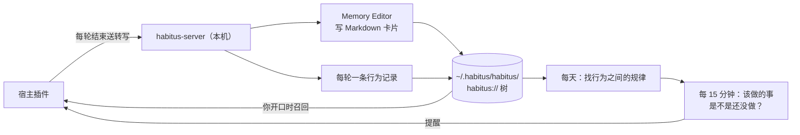

# Habitus

[English](README.md) | 中文

**编程 agent 每开一个新会话就把你忘了，也从来不会留意你平时都在做什么。Habitus 把这两件事补上。**

Habitus 由一个本机服务和装进编程 agent 的插件组成，支持 Codex、Claude Code、OpenCode、pi、ZCode 和 DeepSeek Harness。它把你和 agent 的对话沉淀成长期记忆，你开口时由 agent 召回。打开预测这一半后，它还会学会你自己的作息规律：你平时该做的事到了时间却还没做，它会让 agent 先问你一句。

```text
你      ▸ 帮我修一下 ci.sh 里那个时好时坏的测试
Agent   ▸ （先用宿主自带的提问工具问你）
          Habitus 的提醒：你周四下午一般会写周报。
          ○ 现在就做   ○ 这次不用   ○ 知道了   ○ 已经做过了
```
<sub>示意。提醒的话是模型根据你自己的历史写的。你怎么回答由服务从送回的转写里读出来，插件不需要额外的界面。</sub>

## 特点

- **记忆你能直接看。** `~/.habitus/habitus/` 下的普通 Markdown 卡片，分档案、偏好、实体、工具四类。
- **不用向量库。** 模型读目录概览、读整张卡片来找记忆，只需要一个对话模型。
- **事实有出处。** 工具知识只从真实发生过的工具调用里写。
- **提醒要先攒够信用才开口。** 从你自己的每一轮里学出来，一条规律的命中记录够好之前一直不说话。
- **不挡你的路。** 服务没起来时你的话照常发出去；转写先排队，重送不重复。
- **本地优先。** 服务只监听回环地址，媒体内容先去掉，数据都在 `~/.habitus`；唯一的出站请求是发给你配置的对话模型。

## 支持的宿主

| 宿主 | `--harness` | 现状 |
|---|---|---|
| OpenAI Codex | `codex` | 记忆和提醒在 11 月记忆重构前真机测过，新版待重测 |
| Claude Code | `claude-code` | 记忆在 11 月记忆重构前真机测过，新版待重测 |
| ZCode | `zcode` | 按 v3.15.1 源码接入，还没实测 |
| OpenCode | `opencode` | 已接入，还没在真实的 OpenCode 里跑过 |
| pi | `pi` | 用真实的 pi 1.3.0 扩展加载器验证过 |
| DeepSeek Harness | `dsh` | 按 0.2.1-rc.2 源码接入，还没实测 |

各宿主的已知局限（hook 覆盖哪些事件、子代理、Node 版本要求）见[插件与命令行](docs/plugins-and-cli.zh-CN.md)。

## 快速开始

需要 Python ≥ 3.12、Node ≥ 18，以及一个对话模型的 API key。

```sh
# 1. 本机服务（还没上 PyPI，从仓库装）
pip install "habitus[server] @ git+https://github.com/kkxx939-bot/Habitus"

# 2. 命令行和宿主插件
npm install -g habitus

# 3. 配置：对话协议、地址、模型、API key、时区
habitus-server init

# 4. 起服务（前台运行，http://127.0.0.1:8787）
habitus-server serve

# 5. 另开一个终端：装插件并做一次体检
habitus plugin install --harness codex    # 可以重复 --harness；省略就装进本机找到的全部宿主
habitus doctor
```

> **Codex 用户：** 装完后在 Codex 里输入一次 `/hooks`，批准 Habitus 的 hook。

到这一步记忆就开了，照常和 agent 聊就行。想看 Habitus 记了什么用 `habitus memory tree`，想查用 `habitus recall "<问题>"`。

### 打开提醒

提醒默认是关的。在 `~/.habitus/config.yaml` 里加上下面三段，重启服务即可：

```yaml
behavior:
  primary_subject: "我"   # 跟踪的是谁；填任何非空的名字就打开行为侧
scene:
  enabled: true           # 要先开 behavior
foresight:
  enabled: true           # 要先开 scene
```

全部配置项及注释见 [`habitus/config/example.yaml`](habitus/config/example.yaml)。

## 工作原理



1. **收。** 每一轮结束后，插件把这一轮的转写送到本机服务，服务把它存成不可变的会话片段。
2. **记。** 后台任务读这个片段，以及它涉及的已有卡片。模型提出改动，代码按 Schema 和来源校验（工具知识必须来自真实调用），通过后才写卡片。
3. **召回。** 你开口时插件向服务要记忆。服务先读目录概览，再读完整卡片。注入的内容包在 `<habitus-memory-context>` 里，所以不会被当成你说的话再记回记忆。
4. **预测**（需手动打开）。每一轮被归成一种行为。每天 Habitus 数一遍哪些行为稳定地跟在哪些情境后面。每 15 分钟据此建立预期（"这件事应该在这个时间窗里发生"），时间窗关上了还没做，就可能提醒你。
5. **结算。** 你的回答（"现在就做"、"已经做过了"……）和这件事后来有没有发生，都记进一本账。这本账决定一条规律继续沉默，还是可以开口。

更细的说明和贯穿例子见[架构](docs/architecture.zh-CN.md)。

## 文档

| 文档 | 内容 |
|---|---|
| [架构](docs/architecture.zh-CN.md) | 记忆、行为、关系、提醒各自怎么工作，附贯穿例子 |
| [插件与命令行](docs/plugins-and-cli.zh-CN.md) | 每个 hook 做什么、注入格式、outbox 与重送、环境变量、`habitus` / `habitus-server` 完整命令参考 |
| [HTTP API](docs/http-api.zh-CN.md) | 接口、特性、错误码 |
| [`habitus/config/example.yaml`](habitus/config/example.yaml) | 全部配置字段与默认值 |
| [设计裁定](docs/rulings/README.md) | 代码遵循的编号设计决定 |
| [`AGENTS.md`](AGENTS.md)、[`docs/agents/`](docs/agents/) | 给贡献者的分模块不变量 |

## 现状

Habitus 处在**早期阶段（0.1）**。

- CI 在 macOS、Linux、Windows 上，分别用 Python 3.12、3.13、3.14 跑全部测试。
- 本机服务还没上 PyPI。两个命令行工具的帮助和提示目前都是中文。
- 物理 lane（来自可穿戴设备的行为）已经设计好，但还没有把数据送进来的接口。
- 节假日数据只带了中国大陆和新加坡的。其他地区可以自己提供数据文件（`locale.calendar_path`）。

## 开发

```sh
uv venv --python 3.12 .venv
uv pip install --python .venv -r requirements.txt && uv pip install --python .venv -e . --no-deps
bash scripts/ci.sh        # 和 CI 跑的是同一条链：lint、格式、mypy、pyright、Python 与 Node 测试
```

插件在 [`plugins/`](plugins/) 下（即 npm 包，见[它的 README](plugins/README.md)）。改某个模块之前先读 [`AGENTS.md`](AGENTS.md)。

## 致谢

记忆这一半有几处设计照 [OpenViking](https://github.com/volcengine/OpenViking) 的做法：L0/L1 目录概览，按 pending token 在一轮结束后封存对话，以及把没通过校验的提取候选发回模型修补一轮。只借了设计，没有复制代码（OpenViking 是 AGPL-3.0）。

## 许可证

[Apache-2.0](LICENSE)。DeepSeek Harness（MIT）、OpenCode（MIT）、pi（MIT）、ZCode（Apache-2.0）的插件只按它们公开的插件 / hook 接口和会话格式对接，没有带它们的代码。
