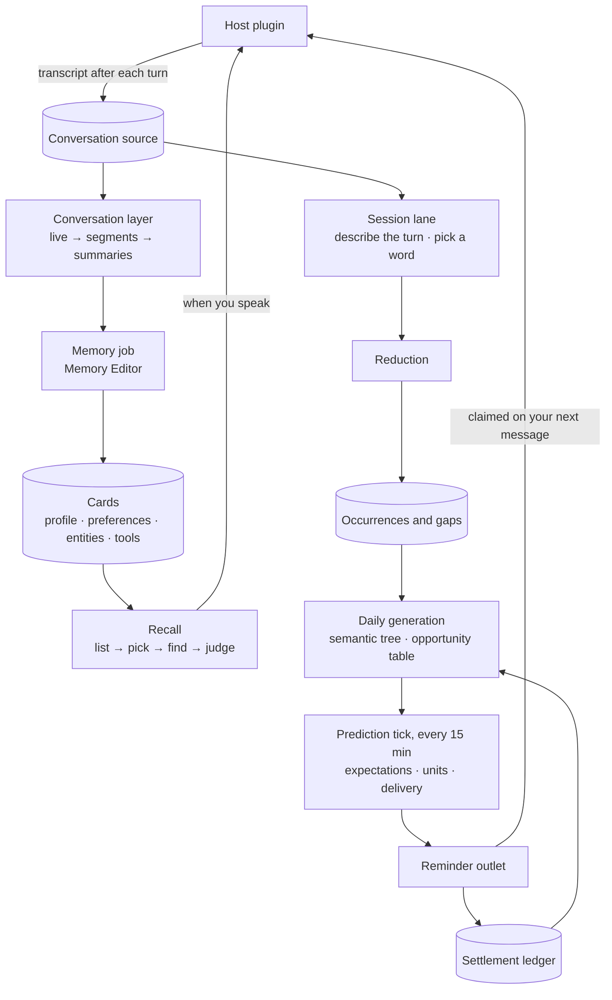

# Architecture

English | [中文](architecture.zh-CN.md) · [← README](../README.md)

This page explains how Habitus is built, at the level that changes rarely. Exact steps, defaults and field names live in the code, in [`habitus/config/example.yaml`](../habitus/config/example.yaml) and in the numbered [design rulings](rulings/README.md) (Chinese); where this page names a ruling, that ruling is the authority.

## The big picture

Habitus is one local process, `habitus-server`, plus thin plugins inside each coding agent (the "host"). Everything the plugins send arrives as a conversation transcript. Two consumers read the same transcript:

- **Memory**: distills who you are, how you like things done, the named things you work with and the tools you use, and hands them back to the agent when you speak.
- **Behavior and prediction** (off by default): records one behavior per turn, learns which behaviors reliably follow which situations, and reminds you when something you usually do is due but hasn't happened.

Only one kind of model is used anywhere: a chat model, through either the OpenAI Chat Completions or the Anthropic Messages protocol. There is no embedding model, vector index or reranker ([ruling 110](rulings/README.md#ruling-110)).

## One tree on disk

Everything a person might want to read lives in a single Markdown tree under `<storage root>/habitus/` (default `~/.habitus/habitus/`), addressed as `habitus://<path>` ([ruling 112](rulings/README.md#ruling-112)). The root holds exactly nine entries:

| Entry | What it is | Who writes it |
|---|---|---|
| `profile.md` | Who you are: role, background, stable abilities | Memory Editor |
| `preferences/{topic}.md` | How you choose: style, format, workflow, tool preferences | Memory Editor |
| `entities/{category}/{name}.md` | Things with a stable name you will come back to | Memory Editor |
| `tools/{tool_name}.md` | Stable know-how from real tool calls | Memory Editor |
| `occurrences/<lane>/YYYY/MM/DD/` | One record per behavior (append-only) | Reduction |
| `gaps/<lane>/YYYY/MM/DD/` | Stretches that were not observed, or not understood | Reduction |
| `habits/<lane>/<word id>.md` | How often each behavior happens | Daily generation |
| `reminders/<lane>/YYYY/MM/DD/<id>.md` | What was reminded and how it went | Prediction |
| `relations/<lane>/<cause>/<effect>--.md` | Relations found between behaviors | Daily generation |

`<lane>` is `session` (your conversations with the agent) or `physical` (behavior from wearables). Every file has the same shell: a Markdown body plus one trailing `HABITUS_FIELDS` JSON comment with the structured fields. The last three entries are **records only**: they are written so you can see what the system knows, and no computation reads them back ([rulings 113](rulings/README.md#ruling-113), [115](rulings/README.md#ruling-115)).

Working state (the conversation layer, memory jobs, the semantic tree's tables, the prediction ledger) lives next to the tree, not in it.

## Conversation layer

- **Turns.** A turn is the host's turn: from your opening message to the agent's final reply. Anything you say in between (answering a question, adding a sentence, telling it to stop) belongs to the same turn.
- **Live → segments.** Messages are appended to a per-conversation `live.jsonl`. When a turn ends (or a conversation goes idle), a prefix is sealed into an immutable **segment**. Over-long turns are cut into several segments at safe points; a tool call is never separated from its result.
- **Summaries.** Each segment gets a summary; summaries are later folded into range summaries and then archive summaries. Summaries are process history, not memory.
- **Raw text is short-lived.** A segment's raw text is released 10 days after its memory job finishes ([ruling 111](rulings/README.md#ruling-111)).
- **No raw payloads.** Images and other media are replaced by a placeholder (type, size, sha256) in the plugin; oversized text tool results are reduced to a deterministic synopsis before they are stored.

## Memory

**Writing.** Each sealed segment becomes one memory job. Jobs for one storage root run strictly in order.

1. The Memory Editor reads the segment and the existing cards it may touch. It always reads `profile.md` and the cards of the tools called in the segment; the preference topics and entity names are listed in its input, and it can list a directory, search card text literally or read cards for a few rounds.
2. The model proposes candidates: new or updated cards, merges, deletions, links. It never writes paths, versions or timestamps.
3. Code validates every candidate against the card schema and against the source. A `tools/` card must come from a tool call that really happened, with a result. Failing candidates go back to the model for one repair round; anything still failing is dropped, not written.
4. Code decides the final file for each candidate and writes the cards, each file atomically, after checking that nothing changed underneath. A job that keeps failing is marked failed after bounded retries, and later jobs go on.

Cards describe *how things are now and how to do them*, not *what happened in this conversation*. "What happened" is the behavior side's job ([ruling 109](rulings/README.md#ruling-109)).

**Directory overviews.** Every card directory has a template-built `.overview.md` (one line per card) and `.abstract.md` (one line per directory). No model writes them.

**Recall** ([ruling 110](rulings/README.md#ruling-110)). One entry point, four steps:

1. **List** (no model): read the overviews, ordered from hot to cold.
2. **Pick** (one model call): given your message and the recent conversation, choose which cards to read, and whether to look up turn records or conversation summaries by date and keyword.
3. **Find** (no model): read the chosen cards in full plus one hop of linked cards; run the lookups.
4. **Judge** (one model call): is this enough? Keep only the material actually used. If not enough, go round once more.

The whole recall has a time limit (12 s by default, under the plugin's 15 s). If the model is unavailable, only the profile is returned, with the reason.

**Hot and cold.** Cards that recall keeps using stay hot; cards never used cool down and are eventually compacted or retired.

## Behavior side

- **Session lane.** For every turn, the model makes two calls: one describes the turn (name, goal, summary, steps), one picks a **word** for it from a vocabulary. A turn with no message from you (a background task coming back) is recorded as "not a task" without calling the model.
- **Vocabulary** ([ruling 101](rulings/README.md#ruling-101)). Each lane ships a fixed vocabulary of short behavior names in up to three levels (279 words for the session lane, 223 for the physical lane), e.g. "write docs → weekly report". The model may grow a more specific word under the one it picked. A word is used downstream once it has been picked on two different days, and drops out after 20 days without being picked. Besides a word, a turn can be "not a task", "continues an earlier task", "a task not in the vocabulary" or "undecided"; none of these are predicted.
- **Reduction.** A worker seals judgements and publishes them as append-only occurrence files. Turns it could not write become "not understood" gaps; periods when the system was not running become "not observed" gaps. Gaps matter: a missed behavior during a gap is "unknown", not "didn't happen".
- **Physical lane.** Same tree, same downstream, separate everything: the two lanes never see each other. There is no endpoint yet for sending physical data in.

## Semantic tree: relations between behaviors

Once a day, after the previous day is closed, a **generation** runs inside the prediction worker ([rulings 96](rulings/README.md#ruling-96)–[99](rulings/README.md#ruling-99)). It needs no model.

- **Concepts.** One behavior concept per word in use, plus calendar situations from your locale (weekday, day of month, workday or holiday, …). Nothing else ([ruling 100](rulings/README.md#ruling-100)).
- **Relations.** Every comparable pair "cause → effect" is tested over four non-overlapping spans after the cause ends: right after it, the rest of that day, the next day, and days 2–7. Only time when you were present counts; a stretch when you were away is "no chance", not "didn't happen". The comparison is against comparable moments without the cause. A relation must pass a multiple-testing-corrected significance test, stay stable across blocks of time, and have a large enough effect.
- **States.** A relation that passes becomes a *candidate*. If it holds again on new data it is *established*. It can later *expire* or be *retired*.
- **Opportunity table.** For each relation, and for each behavior's "time since last time", the generation lays out every past opportunity and whether the effect came. This table is what prediction reads during the day.

## Prediction and reminders

- **Expectations.** Every 15 minutes, a tick builds expectations ("this should happen within this window"), each with a window, a deadline and its basis. There are three triggers: something just happened (**event**), you are in a calendar situation (**situation**), it has been long enough since last time (**day**).
- **Units.** Each behavior has one unit. Its inputs are the expectations for it that are open at that moment. Its reading answers: *in the past, when this same set of inputs was present, how often did the behavior follow?* With few samples it falls back to coarser groupings.
- **Two levels.** Every behavior starts at level 0, **shadow**: it forms expectations, keeps score and settles, but never speaks. It moves up to level 1, **remind**, when the lower bound of its reading reaches θ = 1 − the acceptable false-alarm rate (0.67 by default). It moves back down when the upper bound falls below θ. In between it keeps its level.
- **Delivery.** When a remind-level window closes and the behavior has not happened, and a host has been seen recently, a judge model sees a small package (the candidates and their history rows), may drop or reorder candidates and writes one sentence. It is asked twice with the order reversed; if the answers disagree, the algorithm's order wins. If the model is unavailable, a template sentence is used. A daily cap (10 by default) limits reminders.
- **Outlet.** The reminder waits until a host claims it on your next message. The agent then asks you with the host's own question tool, with fixed options: do it now / not this time / noted / already done. Whether it was asked, and what you answered, is read back from the transcript.
- **Settlement.** Once the day is closed, each expectation is settled: on time, early, late, done after a reminder, expired, and so on. Results go into an append-only ledger, and the readings are recounted from it. A behavior done only *because* it was reminded does not count as evidence for the rule.
- **Loss ruler.** Log loss and Brier score are computed from the ledger after every settlement, as a yardstick for comparing changes. They are measured only: nothing reads them to decide anything ([ruling 114](rulings/README.md#ruling-114)).

## Worked example: the weekly report on Thursday afternoon

1. On several Thursday afternoons you ask the agent to write this week's report into `docs/weekly/`. Each turn is sent to the service after it ends.
2. **Memory** may write a preference (where reports go, how they are written) if the conversation shows it is how you always want it. "It's Thursday and you haven't written it" is not memory's business.
3. **Session lane** describes each turn and picks the word "weekly report". On the second Thursday the word has been picked on two different days, so the next generation puts it in use.
4. **Generation** sees "weekly report" mostly on Thursdays and rarely on other days you were present, and tests the relation "Thursday → weekly report". It becomes a candidate, and is established once later Thursdays confirm it. Separately, the opportunity table records the weekly rhythm ("about 7 days since last time").
5. **Prediction.** On a later Thursday the tick builds two expectations: a *situation* expectation (it's Thursday), with a window taken from the times you actually wrote it before, and a *day* expectation (it's been a week). Both feed the same unit. While its reading is below θ, it stays in shadow and only keeps score. After enough Thursdays on which you wrote the report on time, the lower bound crosses θ and the unit moves to remind.
6. **Reminder.** One Thursday the window closes and nothing has been written. On your next message the agent first asks: "You usually write the weekly report on Thursday afternoon, and this week's isn't done yet." You pick *do it now*.
7. **Settlement.** The report written right after the question is marked as reminded. It counts as a good reminder, but not as proof that the rule predicts on its own, so the rule cannot inflate itself through its own reminders. If you had answered *already done* but no report appears, that settles as neutral.

## Where models are called

| Place | Calls | What the model decides |
|---|---|---|
| Memory job | summary + extraction (with a bounded read loop and one repair round) | What to remember and how to phrase it |
| Recall | pick + judge (at most two rounds) | What to read, what is enough |
| Session lane | describe + pick a word, per turn | What this turn was |
| Delivery | judge, asked twice | Which candidate to say and the sentence |

Everything else, including relation tests, levels, settlement, paths, versions and validation, is plain code.

## Acknowledgements

Several memory-side designs follow [OpenViking](https://github.com/volcengine/OpenViking): L0/L1 directory overviews, sealing after a turn based on pending tokens, ending the old-memory read loop at its round limit instead of failing, and one repair round for invalid candidates. Only the design is borrowed; no code was copied.
