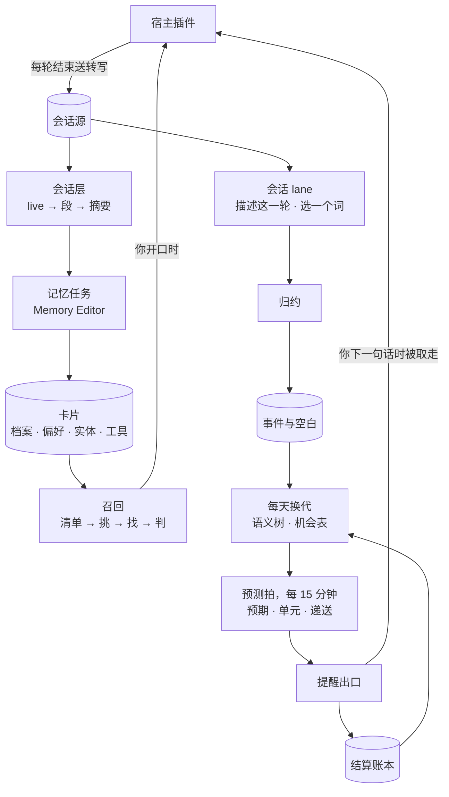

# 架构

[English](architecture.md) | 中文 · [← README](../README.zh-CN.md)

这一页讲 Habitus 是怎么搭起来的，只写不常变的那一层。具体步骤、默认值和字段名以代码、[`habitus/config/example.yaml`](../habitus/config/example.yaml) 和编号的[设计裁定](rulings/README.md)为准；这里点名了某条裁定的地方，以那条裁定为准。

## 总体

Habitus 是一个本机进程 `habitus-server`，加上装进每个编程 agent（"宿主"）里的轻量插件。插件送来的东西都是会话转写。同一份转写有两个读者：

- **记忆**：沉淀你是谁、你喜欢怎么做事、你常打交道的有名字的东西、你用的工具，在你开口时交回给 agent。
- **行为与预测**（默认关）：每一轮记一条行为，学出哪些行为稳定地跟在哪些情境后面；你平时该做的事到了时间却还没做，就提醒你。

全系统只用一种模型：对话模型，走 OpenAI Chat Completions 或 Anthropic Messages 协议。没有 embedding 模型、向量索引和重排（[裁定 110](rulings/README.md#ruling-110)）。

## 盘上一棵树

人可能想看的东西都在一棵 Markdown 树里，位于 `<存储根>/habitus/`（默认 `~/.habitus/habitus/`），地址是 `habitus://<路径>`（[裁定 112](rulings/README.md#ruling-112)）。树根下恰好九样：

| 条目 | 是什么 | 谁写 |
|---|---|---|
| `profile.md` | 你是谁：职业、背景、稳定的能力 | Memory Editor |
| `preferences/{主题}.md` | 你怎么选：风格、格式、工作流、工具偏好 | Memory Editor |
| `entities/{类别}/{名字}.md` | 有稳定名字、以后还会用到的东西 | Memory Editor |
| `tools/{工具名}.md` | 从真实工具调用里得到的稳定用法 | Memory Editor |
| `occurrences/<lane>/YYYY/MM/DD/` | 每个行为一条记录（只增） | 归约 |
| `gaps/<lane>/YYYY/MM/DD/` | 没在看、或没读懂的时段 | 归约 |
| `habits/<lane>/<词编号>.md` | 每种行为多久做一次 | 每天换代 |
| `reminders/<lane>/YYYY/MM/DD/<编号>.md` | 提醒过什么、结果怎样 | 预测 |
| `relations/<lane>/<前因>/<后果>--<段>.md` | 行为之间量出来的关系 | 每天换代 |

`<lane>` 是 `session`（你和 agent 的对话）或 `physical`（来自可穿戴设备的行为）。每个文件同一种外壳：Markdown 正文，加文件末尾唯一一个带结构字段的 `HABITUS_FIELDS` JSON 注释。最后三类**只做记录**：写出来是让你看到系统知道什么，没有任何计算读回它们（[裁定 113](rulings/README.md#ruling-113)、[115](rulings/README.md#ruling-115)）。

工作状态（会话层、记忆任务、语义树的表、预测的账）放在树旁边，不在树里。

## 会话层

- **一轮。** 一轮就是宿主的一轮：从你开口那句到 agent 的最终回复。中间你说的话（回答它的问题、补一句、叫停）都属于这一轮。
- **live → 段。** 消息先追加进每个对话的 `live.jsonl`。一轮结束（或对话闲置）时，前面一截封存成不可变的**段**。超长的轮在安全的位置切成几段，工具调用和它的结果永远不分开。
- **摘要。** 每段一份摘要，之后再合成范围摘要、归档摘要。摘要是过程历史，不是记忆。
- **原文不长留。** 一段的记忆任务结束后，它的原文再留 10 天就释放（[裁定 111](rulings/README.md#ruling-111)）。
- **不存原始载荷。** 图片等媒体在插件里就换成占位（类型、大小、sha256）；超大的文字工具结果存储前先按确定性规则抽成摘要。

## 记忆

**写入。** 每个封存的段是一条记忆任务，同一个存储根上的任务严格按顺序做。

1. Memory Editor 读这一段，以及它可能碰到的已有卡片：`profile.md` 和本段调用过的工具的卡片固定读；偏好主题和实体名字清单直接放进输入；它还可以在几轮之内列目录、按字面搜卡片内容、读卡片。
2. 模型提出候选：新建或更新卡片、合并、删除、链接。路径、版本、时间都不由模型写。
3. 代码按卡片 Schema 和来源校验每一条候选：`tools/` 卡片必须来自真实发生过、有结果的工具调用。不合格的发回模型修补一次，仍不合格的剔掉、不写。
4. 代码确定每条候选的最终文件，核对底下没被改过之后逐个原子写入。一直失败的任务有界重试后判失败，后面的任务照常推进。

卡片写的是"现在是什么样、以后怎么做"，不写"这次对话里做了什么"；"发生过什么"归行为侧（[裁定 109](rulings/README.md#ruling-109)）。

**目录概览。** 每个卡片目录有按模板拼出的 `.overview.md`（每张卡片一行）和 `.abstract.md`（每个目录一行），不调模型。

**召回**（[裁定 110](rulings/README.md#ruling-110)）。只有一个入口，四步：

1. **清单**（不调模型）：读目录概览，按冷热从高到低排。
2. **挑**（调一次模型）：根据你这句话和最近的对话，决定读哪些卡片、要不要按日期和关键词查每一轮的记录或会话摘要。
3. **找**（不调模型）：读挑中的整张卡片，加一跳关联卡片；执行查询。
4. **判**（调一次模型）：够不够？只留真正用到的材料。不够就再走一轮。

整次召回有时间上限（默认 12 秒，小于插件的 15 秒）。模型不可用时只交出档案，并写明原因。

**冷热。** 召回常用到的卡片保持热；从没被用到的卡片逐渐变冷，最后被压缩或退休。

## 行为侧

- **会话 lane。** 每一轮调两次模型：一次描述这一轮（名字、目标、概要、步骤），一次从词表里给它选一个**词**。整轮没有你说的话（比如后台任务回来的通知）时，不调模型，直接记成"不是一件事"。
- **词表**（[裁定 101](rulings/README.md#ruling-101)）。每条 lane 随代码带一份固定的初始词表：简短的行为名，最多三层（会话 lane 279 个词，物理 lane 223 个），比如"写文档 → 写周报"。模型可以在选中的词下面长一个更细的词。一个词在两个不同的日子被选中后进入下游，20 天没被选中就退出。除了选词，一轮还可以是"不是一件事""接着之前那件""表里没有的事"或"待定"，这些都不预测。
- **归约。** Worker 把判断封口，发布成只增的事件文件。写不成的轮记成"没读懂"空白；系统没在跑的时段记成"未观测"空白。空白很重要：空白里没看到的事算"不知道"，不算"没做"。
- **物理 lane。** 同一棵树、同一套下游，但处处分开，两条 lane 互相看不见。目前还没有把物理数据送进来的接口。

## 语义树：行为之间的关系

每天前一天定稿之后，预测 worker 里做一次**换代**（[裁定 96](rulings/README.md#ruling-96)–[99](rulings/README.md#ruling-99)），不调模型。

- **概念。** 每个在用的词一个行为概念，加上按你所在地区生成的日历情境（周几、几号、工作日或节假日……），没有别的（[裁定 100](rulings/README.md#ruling-100)）。
- **关系。** 每一对可比的"前因 → 后果"，都在前因做完之后四段互不重叠的跨度上量：紧接着、当天剩下的时间、次日、第 2–7 天。只算人在场的时间：人不在的那段是"没机会"，不是"没发生"。对照取没有前因、可比的时刻。关系要过多重检验校正后的显著性、在不同时间块上稳定、效应够大。
- **状态。** 过了检验的关系先是**候选**；在新数据上再成立一次就是**成立**；之后可能**失效**或**退休**。
- **机会表。** 对每条关系，以及每种行为的"离上次多久"，换代把历史上每一次机会和后果来没来都列出来。白天的预测读的就是这张表。

## 预测与提醒

- **预期。** 每 15 分钟一拍，建立预期："这件事应该在这个时间窗里发生"，每条带时间窗、最晚时限和依据。三种触发：有件事刚发生（**事件**）、你正处在某个日历情境里（**情境**）、离上次够久了（**日子**）。
- **单元。** 每种行为一个单元。它的输入是此刻针对这种行为、时间窗开着的那些预期。读数回答的是：*历史上同样这组输入在场时，这种行为跟着发生了多少次？* 样本少时退到更粗的分组。
- **两档。** 每种行为都从 0 档**影子**起：建预期、记账、结算，但不开口。读数的下界到了 θ = 1 − 可接受的误提醒率（默认 0.67），升到 1 档**提醒**；上界掉到 θ 以下就退回影子。两者之间保持原档。
- **递送。** 提醒档的时间窗关上时这件事还没发生，并且最近有宿主来过，判断模型会看到一个小包（候选和它们的历史记录），可以去掉候选、调整先后，并写一句话。同一个问题倒过候选顺序问两遍，两次不一致就按算法的顺序。模型不可用时用模板句。每天有提醒次数上限（默认 10）。
- **出口。** 提醒先等着，直到你下一次说话时被宿主取走。agent 用宿主自带的提问工具问你，选项固定：现在就做 / 这次不用 / 知道了 / 已经做过了。问没问出口、你怎么答的，都从送回的转写里读出来。
- **结算。** 那一天定稿后，每条预期结算一次：准时、提前、晚了但做了、提醒后做了、过期等。结果记进只增的账本，读数从账上重新数。只是*因为*被提醒才做的，不算这条规律的证据。
- **loss 尺子。** 每次结算之后从账上算对数损失和 Brier 分，作为比较改动好坏的统一的数。它只量、不当门：任何决定都不读它（[裁定 114](rulings/README.md#ruling-114)）。

## 贯穿例子：周四下午写周报

1. 连续几个周四下午，你让 agent 把这周的周报写进 `docs/weekly/`。每一轮结束后都送到服务。
2. **记忆**可能写一条偏好（周报放哪、怎么写），前提是对话里看得出你一直都要这样。"今天周四你还没写"不归记忆管。
3. **会话 lane** 描述每一轮，选中"写周报"这个词。第二个周四时，这个词已经在两个不同的日子被选中，下一次换代就转成在用。
4. **换代**发现"写周报"大多出现在周四、在其他你在场的日子很少出现，就检验"周四 → 写周报"这条关系。它先成为候选，之后几个周四再确认一次就成立。另外，机会表也记下了每周一次的节奏（"离上次大约 7 天"）。
5. **预测。** 之后的某个周四，预测拍建了两条预期：一条**情境**预期（今天是周四），时间窗取你以前实际写周报的那些时刻；一条**日子**预期（已经一周了）。两条都进同一个单元。读数还在 θ 以下时只做影子、只记账；你按时写了足够多个周四之后，下界过了 θ，单元升到提醒档。
6. **提醒。** 某个周四时间窗关了还没写。你下一次说话时，agent 先问你："你周四下午一般会写周报，这周的还没写。"你选"现在就做"。
7. **结算。** 问完紧接着写的周报被标成"提醒后做的"。它算一次好的提醒，但不算这条规律自己预测对了，所以规律没法靠自己的提醒给自己加分。如果你答"已经做过了"，但始终没有出现周报，这一笔按中性结算。

## 哪里调模型

| 位置 | 调用 | 模型决定什么 |
|---|---|---|
| 记忆任务 | 摘要 + 提取（有轮数上限的读旧卡片循环，加一次修补） | 记什么、怎么写 |
| 召回 | 挑 + 判（最多两轮） | 读什么、够不够 |
| 会话 lane | 每轮描述 + 选词 | 这一轮是什么 |
| 递送 | 判断，问两遍 | 说哪个、那句话 |

其余全部是普通代码，包括关系检验、档位、结算、路径、版本和校验。

## 致谢

记忆这一半有几处设计照 [OpenViking](https://github.com/volcengine/OpenViking) 的做法：L0/L1 目录概览，按 pending token 在一轮结束后封存，读旧记忆的循环到轮数上限就结束、不判失败，以及不合格候选修补一次。只借了设计，没有复制代码。
